# Changelog

All notable changes to mdsh are listed here. The format follows
[Keep a Changelog](https://keepachangelog.com/en/1.1.0/), and versions
follow [Semantic Versioning](https://semver.org/).

## [Unreleased]

### Added

- Drag a tab out of mdsh-gui to another app to hand it the file's full
  path as text, as when dropping it in a terminal or a text editor. A
  tab showing a document the app carries inside it gives its URL
  instead. The tab stays where it was.

  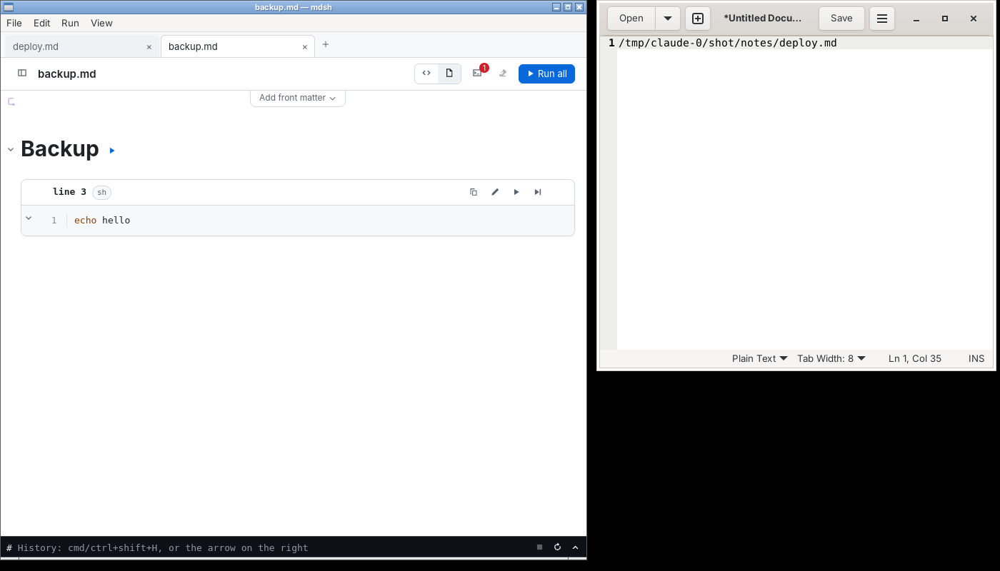

- A running block shows that it is running, and for how long. In
  mdsh-gui its card gets a spinner and a timer that counts up by tenths
  of a second; with `timeout=` the timer reads `12.3s / 1m` and a bar
  under the card's head fills toward the timeout, turning amber and
  then red as it nears. When the block ends, the card keeps how long it
  took (`1.4s`), or says it timed out. `mdsh -i` shows the same in the
  block's header: `running… 12s / 1m`, then `✓ 1.4s`. The time is how
  long the block ran this session; it isn't saved in the file.

  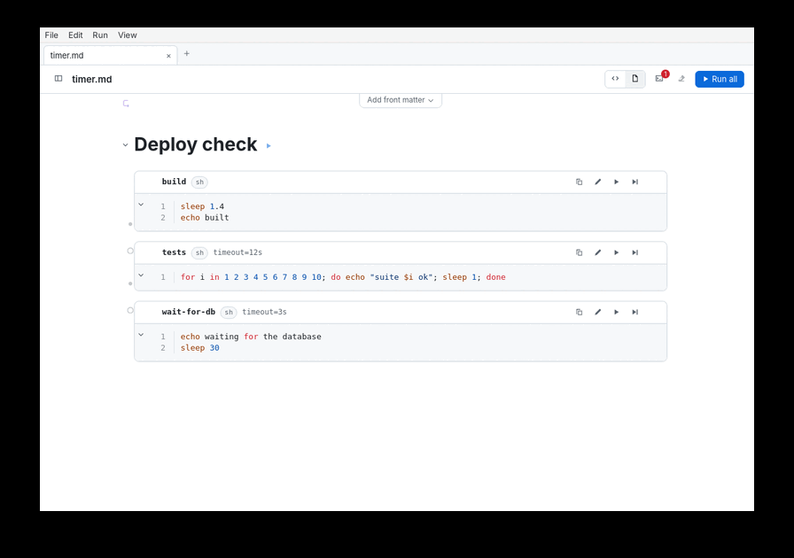

- While a command typed in mdsh-gui's History pane runs, the prompt
  dims and the input shows how long it has run, in every look. With
  reduced motion the clock ticks once a second.

  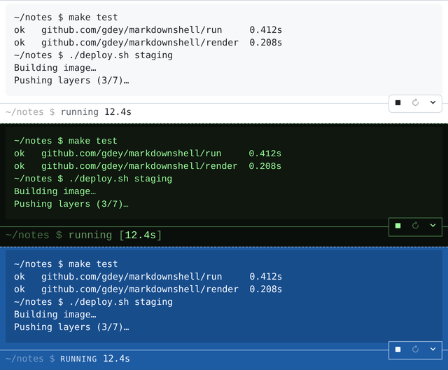

- An `always` block attribute makes a dependency run again each time a
  block that `depends=` on it runs, even if it already ran in this
  session, for steps whose effect doesn't last such as logging in.
  You're still asked before it runs. It runs once on the way to a
  block, even when several of that block's dependencies share it.
- Blocks are marked **stale** once a block they depend on runs again or
  has its output cleared. A stale dependency is asked about and run
  again, like one that never ran, so running a block brings everything
  it needs up to date, and leaves what's current alone. mdsh-gui shows a
  *stale* badge on the card, and `mdsh -i` shows `✓ stale`.

  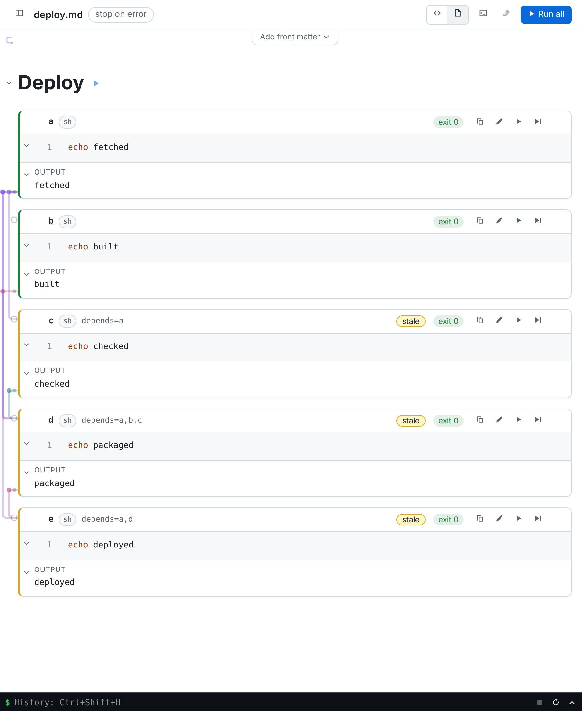

- A textbox or choice can appear more than once with the same `var=`.
  A later input with that `var=` that is the same control, differing
  only in what is typed or checked, is a copy of the first: typing or
  picking in mdsh-gui changes every copy. A file that opens with copies
  that disagree gets a warning for each, and mdsh-gui sets them to the
  first's value, which Undo takes back. An input with that `var=` that
  isn't the same control is still ignored, and the warning now says how
  it differs.

  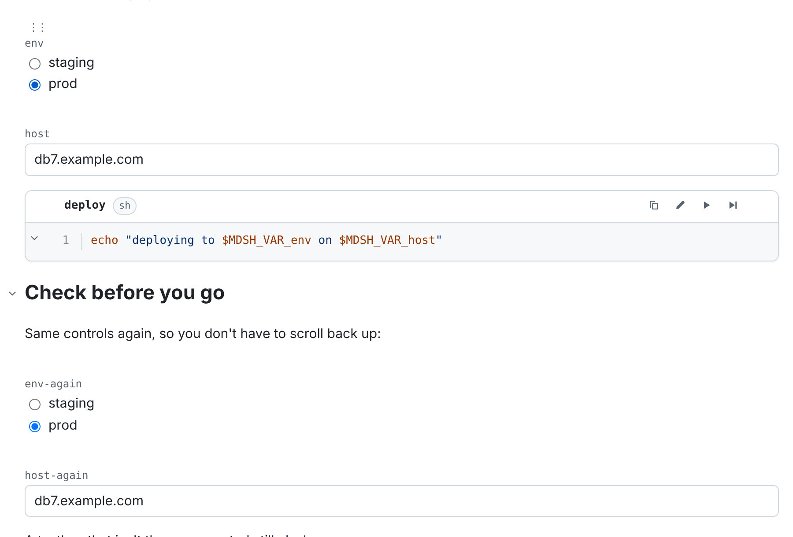

- mdsh-gui's font menus (Settings › Look) list the fonts installed on
  the computer, from AppKit on macOS and fontconfig on Linux, instead of
  a set of common ones; the code font's lists those whose letters are
  all one width, Nerd Fonts included. The terminals fall back to
  Symbols Nerd Font where it is installed, so a prompt drawn with Nerd
  Font icons shows them whatever the code font.

  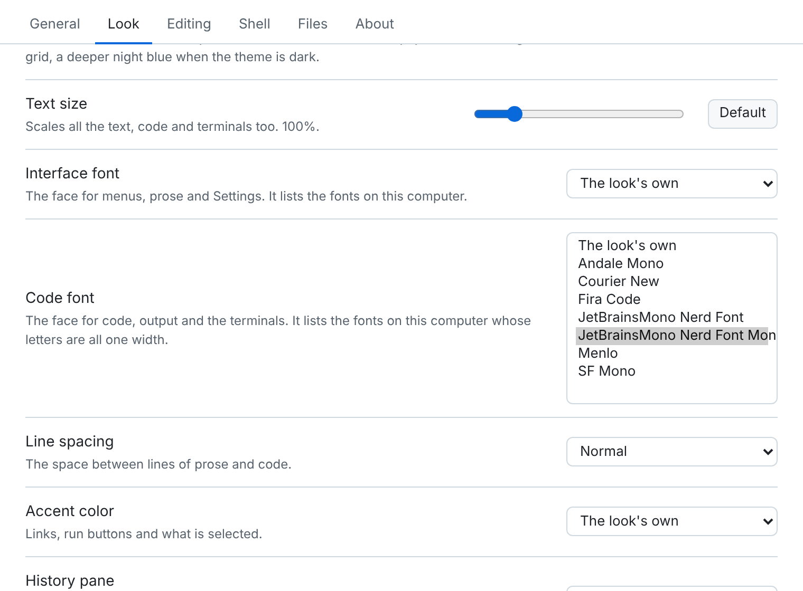

- mdsh-gui has the changelog built in. Help › Changelog, or the
  Changelog link on Settings › About, opens it in a read-only tab of
  the document window, screenshots and all, in place of sending you to
  the website. It is the changelog of the build you're running, and its
  web links open in the browser.

  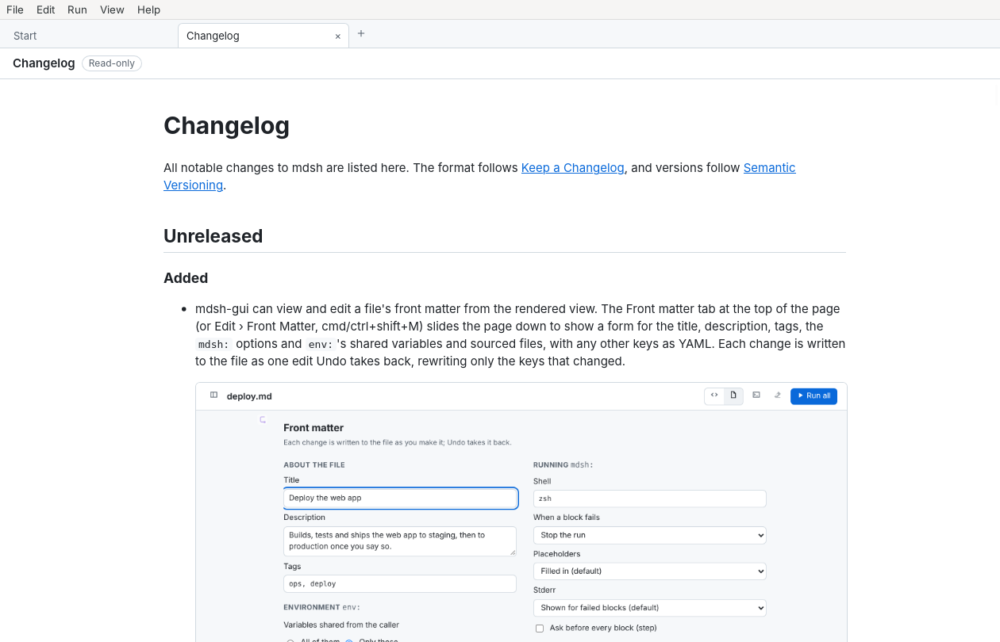

- mdsh-gui can view and edit a file's front matter from the rendered
  view. The Front matter tab at the top of the page (or Edit › Front
  Matter, cmd/ctrl+shift+M) slides the page down to show a form for the
  title, description, tags, the `mdsh:` options and `env:`'s shared
  variables and sourced files, with any other keys as YAML. Each change
  is written to the file as one edit Undo takes back, rewriting only
  the keys that changed.

  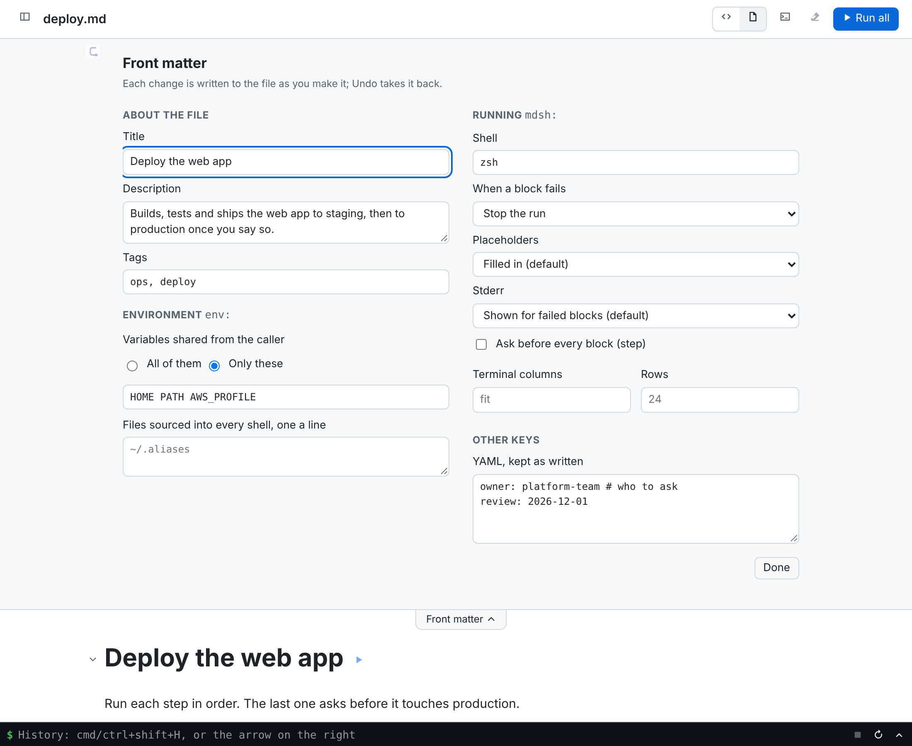

- A `links` block attribute makes the web addresses in a block's output
  clickable: links in mdsh-gui's rendered view, OSC 8 hyperlinks in
  `mdsh -i`. Only `http:`, `https:` and `mailto:` addresses count, and
  they open in the browser or mail app. Commands typed in the History
  pane are added with `links`, and the addresses they print are
  clickable in the pane too. Take `links` off a block to turn it off.
- Copy a fenced block's code to the clipboard. In mdsh-gui each block's
  card has a copy button (or press `c` on the selected block), and other
  fenced code in the document shows one in its corner on hover; the
  status line says what was copied. In `mdsh -i`, `y` copies the
  block under the cursor, through the terminal (OSC 52, which works over
  ssh) and, run locally, the system clipboard too. The code is copied as
  written in the file, without its fences or output.

  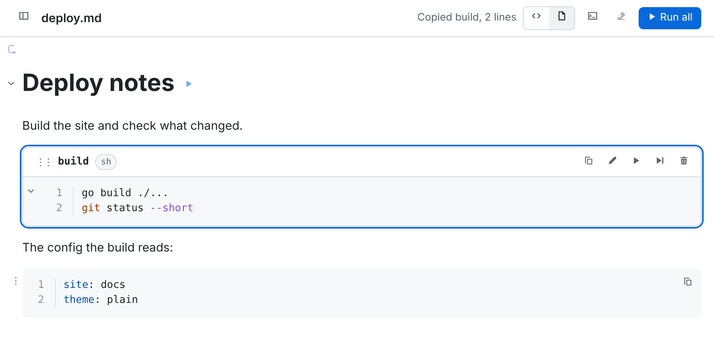

### Changed

- mdsh-gui's shortcut hints name the one shortcut for your platform, as
  the platform writes it: ⇧⌘H on macOS and Ctrl+Shift+H elsewhere,
  in place of "cmd/ctrl+shift+H". The History bar's hint is just the
  shortcut now.

  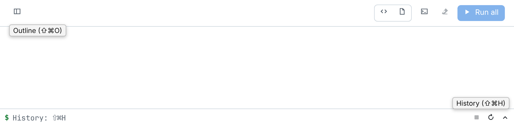

- mdsh-gui's History pane buttons (Stop, Restart, and the open/close
  chevron) sit on the line between the transcript and the prompt when
  the pane is open, in a small box the line runs through, rather than
  at the end of the prompt line. Closed, they stay at the end of the
  bar.

  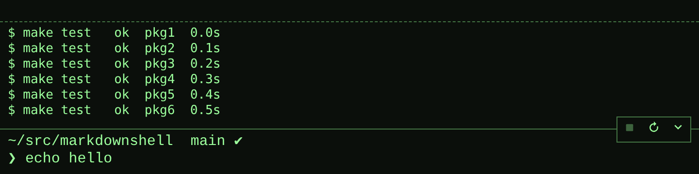

- An empty dependency, a block whose body is only blank lines and `#`
  comments, now runs without asking when a block that depends on it
  runs, in `mdsh`, `mdsh -i` and mdsh-gui alike. Its own `depends=` are
  still asked about. An empty block marked `confirm` is still asked
  about, so it can serve as a checkpoint.
- Running a block with `depends=` now works out the whole chain first,
  then asks about each block from the top of the chain down, right
  before it runs: a block you say yes to runs straight away, before the
  next question, and every block a block needs has run by the time it is
  asked about. Before, mdsh asked its way up the chain and then ran it
  all at the end. A block marked `confirm` is now confirmed after its
  dependencies have run, right before it runs.
- **Blocks no longer get your whole environment by default.** A file
  without `env.share` in its front matter now passes just the base set
  below. A file that wants everything says so with `share: [...]`
  (`[..., -GITHUB_TOKEN]` to leave some out), and `mdsh -i` and
  mdsh-gui show a banner over it: "This file brings in all your
  environment variables". Add `share: [...]` to documents that rely on
  other variables, such as `GOPATH` or `AWS_PROFILE`. `{{$VAR}}`
  placeholders are unchanged: they still read what you `--expose`.

  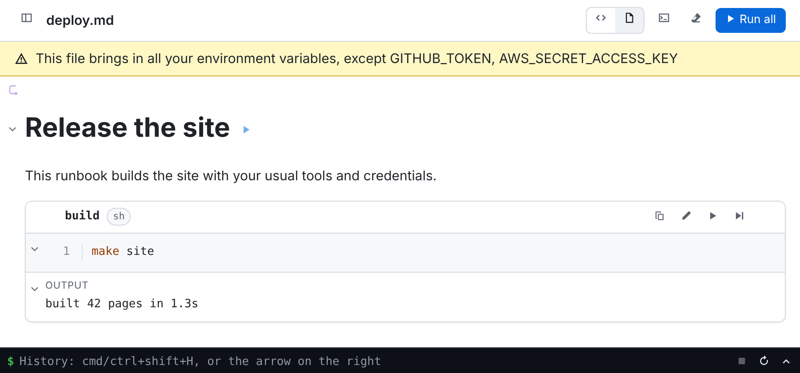

- `PATH`, `HOME`, `USER`, `LOGNAME`, `SHELL`, `TERM`, `COLORTERM`,
  `LANG`, `LANGUAGE`, `LC_*`, `TZ`, `TMPDIR` (and, on macOS,
  `__CF_USER_TEXT_ENCODING`) now get past any `share` list, in the front
  matter's `env.share` and a block's `share=`, so a filtered shell can
  still find programs and its home folder. None of them holds a secret.
  Drop one with `-NAME`, as in `share=GREETING,-PATH`. `share=` (empty)
  now passes just this base set. Documents loaded from a URL, once mdsh
  can, won't get it.

- A `tty` block's output is now its asciinema cast, not an animated GIF:
  mdsh links `<doc>.assets/<block-id>.cast` below the block, and
  mdsh-gui plays it in the block's card, with play and pause, a
  scrubber, and steps to the previous or next frame (the arrow keys, `,`
  and `.`, space to play). Drag over the screen to select text and press
  cmd+c (ctrl+c elsewhere) to copy it without its colors, even in a
  recording of a program that turned on mouse reporting; a right-click
  keeps the selection and offers Copy and Copy as GIF. The camera button
  copies the frame shown as plain text, with no colors or cursor moves. The copy button puts an animated
  GIF of the recording on the clipboard, and in a file in the temporary
  folder for apps that paste files (macOS; elsewhere it copies the
  screen's text). Where you leave the player's head is written to the
  block as `frame=N`, so the file opens there again. A PDF shows the
  last frame, or the one `frame=N` picks, and the player opens there;
  `mdsh -i` previews the last frame, and an HTML report plays a GIF made
  from the cast. For a document read on GitHub, which can't play a cast,
  give `out=recording:` a path ending in `.gif` to link a GIF as before.
  A fenced `cast` block, an asciinema recording pasted into the
  document, plays in the same player, with a button to show its code, as
  `svg` fences show their picture.

  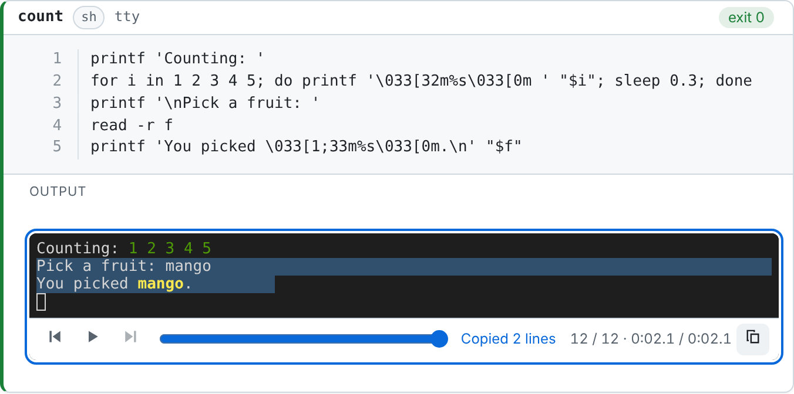

  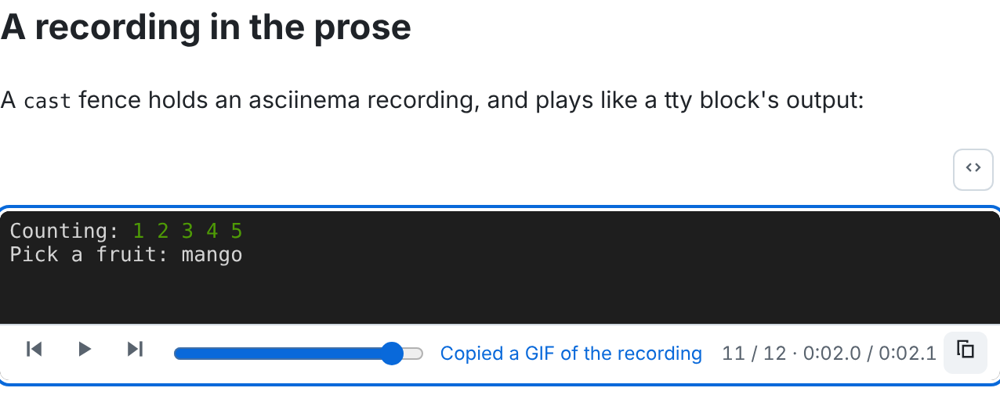

- Commands typed in the History pane, in mdsh-gui and `mdsh -i`, are
  added with `skip`, so running the whole file doesn't run them again.
  Running one by hand still does.

  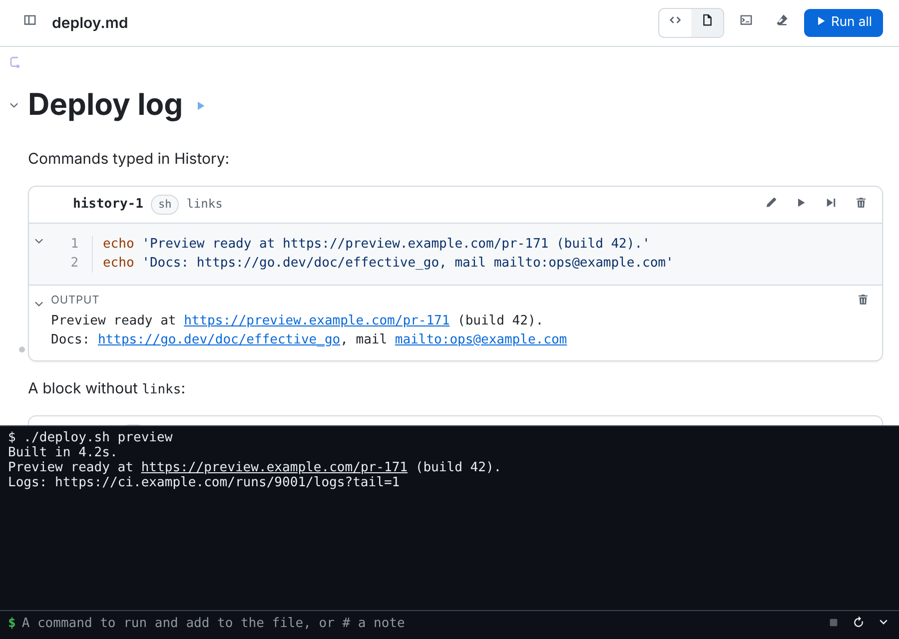

### Fixed

- tmux runs in the History pane, in `mdsh-gui` and `mdsh -i`, and in
  `tty` blocks. On macOS it stopped with "open terminal failed: can't
  use /dev/tty", since a command's terminal was opened as /dev/tty and
  named itself that; it is now opened by its own name, such as
  /dev/ttys003, which `tty` prints too.

- In `mdsh-gui` on macOS, the rendered view no longer goes blank,
  until it is scrolled by hand, after a run jumps a long way down it,
  to a question or the next block, or when the page is drawn anew, as
  when a run ends. A jump further than the view is tall now goes at
  once rather than smoothly, and the view is painted again after it
  and after each redraw.

- In `mdsh-gui`, the History pane's prompt follows the pane's width. A
  prompt drawn to fit the terminal, such as one with a rule or a
  right-aligned part, kept the width of the last command run there (or
  none at all), since the shell's terminal was only sized while a
  command ran. Now the prompt is asked for at the pane's size, with
  `COLUMNS` and `LINES` set, and asked for again when the pane is
  resized.

  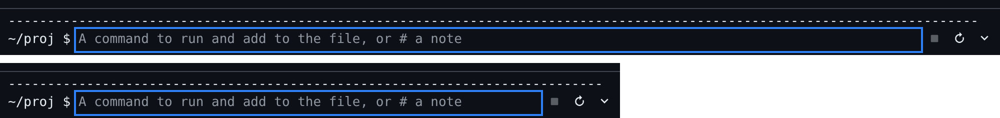

- In `mdsh-gui`, a block's confirm question is now scrolled to the
  middle of the rendered view when it's asked, even when the block's
  last output is longer than the view; before, the card was centered
  and the question could land far above the fold. Picking the block's
  `?` in the outline, or its chip in the toolbar, centers the question
  too. If you're scrolling by hand when the question comes, the view
  waits until you stop. The block waiting for an answer is ringed in
  the outline, and a section folded over it opens for the question and
  folds again once the run moves past it.

  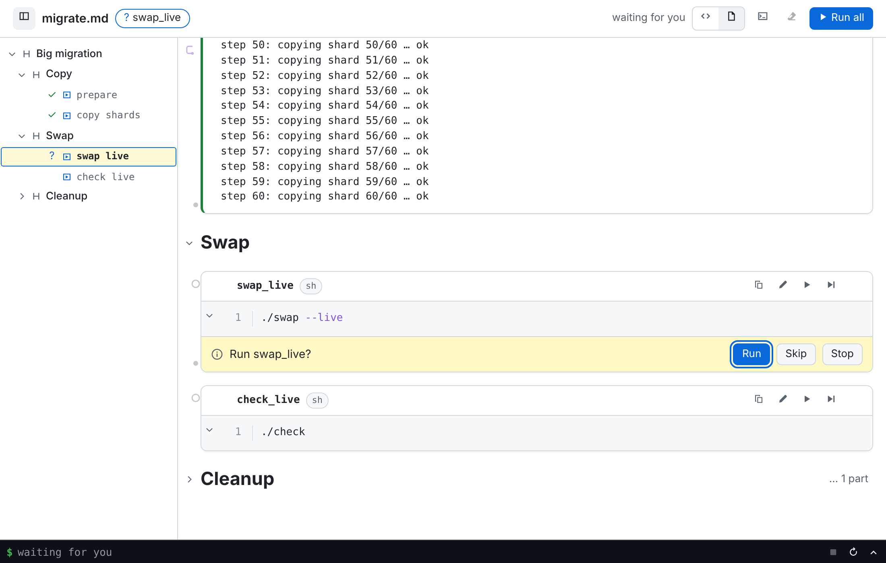

- The History pane's input, in mdsh-gui and `mdsh -i`, takes the emacs
  line keys a shell's prompt does: ctrl+a/e, ctrl+b/f, alt+b/f, ctrl+w,
  alt+backspace, alt+d, ctrl+u and ctrl+k, which kill text that ctrl+y
  yanks back (kills in a row add up, as in readline), ctrl+d to delete a
  character or, with nothing typed, close the pane, ctrl+p/n for earlier
  and later commands, and ctrl+l to clear the pane. In mdsh-gui they
  go through the input's undo, and option is meta on a Mac, so
  option+b moves back a word rather than typing ∫.

  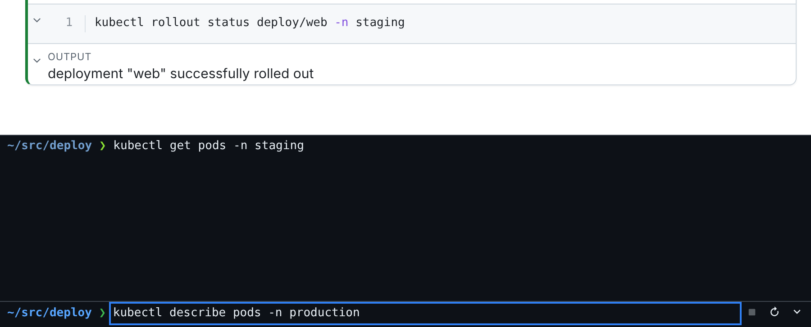

- In `mdsh-gui` on macOS, the source pane no longer jumps to the block
  at the top of the rendered view while you type or click in it. The
  panes follow only the one you last scrolled, clicked or typed in, so
  the rendered view redrawing after an edit can't move the source.

## [1.3.0] - 2026-11-02

The desktop app becomes a full editor: undo and redo, blocks that move
by drag or keyboard, `depends=` drawn as lines you can edit, three looks
with a tab to tune them, collections and sessions on the start screen,
pinned files, a Console, a History terminal and an experimental Neovim
pane. `mdsh -i` matches it feature for feature where a terminal allows.
The command line gains `mdsh ctl`, so a block can set variables for the
blocks after it, and `--audit` for a log of what a run did. The four High
findings of the v1.2.1 security review are fixed, and `brew install
gdey/tap/mdsh` installs it.

**Two changes reach into existing files and scripts.** On the next save,
unnamed blocks are renamed from `block-N` to `block-<uuid>`, and every
reference inside the file is rewritten to match; a script that calls
`mdsh --only block-3` needs the new id or a name. And `{{$VAR}}` now reads
a caller variable only when it is exposed with `--expose VAR` or
`MDSH_EXPOSE`; a document that relied on `{{$USER}}` or `run={{$DEBUG}}`
needs `--expose USER,DEBUG`. Both are described in full below.

### Security

- `SECURITY.md` says how to report a vulnerability privately and which
  versions get fixes. The v1.2.1 security reviews of the CLI and
  mdsh-gui are in `docs/security/`.
- `{{$VAR}}` placeholders, conditions and tapes read a variable from
  the caller's environment only when the person running mdsh exposes it,
  with `--expose VAR` or `MDSH_EXPOSE=VAR,OTHER`, and the front matter's
  `env.share` (if any) passes it; mdsh's own `MDSH_` variables need
  nothing. An unexposed `{{$VAR}}` prints as written and reads as unset.
  Write-back (`-w`, `-o`, `mdsh -i` and mdsh-gui saving) never stores a
  caller value, `{{$VAR:"value"}}`, and drops one an older mdsh stored.
  Before, `mdsh -n --html` or `mdsh -w` on a document someone sent could
  put `$GITHUB_TOKEN` in a file without running anything. **Breaking:**
  a document that used `{{$USER}}` or `run={{$DEBUG}}` now needs
  `--expose USER,DEBUG`. (v1.2.1 review, finding 2.)
- `confirm`, `--step` and `mdsh -i`: control characters in a block's
  code, such as `\r` followed by an erase-line escape, are shown as
  `^M^[[2K` instead of being sent to the terminal, with a warning, so
  code can't hide itself from the question that asks whether to run it.
  The printed document shows code the same way, and `mdsh -i` its ids
  and attributes too; `-w` keeps them as they are.
  A question asked after the streamed document now shows the code of a
  block that `show=` or an off `mdsh:if` section left out of it, and
  `mdsh -i` shows a block's code while asking even with Code switched
  off. (v1.2.1 review, finding 1.)
- `mdsh-gui`: a block hidden by `show=` or by an `mdsh:if` section that
  is off is drawn, with a dashed edge and a "hidden when printed" badge,
  instead of being left out. Run all and Run from here run those blocks,
  so before a file could run code the rendered view never showed. A
  hidden tape is drawn the same way, and a section that holds one opens
  unfolded even when an `mdsh:collapse` line folds it.
- `mdsh-gui`: opening a file no longer fetches anything from the
  network. An image linked from another site (`https:`, `//host`,
  `file:`) is drawn as a note with its alt text and host instead of
  being loaded, so a `{{$VAR}}` in its link can't send your environment
  anywhere and nobody learns that the file was opened. Images beside
  the file and `data:` images still show. Every window page also
  carries a Content-Security-Policy that allows loads only from the app
  itself, and files beside the document are served with one that loads
  and runs nothing. Since `{{$VAR}}` now reads only exposed variables
  (above), a link's target can't carry the rest of your environment to
  a click either.

### Added

- A Homebrew tap: `brew install gdey/tap/mdsh` installs the command line
  with its completions on macOS and Linux, and
  `brew install --cask gdey/tap/mdsh` the desktop app on macOS. A
  workflow writes the formula and cask into `gdey/homebrew-tap` when a
  release is published. Releases also carry a `.deb` and an `.rpm` for
  `mdsh`.
- `examples/` and `docs/`, and the folders in them, have a `.mdsh.yaml`,
  so mdsh-gui's start screen shows the examples tour and the design docs
  as collections, each with a title, description, icon and color.
- mdsh-gui: a pin on each file of the start screen pins it to a
  **Pinned** list at the top, above Recent, until it is unpinned. Pins
  are kept in the settings file with the recent files.
- mdsh-gui: a ⚙ on each folder of the start screen that you can write
  to opens a form for its `.mdsh.yaml` (title, description, icon,
  color, background and tags) and saves the file, so making a
  collection doesn't need the YAML format. Other keys and comments in
  the file are kept, and a value the start screen would ignore, such as
  an icon that isn't in the folder, is refused with the reason.
- mdsh-gui: **New Session** and **Last Session** on the start screen.
  New Session opens a file named for the day, such as `2026-11-02.md`,
  in a sessions folder (`~/.mdsh/sessions` by default), making it from
  a session template the first time; Last Session opens the session
  changed last. Both open with the History pane open and focused. The
  folder and template are in Settings › Files.
- `mdsh -i`: a **History** pane, as in mdsh-gui: `h` opens a terminal
  along the bottom of the screen. A command typed there runs in the
  file's shell, on a terminal, and is added to the end of the file as a
  `#history-N` block with its output; a full-screen one, such as `vi`,
  is kept as a `tty` block with its recording, and a trailing `&` adds
  a `background` block. A line starting with `#` is added as prose.
  The prompt is the shell's own `PS1`/`PS2`, tab completes commands,
  files and variables, ↑/↓ bring back earlier commands, and a command
  that goes on, such as an open `if`, gets another line. esc gives the
  keys back to the file, and ctrl+d closes the pane.
- `mdsh-gui`: screen reader support. Every button, pane, tab, field
  and dialog has a name, toggles say whether they are on, and each
  block's card is a tab stop named for the block, its language, its
  attributes and its state; focusing a card selects it. The outline's
  entries say what they are and their state, folds say whether they
  are open, the window's tabs and Settings' tabs take the arrow keys,
  and the grips that size the panes take them too. A block's question
  is read out and puts the focus on Run; the status line and the end
  of a run are read out. The terminals use xterm's screen reader
  mode. Keyboard focus shows a ring in every look, and the system's
  reduce-motion setting turns off the sliding and smooth scrolling.
- `mdsh-gui`: Edit › Depends On… (`d`) edits the selected block's
  `depends=` from the keyboard, as a list of the blocks above it to
  check in order. In the outline, ↑/↓ move between entries and ←/→
  fold and unfold a section. The text size goes up to 200%, and the
  outline widens with it. The terminals' cursors don't blink under the
  system's reduce-motion setting.
- `mdsh -i`: `?` opens a panel of the keys, grouped, each with what it
  does. Keys that do nothing now, such as `u` with no move to undo or
  `s` on a block under no heading, are greyed with the reason. ↑/↓
  pick one and enter does it; esc closes the panel.
- `mdsh-gui`: a Blueprint look in Settings › Look: white lines on
  blueprint blue over a drafting grid, with lettered headings and
  outlined cards, or a deeper night blue when the theme is dark. The
  grid can be turned off.
- `mdsh-gui`: a Teletype look, beside the theme in a new Settings ›
  Look tab: everything in a typewriter face on fan-fold paper, with
  sprocket holes, ruled lines, hard-edged cards and keycap buttons, or
  green phosphor when the theme is dark. The tab also sets the text
  size, the interface and code fonts, line spacing, an accent color,
  the paper's texture, and the History pane's colors: the window's,
  inverted (light under a dark window, dark under a light one), or
  always dark, as before.
- `mdsh-gui`: turning off spell checking in Settings is now saved.
- `mdsh-gui`: a file opens in a window the size its window was last,
  and on macOS and Windows in the same place, when it opens in a window
  of its own. Opened in a tab beside others, it leaves the window's
  size alone. The Settings window remembers its size as well. Both are
  kept in `gui.json`, not in the file.
- `mdsh -i`: alt+↑/↓, or `K`/`J`, moves the block under the cursor,
  with its output and tape, up or down past the paragraph, heading or
  block next to it, as in `mdsh-gui`; `u` undoes it. New order
  warnings, and a note when the block ran in the old order, show in
  the footer.
- `mdsh-gui`: dragging a dependency line over a folded section's heading
  opens the section for the moment, so a block in it can be dropped on.
  It folds again when the line leaves it; dropping on a block in it
  leaves it open for the tab, without writing the fold to the file.
- `mdsh-gui`: selecting a block outlines what it depends on in the
  outline too, in its lines' colors. A dependency in a folded section
  marks the section's heading instead, with a ring per dependency
  stacked in their order, in the outline and the rendered view.
- `mdsh-gui`: a button at the top of the dependency lines' margin hides
  the lines and shows them again.
- `mdsh-gui`: a `.mdsh.yaml` file makes a folder of runbooks a
  collection on the start screen. Its header shows the folder's
  `title`, `description`, `icon` (an image in the folder or an emoji)
  and `tags`, in its `color` and over its `background` image. Files get
  the tags of the collections above them plus their own front matter
  `tags:`, a tag bar under the filter lists every tag with a count, and
  clicking one or typing `#tag` shows only the files that have it.
- `mdsh-gui`: Clear All Outputs has a shortcut, cmd/ctrl+alt+K, and an
  eraser button in the toolbar beside Run all. It now asks before it
  clears, from the menu, the key or the button.
- `mdsh lsp`: a language server for editors, on stdin and stdout. It
  completes the attributes in a fence's `{…}`, their values and the
  block names in `depends=`, explains an attribute on hover and reports
  mistakes in them (unknown or misused attributes, `depends=` naming no
  block that runs, a `var=` bound twice) as diagnostics.
- `mdsh-gui`: the Neovim source pane attaches that language server, so
  completion plugins such as nvim-cmp see mdsh's completions too.
- `mdsh ctl`: a block can talk back to the run that started it. `mdsh
  ctl set NAME VALUE` sets `$MDSH_VAR_NAME` for the blocks that start
  after it, and for their `run=` conditions; `unset` removes it, `get`
  reads it as it is now, and `status [--step N --of M] TEXT` shows
  progress on stderr. Every block gets `$MDSH_SOCK` and `$MDSH_TOKEN`;
  the socket is in a directory only you can open, and a token stops
  working when its block ends. Exit codes: 0 done, 2 refused, 3 not
  running under mdsh. macOS and Linux only for now.
- `--audit FILE` writes an audit log of the run, one JSON object per
  line: the run starting and ending (with a SHA-256 of the file), envs
  starting, blocks starting, ending and skipped (and why), every `mdsh
  ctl` call, refused ones too, variables changing, and the file being
  written. `--secret` values appear only as an HMAC keyed for that run.
- `mdsh-gui`: a Console (View › Console, cmd/ctrl+shift+Y, or the
  toolbar's console button) along the bottom of the window shows what
  the app logs, with the time and level: errors from what you did, such
  as a file that no longer parses, and notes at info and above. The
  button counts warnings and errors that came while it was closed. Copy
  copies the selected lines, or all of them; Clear empties it in every
  window. It keeps the last 1000 lines.
- `mdsh-gui`: a Console line about a place in a file, such as a
  `depends=` naming no block, shows the file's name and line; in a tab
  showing that file, a click on it opens the source pane at the line.
- `mdsh-gui`: a block's `depends=` is drawn as lines in the margin of
  the rendered view, from the block up to each block it names, faint
  behind the cards: the first dependency in purple, then pink, teal and
  orange, and any past four in gray. Selecting a block lights its lines
  and outlines the blocks they lead to in the same colors. Hovering a
  line says what it joins, and double-clicking one goes to its far end.
- `mdsh-gui`: the dependency lines are edited in place. Each card has
  a ring at the top of its edge, where its lines leave, and a dot at the
  bottom, where lines from the blocks that depend on it arrive. Drag
  the ring onto a block above to add it to `depends=`, click
  the dot at a line's corner to take that dependency out, or drag the
  dot to another block above to depend on that one instead, or out past
  the lines, away from the cards, to tear it off. Undo takes
  each back; blocks without ids get them first, as moving one does.
- `mdsh-gui`: folding a block's code or output, or a section, by hand
  now saves the fold in the file, so it opens folded next time: a bare
  `collapse` or `collapse-output` on the block, or a
  `<!-- mdsh:collapse -->` line under the heading, which other markdown
  renderers hide. Unfolding takes them out, and Undo takes a fold back.
  Folds the file sets by a condition are left alone.
- `mdsh-gui`: Settings has tabs (General, Editing, Shell, Files, About)
  and scrolls, so every setting fits. About shows the version and build
  (commit, time, whether the tree was modified), the Go version and
  platform, where the settings file, `.zshrc`, start folder and
  templates folder are with Show buttons, whether `zsh`, `sh`, `mdsh`
  and the shell from Settings are on the app's PATH with their
  versions, and links to the docs, source, releases, changelog and new
  issues; Copy puts it on the clipboard for a bug report.
  `mdsh-gui --version` now falls back to the module version or the
  commit it was built from, as `mdsh --version` does.
- Run a section: in `mdsh-gui`, each heading with a block under it has a
  play button that runs the blocks of its section and its
  subsections, following Run All's rules (confirm, `skip`, `run=once`,
  `depends=`, `on_error`). Selecting a heading shows its play button in
  the outline, and enter or `s` runs it; Run › Run Section
  (cmd/ctrl+shift+enter) and the source view's gutter run one too. In
  `mdsh -i`, `s` runs the section the block is in.
- `mdsh-gui`: fenced `d2` and `svg` blocks show in the rendered view as
  the diagram or picture they draw, with a button to switch to the code.
  d2 diagrams are drawn with the d2 library built into the app; when one
  has a mistake, the code shows with d2's message.
- `mdsh-gui`: drag a block by the grip on its card to move it, with its
  output, between top-level cells, or drag a block or a heading in the
  outline; a heading carries its whole section. A fence that doesn't
  run, such as a Go example or a diagram, has a grip in the margin
  beside it and drags the same way. Undo takes a drag back, and order
  warnings show as for alt+↑/↓.
- `mdsh-gui`: alt+↑/↓ (Edit › Move Block Up/Down) moves a block, with
  its output and tape, past the cell above or below it, and alt+shift+↑/↓
  past the block above or below. It works on the selected card, the
  textbox or choice being used, and in the source view on the block at
  the cursor. A bar with Undo shows what a move changed that depends on
  block order, such as a condition now reading a block below it.
- `mdsh-gui`: Edit › Undo and Redo work in the rendered view, taking
  back and redoing checking tasks, typing in textboxes and picking
  choices. Where the focus is decides what they undo: the source view
  and a textbox being typed in keep their own history.
- `res://name` paths name a file in the document's assets folder,
  `<doc>.assets/name`: `<include file=res://notes.md` reads one (tapes
  too), and `out=image:res://plot.png` (or `screenshot:`, `recording:`)
  saves there. A `res://` path can't leave the folder. In `mdsh-gui`'s
  source pane, completing `file=` offers the files beside the document
  and those in the assets folder as `res://` paths, and `out=image:`
  the assets folder's. A path with spaces is put in quotes.
- `depends=a,b` on a block lists blocks to run before it, in order.
  Each one that hasn't run in this session, or failed when it did, is
  asked about first (run it, skip it or stop), on the terminal in `mdsh`,
  in the TUI's prompt line and in mdsh-gui's card. `--yes` runs them
  without asking, and with no terminal the run stops with an error. A
  failed dependency keeps the block from running. An unknown id is a
  warning and is ignored, so a typo doesn't stop the file opening;
  mdsh-gui's source pane underlines it and the Console notes it, and
  completing `depends=` offers the blocks above. A block depending on
  itself and cycles are parse errors.
- `mdsh-gui`: the active block (the selected card, or the block the
  source pane's cursor is in) has a play button by its name in the
  outline, which runs it as the card's play button does. Moving the
  cursor into a block in the source pane now selects its card.
- `mdsh-gui` shows which blocks are running: the toolbar lists the
  run's current step (▶, or ? while it waits for an answer) and each
  block running in the background (◐), and a click on one jumps to
  it. The outline marks them the same way, instead of … for both.
- `mdsh-gui` **Run › Clear All Outputs** takes every block's output out
  of the document, empties output copies and the stored values of
  block placeholders, and starts the shells again, as if nothing had
  run. Includes keep their lines. It isn't saved until you save, and
  with the source view open, undo there brings the output back.
- `--source FILE` and `env.source` in the front matter source files into
  every shell, sub-envs included, before its first block, so blocks can
  use aliases and functions. `--source` reads its file once, so
  `mdsh() { command mdsh --source <(alias -L; typeset -f) "$@"; }` in
  `~/.zshrc` gives blocks the ones defined in the calling shell.
- `mdsh-gui` takes flags: `--help`, `--version`, `--source FILE` (as in
  `mdsh`, for every file the app opens) and `--only`, `--step` and
  `--stop-on-error` for the file it opens. It used to take every
  argument as a file, so `--source` was opened as one.
- `mdsh-gui` setting **Give blocks your zsh aliases and functions** adds
  that function to `~/.zshrc`, or takes it out.
- `mdsh-gui` Run › Run Current Block (cmd/ctrl+enter) runs the block
  the source view's cursor is in: on its fence, in its body or in its
  output. Without the source view it runs the selected card. With Vim
  mode on, `:RunBlock` does the same.
- `mdsh-gui` highlights code in the rendered view as the source view
  does, with line numbers, in block cards and in the prose's code
  blocks. Both views now know Go, Python, JavaScript, TypeScript, JSON,
  YAML, TOML, Rust, Ruby, Lua, Perl, Swift, SQL, diff, Dockerfile, INI,
  CSS, C, C++, Java and Kotlin besides shell. Block cards show the
  block's language and exit status as badges and label their output.
- `mdsh-gui` shows the ANSI colors and bold, italic and underline in a
  block's output, saved or live, instead of the escape codes.
- `mdsh-gui` File › New File… (cmd/ctrl+N), and a New File… button on
  the start screen: it offers the markdown files in the new
  **Templates folder** setting to start from, or a blank file with a
  heading named for it, then asks where to save it and opens it.
- `mdsh -i` with no file, or with a folder, starts on a list of the
  markdown files under it, as `mdsh-gui` does: recent files first, the
  rest grouped by folder, with block counts and front matter
  descriptions, filtered as you type. `q` in a file goes back to it.
  The `library` package that finds them moved out of `mdsh-gui` into
  the root module, so both use it.
- `mdsh -i`: `W` saves as another file and follows it, ctrl+s saves,
  and a banner says when the file changed on disk, with `R` to reload
  it and `M` to keep yours.
- `mdsh -i`: an outline of the headings and blocks, with each block's
  state, beside the document (`o`), and `C` and `O` to hide the code and
  the output of blocks, as in `mdsh-gui`'s View menu. The view is kept
  for the next file.
- `mdsh -i`: `E` edits the whole file in `$EDITOR`, at the block under
  the cursor, as it would be saved. Blocks whose code didn't change keep
  their output, wherever they moved, as in `mdsh-gui`'s source view.
- `mdsh -i`: `p` creates a report (PDF, HTML or markdown, with or
  without code and output, of this run, a run of every block or the
  saved file) and shows the matching `mdsh` command, as `mdsh-gui`'s
  Create Report does. `,` sets the file's run options: arguments,
  `--only`, `--step` and `--stop-on-error`. The command line both show
  now comes from `report.Command`, and `SplitArgs` and `JoinArgs` moved
  from `mdsh-gui` into `run`.
- `mdsh -i`: a `tty` block runs in a terminal drawn in its card, as in
  `mdsh-gui`, instead of taking over the screen: up to 24 rows, as wide
  as the card, and following it when the window resizes. Keys go to the
  block while it runs, and ctrl+] stops it.
- `mdsh -i` has tabs, as `mdsh-gui` does: ctrl+t opens one on the list
  of files, `]` and `[` move between them, and ctrl+w closes one. Each
  tab has its own shells, and runs go on in the tabs behind. The tab bar
  marks output not saved, running blocks and questions waiting, and
  quitting stops at a tab with output not saved first.

### Changed

- **Documents will have their unnamed blocks renamed from `block-N` to
  `block-<uuid>`.** The next time mdsh saves a file (`-w`, or a save in
  `mdsh -i` or `mdsh-gui`), every runnable block without an `#id` gets
  one written into its fence, such as
  `sh {#block-0192f3a4-7c1e-7b2a-9d3e-5f6a7b8c9d0e}`, a UUIDv7. Ids no
  longer change when blocks are added or moved, so diffs stay small.
  The same save rewrites everything that named the old `block-N`: the
  block's saved output, output copies, tapes, placeholders and
  conditions such as `{{#block-3/?}}`, and its image and recording
  files in `<doc>.assets/`, which are renamed to match. `-o` leaves the
  source file and its blocks as they are. Scripts that call
  `mdsh --only block-3` need the new id, or better, a name for the
  block.
- Messages and the GUI name a block whose id mdsh made up by its line,
  as in `block at line 12: ok`, and the image alt text is the kind of
  output rather than the id. Shell completion lists named blocks first.
- `mdsh-gui`: the Teletype and Blueprint looks' muted text, card
  borders and failure red are a little stronger, so they meet the
  WCAG AA contrast ratios (4.5:1 for text, 3:1 for borders).
- `mdsh-gui`: in the dark theme, text on the accent buttons (Run all,
  Save, Apply) and on the red Delete button is dark instead of white,
  so it reads at the WCAG AA ratio; white on the dark blue and red was
  under 4.5:1. A custom accent gets black or white text by its
  luminance, so the Green and Amber presets get black text too.
- `mdsh-gui`: blocks the History pane adds (`#history-N`) are scratch
  work, so their trash buttons, on the block and on its output, always
  show, and deleting one doesn't ask first; the bar's Undo brings it
  back. A history block that moves, by dragging or with alt+↑/↓, becomes
  an ordinary block with an id of its own, `block-<uuid>`, and its
  output's `for=` and anything else that named it follow.
- `mdsh-gui`: Settings marks "Use Neovim for the source pane" with an
  Experimental badge, as the pane still has rough edges.
- `mdsh-gui`: windows open bigger: 1280×900 for a file and 720×720 for
  Settings, so the Settings tabs fit without scrolling. A window that
  wouldn't fit the screen is cut down to fit.
- `mdsh-gui`'s outline marks what each entry is: an H for a heading, a
  run icon for a block, and, in purple, a textbox or choice icon for a
  control. A block's name shows its underscores as spaces, so `make_db`
  reads as "make db"; its tooltip keeps the name as written.
- `mdsh -i` saves when asked (`w`), as `mdsh-gui` does, and marks
  output not saved with a •. `--autosave` saves after every block that
  runs, as before.
- `mdsh -i` asks a confirm question in the block's card, under its
  code, rather than in the footer.
- `mdsh-gui` New Window moves to cmd/ctrl+shift+N, for New File.
- Folding in `mdsh-gui`: a block's code and its output each fold to one
  line, and a heading folds its section. `collapse[=COND]`,
  `collapse-output[=COND]` and `<!-- mdsh:collapse [COND] -->` lines say
  what starts folded; printing leaves the lines out. The source view
  folds headings and fences on its own, and View › Folding copies folds
  between the two views.
- `textbox` blocks: ```` ```textbox {#host lines=1 placeholder="Which host?"} ````
  holds text rather than code. `mdsh-gui` draws it as a box to type in
  and saves what is typed into the block's body; `lines=` is the most
  lines it holds and `placeholder=` shows while it is empty.
- `choice` blocks list options as task list items:
  `mode=dropdown` (the default), `radio` or `multi`. `mdsh-gui` draws
  the control and writes the picks back as `[x]`.
- `var=name` on a textbox or choice binds `$MDSH_VAR_name` to its text or
  checked options, for blocks and for conditions such as
  `run={{$MDSH_VAR_env}}==prod`. Only the first input binding a name
  counts; mdsh warns about later ones, and `mdsh-gui` marks them, with
  `!` in the outline.
- `$MDSH_MODE` tells a block how it is being run: `running` from the
  command line, `interactive` in `mdsh -i` and `mdsh-gui`, `report` for
  `--pdf` and `--html`. Conditions read it too, so
  `<!-- mdsh:if {{$MDSH_MODE}}!=report -->` leaves a part out of reports.
- `mdsh-gui`: task list checkboxes in the rendered view check and
  uncheck the item in the file. A table cell starting with `[ ]` or
  `- [ ]` shows a checkbox too, and so does a block's `out=markdown`
  output, until the block runs again.
- `run=once` runs a block only while it has no output, saved in the file
  or from an earlier run in the same `mdsh -i` or `mdsh-gui` session.
  Running the block by hand still runs it.
- `mdsh-gui` **History** pane (View › History, cmd/ctrl+shift+H): a
  terminal along the bottom of the window. A command typed there runs
  in the file's shell, on a terminal, and is added to the end of the
  file as a `#history-N` block with its output; a full-screen one, such
  as `vi`, is kept as a `tty` block with its recording. A line starting
  with `#` is added as prose. Tab completes commands, files and
  variables, and the pane's top edge drags to resize it. The prompt is
  the shell's own `PS1`/`PS2`, and a Settings entry names an rc file,
  such as `~/.zshrc`, for the shells to read while History is on.
  Commands get job control (ctrl+Z, `jobs`, `fg`, `bg`) in shells
  that allow it without being interactive, such as dash, and a trailing `&` adds the command as a `background` block.
  Closed, the pane is a status bar with stop, restart-the-shells and
  open buttons; it slides open from there.
- `tty` blocks ignore ctrl+Z, which used to stop them for good.
- `mdsh-gui`: drag the line between the source view and the rendered
  view to share the width between them.
- `terminal:` front matter, with `cols:` and `rows:`, sets the size of
  the terminal `mdsh-gui` runs `tty` blocks on.
- `mdsh-gui` checks the spelling of the prose in the source view with
  the system's spell checker, leaving out code, links and HTML. A
  setting turns it off.

### Fixed

- `mdsh-gui` on Linux: a running block's output shows in its card as it
  comes in. Before, WebKitGTK kept the card's output area hidden until
  the run ended or stopped at a question, then showed it all at once.
- `mdsh-gui`: one click on a block's play button runs it, even when the
  block is not selected. Before, the click selected the block, which
  showed its delete button and slid the play button out from under the
  pointer, so it took a second click to run.
- `mdsh-gui`: Clear All Outputs is off when there is no output to
  clear, so clearing twice doesn't ask again. It comes back on once a
  block's output comes in.
- `mdsh-gui`: an include's line numbers are the file's (4, 5, 6 for
  `from=4`), with or without `number_on`, in one column. Before, the
  view counted 1, 2, 3, and a `number_on` include also showed the
  file's numbers written into the code beside them.
- `mdsh-gui`: on macOS the app menu's About opens Settings at its About
  tab instead of the stock Cocoa About panel.
- A block whose `timeout` ran out while mdsh checked its syntax was
  reported as failing with exit status 2, as if it had a syntax error.
  It is now reported as timed out.
- On macOS, a terminal block that ended its shell, as with `exit`,
  could lose the output it wrote just before.
- A read-only file, or one in a read-only folder, is no longer
  overwritten or found out only after the run. `mdsh -w` stops before
  running anything and says to pass `-o`. In `mdsh -i` and mdsh-gui,
  saving opens save as; with autosave on, save as opens before the run,
  which then goes on in the copy. Cancelling it doesn't run, and the
  next run goes ahead without saving. Writing is tried rather than mode
  bits read, so ownership and read-only folders count.
- `mdsh-gui`: in the Neovim source pane, a right-click no longer leaves
  Neovim waiting for a mouse release that the menu took, which garbled
  the pane and left it stuck. The menu's Cut, Copy and Paste now act on
  Neovim's selection.
- `mdsh -i` no longer shows a block that ended as running while the
  run goes on, such as while a later block waits for an answer.
- In a zsh block, a lone `}` anywhere on a line, as in `echo }`, is a
  parse error in zsh itself. mdsh now adds a line after zsh's error
  saying to quote it, as in `echo '}'`.
- In `mdsh-gui`, clicking in the source pane while the rendered view
  has the focus puts the cursor where you click. In a file just opened
  the pane used to jump to the top of the file instead.
- An include block reads its file again when the run reaches it, so it
  shows what a block above it wrote in the same run. `mdsh-gui` also
  reads includes again after every run, and reads one as soon as it is
  typed, rather than when the file is next opened.
- `mdsh-gui`'s source pane no longer loses what you type when the file
  changes under it, as when a run writes output or an include fills its
  fence: the change comes in around your typing, and your typing no
  longer writes over the change. Undo there undoes only your own edits.
- `mdsh-gui`'s source pane no longer runs past the window's bottom
  edge, and the last lines can scroll up from it.
- A block's errors name it `block` instead of the runner's temp file,
  so `/var/folders/…/mdsh-123/block.sh:2: no such file or directory`
  reads `block:2: no such file or directory`.
- Output of programs that print bold and underline with backspaces,
  such as `man`, is no longer garbled: `N\bN` is saved as `N` and
  `_\bx` as `x`, in every front end. Blocks with `out=image` are left
  as they are.

## [1.2.1] - 2026-10-29

Three changes to `mdsh-gui`: links in a document now work, a setting
picks the view files open in, and the macOS `.dmg` shows how to install.

### Added

- `mdsh-gui` setting **Open files in**: the rendered view, the source
  view, or both side by side. The default, the view the last tab had,
  keeps the 1.2.0 behavior. It applies when a file opens in a tab, not
  on a reload or when a tab moves to another window.

### Changed

- The macOS `.dmg` opens on a window laid out for installing: mdsh's
  icon and the Applications folder on either side of an arrow, with
  notes on getting past Gatekeeper for the unsigned app (Open Anyway,
  or `xattr`). The desktop docs now lead with Open Anyway, since macOS
  15 dropped right-click › Open.

### Fixed

- `mdsh-gui` links in the rendered view are followed when clicked,
  instead of opening the source editor. Web and mail links open in the
  system browser, a markdown link opens in a tab (or brings forward the
  tab it's already in), other local files open as the system would open
  them, and `#heading` links scroll to the heading. Links have their own
  right-click menu (Open Link, Copy Link), and nothing can navigate the
  window away from the app, which used to leave the tab blank.

## [1.2.0] - 2026-10-29

The desktop app: `mdsh-gui` opens documents in a window, with packages for
macOS and Linux. Blocks can also run in the background, output can be
copied elsewhere in a document, and reports come as HTML too.

### Desktop app (`mdsh-gui`)

- `mdsh-gui`, a start on a desktop window for mdsh built with Wails v3.
  It shows a document, runs blocks as you pick them, streams their output
  and saves it. It is its own Go module under `cmd/mdsh-gui`.
- `mdsh-gui` files and menus: one window per file, a start screen listing
  the markdown files under the current folder, native menus and
  shortcuts, Save As, Open Recent, Reload, drag and drop, a dirty marker
  with a prompt before closing unsaved output, a banner when the file
  changes on disk, run options (arguments, only, step mode, stop on
  error) and a Settings window (autosave, shell, start folder).
- `mdsh-gui` start screen shows each file's front matter description
  (`description`, else `summary`, else `abstract`) under its name, and
  the filter matches it too.
- `mdsh-gui` tabs: each file opens in a tab with its own shells. Tabs
  drag to reorder, onto another window to move there, or away for a
  window of their own, and a run carries on through a move.
- `mdsh-gui` packages: releases have an unsigned universal macOS app
  (`.dmg` and `.zip`) and a Linux AppImage, and `mdsh-gui --version`.
- `mdsh-gui folder` lists the markdown files under that folder on the
  start screen, in place of the current folder.
- `mdsh-gui` block editing: edit a block in a CodeMirror editor, fences
  and attributes included, or add one at the end. The editor completes
  attribute names and values, explains them on hover, underlines
  mistakes and has a form over the attributes. Vim key bindings are a
  setting. The frontend is now TypeScript, bundled by esbuild from
  `go generate`, with CodeMirror vendored without npm.
- `mdsh-gui` source view: edit the whole file in a markdown editor
  beside the rendered view, or on its own; blocks whose code didn't
  change keep their output, and a gutter button runs a block. It
  replaces the block card editor and Add block: the pencil and clicks
  on prose go to the source, and clicking a block lines the two up. A
  markdown bar, and Insert in the right-click menu, add headings,
  lists, tables, links and mdsh blocks. An outline drawer lists the headings
  and blocks with their state, and View › Show Code and Show Output hide
  those parts. A Theme setting picks System, Light or Dark, with code
  colors that read well in both. A confirm block's own Run button
  runs it without asking again.
- `mdsh-gui` images: image, screenshot and recording output, and images
  in the prose, show inline from the document's folder, which the window
  serves and nothing outside it. Clicking an output image shows it full
  size.
- `mdsh-gui` reports: File › Create Report… writes a PDF, HTML or
  markdown report of the window's run, a run of every block, or the
  saved file, with code and output shown or hidden. It shows the
  matching `mdsh` command, and offers to show the file in its folder.
- `mdsh-gui` tty blocks: a block marked `tty` runs in an xterm.js
  terminal in its card, sized to fit, with keys going to the block. Its
  recording replaces the terminal when it ends.

### Running documents

- A block marked `background` starts and the run goes on to the next
  block. Its output is kept apart from other blocks', its process ID is
  in `$MDSH_BG_<id>` for `wait`, `timeout=` kills just that block, and
  after the last block mdsh waits for it (until its timeout, or 5s) and
  then kills it. `run.Result.Running`, `Session.Reap` and `Session.Wait`
  let front ends follow background blocks, and `env.Shell.Background`
  starts one. `mdsh -i` tags them, shows them as running in the
  background while other blocks run, counts them in the status line,
  and fills in their output when they end.
- `examples/fifo` hands data between blocks through named pipes: a
  background reader fed by later blocks, a writer held open across
  blocks, and one never closed, which only a timeout ends. Tests in
  `run` pin down what happens in each case.
- Output copies: an `output {for=id}` fence, or an `mdsh:output` region,
  that isn't right after block `id` is a copy of its output, refilled on
  every run like a placeholder. `stream=stderr` copies the stderr fence.
  A copy keeps its content when the block doesn't run, and one for a
  block that doesn't exist is a warning. `doc.Document.Copies` lists them
  and `doc.Document.Warnings` holds the warnings, which the CLI prints.

### Reports

- `--html FILE` writes what mdsh would print as a standalone HTML page,
  styled like the PDF, with local images inside it. `--html -` writes it
  to stdout.
- The `report` package makes the reports `--pdf`, `--html` and `-n -o`
  write (PDF, HTML or the printed markdown), so other tools such as
  mdsh-gui make the same ones.

### Library

- `run.Options.Terminal` runs blocks marked `tty` on a terminal the
  caller draws itself, such as a pane in a window, with keys on a
  channel and the size it reports. `env.Shell.RunTerminal` does the
  running.
- `doc.BlockAttrs` describes every block attribute (kind, allowed
  values, default, one-line help) for tools that help write them, with
  `AttrSpec.Check` to validate a value. `doc.SplitInfo` edits a fence
  info string in place, keeping unknown attributes and their order.
- `doc.Document.SetSource` parses an edited file again, keeping each
  unchanged block's identity, and `run.Session.Sync` then keeps their
  results, so a whole-file edit only clears the output of blocks that
  changed.

### Site and examples

- A Use cases section on the site: runbooks, reports and setup
  checklists, each with a sample report in PDF, HTML and markdown. New
  runbooks in `examples/runbooks` back them: `deploy.md`,
  `disk-report.md` and `onboarding.md`. `site/samples.sh` regenerates
  the samples.
- `examples/runbooks/mdsh-release.md`, the runbook for releasing mdsh:
  it checks `CHANGELOG.md` and the checkout, shows the release notes'
  sections, and with `PUSH=1` tags and pushes the release.

### Changed

- The output right after a block holds at most one stdout part and one
  stderr fence. A second `output` fence for the same block used to be
  replaced along with the first; it is now a copy.
- mdsh now needs Go 1.27 or newer to build, since the desktop app's
  Wails v3 needs Go 1.26 or newer and the CLI and app share one Go.

### Fixed

- When a block's `timeout=` stops the run, mdsh says it timed out,
  instead of blaming `exit` or `set -e`.

## [1.1.0] - 2026-10-28

Interactive mode: `mdsh -i` opens a document in a terminal UI and runs its
blocks as you go.

### Interactive mode

- `mdsh -i file.md`, interactive mode: a terminal UI (Bubble Tea) that
  shows the document, runs blocks as you pick them, streams their output
  under them and saves it to the file. `a` runs from the cursor to the
  end; `confirm` and step mode ask inside the UI.
- `i` (or `:`) types a command at a prompt; it is added to the end of the
  document as an `sh` block and run.
- `tty` blocks and taped blocks run on the terminal: the UI steps aside
  while they run and comes back on enter.
- Images and recordings show under their block as half-block previews,
  and `v` shows one full size through the kitty, iTerm2 or sixel
  protocol.
- `e` opens the selected block, fences and attributes included, in
  `$VISUAL`, `$EDITOR` or `vi` and saves the edit to the file. Saved
  output follows a changed id.

### Library

- `run.Session` runs a document's blocks one at a time while keeping
  their shells alive; `run.Run` is now built on it. `run.Session.Sync`
  catches a session up with edits to the document, and
  `run.Options.TakeTTY` lets a front end hand the terminal over.
- `doc.AppendBlock` adds a block to the end of a document, and
  `doc.Document.BlockText` and `SetBlock` read and replace a block while
  every block keeps its identity.
- The new `termimg` package draws images in a terminal.

### Shell helpers and examples

- `md_table -F SEP` splits fields on SEP as `awk -F` does (`-F ' '` is
  runs of blanks), and `md_table -s N` skips the first N lines.
- `examples/pdf/test-coverage.pdf`, the PDF of a run of the test coverage
  report runbook.

### Fixed

- The last thing a `tty` block or tape shows, after a quiet spell, is no
  longer sometimes cut off from the terminal and the recording.
- Stopping a block (`timeout=`, ctrl+c) no longer waits for a child that
  outlives the kill, such as a `sleep`: mdsh stops reading the shell's
  output instead of waiting for it to close.
- An env whose shell exited starts a fresh shell for the next block run
  in it.

## [1.0.0] - 2026-10-28

The first release: a markdown file with shell blocks runs end to end from
the command line, and its output is printed or written back into the file.

### Running documents

- `mdsh` runs the `sh` blocks in a markdown file top to bottom and prints
  the markdown with each block's output below it. `mdsh file.md` is short
  for `mdsh run file.md`, so `#!/usr/bin/env mdsh` makes a markdown file
  executable; extra arguments reach blocks as `$1`, `$2`, …
- `zsh` blocks run too. A document with any `zsh` block runs in `zsh`
  unless `shell:` is set.
- Blocks without `env=` share one long-lived shell; sub-envs only receive
  the exported variables listed in `share=`.
- `env.share` and `share=` accept `...` for all variables (like `*`) and
  `-NAME` to leave a variable out, so `[..., -USER]` passes all but `USER`.
- Fences inside list items and block quotes run like any other block;
  their output is written inside the same list item or quote.
- Include blocks: a block marked `<include` with `file=`, `from=`, `to=`
  and `number_on` holds lines from another file, written into its body on
  every run. Include blocks never run and have no name.
- `tty` block attribute: the block runs on a terminal, so commands that
  need one, such as `docker run -it`, work, and ctrl+c reaches them
  rather than mdsh. The session is saved as an asciinema cast and as an
  animated GIF linked below the block; a PDF shows its last frame, or
  the one `frame=N` picks. With no terminal the block fails with an
  error, unless it has a tape. Shells now run in their own process group.
- `tape {for=id}` fences type the input for a `tty` block, in the
  commands of a VHS tape, inline or from a file with `<include`, so the
  block runs unattended.
- Shell helpers for markdown output: `md_h1`–`md_h3`, `md_table`, `md_code`.

### Command line

- `-w` writes output back into the file; `-o out.md` writes it to another
  file instead. Writing back twice gives the same file.
- `--no-run` (`-n`) prints the document with the output saved in it by
  `-w`, without running anything. It combines with `--hide-code` and
  `--hide-output`, and `-o out.md` saves the printout to a file.
- `--hide-code`, `--hide-output` (both: prose only, nothing runs),
  `--only BLOCK`, `--stop-on-error`, `--yes`, `-` to read from stdin.
- Step-wise runs: `--step` or front matter `step: true` asks before every
  block. The confirm prompt can run, skip, skip blocks that already have
  saved output, or stop.
- Runs that ask (`--step`, `step: true`, `confirm` blocks) print the
  document as they go, so each prompt follows the prose and code it is
  about and a failed block's output and stderr show before the next one.
  This works with `-w` too. Without prompts, `-w` prints a failed block's
  output and stderr after its status line.
- When a run stops early, mdsh says why, before and after the rest of
  the document: the block ended its shell (`exit`, `set -e`), failed
  with `on_error: stop`, or you stopped at a prompt.
- `--pdf FILE` lays out what mdsh would print as a PDF, in pure Go. The
  hide flags, `--only` and the rest apply; with `-w` or `-o` the markdown
  is written as well. `--pdf -` writes the PDF to stdout.
- Styled terminal output with `--color=auto|always|never`, `--no-color`
  and `NO_COLOR`.
- `mdsh --version` and `mdsh completion bash|zsh`.

### Document format

- Front matter options under `mdsh:`: `shell`, `on_error`, `interpolate`,
  `show_stderr`, `step` and `env.share`.
- Block attributes: `#id`, `skip`, `env=` (stacked sub-envs), `share=`,
  `on_error=`, `timeout=`, `confirm`, `run=`, `show=`, `show-output=`,
  `show-stderr=`, `out=markdown|image|screenshot` and `embed=inline`.
- `out=image` saves image output; `out=screenshot` draws text output as a
  terminal-style SVG or PNG.
- Placeholders in prose: `{{#block/env(VAR)}}` and `{{$VAR}}`, with the
  last value stored in the file on write-back.
- Block facts: `{{$?}}` (alias `{{$err?}}`) for the last block's exit
  status, `{{$ran?}}` for whether it ran, and `{{#block/?}}`,
  `{{#block/err?}}` and `{{#block/ran?}}` for a named block, in
  conditions and prose.
- Conditions (`{{$VAR}}`, `{{#block/env(VAR)}}`, `!`, `==`, `!=`) for
  `run=`, `show=`, `show-output=`, `show-stderr=` and
  `<!-- mdsh:if COND -->` … `<!-- mdsh:end -->` sections.

### Releases and docs

- Release archives for Linux, macOS and Windows (amd64 and arm64), built
  by goreleaser when a `v*` tag is pushed. Windows builds are not well
  tested yet.
- A documentation site in `site/`, the design spec in `docs/spec.md`, the
  roadmap in `docs/plan.md`, and examples: a literate `examples/hello.md`,
  `examples/report.md` with PDFs in `examples/pdf`, and runbooks in
  `examples/runbooks` (release checklist, system report, Linux and macOS
  triage, test coverage report), run as tests on the OS each is for.

[Unreleased]: https://github.com/gdey/markdownshell/compare/v1.3.0...HEAD
[1.3.0]: https://github.com/gdey/markdownshell/compare/v1.2.1...v1.3.0
[1.2.1]: https://github.com/gdey/markdownshell/compare/v1.2.0...v1.2.1
[1.2.0]: https://github.com/gdey/markdownshell/compare/v1.1.0...v1.2.0
[1.1.0]: https://github.com/gdey/markdownshell/compare/v1.0.0...v1.1.0
[1.0.0]: https://github.com/gdey/markdownshell/releases/tag/v1.0.0
