# Changelog

All notable changes to mdsh are listed here. The format follows
[Keep a Changelog](https://keepachangelog.com/en/1.1.0/), and versions
follow [Semantic Versioning](https://semver.org/).

## [Unreleased]

### Added

- The website has a [Terminal escape codes](https://gdey.github.io/markdownshell/docs/terminal-codes/)
  page: every OSC sequence terminals speak, from titles and the clipboard
  to shell marks, notifications and program status, how widely each is
  supported across thirteen terminals, and what mdsh sends, reads or
  strips. The survey behind it, with what mdsh should do next, is
  [docs/osc-codes/design.md](docs/osc-codes/design.md).

- mdsh keeps the Program Status Protocol (OSC 7501) records of the
  programs blocks run: a program on a `tty` block's terminal, a
  background `tty` block's or the History pane's shell can report
  working, blocked, done or error, with a message, and mdsh keeps the
  records as a terminal would and answers the feature query. Nothing
  shows them yet; the cards and the History bar will. See
  [docs/program-status/design.md](docs/program-status/design.md).

- `mdsh doc.md` and `mdsh -i` tell the terminal they run in what they
  are doing, with the Program Status Protocol (OSC 7501): working as
  each block starts, with how far through the blocks the run is, blocked
  while a `confirm=`, `depends=` or `mdsh ctl ask` question waits, and
  done or error as the run ends, naming the block that failed. A
  terminal that shows program status, such as Ghostty, lists the run and
  what it waits on; one that doesn't ignores the reports. See
  [docs/program-status/design.md](docs/program-status/design.md).

- `symbol=` on an include finds definitions in languages other than Go,
  best effort, with the highlighter's tokens: Python, JavaScript,
  TypeScript, Rust, C, Java, Ruby, shell, YAML and most others it
  knows. `A.b` finds `b` inside `A`, as a class's method or a Rust
  `impl` block's. A Go file that doesn't parse is read the same way,
  with a warning. `lines=` or `until=` fixes the end when the guess is
  wrong.

- The website has an [llms.txt](https://gdey.github.io/markdownshell/llms.txt),
  for pointing an LLM or a coding agent at the docs: what mdsh is and a
  link with a line on each docs page, and
  [llms-full.txt](https://gdey.github.io/markdownshell/llms-full.txt),
  every docs page and the cheat sheet as one markdown file. Both are built
  from the docs pages themselves, so they stay current.

- An `out=file` block's output bar in mdsh-gui says how long its log is,
  "63 lines in test.log", and clicking that shows the whole log with the
  lines the output shows marked. A window that matched nothing is badged
  "no match", and a log cut at 16 MB "truncated". `--html` reports link
  the log from the output's caption, and `--pdf` names it there.

  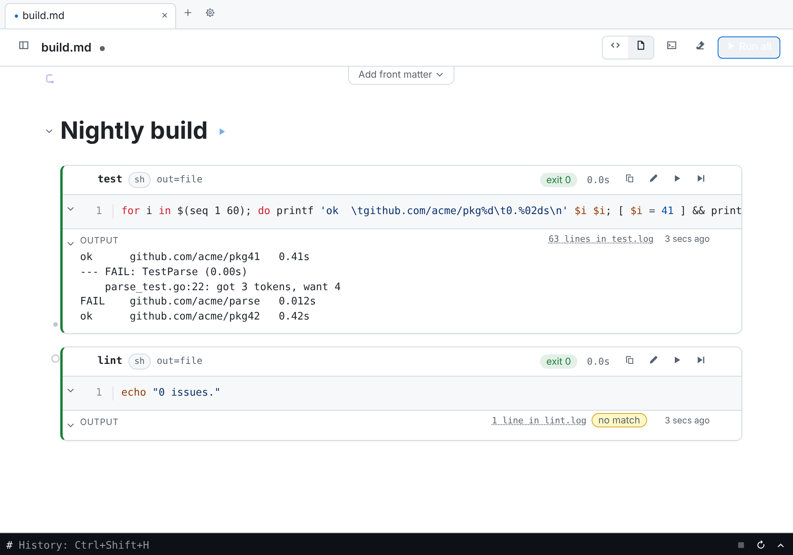

- `out=file` sends a block's stdout to `<doc>.assets/<id>.log` (or the
  path given), and its output fence becomes an include of the file: the
  first `fold_output` lines, or the window you pick by adding `match=`,
  `before=`, `lines=`, `until=`, `from=` or `to=` to the fence, which
  every run keeps. So a long build log stays out of the document, and
  the document points at the part that matters. Copies keep their own
  windows, includes of the log show the latest run, the file is
  rewritten only when it changed, and `history=N` keeps earlier logs.

  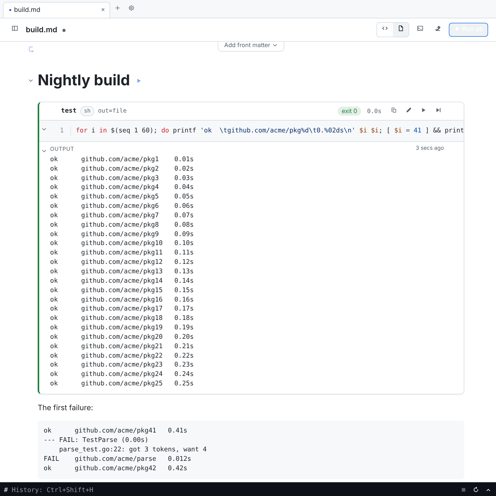

- An include block can find its lines by what they hold, so it stays on
  them when the file changes above: `match="^FAIL"` starts at the first
  line matching a regexp, `before=N` adds lines above it, and `lines=N`
  or `until="re"` ends it. `symbol=Name` shows a Go function, method
  (`T.Method`), type, const or var with its doc comment (`comment=false`
  drops it). Line numbers start where the window does. A window that
  finds nothing is left empty with a warning, a "no match" badge in
  mdsh-gui, and doesn't fail the run.

  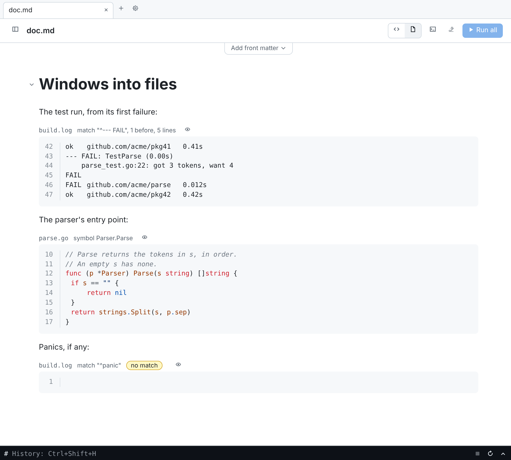

- A block's output longer than 25 lines opens folded to its first line,
  in mdsh-gui and `mdsh --serve`, so a long log doesn't push the rest of
  the file out of view; it shows as it streams and folds once the block
  ends. `fold_output:` under `mdsh:` in the front matter sets how many
  lines that is, and `fold_output: 0` turns it off. Unfolding one by hand
  writes `collapse-output=false` on the block, so it stays open, and
  folding it again takes that out.

  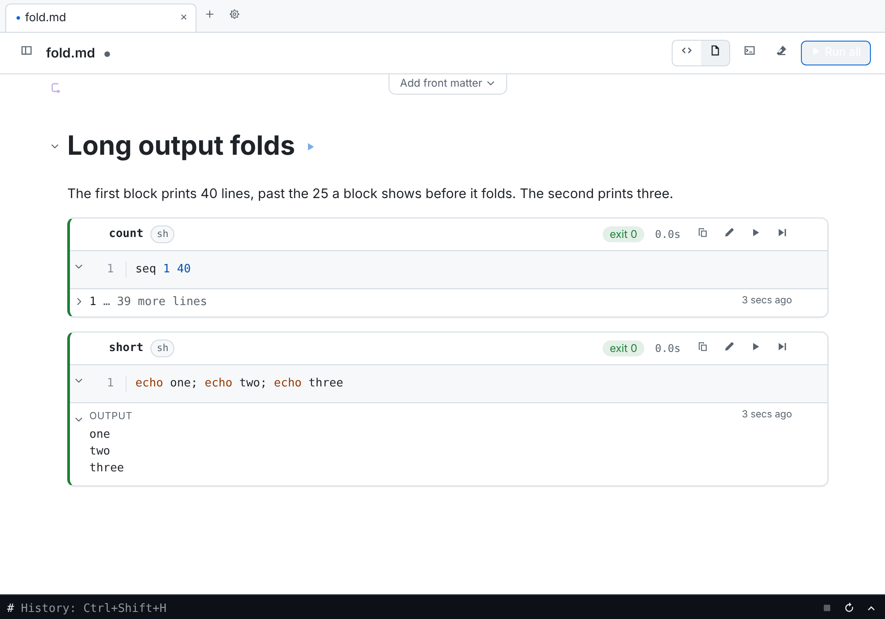

- With the experimental interactive shell on, the History pane can move
  to a sub-env: the picker on its bar, shown when blocks name an
  `env=`, lists the top level and each env. Picking one starts that
  env's shell interactively, on a terminal of its own, so vim, ctrl+z
  and `fg` work there too, and what you type there is added with the
  env's `env=`, so it runs there again. When blocks have already started
  the env's shell, it asks first, as it starts again and what they set
  is lost. The shell the pane leaves keeps running, with its jobs and
  what it showed, for when you come back; the picker counts each env's
  stopped jobs.

  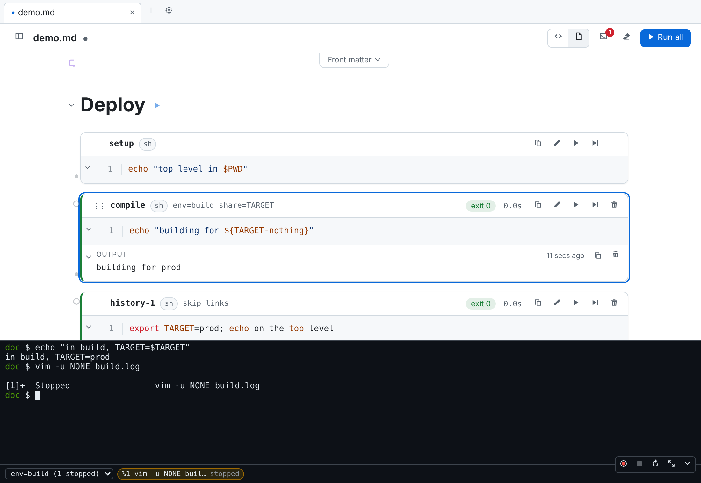

  In `mdsh -i --interactive-shell`, `@` lists the envs in the footer;
  enter moves History to the one picked, and the pane's rule names it.

  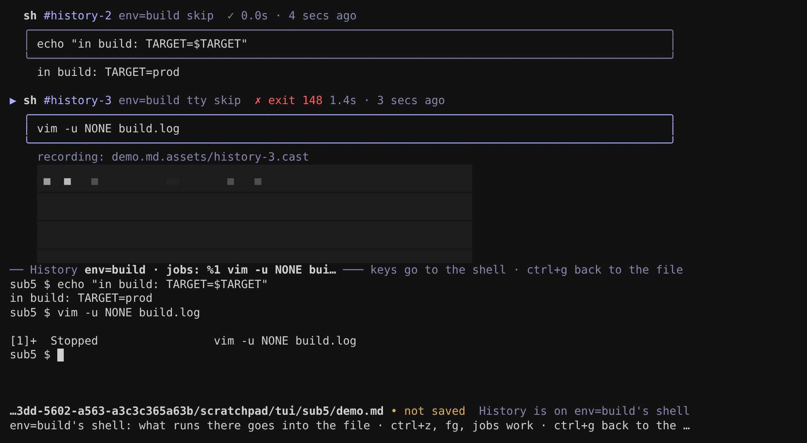

- With the experimental interactive shell on (Settings › Shell), the
  History pane is a terminal on the document's shell, in mdsh-gui and
  `mdsh --serve`: the shell draws its own prompt, reads your rc file's
  key bindings and completion, and every key goes to it, so vim, ctrl+z,
  `fg`, `bg` and `jobs` work as in any terminal. What you type there
  still goes into the file: a line starting with `#` as a note, any
  other command as a History block with what it showed, and one that
  took the screen as a recording. Record off runs commands without
  adding them. The bar under the pane shows the shell's jobs, a stopped
  one marked, and its block gets a stopped badge; Restart Shells names
  the jobs it would end. In the browser, ctrl and a letter in a
  terminal now go to the program, not to mdsh's shortcuts, off macOS.

  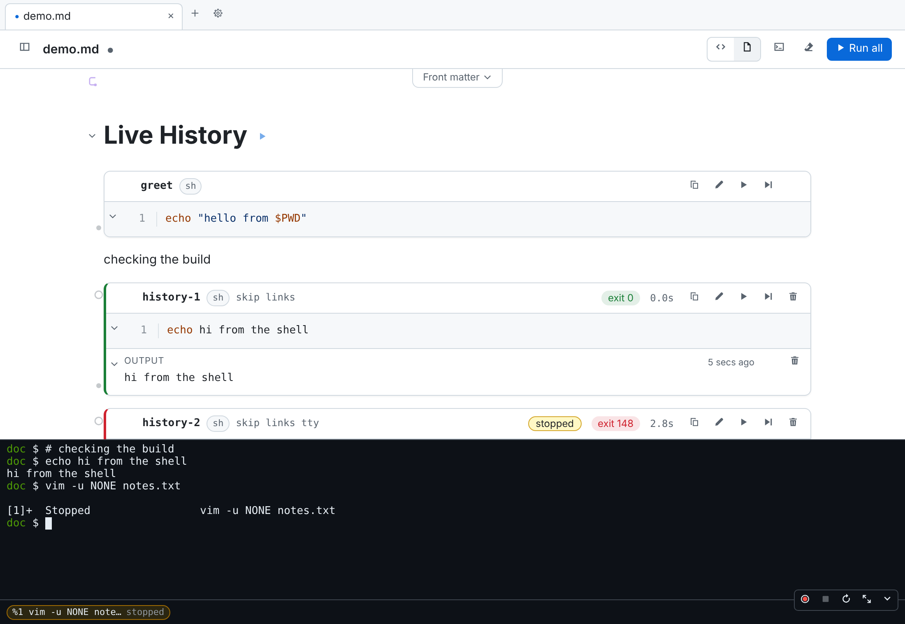

  `mdsh -i --interactive-shell` has the same History pane, as a
  terminal: the shell's jobs show on the pane's rule, and ctrl+g gives
  the keys back to the file, since esc is the program's.

  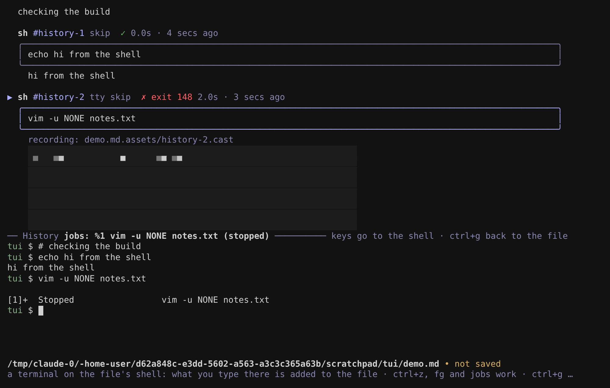

- With the experimental interactive shell on, running a block while a
  command such as vim holds the History pane's shell no longer fails
  with "the shell is running a command": mdsh stops the command, as
  ctrl+z would, runs the block in the same shell, so what it sets is
  kept, and brings the command back with `fg`. A command that doesn't
  stop for ctrl+z still keeps the shell. Alt-click (option-click on a
  Mac) a block's play button, or press cmd/ctrl+alt+enter (Run › Run
  Current Block in a Side Shell), to run it in a side shell instead:
  one of its own, started from the History shell's exported variables
  and directory, which leaves the command running and keeps nothing
  the block sets.

- Help › Copy Bug Report, and a Bug Report button in the Console pane,
  copy a Markdown report to paste into an issue or a chat with Claude:
  the version and build, the settings (less the recent, pinned and
  window lists), what the tab is doing (its file, whether a run is
  going, unsaved output, the History pane open or minimized, the view),
  its processes, the console and the file's events. Paths under your
  home folder show as `~`. It holds commands and what blocks printed,
  so read it before you share it.

  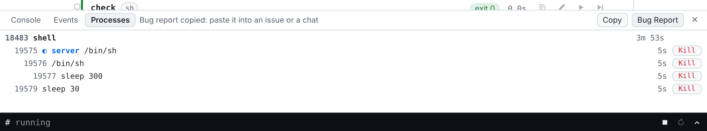

- The Console pane's Processes tab has Copy too, as Console and Events
  do: the selected lines, or every process as an indented tree with its
  pid and how long it has run.
- A Console line that repeats the one before it isn't shown again: the
  first shows how many times it came, such as ×7, and hovering says when
  the last did. Copy copies it once, with the count.

  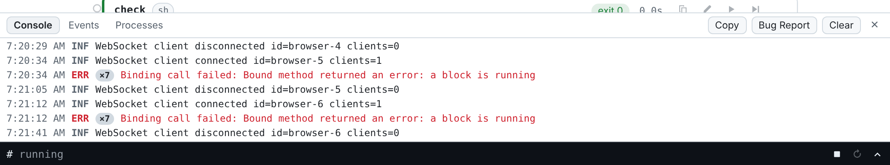

- A call from the window to the app that fails now says which call it
  was in the Console, and for which file, such as `demo.md Save failed:
  a block is running`, in place of Wails' `Binding call failed: Bound
  method returned an error: …`, which named none.

- A `background` block can be `tty` too. In mdsh-gui, `mdsh -i` and
  `mdsh --serve` it runs on a terminal of its own, in its card, while
  other blocks run, so an editor can stay open on a script that the
  next block runs, as often as you like. It takes the keys as it
  starts; in mdsh-gui a click in its terminal gives them back to it,
  and in `mdsh -i` ctrl+g leaves it running and `t` on its card goes
  back to it. It isn't stopped at the end of a run, Stop and Processes
  reach it as any background block, and its card shows the recording
  once it ends. It runs in a new shell of its env's kind, in a session
  of its own, that first takes on the shell's variables, working
  directory and options, and in bash and zsh its functions and aliases.
  `mdsh` on the command line, with nobody at a terminal, fails it, as
  before.

  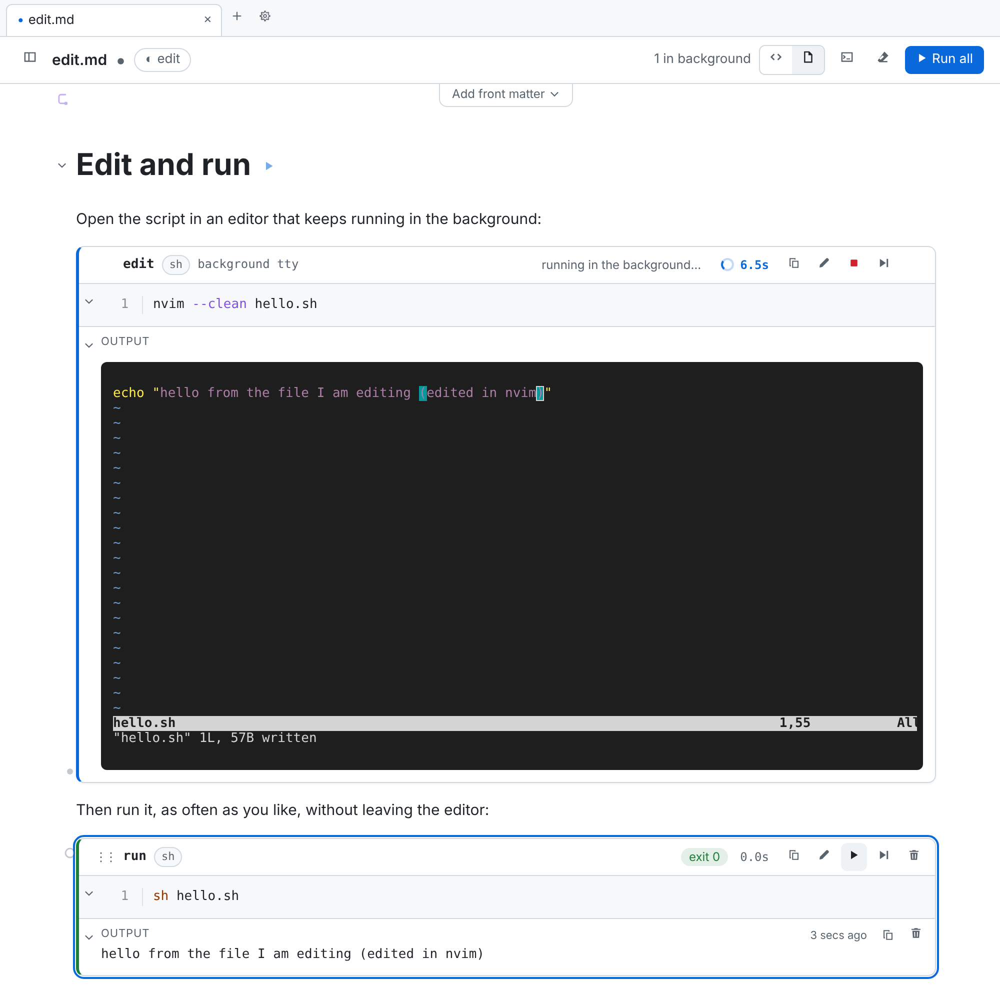

  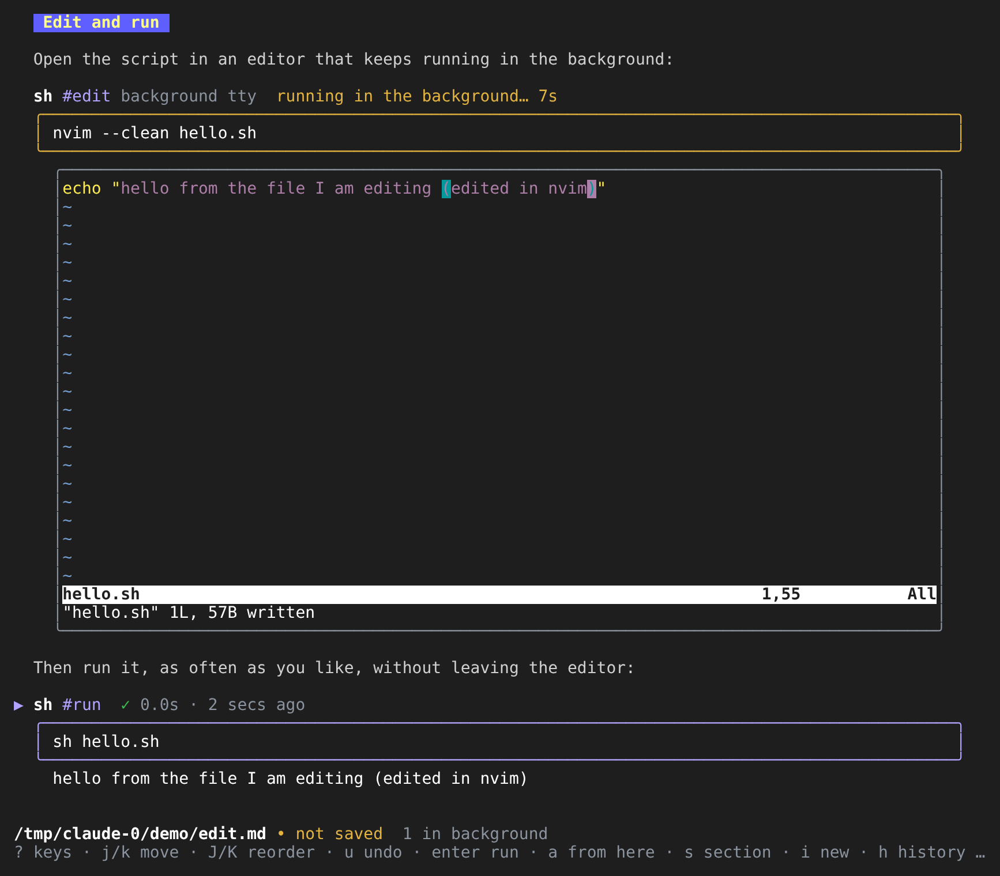

- An experimental interactive shell for the History pane, for using mdsh
  as the terminal you live in. With Settings › Shell › Interactive shell
  in mdsh-gui, or `mdsh -i --interactive-shell`, the file's top-level
  shell runs as an interactive shell (`zsh -i`, `bash -i`, `sh -i`) on
  its own terminal and reads your rc files, so ctrl+z stops a command and
  `fg`, `bg` and `jobs` work as they do in a terminal. Blocks run there
  are typed at its prompt as one line that sources them, and their
  output and errors come back as one stream. Blocks with `env=` still
  run in shells of their own, as before. "Start it as a login shell"
  (`--login-shell`) reads the profile files too. The audit log marks
  the shell `interactive` and logs `job.stopped`, `job.backgrounded` and
  `job.ended` for bash and zsh. It is off by default.

  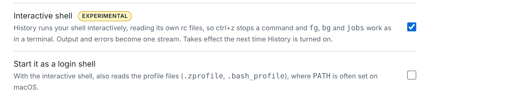

### Changed

- mdsh-gui starts faster. The window's tab bar no longer loads the
  editor's code, the first calls each page makes to Go go together, and
  the start folder's files are listed while the window loads, on every
  CPU at once. On an M2 Max a file named on the command line is drawn
  in 526ms, down from 559ms, and the start screen of a 500-file folder
  in 509ms, down from 836ms.
- `MDSH_STARTUP_TRACE=1 mdsh-gui` prints when it gets to each point of
  starting up, and `go run ./internal/startuptime` in cmd/mdsh-gui
  times a build's startup over several runs.
- A long file opens at once: the first screen is drawn from the first
  few hundred cells while the rest are laid out behind it, and only the
  cards near the view are rendered. A 1M-line runbook shows its first
  screen in about 0.4 s, against 13.5 s before in Chromium; a 1M-line
  file that is mostly prose opens, where before the window gave up.
- A long file scrolls at once, wherever you jump: the rendered view
  keeps only the cards near what is in sight, a few dozen, between
  spacers as tall as the rest, and draws the others as you come to
  them. Folding, the outline, j and k, the dependency lines, dragging
  and the source pane's scrolling go by the document's cells rather than
  its cards. A 1M-line runbook has every cell in about 4.5 s, against 9 s
  before, and a jump anywhere in it draws in under 0.1 s; the page holds
  about 20 cards wherever it is, where before it held one for every
  cell.

  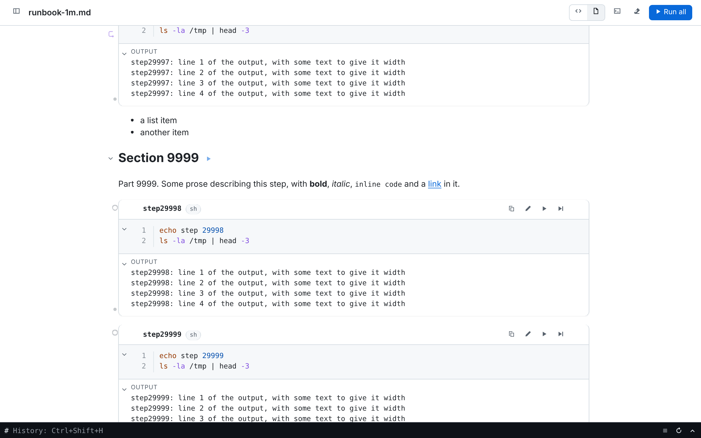
- Typing in a long runbook shows in the rendered view in about 0.4 s
  at 1M lines, against 7.8 s. The source pane's check of `depends=`
  names looked each one up through every block, which took 4.5 s and
  held up the edit behind it; it takes 15 ms now. Laying the cells out
  again parses only the prose that changed, doesn't wait for the parse
  of the whole file that says where blocks can be dragged (that follows
  a moment later), and Go sends the page only the cells a keystroke
  changed, a few hundred bytes where it sent every cell's head, 7 MB.
  The check of fence attributes waits only on the fences that changed.
  Typing in prose lays out only the prose between the two blocks
  around it; the cells above and below are kept, moved. And the edit
  parses only that prose, from the block above it to the one below,
  where it parsed the whole file. The page, too, goes through only the
  cells a keystroke changed, and the source pane keeps its run buttons
  and looks again only at the fences in the lines that changed.
  Typing in a block's code, or changing a heading's level, is as quick,
  about 0.3 s at 1M lines, against 1 to 2 s: the edit parses only that
  block, the layout makes only its cell again, or works out the
  headings' sections again without laying out the cells, and the page
  goes through only the cells that changed.
- An edit in a long file costs less to draw: after typing, a fold or a
  textbox, Go sends the page every cell's head and the bodies of only
  the cards drawn, where it sent every cell whole. At 1M lines that is
  6 MB laid out in 1.5 s, against 65 MB in 3.6 s.
- The `.dmg` window shows the newest look, Green Tea, in the app rising
  from its bottom edge. `build/darwin/dmg/render.sh` takes the newest
  look's picture from `site/data/looks.toml`, so running it again when a
  release brings a new look is enough.

### Fixed

- Stopping a block no longer, now and then, stops the next one too,
  or lets it run on past the command it was stopped at. Run kept
  interrupting for a moment after the stopped block ended, which could
  reach the next block, and the kill that follows for a command that
  ignores ctrl+c could take a command the block had only just started,
  so the block went on past it.

- A `tty` block that `mdsh` runs on the terminal it is in no longer
  leaves that terminal retitled or recoloured. mdsh saves the title on
  xterm's title stack before the block and restores it after, and resets
  each colour the block set (OSC 104, 105 and 110 to 119), as tmux does
  for a pane. A block that only asks for a colour, as programs do to
  pick light or dark styles, changes nothing, so a palette you set
  yourself is left alone.

- A program in a `tty` block or the History pane of mdsh-gui that copies
  with OSC 52, as vim, tmux and lazygit do, now sets the clipboard. It
  was dropped before. The status line says which block copied how many
  lines, and a `secret` block's copy goes on marked secret, as its copy
  buttons do. Reads of the clipboard are never answered.

  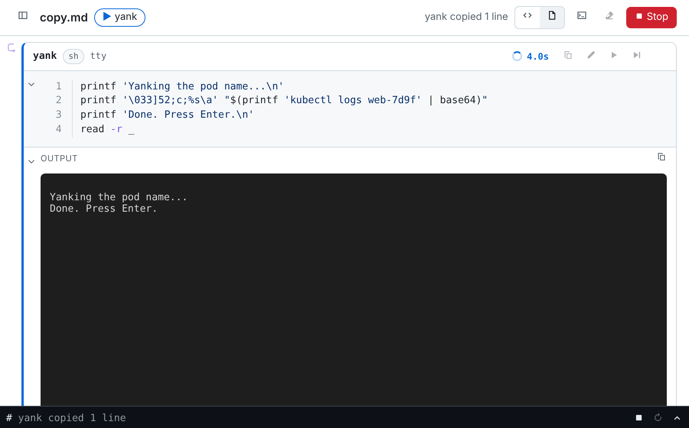

- A program in a `tty` block, a background `tty` block or the live
  History pane of `mdsh -i` that copies with OSC 52 now sets the
  clipboard, as it would in the terminal outside: the pane's terminal
  emulator dropped it. The footer says which block copied how many
  lines, beside "running…" while the run goes on.

  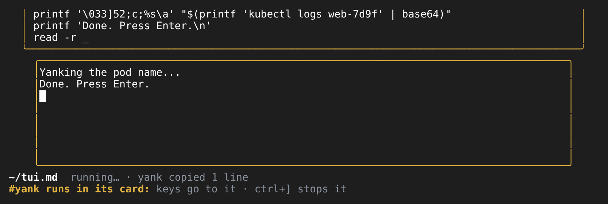

- `mdsh -i` inside tmux, over ssh, now reaches the clipboard: it hands
  tmux the text with `tmux load-buffer -w`, which tmux 3.2 and later send
  on to the terminal under the default `set-clipboard external`, and
  wraps its OSC 52 in tmux's passthrough for older tmux and
  `allow-passthrough on`.

- With the interactive shell on zsh and powerlevel10k, only the first
  line typed in the History pane went into the file: notes typed after
  it weren't added as prose, nor commands as blocks. powerlevel10k adds
  the hook that sets its prompt after mdsh's, which took mdsh's prompt
  marks off it. mdsh's hook now moves itself back to the end.

  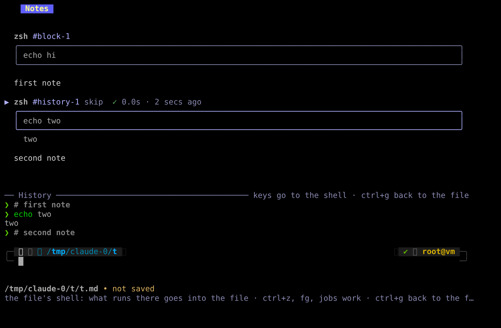

- An include typed in the History pane, as
  `` # ```markdown {<include file=README.md} `` then a closing fence, is
  added to the file. Its body comes from its files, so it has none of
  its own, and it was turned away as empty.

  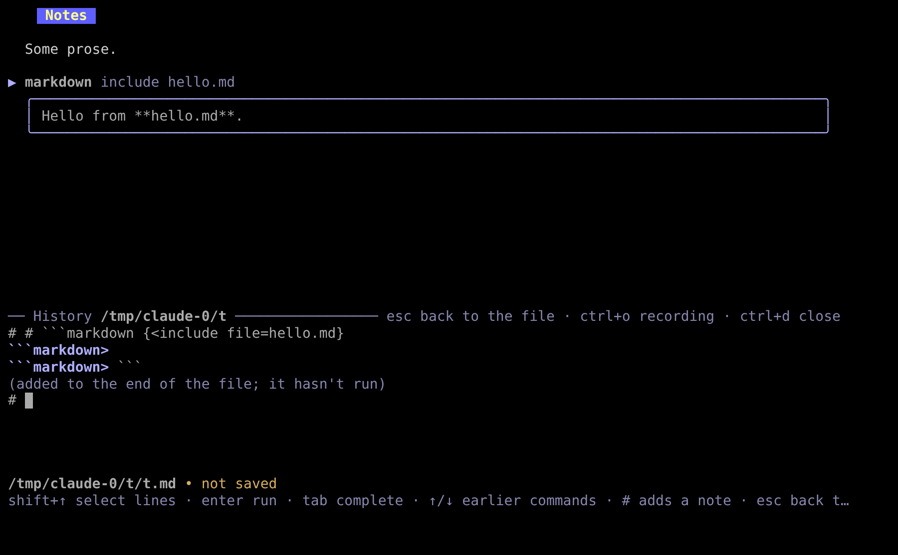

- After an edit that left a heading's section with no block that runs,
  the rendered view could keep the section's old blocks for that
  heading, as the page took in a section's change only when it had
  blocks, and a card drawn again kept its old card's marks.
- With the experimental interactive shell, a message mdsh showed in the
  History pane, such as why a link wasn't opened, was written at the
  shell's cursor, behind its back, so the cursor and what you typed
  after it landed in the wrong place. Such a message now goes above the
  prompt, the prompt and what is typed moving down with it, or to the
  status line while a command runs. Turning recording on or off no
  longer prints a line in the pane, in mdsh-gui, `mdsh --serve` or
  `mdsh -i`: the pane's bar already says when it isn't recording.

  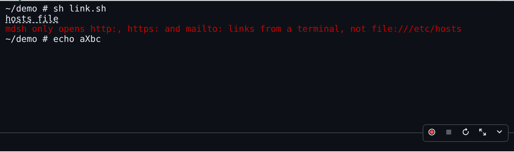

- With the experimental interactive shell, a command typed in History
  in bash that wrapped past the pane's edge was added with a carriage
  return and a doubled character where it wrapped, and one edited with
  backspace, in bash or sh, kept the backspaces. The typed line is now
  read as the terminal shows it. In zsh, a command typed soon after
  another, on a busy machine, could be added as the one before it.
  With bash as sh, as macOS's `/bin/sh` is, mdsh's marks in the prompt
  counted toward its width, so a narrow pane wrapped inside them and the
  shell looked busy for good.
- On macOS, mdsh-gui opened with a folder on the command line showed
  a "read …: is a directory" error sheet, which held back the window by
  a quarter of a second or kept it from showing at all. macOS asks to
  open the command line's folder as if Finder had, and mdsh-gui now
  skips that, and the same for a file it opened already.
- Closing an interactive shell twice no longer kills another program's
  processes. The second close looked for jobs left on the shell's
  terminal after mdsh had let go of it, when the system may have given
  the same terminal to another program, such as another document's
  shell, and killed what it found there.
- Saving in mdsh-gui and `mdsh --serve` no longer drops what was just
  typed in the source pane. Right after a command typed in the History
  pane ended, the pane asked the shell for its prompt, and an edit or
  save made in that moment was turned down with "a block is running";
  the page then saved the file without the edit and said "saved", so a
  new block typed while the command ran was gone from the file. Edits
  and saves now wait for the prompt, and a save never goes ahead
  without the typing it was asked to keep. Saving while a block runs,
  as with `:w` while a long command runs in a collapsed History pane,
  says the file isn't saved yet and saves it as soon as the block ends.

  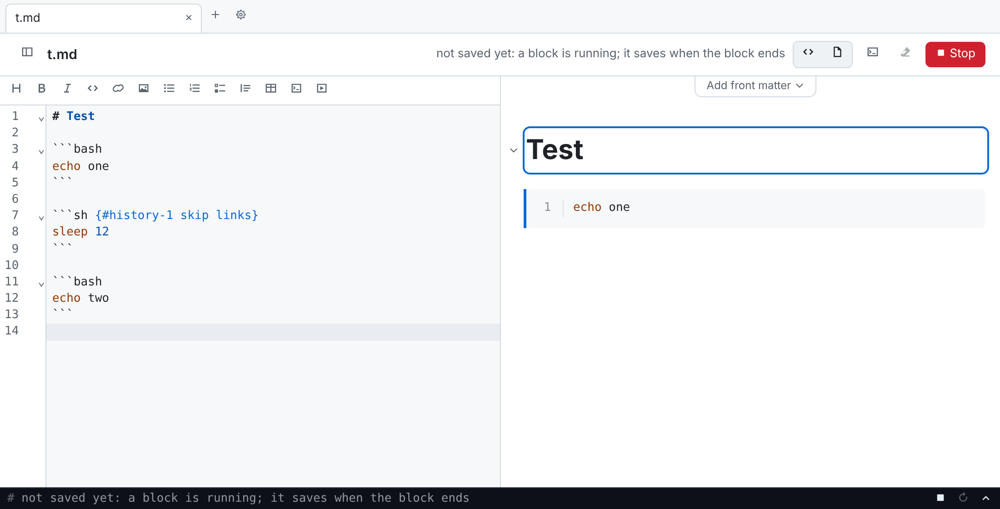

- Stop and the Processes view work when a shell is stuck. A shell that
  never finished starting, such as `zsh -i` (which reads its commands
  from the terminal rather than from mdsh), held the History pane for
  good: Stop did nothing, Kill Shell had no shell to kill, and the
  Processes view showed none. Stop now kills a shell still starting,
  since nothing has run in it to lose, and the Processes view lists it
  meanwhile, with Kill Shell able to end it. A block whose shell never
  says it finished on the terminal ends when stopped or killed, and
  mdsh-gui's questions to the shell, its prompt and completions for the
  History pane and reading the rc file, can be stopped, give up after a
  while, and kill the shell if it won't stop. In the History pane, Stop
  sends ctrl+c to the command as before, and pressing it again stops as
  Run › Stop does, offering to kill the shell if that doesn't work.

  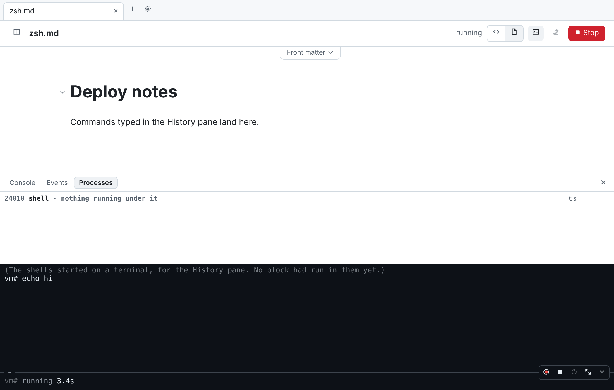

  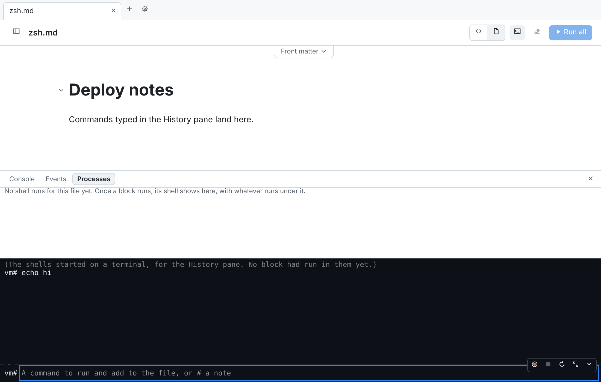

  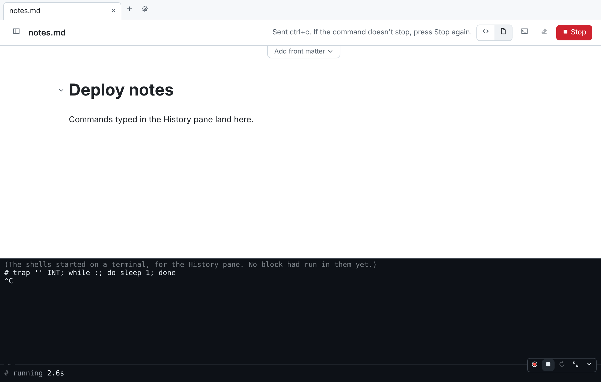

- Pressing ctrl+z in vim or nvim in the History pane, or in any block
  run on a terminal, no longer hangs mdsh. Where the shell has no job
  control, as zsh and bash don't when mdsh runs them, nvim's suspend
  stopped the shell along with itself on macOS, and nothing could
  continue them. mdsh now continues them at once, so ctrl+z is ignored
  there, as it was meant to be, and the editor carries on. With
  `/bin/sh` as dash, ctrl+z still stops the command for `fg`.
- The `.dmg` window no longer says to choose Open Anyway or run `xattr`
  to clear the quarantine flag. The app has been signed and notarized
  since 1.4, so macOS opens it without either.
- In mdsh-gui, a command typed in the History pane while it isn't
  recording no longer scrolls the rendered view to the end of the file:
  nothing was added there, so the view stays where it was. Drawing the
  document again after a run also no longer nudges the view down by a
  little, as cards out of sight now keep the height they were drawn at.

  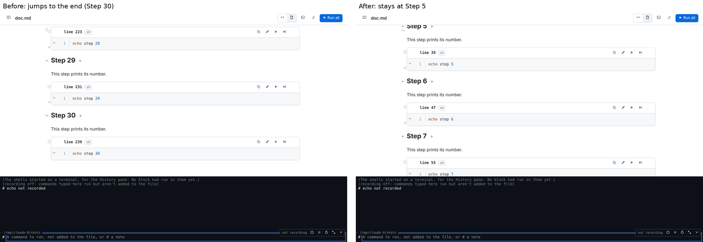

## [1.7.0] - 2026-11-18

mdsh now keeps a block's earlier runs. With `history=N`, each run moves
the output before it down, up to N of them, and mdsh-gui and `mdsh -i`
show them under the block's output, newest first, while `--history`
prints them in text, HTML and PDF reports. Every output says how long
ago it ran. 1.7's new look is Green Tea, a sheet of washi on a tatami
mat beside a bowl of whisked matcha. The History pane shows the shell's
working directory, can fill the tab, and takes a whole block typed into
it, added to the end of the file. Its record button turns recording
off, so commands run in the shell without being added to the file, and
a setting, off by default, runs a repeated command again in its
`#history-N` block, keeping the output before as an earlier run. An
image mdsh-gui wouldn't load by itself can be loaded with a click, and
the document remembers it. The docs gain an HTTP requests page and a
seventh part of the examples tour, and an http block's body folds on
its own. `mdsh --serve`, the notebook in a web browser, comes in an
mdsh built with `-tags serve` and, experimentally, in mdsh-gui behind a
setting; release builds leave it out. A `<details>` element with
markdown inside now folds as one card, and mdsh-gui's Edit button with
Neovim on lands on the right line. A `background` block that outlives
its run can now be stopped, with Stop on its card in mdsh-gui or enter
in `mdsh -i`. A new Processes view, the Console's Processes tab in
mdsh-gui and `P` in `mdsh -i`, shows what runs under a file's shells,
with a Kill for each. From the v1.7.0 security review, an earlier run's
image can no longer be renamed outside the document's folder, and `mdsh
-i` cleans the working directory it shows on the History pane.
golang.org/x/net and the other golang.org/x modules are updated.

### Added

- The History pane can stop recording. Its record button, a dot beside
  Stop in mdsh-gui and ctrl+o in `mdsh -i`, turns recording off: a
  command typed then still runs in the document's shell, so a `cd` or a
  variable it sets carries over to what runs next, but isn't added to
  the document as a `#history-N` block. Notes and typed blocks are
  still added. The pane says "not recording" while it is off, and
  closing the pane turns recording back on.

  

  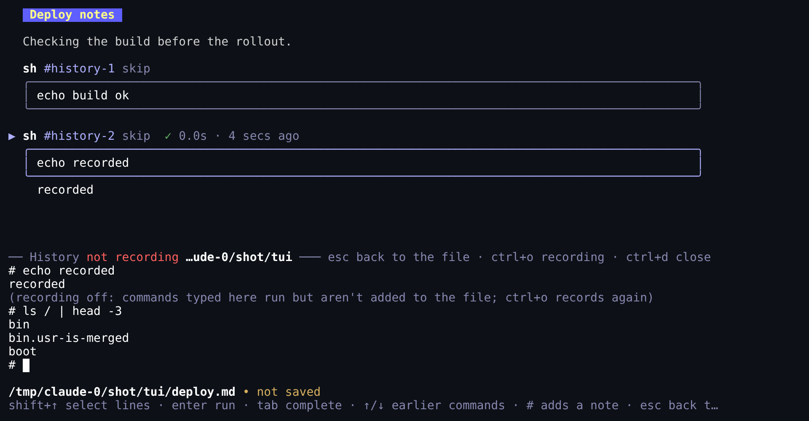

- A setting, off by default, runs a command typed in the History pane
  again in its `#history-N` block rather than adding another: Settings ›
  Shell › Run a repeated History command in its block in mdsh-gui, and
  `--history-reuse` with `mdsh -i`. The block gains `history`, so the
  output it had is kept under the new one as an earlier run, as
  `history=N` keeps them (the front matter's `history:`, else 10).
  The command must match the block's code exactly, in the same
  language, and the last such block is the one that runs. The block
  stays where it is in the document.

  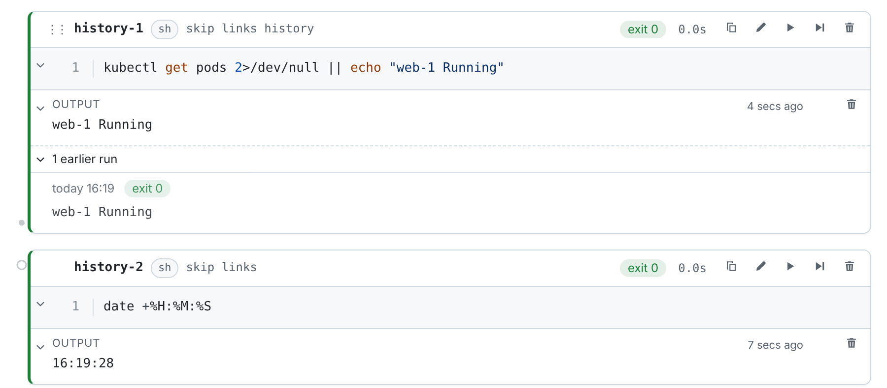

- A view of what runs under a file's shells, to find and end a process
  that was left running: the block running, background blocks, and
  whatever a block or the History pane started with `&`. mdsh-gui shows
  it in the Console's new Processes tab, and `mdsh -i` in a panel `P`
  opens. Each shell's processes show as a tree, with how long each has
  run, and each has a Kill (`x` in `mdsh -i`) that ends it and what it
  started. A background block's process is named by its block, and
  killing it stops the block.

  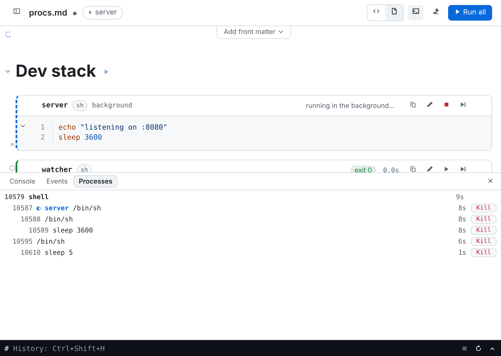

  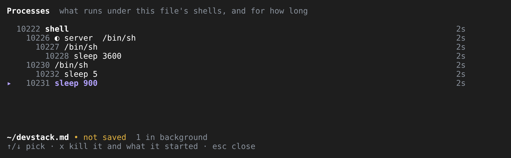

- Each block's output says how long ago the run that made it started,
  from its `at=`: "42 secs ago" under a minute, then minutes, hours,
  days, weeks, months and years. mdsh-gui shows it on the output's
  title bar and keeps it current, with the exact time in its tooltip.
  `mdsh -i` shows it on the saved output's label, "saved output, 3 mins
  ago:", and after a block's time in its header once it runs this
  session.

  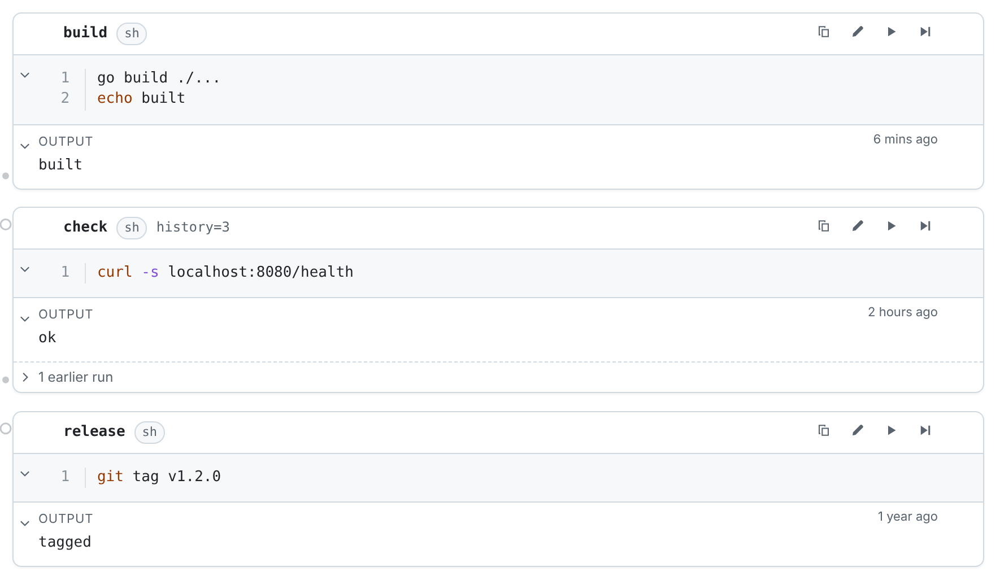

  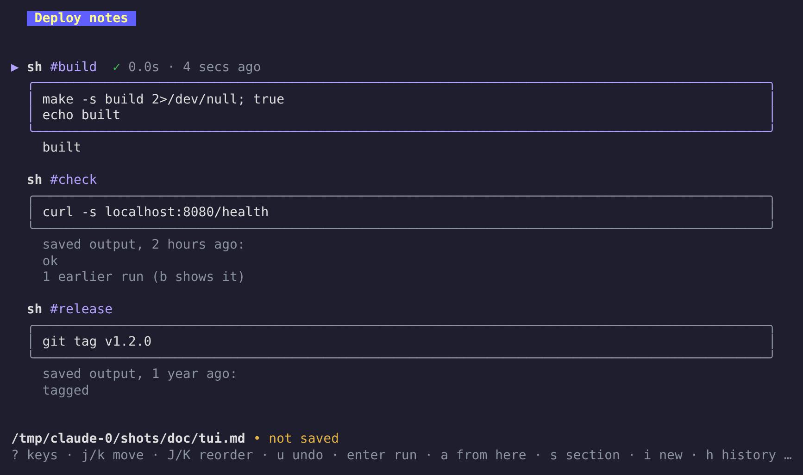

- The History pane shows the shell's working directory, `~` for your
  home folder, on the separator over its input in mdsh-gui and on its
  rule in `mdsh -i`. It is asked for with the prompt, so it follows a
  `cd` typed in the pane or run in a block. A button beside the one
  that closes the pane has it fill the tab, up to the tab bar, in place
  of the toolbar and the document, until it is pressed again or the
  pane closes; in `mdsh -i`, `Z` has it fill the screen, and esc gives
  the document its place back.

  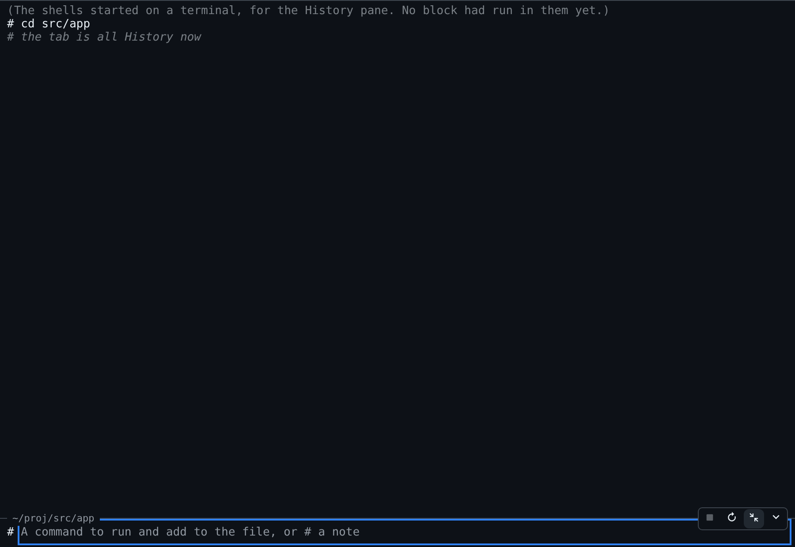

  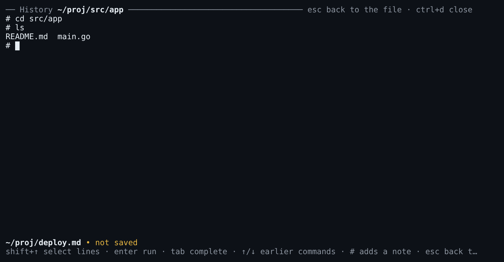

- The site's docs have an [HTTP requests](site/content/docs/http.md)
  page: how to write an `http` block, its checks and captures, the
  placeholders that read a response, what is saved and what is masked,
  its attributes, and the views in mdsh-gui and `mdsh -i`, with both
  folds. The examples tour has a seventh part,
  [examples/http.md](examples/http.md), which runs each of those
  against a small API of its own, started in a `background` block.
  The other docs pages catch up with the code: `raw`,
  `out=recording:`, `at=` on output, `{{$?}}` and the other result
  placeholders, `http.secret_headers`, the `x`, `H`, `Y` and `F` keys,
  `--show-secrets`, the Load image button, and typing a block in the
  History pane.

  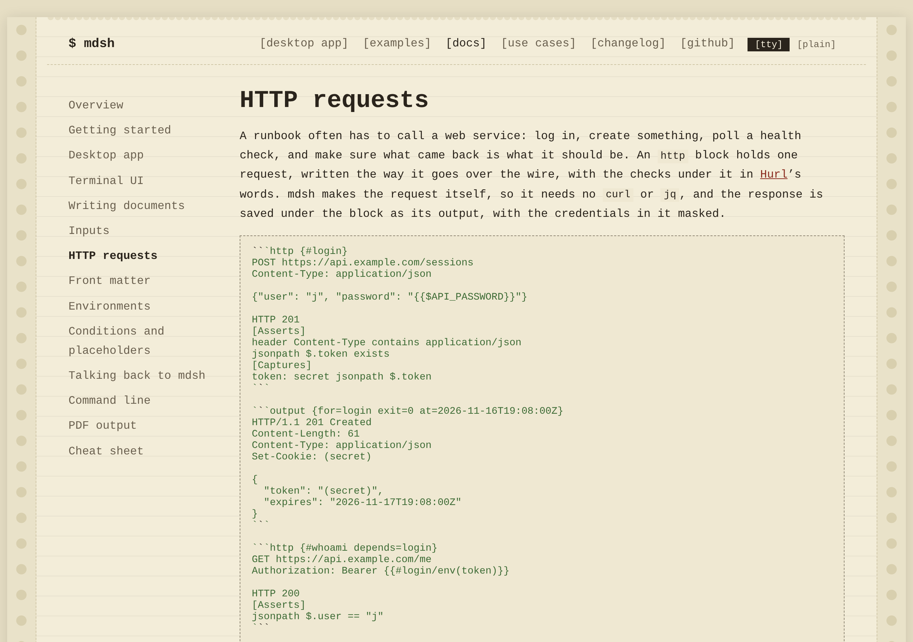

  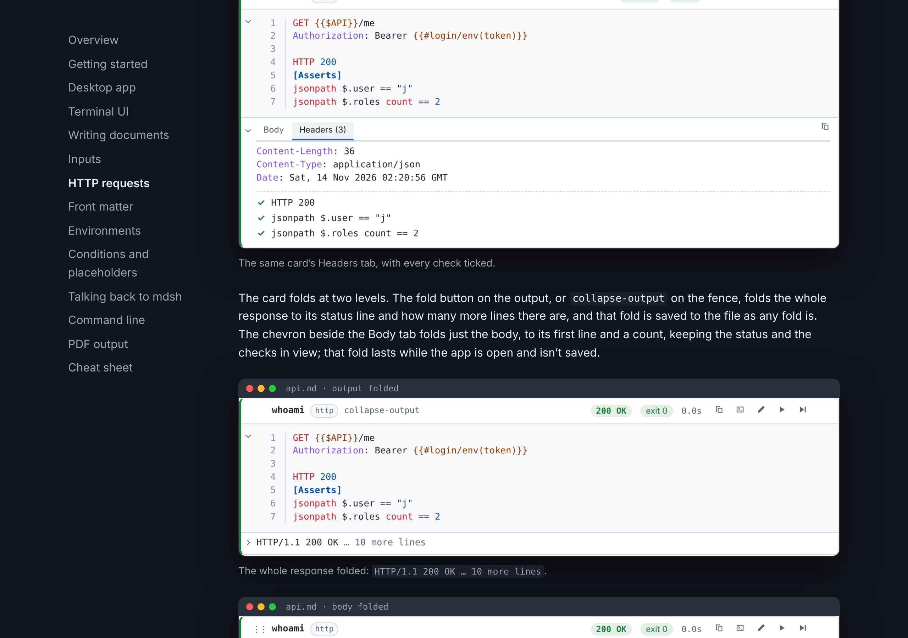

- The docs explain earlier runs: an Earlier runs section on the site's
  Writing documents page, with the fences `history=N` writes, the
  `history` front matter key, how mdsh-gui and `mdsh -i` show them and
  the Report form's switch, and a new example,
  [examples/earlier-runs.md](examples/earlier-runs.md), in part 9 of
  the tour. The cheat sheet, mdsh-gui's Cheat Sheet tab, adds
  `history=N`, `--history`, `at=`, `Z` and the History pane's typed
  blocks, and the site gains a section on HTML in a document, new in
  1.6, with a `<details>` example.

- An image mdsh-gui's rendered view doesn't load by itself, one from
  another site or a file outside the document's folder (or hidden in
  it), has a Load image button on the note that stands in for it.
  mdsh-gui fetches or reads the image when it is clicked (PNG, JPEG,
  GIF, WebP, BMP or an icon, up to 20 MB) and shows it in place of the
  note, and remembers that this document may load this image, so it
  shows by itself whenever the document opens again. Other images in the
  document still wait for their own click, and opening a document never
  reaches the network, or outside its folder, for an image nobody loaded
  in it. The answers are kept in `images.json` in mdsh's config folder.
  Before, an image outside the document's folder showed as a broken
  image.

  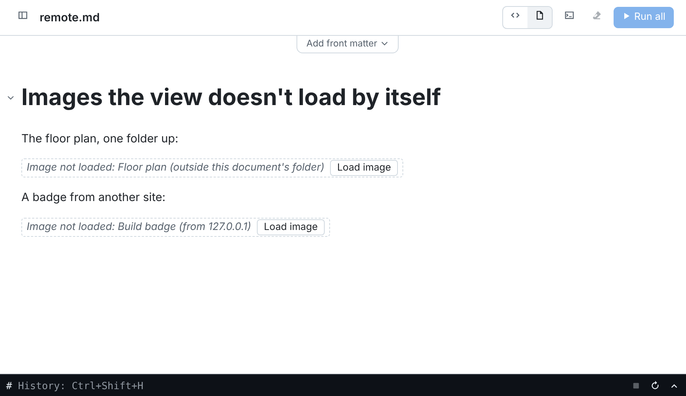

- A block can be typed in the History pane, in mdsh-gui and `mdsh -i`.
  A line such as ``# ```sh {#rollout}`` opens it, the `#` making it a
  comment should it reach a shell. The prompt becomes ```` ```sh> ````
  while the block is open, the lines typed are kept rather than run, and
  a line of ```` ``` ```` (a fence as long as the opening one, or
  longer) adds the block to the end of the file as it was typed, without
  running it. ctrl+c drops a block partway through, as it drops a
  command at a shell's prompt; mdsh-gui's pane now takes ctrl+c for
  that too, when nothing is selected to copy.

  

  

  

- An http block's body folds on its own in mdsh-gui, by the chevron
  beside its Body tab, to its first line and how many more there are.
  The status in the card's head and the checks under the body stay in
  view; folding the whole output still hides the lot. The body's fold
  lasts while the app is open and isn't saved to the file.

  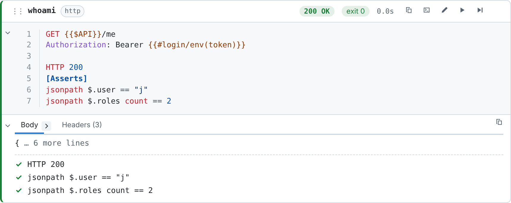

- mdsh reads `history=N` on a block, and the earlier runs' outputs kept
  under its current output as fences marked `history=K`. They belong to
  the block: moving, deleting and renaming it carry them along, Clear
  output removes them, saving keeps them, and printing shows only the
  current output. One that isn't right under its block's output is an
  error.

- Each run of a block with `history=N` keeps the run before it: the
  output the file held moves down as `history=1`, the older ones down
  one, and those past N are dropped. Every run counts, even one with
  the same output, and one that prints nothing is kept as an empty
  output with its time. An image, screenshot or recording moved down
  is renamed with its run's time, `d.md.assets/check.2026-11-13T190800Z.svg`,
  and its link follows; the current one keeps its path. Saving holds
  the history to N, so lowering N, or dropping `history=`, trims it,
  and deletes the files of the runs it drops.

  Note: mdsh 1.6.0 and older read the earlier runs as copies of the
  output, and `-w` overwrites them all with the current output.

- mdsh-gui shows a block's earlier runs, kept by `history=N`, under its
  output: a line says how many there are, and opens to each run's
  output under its time ("yesterday 16:21") and exit status, newest
  first. Each has a copy button and a trash, which deletes that run and
  numbers the rest again; Clear earlier runs, beside the output's
  trash, takes them all and keeps the current output. Undo puts them
  back, and saving deletes the image files of the runs they took.
  Saving a block whose `history=` was lowered or taken off warns in the
  console that its earlier runs past the cap were dropped.

  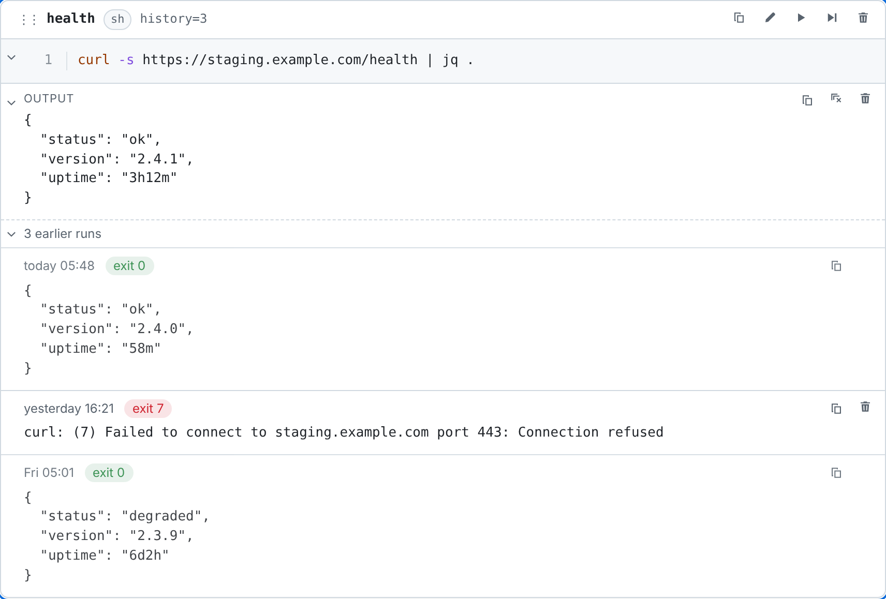

- `mdsh -i` shows a block's earlier runs too: a dim line under its
  output says how many, and `b` shows each one under a line with how
  far back it is, its exit status and when it ran, and hides them
  again. Running a block with `history=N` several times before saving
  now keeps every run, as mdsh-gui does, not only the last; and saving
  says in the footer when a lowered `history=` dropped earlier runs.

  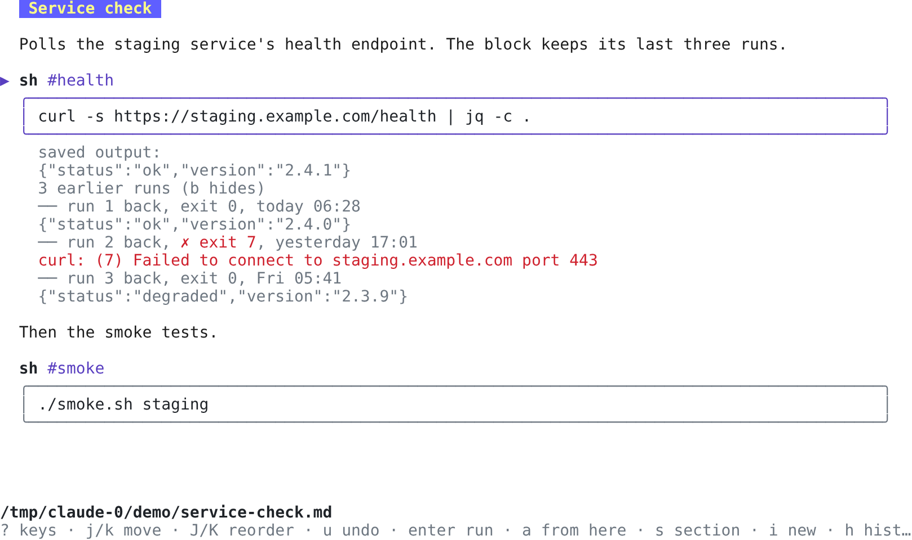

- `--history` prints each block's earlier runs, kept by `history=N`,
  under its output, newest first, each under a line such as *Run 1
  back, 2026-11-13 19:08 UTC, exit 7*. `--html` and `--pdf` take it
  too, and the Report forms in mdsh-gui and `mdsh -i` have an Earlier
  runs switch that adds it. Without it, printing and reports show the
  current output only, as before.

  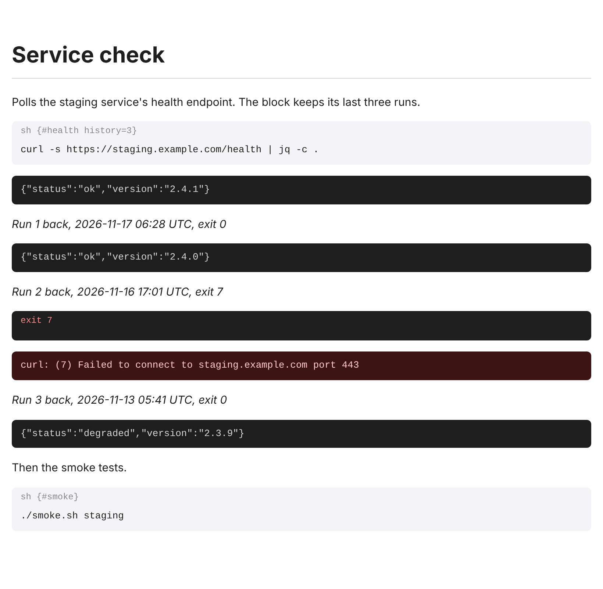

- `mdsh --serve` serves the notebook mdsh-gui shows to a web browser,
  at `127.0.0.1:8080` or the address after `=`. Anyone who can reach the
  address can run commands as you, so it listens on loopback by default,
  and it is only in an mdsh built with `-tags serve`: release builds
  leave it out. See Serving to a browser in the README.
- `mdsh --serve=stdio` and `mdsh-gui --serve=stdio` serve the notebook to
  the program that started them, such as an editor plugin, as JSON lines
  on stdin and stdout. In mdsh-gui it is experimental, and off until
  Settings › Shell › Serve notebooks to browsers and other programs
  turns it on.
- mdsh-gui: File › Serve in Browser, with that setting on, serves the
  file in front to your web browser, as `mdsh --serve` does, on a free
  port of 127.0.0.1, and opens it there.

- `mdsh-gui`: a Green Tea look in Settings › Look, in matcha greens. The
  document is written on a sheet of washi laid on a tatami mat, with a
  bowl of whisked matcha and a bamboo whisk by its top corner; the washi
  is a field notebook's page, with faint ink sketches of the tea things
  (a sprig of camellia sinensis, a chawan, a chasen, a chashaku, a
  tetsubin and a natsume) labeled in script in its margins and between
  the cards. The paper and its sketches scroll over the mat while the
  bowl stays put. Headings are set in a mincho serif, the cards are
  paper slips, the accent is the matcha's green and lacquer vermilion
  is kept for errors and Stop. The dark theme is the same room at
  evening: the washi dusk-dark, the ink steam-white, the bowl black raku
  and the lit matcha for the accent. The bowl and whisk, the sketches
  and the shadows under cards can each be turned off. Its text, code,
  links and buttons measure at least 4.5:1 and its accent 3:1 in both
  themes.

  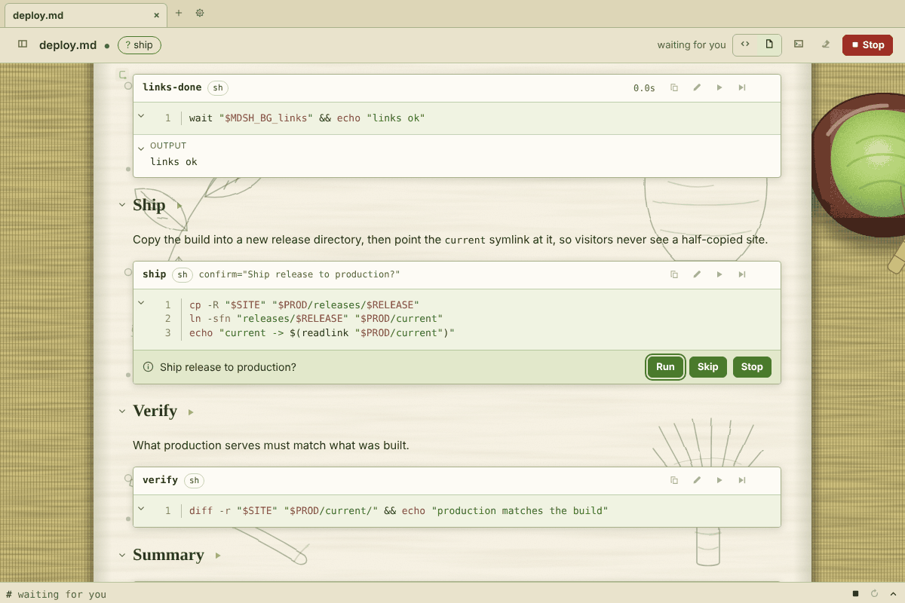

### Fixed

- A `background` block that outlived the run that started it couldn't
  be stopped: its play button stayed a play button, and only Restart
  Shells ended it. In mdsh-gui the play button is now a red Stop while
  the block runs in the background, and in `mdsh -i` enter on the block
  stops it. It is killed with what it started, and its output says
  `stopped`.

  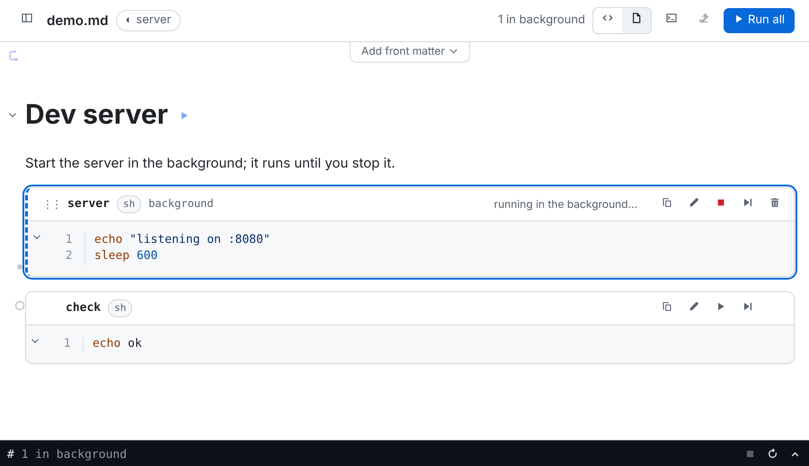

  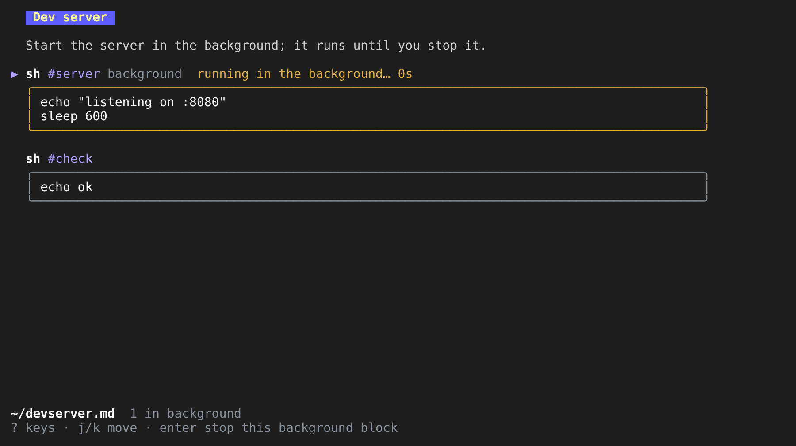

- mdsh-gui: with Use Neovim on, a block's Edit button, or a click on
  prose, while the source view was closed opened Neovim with the cursor
  on line 1. It now waits for Neovim to start and puts the cursor on
  that block or prose, as it does when the view is already open.
- mdsh-gui: a `<details>` block with markdown inside, written with
  blank lines around the markdown, was drawn as separate cards, so the
  markdown always showed under a summary that folded nothing. An HTML
  block that opens an element is now drawn in one card through the
  block that closes it, the markdown between rendered inside it.

  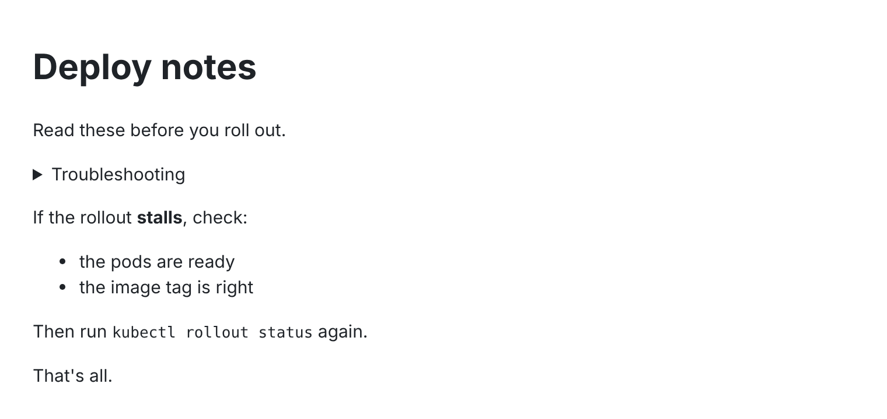

  

- Folding an http block's output in mdsh-gui, or opening it with
  `collapse-output`, left its response's body showing. The whole
  response folds now, to its status line and how many more lines there
  are.

  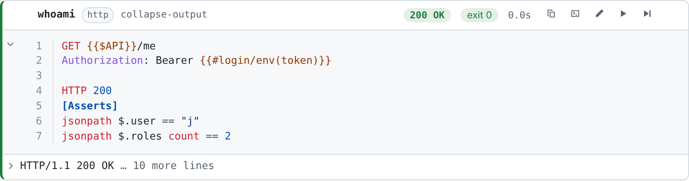

### Security

- The file an earlier run's image is renamed to, when a block with
  `history=` runs again, takes its time from the output's `at=` as a
  parsed RFC 3339 time, not as the text in the file. A document that
  wrote a path there, and shipped a folder beside its assets for it,
  could have a run move the block's own image file to a path of its
  choosing outside the document's folder, as a new file, before the
  block's code ran. Anything that isn't a time now names the file
  `earlier`, and a rename never leaves the file's folder. Finding 1 of
  [the v1.7.0 security review](docs/security/v1.7.0.md).
- `mdsh -i` draws the shell's working directory on the History pane's
  title through the same cleaning as the rest of what the shell prints,
  so a folder name holding escape codes can't move the cursor or
  recolor the screen. Finding 2 of the v1.7.0 review.
- golang.org/x/net is now v0.63.0, in mdsh and mdsh-gui alike, with
  x/sys, x/term, x/text and x/sync brought up with it. Its HTML parser
  is what mdsh draws a document's HTML through, so it is kept current.
  Finding 4 of [the v1.7.0 security review](docs/security/v1.7.0.md).

## [1.6.0] - 2026-11-16

mdsh learns to talk to web services. An `http` block makes one HTTP
request, written the way it goes over the wire, checks the response in
Hurl's words, and captures values for prose, conditions and later
requests, with credential headers and secret captures saved masked;
mdsh-gui and `mdsh -i` show its body and headers in tabs beside its
checks. A block can now ask you a question while it runs with
`mdsh ctl ask` and `mdsh ctl confirm`. 1.6's new look is Coffee, a
coffee-stained sheet of cream paper on a wooden table. HTML written in
markdown now draws, cleaned, in mdsh-gui and HTML reports, links,
images and image maps included. An include's range can be dragged in
the rendered view, saved output records when it ran with `at=`, and the
History pane keeps the keyboard while a command runs. From the v1.5.0
security review, a document now reaches only its own folder and no
hidden files in it, a repository's `.git` folder is off limits, the
cast player refuses oversized recordings, the mdsh link is no longer
taken over by a copy of the app, and the site build checks its
downloads. golang.org/x/net is updated for its HTML parser's fixes.

### Added

- `http` blocks: a fence that makes one HTTP request, written the way
  it goes over the wire, and checks the response in Hurl's words. `HTTP
  201` checks the status; `[Asserts]` lines check `status`, `header`,
  `jsonpath`, `body`, `regex` and `duration` with `==`, `contains`,
  `exists`, `matches` and the rest; `[Captures]` set the block's own
  variables, read as `{{#login/env(token)}}` by prose, conditions and
  later requests, and `{{#login/status}}`, `{{#login/json($.expires)}}`
  and `{{#login/header(Content-Type)}}` read the response itself, in
  prose and in conditions such as `run={{#login/status}}==201`.
  `[QueryStringParams]`, `[FormParams]`, `[Options]`
  (`insecure`, `follow`, `timeout`) and an `@file` body are there too.
  Placeholders are filled in as the request goes out and never saved.
  The response is the block's output, with `Set-Cookie`,
  `Authorization` and the other credential headers saved as `(secret)`,
  and front matter `mdsh.http.secret_headers` adds more; a `secret`
  capture is masked wherever the response holds it, and its placeholder
  is saved bare. A failed check fails the block with one line on
  stderr, so `on_error`, `depends=` and `{{#id/?}}` work as for any
  block. The audit log records the method, the URL as written, the
  status and each check, never headers or bodies; a request that gets
  no response reports its error with the URL's scheme and host only,
  and a failed check on a credential header reports `(secret)`, so
  neither the saved file nor the log holds a filled-in placeholder.
  `raw` keeps a JSON body as it came.

  In mdsh-gui an http block's card shows the response's status next
  to its exit status, the body and the headers as two tabs, body first,
  with JSON highlighted, and the checks with a tick or a cross and what
  the response had for each that failed. Its terminal button copies the
  request as a `curl` command, placeholders filled in; the Insert menu
  and the markdown bar's block button offer an http request. `mdsh -i`
  shows the same under the block: `H` switches between body and
  headers, and `Y` copies the request as `curl`.

  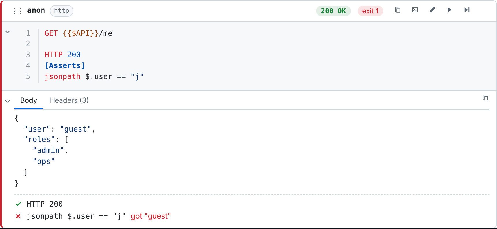

  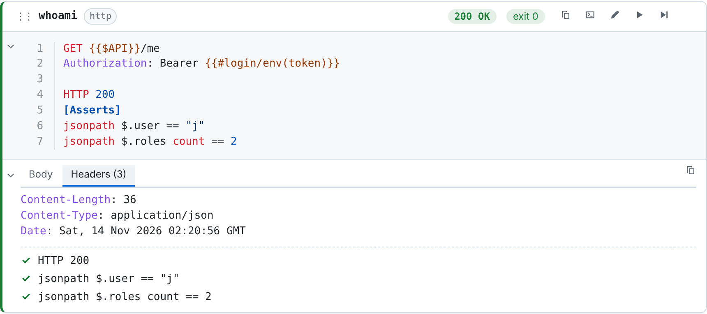

  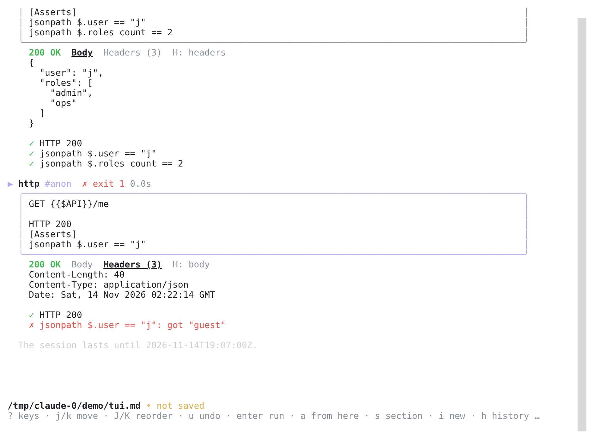

  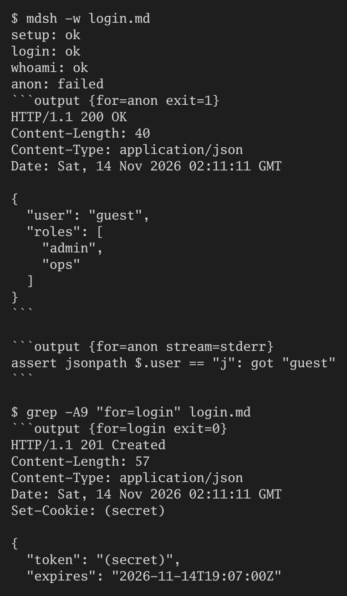

- Saved output says when it was made: each output fence and region a
  run writes carries `at=`, the time the block started, in UTC to the
  second (`at=2026-11-13T19:08:00Z`). It changes only when the block
  runs again, so the first save after upgrading stamps each block's
  output as it reruns. Output without `at=`, from an older mdsh, reads
  as before.

- `mdsh-gui`: a Coffee look in Settings › Look, in roast browns. The
  document is written on a sheet of old cream paper, splashed and
  ringed with coffee, lying on a wooden table with a latte on a red
  saucer by its corner; the paper scrolls over the table while the cup
  stays put. Headings are typed, the cards are index cards, the accent
  is the roast's brown and the saucer's red is kept for errors and Stop.
  The dark theme is late at night: dark-roast paper, steamed-milk
  lettering and a cup of black coffee, with crema amber for the accent.
  The cup and saucer, the stains and the shadows under cards can each
  be turned off. Its text, code, links and buttons measure at least
  4.5:1 and its accent 3:1 in both themes.

  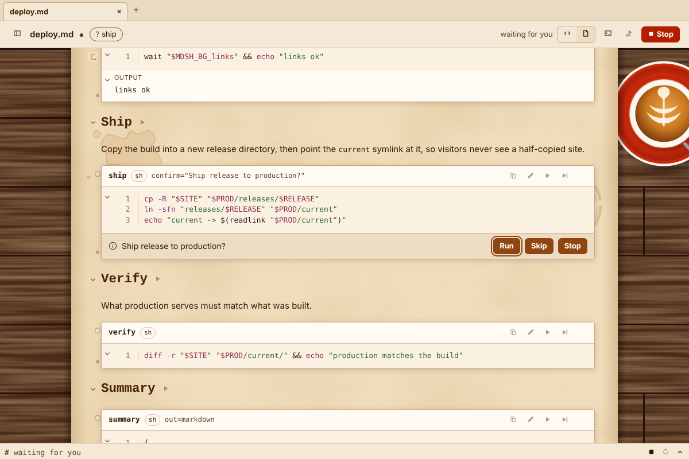

- An include block in mdsh-gui's rendered view has a grip above and
  below its lines. Dragging the bottom one down shows the lines after
  them, raising `to=`, and dragging the top one up shows the lines
  before, lowering `from=`; the lines appear as the grip moves, and the
  range is written to the file when it is let go, as one edit Undo takes
  back. A grip dragged to the file's edge takes the attribute out, so
  the include follows the file as it grows. With a grip focused, up and
  down move it a line. The eye button by the file's name shows the whole
  file over the window, with the included lines marked.

  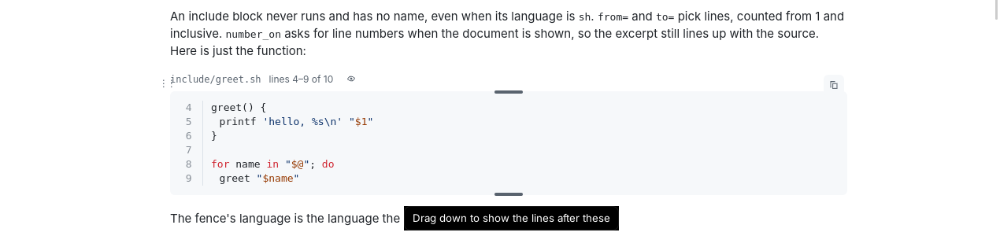

  

- `mdsh ctl ask` and `mdsh ctl confirm`: a block can ask you a question
  while it runs. `ask` prints the answer, with `--choice a,b,c` to
  limit it, `--default V` for when nobody can answer, and `--secret` to
  hide the typing; `confirm` answers with its exit code, 0 for yes and
  1 for no. `mdsh` asks on the terminal and `mdsh -i` in the block's
  card. With nobody to answer, as in a report or a run with no terminal,
  the default answers, or the call exits 4 and mdsh says "no answer".
  `--yes` answers yes to a `confirm` with no default. A question is
  withdrawn when its block ends, and the audit log's new `ask` event
  records the answer and who gave it. Every question a run waits on,
  these and `confirm` and `depends=` ones alike, now has an id. mdsh-gui
  doesn't ask these yet; there the default answers.

  

  

### Fixed

- In mdsh-gui's rendered view, the grip that drags a textbox or choice
  to another spot sits on the line of its name, just before it, rather
  than on a line of its own above the name.

  

- HTML written in a document's markdown now shows in mdsh-gui's rendered
  view and in `mdsh --html` reports, as CommonMark allows, instead of
  being left out. A link written as `<a href="...">` works like a
  markdown one, and `<kbd>`, `<sub>`, `<sup>`, `<details>`,
  `<p align="center">` and the other formatting tags GitHub allows draw
  as they do there. `` loads by a markdown image's rules: in
  mdsh-gui, from beside the document, with a note in place of an image
  from another site; in a report, inside the page. Image maps work too,
  and each `<area>` is followed like a link. HTML is cleaned first:
  scripts, styles, event handlers, forms, frames, `id` and `class`
  attributes, and links and images other than http:, https:, mailto:
  and relative ones are taken out.

  

- Pressing enter in mdsh-gui's History pane no longer sends the keys you
  type next to the rendered view. While a command typed there runs, the
  input used to give its place to the run's clock, and hiding it dropped
  the keyboard onto the page until the command ended. Now the clock comes
  before the input, the input keeps the keyboard, and what you type
  meanwhile waits in it for the next command, as a terminal's type-ahead
  does. A command that takes the terminal gives the keyboard back to the
  input when it ends, not to the page.

  

### Security

- golang.org/x/net is now v0.62.0, in mdsh and mdsh-gui alike. The HTML
  that mdsh now draws from a document's markdown goes through its HTML
  parser, which has had seven security fixes since the v0.33.0 mdsh
  used (GO-2026-5025, 5027, 5028, 5029, 5030, 6860 and 6866), and its
  HTTP/2 code one (GO-2026-4918). Finding 5 of the v1.6.0 security
  review.

- A document reaches only its own folder, and the folders under it, and
  no hidden file or folder in them (a name starting with a dot, such as
  `.env`, `.ssh` or `.git`), for includes, `out=` files, report images
  and image previews alike. Before, a document with no repository got
  its whole folder, so `~/notes.md` could include `~/.ssh/id_ed25519` on
  open or write over `~/.zshrc` with an `out=`; and one in a repository
  got all of it. Being in a repository no longer widens the root: an
  include of `../scripts/setup.sh` from `docs/` is outside, and mdsh-gui
  asks about it as it opens, as it asks about any file outside the
  folder; `--allow-outside` still lifts it (finding 3 of the v1.5.0
  security review). The `.git` rule below is now part of this one.

  

- A repository's own `.git` folder (and `.hg`, `.jj`, `.svn`, in nested
  repositories too) counts as outside the document's root, for includes,
  `out=` files and report images alike. `{<include file=.git/config}`
  read the repository's settings on open, and a remote's URL there can
  hold a token, so `mdsh -w` or a report could carry it off without a
  block running; an `out=` could write into `.git/hooks/` (finding 4 of
  the v1.5.0 security review). Now those fail with an error that names
  the folder, and mdsh-gui lists them in its question about files
  outside the repository. `--allow-outside` still lifts it.

  

- The site build checks the Hugo package's SHA-256 before installing it,
  and CI installs Playwright with `npm ci` from a lockfile, so each npm
  package is checked against its integrity hash. A changed upload now
  fails the build instead of being installed (finding 7 of the v1.5.0
  security review).

- mdsh-gui's cast player now refuses a recording wider than 1000
  columns, taller than 500 rows, or with more than 100,000 writes or
  16 MB of output, the limits mdsh already put on casts for reports and
  GIFs. A `.cast` beside a document, made with a huge size in its
  header, used to make the player ask xterm.js for billions of cells
  and hang or kill the window as the card was drawn. The card now says
  the recording is too large instead (finding 6 of the v1.5.0 security
  review).

- Opening a copy of mdsh-gui 1.5.0, such as one on a mounted `.dmg`,
  could still point `/usr/local/bin/mdsh` at itself, so the copy became
  the `mdsh` every terminal ran, and `sudo mdsh` too. The fix for this
  in 1.5.0 left a link into another `mdsh.app` alone unless the link
  pointed at a place "this app has stood", but that list lived in the
  user's settings, which every copy shares, so the installed app's own
  path was on it (finding 1 of the v1.5.0 security review). Now the
  link is repaired at launch only when its target is gone; a link into
  another `mdsh.app` that is still there moves only when you press
  Install in Settings › Shell.

## [1.5.0] - 2026-11-10

mdsh-gui settles in. Settings and the cheat sheet open in tabs beside
your files, each file reopens in the view it was left in, and the
outline keeps the selected block in sight. Typing in the source view
hands the app only the lines it changed, so long documents stay quick to
edit. 1.5's new look is Witchcraft, a purple scroll under the stars, and
looks are now one folder each, made into everything else by
`go generate`. A cast recording prints as a picture, a GIF or text outside
the app, and in it can be replaced with its frame's text or a GIF. A
file whose front matter doesn't parse now opens, under a banner that
gives the error and offers to fix it, with running blocked until it's
fixed. On macOS, Finder's Open With opens the file, and Escape in vim
mode no longer leaves fullscreen. mdsh now asks before it reads a
document's `env.source` files into its shells, so an unattended run of a
document that names any stops until it's approved once or given `--yes`.
A document's includes, `out=` files and report images must now stay
inside its repository or folder unless you pass `--allow-outside`. Links
to files no longer open scripts or apps, a skipped block another one
depends on asks before it runs, secrets stay masked in the source pane
and `mdsh -i`, and escape sequences in a document print as text rather
than reaching the terminal.

### Added

- mdsh-gui asks whether a document may reach outside its repository,
  as `mdsh --allow-outside` lets it on the command line. A document
  whose includes or `out=` files name files outside its git repository
  (or its folder) asks as it opens, listing them: Allow for this
  document, Keep it inside, or Ask me later. The answer is remembered
  for the document until the list changes, and only the files listed
  are let out, so an include added later stays inside until it is asked
  about. A banner says which way it was answered, with a button to
  change it, and the start screen tags an allowed file *outside*.

  

  

- `mdsh-gui`: a Witchcraft look in Settings › Look, in purple. The
  document is written on a scroll hung against a sky of stars and
  crescent moons: speckled kraft paper in aubergine ink, ruled round
  with a double line and a flourish in each corner, with carved
  capitals for the headings and an amethyst accent edged in gilt. The
  dark theme is the witching hour: the scroll in deep plum, ruled in
  gold, with moonlit lettering and cards that glow. The stars and moons and the glow can be turned off. Its text,
  code, links and buttons measure at least 4.5:1 and its accent 3:1 in
  both themes, and `TestLookContrast` now checks it too.

  

- mdsh-gui shows the cheat sheet beside the changelog: Help › Cheat
  Sheet, or its link on Settings › About, opens it in a read-only tab,
  so every attribute, key and flag is a menu away and matches the build.

  

### Changed

- `mdsh-gui`: each look is now one file, `look.css` in its own folder
  in `cmd/mdsh-gui/frontend/looks`. It opens with the look's front
  matter in TOML, between `+++` lines in its first comment, that says
  what the look is, and the rules after it paint it. Everything else
  that names the looks is made from those files by `go generate`:
  Settings › Look's menu, description and texture switches, the one
  stylesheet the pages load, the looks the app accepts, the tests every
  look must pass, the website's looks band and the GUI README's
  pictures. `go run ./internal/newlook <folder> "<Name>"` starts a new
  look that passes the tests from the start, and `docs/looks.md` says
  the rest.
  Settings › Look now describes the look that is chosen, rather than
  all of them at once.

  

- `mdsh-gui` remembers each file's view: whether it shows the source,
  the rendered view or both, and whether its History pane is open. A
  file opens as it was left, instead of in whatever view the last tab
  had, and the History pane starts closed in a file you haven't opened
  it in, so opening a file no longer starts its shell (and reads its
  `env.source` files) just because History was open in another one.
  Settings › General › Open files in now offers "The view the file was
  left in" as its default; picking a view there still opens every
  file in it.

- mdsh-gui's Settings opens in a tab of the document window, beside
  your files, instead of in a window of its own, as the Changelog
  does. Settings… (cmd/ctrl+,) and About mdsh bring the tab forward if
  it's open, at its About tab for About. It drags between windows like
  any tab, and Close Tab closes it.

  

- mdsh-gui's outline keeps the selected block or heading in sight.
  Selecting one in the rendered view, by clicking it, moving to it with
  j and k, or moving the source view's cursor into it, scrolls the
  outline just enough to show its entry. Scrolling the rendered view
  leaves the outline where it is, so the entry stays there to go back
  to, and an outline scrolled by hand stays put until something else is
  selected. Marking the selected entry also no longer goes through
  every entry of the outline, which made each move of the selection
  slow on documents of 100,000 lines with the outline open.

  

- mdsh-gui: a tty block's recording player has two more buttons. One
  replaces the recording in the file with the text of the frame shown,
  as an ordinary output block; the other replaces it with an animated
  GIF, saved beside the cast. Undo puts the recording back, and running
  the block again records a new one.

  

### Security

- mdsh asks before it reads a document's `env.source` files into its
  shells, and remembers the answer for the file. The files ran with no
  question as soon as a shell started, and opening the History pane in
  mdsh-gui, which was on for every file once left on, or pressing `h`
  in `mdsh -i`, starts one to ask for its prompt: so opening a file
  could run its setup script before you had read a line (finding 1 of
  the v1.4.0 security review). Now the first shell waits for an answer:
  mdsh-gui shows a dialog listing the files, `mdsh -i` lists them over
  the document, and `mdsh` asks on the terminal. **Allow** sources them,
  **Run without them** starts the shells without them, and Cancel or
  stop starts nothing. Allow and Run without them are remembered for
  the document, in `mdsh/sources.json` in your config folder, shared by
  all three, and asked again when the list of files changes. **This
  can stop an unattended run:** `mdsh` with no terminal and a document
  never approved now stops with "env.source files not approved"; pass
  `--yes`, or approve it once on a terminal. Files given to `--source`
  are yours and aren't asked about.

  
- A document can no longer read or write files outside where it lives.
  Include blocks, `out=image:`, `out=screenshot:` and `out=recording:`
  paths, and the images `--html` and `--pdf` put in a report must be
  inside the document's git repository (or Mercurial, Jujutsu or
  Subversion), or its folder when it isn't in one. A repository at your
  home folder doesn't count, so a dotfiles repository doesn't open up
  all of `~`. Symlinks are resolved first, and an `out=` file that is a
  symlink is replaced rather than written through. Before, `{<include
  file=/etc/hostname}` or `file=../../.ssh/id_ed25519` put that file in
  the output, and `out=screenshot:../../.zshrc` could overwrite it.
  `mdsh --allow-outside` lifts this for a document you trust. Files read
  this way, and the `env.source` files you approve, must be regular
  files of at most 16 MB.
- A recording (`.cast`) wider than 1000 columns, taller than 500 rows
  or with more than 100,000 writes is refused, and turning one into a GIF
  keeps memory bounded, so a crafted cast linked as an image can't make
  `--html`, `--pdf` or mdsh-gui's Copy as GIF run out of memory.
- mdsh-gui no longer opens a linked file with the system's app for it
  on a click, which let a document link to a script or an app and run it.
  A link to a file now shows it in Finder (or the file manager), a linked
  image opens in the image viewer, and markdown files still open in a
  tab. Settings › Files › **Links open these file types** names the
  types, such as `pdf, txt`, that open in their app; a file marked
  executable is only ever shown.

  
- A block marked `skip`, or whose `run=` is false, no longer runs just
  because another block's `depends=` names it, which `mdsh --yes` did
  without asking. mdsh now asks `Run wipe anyway?` whenever there is a
  terminal, with `--yes` too, and in `mdsh -i` and mdsh-gui; skip treats
  it as done without running it, so the block that needs it still runs.
  With no terminal, as in CI, it is skipped with a warning.

  

  
- mdsh-gui writes its settings, `gui.json`, so only you can read them
  (0600, in a 0700 folder when it makes one). They name your recent
  files, the shell and the Neovim to run, and were readable by every
  user on the machine; a file left that way is fixed on the next save
  (finding 12 of the v1.4.0 security review).
- Reports print a block marked `secret` as `(secret)`, its code and its
  output, whether it ran or the output was saved: `--pdf`, `--html` and
  the reports mdsh-gui and `mdsh -i` make. `secret` kept the output out
  of the `.md` only, so a PDF of the run carried the secret to whoever
  you sent it to (finding 9 of the v1.4.0 security review). Pass
  `--show-secrets` to put them in.
- A secret no longer shows in mdsh-gui's source pane or in `mdsh -i`.
  The source pane, and the Neovim one, mask the lines of a `secret`
  block's code, and the output of a block whose code names a variable
  set with `mdsh ctl set --secret`, as the block's card does, until its
  eye button shows them. `mdsh -i` had no notion of `secret`: it now
  shows such code and output as `•••••••• secret` until you press `x`
  on the block, and masks them again when you move off it. Copying a
  secret on Linux and Windows says a clipboard manager may keep a
  copy, since only macOS can mark it concealed (finding 9 of the
  v1.4.0 security review).

  
  
- `mdsh` printing to a terminal and `mdsh -i` show escape sequences in
  a document's prose and saved output as text, `^[]52;c;...^G`, and keep
  only their colors. They went to the terminal as they were, so opening
  a file with `mdsh -n` or `mdsh -i` could write your clipboard (OSC
  52), set the window title, make a link whose target isn't its text, or
  move the cursor to hide a line, with no block run (finding 5 of the
  v1.4.0 security review). A block's output in `mdsh -i`, and the
  History pane's output and prompt, keep their colors and drop the
  rest. Printed to a file or a pipe, `mdsh` leaves the markdown as it
  is.
- mdsh-gui no longer takes over the `mdsh` command when any copy of it
  is launched. At launch it pointed `/usr/local/bin/mdsh` at itself
  whenever the link went into another `mdsh.app`, so opening an older
  release from a mounted `.dmg`, or a fork's build, quietly made it the
  `mdsh` every terminal ran; and an older AppImage replaced a newer copy
  in `~/.local/bin` (finding 7 of the v1.4.0 security review). Now the
  link is repaired only when its target is gone or is a place this app
  has stood, the AppImage copy is only ever brought forward, and the
  Console says when either happens. Settings › Shell says "runs another
  mdsh.app" for a link it left, and Install points it here. Installing
  the command no longer clears the quarantine flag on the app, which is
  notarized.
- mdsh-gui's window loads only images, audio, video and terminal
  recordings from beside an open document. It served any file in the
  document's folder tree, so with a file open in `~/notes` a bug in the
  page could have read a `.env` or a key there; the page's Content
  Security Policy kept it from sending one anywhere, and `mdsh --serve`
  would have put the same route on the network (finding 12 of the
  v1.4.0 security review). The type is the file's own, so a link named
  `.png` that points at something else isn't served.
- The release workflows no longer paste the release tag into their
  shell scripts, where a tag name holding `$(...)` or backticks would
  have run as a command. The tag and version reach the scripts through
  the environment, and a tag that isn't `vX.Y.Z` (with an optional
  pre-release) stops the release. goreleaser runs `go mod verify`
  instead of `go mod tidy`, so a release can't build a `go.mod` that
  differs from the tag's (finding 11 of the v1.4.0 security review).
- The build pins what it downloads. The workflows name each action by
  commit, not by a tag that can be moved. The macOS build installs
  dmgbuild and what it needs from a requirements file with
  `pip --require-hashes`. The AppImage build fetches linuxdeploy at a
  tagged release and checks its checksum, instead of whatever
  continuous build wails3 would download. CI checks the Neovim tarball's
  checksum too. A changed upload now fails the build instead of landing
  in the signed app (finding 11 of the v1.4.0 security review).
- `mdsh -i` and mdsh-gui show the environment banner over a file whose
  `env.share` names variables beyond the base set, and list them: "This
  file brings in GITHUB_TOKEN, AWS_SECRET_ACCESS_KEY from your
  environment". The banner was shown only for `...`, so a file could ask
  for exactly the secrets it wanted with no sign of it (finding 2 of the
  v1.4.0 security review). Naming only base variables (`PATH`, `HOME`,
  `LC_*`, ...) or removing them with `-NAME` still shows nothing.
- The questions say more about what a block will do than its code.
  `mdsh` asking on the terminal adds the front matter's shell when it
  isn't sh, bash or zsh, and the block's `env=`, `share=`, `out=`,
  `background` and `tty`, so `out=screenshot:../../.zshrc` is in front
  of you when you answer. The question whether to run a dependency first
  asks that block's own `confirm` question when it has one, in `mdsh`,
  `mdsh -i` and mdsh-gui: Run answers it too, so a block that asks
  "This deletes the database. Sure?" is no longer run on "Run it
  first?" (finding 10 of the v1.4.0 security review).

### Fixed

- A `cast` block, a recording kept in the document, no longer prints as
  its JSON outside mdsh-gui. PDF reports draw its `frame=` (or the last
  frame) as a picture, HTML reports play it as a GIF, and the terminal,
  as with `mdsh -n`, shows that frame's text.
- A file whose front matter doesn't parse, such as `title: Setup: the
  first steps` with its colon not in quotes, now opens. mdsh-gui and
  `mdsh -i` used to refuse it with only the YAML error. Now the file
  shows as usual under a banner that gives the error, with lines
  counted from the top of the file, and says blocks can't run until it
  is fixed; the run buttons are off, and a run, a typed command or Run
  all is refused. When a colon in a value is why, the banner offers
  **Add quotes** (`F` in `mdsh -i`), which quotes the value and is
  undone like any edit. Once the front matter parses, the shells start
  again with what it says and blocks run. `mdsh FILE` still runs
  nothing and says why, and `mdsh --no-run` prints the file with a
  warning. This applies however the file is opened: File › Open, Open
  With or a double click in Finder, the start screen or the command
  line.

  
- Typing in mdsh-gui's source view, CodeMirror or Neovim, now hands the
  app only the lines it changed. Each pause in the typing sent the whole
  file twice, and checking the fences' `depends=` sent it again, so a
  100,000-line runbook moved about 600 KB from the page for every pause
  and one of a million lines about 80 MB; it is now under a kilobyte at
  any length. Text the app writes itself, such as a run's output, comes
  back to the source view the same way, as the lines it changed. This is
  the first step of the plan in
  [docs/design/ui-protocol.md](docs/design/ui-protocol.md). Nothing on
  screen changes:

  
- On macOS, **Open With › mdsh** in Finder (and a double click on a file
  mdsh is the default app for, or a file dropped on mdsh's Dock icon)
  opens the file. Before, mdsh started but showed only the start screen,
  and an mdsh already running ignored the file. A file opened while mdsh
  starts fills the first window; one opened later opens in a new tab of
  the window in front.

  
- On macOS, Escape in mdsh-gui's code editor with vim mode on no longer
  takes a fullscreen window out of fullscreen. An Escape that vim had
  nothing to do with, such as one in normal mode or the second of a
  double press, went on to the window, which left fullscreen. To leave
  fullscreen use View › Exit Full Screen (⌃⌘F) or the green button.

  

## [1.4.1] - 2026-11-07

mdsh-gui keeps up with long documents. Scrolling is smoother, typing in
the source view no longer stalls on a runbook of a few thousand lines,
and documents of 100,000 lines and more open in seconds and stay
editable. The app also stops losing what blocks set in their shells:
Stop and `timeout=` interrupt the block rather than ending its shell,
and a new Events tab in the Console says when and why a shell ended.
Textboxes can grow with their text (`lines=fit`) and be dragged taller,
and the docs gain a cheat sheet.

### Added

- A [cheat sheet](docs/cheatsheet.md): every fence attribute, front
  matter key, command line flag, `mdsh -i` key and desktop app shortcut
  and menu item on one page, in the repo and on the site's docs section.

  

- mdsh-gui's Console has an **Events** tab: the file's event log, in
  the events `mdsh --audit` writes, said in words. It shows the shells
  starting and ending, and why, blocks running and being skipped, the
  file changing on disk and being reloaded, and `mdsh ctl` calls. When
  the shells lose what blocks set in them, the event is in bold, counts
  on the Console badge and shows in the status line, so a missing
  variable, function or alias has a visible cause. Copy gives the
  events as JSON lines. The audit log has new events for this:
  `env.end` with its reason (`exit`, `timeout`, `stopped`, `killed`,
  `died`), `env.start` with `again`, and in the GUI `session.start`,
  `session.end`, `restart.needed`, `args`, `outputs.clear`,
  `file.changed` and `file.reload`.

  

- `textbox` blocks take `lines=fit`: the box holds any number of lines
  and is as tall as its text, growing and shrinking as you type.
- mdsh-gui: a grip under each textbox in the rendered view makes it
  taller. Drag it, or focus it and press down and up; a double click
  puts the box back to its own height. The height lasts until the
  window closes and is never written to the file, whose `lines=` stays
  the limit on the text for every copy and everyone who opens it.

  

### Fixed

- mdsh-gui scrolls long documents more smoothly. Moving the pointer
  over a card no longer lays the whole document out again, each frame
  paints much less of the page, the dependency lines redraw several
  times faster when the page changes size, and the source view finds
  the matching cell without measuring every cell above it.
  Nothing on screen changes:

  
- Typing in mdsh-gui's source view no longer stalls on a long document.
  Each pause in the typing drew every card of the rendered view again,
  which on a runbook of a few thousand lines took long enough to swallow
  keystrokes. Now only the cards whose markdown changed are drawn again.
  The fence checker also stopped asking for every fence's attributes
  again after each pause, and moving the cursor along a line no longer
  re-selects its block on every key.

  
- mdsh-gui laid out a document's cells in time that grew with the
  square of its length, and does that after every pause in typing: a
  10,000-line runbook took 3.5 seconds, and one mostly of prose 10. Each
  cell asked the document questions, such as where a block could move to
  and what uses it, that read the whole document again. It now works
  those out once, and the same documents take 30 and 70 milliseconds.
- mdsh-gui opens and edits documents of 100,000 lines and more. A
  100,000-line runbook took 23 seconds to open with the source view and
  now takes 8, typing in it is about three times as quick, and one of a
  million lines, which never finished opening, opens in about a minute
  and a half. Cards out of sight are no longer laid out or painted,
  copying folds between the views and placing the dependency lines no
  longer take time that grows with the square of the length, the source
  view's fold arrows are worked out again only around each edit, and the
  fence checker asks Go about every new fence in one call.
- Adding a block in mdsh-gui's source view, such as typing a ```` ```text ````
  fence to paste captured output into, no longer redraws every card
  below it. Each block after it was numbered anew, and an unnamed one
  renamed for its new line, which drew its card again; now the number
  and name are changed in place. While the new fence is still open, and
  everything below it reads as its code, the rendered view waits for the
  typing to settle before drawing it.
- mdsh-gui's rendered view now follows typing in the source view of a
  10,000-line document within about a fifth of a second, rather than
  half a second after you stop, with no stall in between; a document
  that takes longer to draw still waits for a pause. On 100,000 lines
  keys take a third of the time they did. The source pane colors the
  code in fences only in documents of up to 20,000 lines, as parsing it
  again after each key was most of a key's time in longer ones, and the
  dependency lines are drawn near the view rather than all of them.
- mdsh-gui draws the cards of a document with more than 1,000 parts
  only near the view, and the rest as empty cards of about their size
  until you scroll to them. A 100,000-line document of prose and short
  blocks made over a million elements, which on a Mac slowed every key
  to seconds and used gigabytes of memory; it now makes about 30,000,
  and opens in 2 seconds rather than 8.
- mdsh-gui never ends a shell, and the variables, functions and aliases
  blocks set in it, without asking. Stop and a block's `timeout=` now
  interrupt the block, as ctrl+c would, and the shell lives on; a block
  still running three seconds after Stop gets a **Kill Shell**
  question. `mdsh -i` and `mdsh` keep the shell the same way: in
  `mdsh -i`, ctrl+c again kills the shell of a block that won't stop,
  and `mdsh` kills it 5 seconds after its timeout or ctrl+c. A timeout
  still stops the run. Restart Shells asks first. Reload, Clear All Outputs, Save
  As and new arguments in Run Options keep the shells (the arguments
  are set with `set --`); a new `shell:` or the first `tty` block waits
  for Restart Shells, and opening the History pane asks before starting
  the shells again on a terminal. A block that runs `exit` still ends
  its own shell, and the Events tab says so.

  
- `mdsh completion zsh` (and `run`, `lsp` and `ctl`) work again through
  the zsh wrapper from Settings › Shell and the README. The wrapper puts
  `--source …` first, so mdsh took the subcommand for a file and failed
  with `open completion: no such file or directory`. A subcommand may now
  follow `--source` flags.
- Settings › Shell's **Give blocks your shell's aliases and functions**
  (was "your zsh aliases") now also turns on tab completion for `mdsh`,
  in zsh once `compinit` has run, and adds the bash version of the
  wrapper and completion to `~/.bashrc` when you have one. A `.zshrc`
  with the older block gets the completion line the next time Settings
  opens.

  
- The Homebrew cask no longer warns that mdsh.app isn't signed and
  suggests `--no-quarantine`: from 1.4.0 the app is signed with a
  Developer ID and notarized, so it opens like any other app.

## [1.4.0] - 2026-11-04

Running a runbook gets easier to follow and to trust. Blocks show a
timer while they run and keep how long they took, a dependency that has
gone stale since it ran is run again, `always` reruns steps such as a
login every time, `nosave` keeps a value out of the file, and `secret`
blurs a block until you ask to see it. mdsh-gui gains a front matter
form, the changelog built in, copy buttons for code, output and History
lines, Console warnings that fix themselves, tabs that drag out to
other apps, and a fourth look, Bubble Gum; the History pane gets
readline keys, a timer and tmux. The macOS app is now signed with a
Developer ID and notarized by Apple, so it opens without the Gatekeeper
workaround that earlier releases needed. The desktop app also carries
the `mdsh` command line tool, which Settings › Shell installs.

**Two changes reach into existing files.** Blocks no longer get your
whole environment: a file without `env.share` in its front matter now
passes only a base set (`PATH`, `HOME`, `USER`, `LANG` and the like),
so a document that relies on `GOPATH`, `AWS_PROFILE` or similar needs
`share: [...]`. And a `tty` block's output is now an asciinema `.cast`
file played in place rather than an animated GIF; give `out=recording:`
a path ending in `.gif` to keep a GIF. Both are described in full under
Changed.

### Added

- The desktop app carries the `mdsh` command line tool, at the same
  version, so one download gives both. Settings › Shell has a Command
  line tool row with Install and Remove: on macOS it links
  `/usr/local/bin/mdsh` to the `mdsh` inside `mdsh.app` (asking for an
  administrator password when it must), and the app menu has Install
  Command Line Tool… too; from the Linux AppImage it copies `mdsh` to
  `~/.local/bin` and keeps the copy at the app's version. The AppImage
  also runs `mdsh` itself with `--cli` first, or through a link to it
  named `mdsh`. Turning on the zsh wrapper offers to install it first,
  and the About tab says when `mdsh` is only inside the app. The
  Homebrew cask now links the app's `mdsh` and conflicts with the
  `mdsh` formula: on a Mac, install one or the other.

  
- `mdsh-gui`: a Bubble Gum look in Settings › Look: Hubba Bubba pink
  paper with bubbles blown across the page, puffy cards and pill
  buttons on a chunky shadow, and bubble-lettered headings, or the
  same pink gone to berry when the theme is dark. The bubbles and the
  shadows can be turned off. The look's text, code, output and History
  pane all measure at least 4.5:1, and a new test checks that the
  plain and Bubble Gum palettes keep that ratio.

  
- A copy button on a block's output in mdsh-gui. It sits in the
  output's top right corner, shows on hover, focus or the selected
  card, and copies the output as text, without its colors (the text as
  shown for `out=markdown`), then says Copied for a moment.
- A `secret` block attribute. mdsh-gui blurs the block's code and
  output until you show them with the eye button on its card, and masks
  them again after a minute, or the time set in Settings › Editing ›
  Show secrets for, or when the window loses focus. Copying still
  works: a secret copied from the card is marked concealed on macOS, so
  clipboard managers leave it out of their history, and comes off the
  clipboard after the same time unless you copied something else. A
  block whose code names a variable set with `mdsh ctl set --secret`
  has its output masked the same way. `secret` implies `nosave`, so the
  block's output isn't saved to the file.

  

  


- `nosave` on a block, textbox, choice or `output` fence keeps its value
  out of the file. The block still runs and shows its output, and what
  is typed or picked still reaches blocks, conditions and placeholders,
  but saving (`mdsh -w`, `-o`, `-i` and mdsh-gui) leaves the fence as
  the file has it: the output, output copies and placeholders of a
  `nosave` block keep what they hold, and a `nosave` textbox or choice
  keeps the body it was written with, which is its value until something
  changes it. On an `output` fence, `nosave` keeps just that fence. In
  mdsh-gui a `nosave` card carries a *session only* badge, typing in a
  `nosave` input doesn't mark the file changed, and `mdsh ctl set` may
  fill a `nosave` input from a block.

  
- mdsh-gui's History pane can show that its prompt has the keyboard
  with a blinking block cursor where you type, as a terminal does,
  in place of the outline around the field. Pick it in Settings › Look
  › History prompt focus. The cursor stays solid while it moves, doesn't
  blink with reduced motion, and gives way to the outline with forced
  colors.

  

- mdsh-gui's Console strikes out a warning once an edit fixes it, and
  marks it "(fixed)", instead of leaving it looking current. A warning
  with a plain fix gets a Fix button, which says what it will do and
  asks first: an output copy whose `for=` names no block is deleted,
  and an id in a `depends=` that names no block that runs (a typo, or
  an input) is taken out of it. Edit › Undo takes a fix back.

  

- Drag a tab out of mdsh-gui to another app to hand it the file's full
  path as text, as when dropping it in a terminal or a text editor. A
  tab showing a document the app carries inside it gives its URL
  instead. The tab stays where it was.

  

- A running block shows that it is running, and for how long. In
  mdsh-gui its card gets a spinner and a timer that counts up by tenths
  of a second; with `timeout=` the timer reads `12.3s / 1m` and a bar
  under the card's head fills toward the timeout, turning amber and
  then red as it nears. When the block ends, the card keeps how long it
  took (`1.4s`), or says it timed out. `mdsh -i` shows the same in the
  block's header: `running… 12s / 1m`, then `✓ 1.4s`. The time is how
  long the block ran this session; it isn't saved in the file.

  

- While a command typed in mdsh-gui's History pane runs, the prompt
  dims and the input shows how long it has run, in every look. With
  reduced motion the clock ticks once a second.

  

- An `always` block attribute makes a dependency run again each time a
  block that `depends=` on it runs, even if it already ran in this
  session, for steps whose effect doesn't last such as logging in.
  You're still asked before it runs. It runs once on the way to a
  block, even when several of that block's dependencies share it.
- Blocks are marked **stale** once a block they depend on runs again or
  has its output cleared. A stale dependency is asked about and run
  again, like one that never ran, so running a block brings everything
  it needs up to date, and leaves what's current alone. mdsh-gui shows a
  *stale* badge on the card, and `mdsh -i` shows `✓ stale`.

  

- A textbox or choice can appear more than once with the same `var=`.
  A later input with that `var=` that is the same control, differing
  only in what is typed or checked, is a copy of the first: typing or
  picking in mdsh-gui changes every copy. A file that opens with copies
  that disagree gets a warning for each, and mdsh-gui sets them to the
  first's value, which Undo takes back. An input with that `var=` that
  isn't the same control is still ignored, and the warning now says how
  it differs.

  

- mdsh-gui's font menus (Settings › Look) list the fonts installed on
  the computer, from AppKit on macOS and fontconfig on Linux, instead of
  a set of common ones; the code font's lists those whose letters are
  all one width, Nerd Fonts included. The terminals fall back to
  Symbols Nerd Font where it is installed, so a prompt drawn with Nerd
  Font icons shows them whatever the code font.

  

- mdsh-gui has the changelog built in. Help › Changelog, or the
  Changelog link on Settings › About, opens it in a read-only tab of
  the document window, screenshots and all, in place of sending you to
  the website. It is the changelog of the build you're running, and its
  web links open in the browser.

  

- The release workflow signs the macOS app with a Developer ID and
  notarizes it when the repository has the certificate and an App
  Store Connect API key as secrets, and keeps the ad hoc signature
  until then. `docs/signing.md` walks through getting them: the Apple
  Developer Program, the certificate, the key, the secrets, and what
  `build/darwin/app.sh` does with them.

- mdsh-gui can view and edit a file's front matter from the rendered
  view. The Front matter tab at the top of the page (or Edit › Front
  Matter, cmd/ctrl+shift+M) slides the page down to show a form for the
  title, description, tags, the `mdsh:` options and `env:`'s shared
  variables and sourced files, with any other keys as YAML. Each change
  is written to the file as one edit Undo takes back, rewriting only
  the keys that changed.

  

- A `links` block attribute makes the web addresses in a block's output
  clickable: links in mdsh-gui's rendered view, OSC 8 hyperlinks in
  `mdsh -i`. Only `http:`, `https:` and `mailto:` addresses count, and
  they open in the browser or mail app. Commands typed in the History
  pane are added with `links`, and the addresses they print are
  clickable in the pane too. Take `links` off a block to turn it off.

  

- Copy a fenced block's code to the clipboard. In mdsh-gui each block's
  card has a copy button (or press `c` on the selected block), and other
  fenced code in the document shows one in its corner on hover; the
  status line says what was copied. In `mdsh -i`, `y` copies the
  block under the cursor, through the terminal (OSC 52, which works over
  ssh) and, run locally, the system clipboard too. The code is copied as
  written in the file, without its fences or output.

  

- Select and copy lines of the History pane's output. In mdsh-gui, drag
  over the transcript and press cmd+c (ctrl+c elsewhere), use Edit ›
  Copy, or right-click for Copy and Select All; with lines selected,
  ctrl+c copies them rather than stopping a command that runs there.
  In `mdsh -i`, shift+↑ in the pane (or `V` in the file) selects the
  last line, ↑/↓ or `j`/`k` take in more, and `y` copies them, through
  OSC 52 and the system clipboard as `y` does for a block. Lines are
  copied as text, without colors or links.

  

### Changed

- mdsh-gui's shortcut hints name the one shortcut for your platform, as
  the platform writes it: ⇧⌘H on macOS and Ctrl+Shift+H elsewhere,
  in place of "cmd/ctrl+shift+H". The History bar's hint is just the
  shortcut now.

  

- mdsh-gui's History pane buttons (Stop, Restart, and the open/close
  chevron) sit on the line between the transcript and the prompt when
  the pane is open, in a small box the line runs through, rather than
  at the end of the prompt line. Closed, they stay at the end of the
  bar.

  

- An empty dependency, a block whose body is only blank lines and `#`
  comments, now runs without asking when a block that depends on it
  runs, in `mdsh`, `mdsh -i` and mdsh-gui alike. Its own `depends=` are
  still asked about. An empty block marked `confirm` is still asked
  about, so it can serve as a checkpoint.
- Running a block with `depends=` now works out the whole chain first,
  then asks about each block from the top of the chain down, right
  before it runs: a block you say yes to runs straight away, before the
  next question, and every block a block needs has run by the time it is
  asked about. Before, mdsh asked its way up the chain and then ran it
  all at the end. A block marked `confirm` is now confirmed after its
  dependencies have run, right before it runs.
- **Blocks no longer get your whole environment by default.** A file
  without `env.share` in its front matter now passes just the base set
  below. A file that wants everything says so with `share: [...]`
  (`[..., -GITHUB_TOKEN]` to leave some out), and `mdsh -i` and
  mdsh-gui show a banner over it: "This file brings in all your
  environment variables". Add `share: [...]` to documents that rely on
  other variables, such as `GOPATH` or `AWS_PROFILE`. `{{$VAR}}`
  placeholders are unchanged: they still read what you `--expose`.

  

- `PATH`, `HOME`, `USER`, `LOGNAME`, `SHELL`, `TERM`, `COLORTERM`,
  `LANG`, `LANGUAGE`, `LC_*`, `TZ`, `TMPDIR` (and, on macOS,
  `__CF_USER_TEXT_ENCODING`) now get past any `share` list, in the front
  matter's `env.share` and a block's `share=`, so a filtered shell can
  still find programs and its home folder. None of them holds a secret.
  Drop one with `-NAME`, as in `share=GREETING,-PATH`. `share=` (empty)
  now passes just this base set. Documents loaded from a URL, once mdsh
  can, won't get it.

- A `tty` block's output is now its asciinema cast, not an animated GIF:
  mdsh links `<doc>.assets/<block-id>.cast` below the block, and
  mdsh-gui plays it in the block's card, with play and pause, a
  scrubber, and steps to the previous or next frame (the arrow keys, `,`
  and `.`, space to play). Drag over the screen to select text and press
  cmd+c (ctrl+c elsewhere) to copy it without its colors, even in a
  recording of a program that turned on mouse reporting; a right-click
  keeps the selection and offers Copy and Copy as GIF. The camera button
  copies the frame shown as plain text, with no colors or cursor moves. The copy button puts an animated
  GIF of the recording on the clipboard, and in a file in the temporary
  folder for apps that paste files (macOS; elsewhere it copies the
  screen's text). Where you leave the player's head is written to the
  block as `frame=N`, so the file opens there again. A PDF shows the
  last frame, or the one `frame=N` picks, and the player opens there;
  `mdsh -i` previews the last frame, and an HTML report plays a GIF made
  from the cast. For a document read on GitHub, which can't play a cast,
  give `out=recording:` a path ending in `.gif` to link a GIF as before.
  A fenced `cast` block, an asciinema recording pasted into the
  document, plays in the same player, with a button to show its code, as
  `svg` fences show their picture.

  

  

- Commands typed in the History pane, in mdsh-gui and `mdsh -i`, are
  added with `skip`, so running the whole file doesn't run them again.
  Running one by hand still does.

### Fixed

- Clicking anywhere in mdsh-gui's open History pane puts the keyboard
  in it. With a prompt of more than one line, a click on the lines
  above the input, between the transcript and the last line, did
  nothing. Dragging over those lines still selects them.

  
- tmux runs in the History pane, in `mdsh-gui` and `mdsh -i`, and in
  `tty` blocks. On macOS it stopped with "open terminal failed: can't
  use /dev/tty", since a command's terminal was opened as /dev/tty and
  named itself that; it is now opened by its own name, such as
  /dev/ttys003, which `tty` prints too.

- In `mdsh-gui` on macOS, the rendered view no longer goes blank,
  until it is scrolled by hand, after a run jumps a long way down it,
  to a question or the next block, or when the page is drawn anew, as
  when a run ends. A jump further than the view is tall now goes at
  once rather than smoothly, and the view is painted again after it
  and after each redraw.

- In `mdsh-gui`, the History pane's prompt follows the pane's width. A
  prompt drawn to fit the terminal, such as one with a rule or a
  right-aligned part, kept the width of the last command run there (or
  none at all), since the shell's terminal was only sized while a
  command ran. Now the prompt is asked for at the pane's size, with
  `COLUMNS` and `LINES` set, and asked for again when the pane is
  resized.

  

- In `mdsh-gui`, a block's confirm question is now scrolled to the
  middle of the rendered view when it's asked, even when the block's
  last output is longer than the view; before, the card was centered
  and the question could land far above the fold. Picking the block's
  `?` in the outline, or its chip in the toolbar, centers the question
  too. If you're scrolling by hand when the question comes, the view
  waits until you stop. The block waiting for an answer is ringed in
  the outline, and a section folded over it opens for the question and
  folds again once the run moves past it.

  

- The History pane's input, in mdsh-gui and `mdsh -i`, takes the emacs
  line keys a shell's prompt does: ctrl+a/e, ctrl+b/f, alt+b/f, ctrl+w,
  alt+backspace, alt+d, ctrl+u and ctrl+k, which kill text that ctrl+y
  yanks back (kills in a row add up, as in readline), ctrl+d to delete a
  character or, with nothing typed, close the pane, ctrl+p/n for earlier
  and later commands, and ctrl+l to clear the pane. In mdsh-gui they
  go through the input's undo, and option is meta on a Mac, so
  option+b moves back a word rather than typing ∫.

  

- In `mdsh-gui`, the History pane no longer reads a `.zshrc` (or
  another rc file named for a different shell) when blocks run in
  `sh` or `bash`. Read by macOS's `/bin/sh`, a `.zshrc` that sets up
  zoxide made `cd` fail with `(Ie)__zoxide_hook: syntax error in
  expression`. A `.zshrc` is read only when blocks run in zsh, and a
  `.bashrc` only in bash. New Session's file, when there's no session
  template, now starts with front matter setting `shell:` to your login
  shell (`$SHELL`, if it is zsh or bash), so a session's History pane
  is the shell you use and reads its rc file.

  

- In `mdsh-gui` on macOS, the source pane no longer jumps to the block
  at the top of the rendered view while you type or click in it. The
  panes follow only the one you last scrolled, clicked or typed in, so
  the rendered view redrawing after an edit can't move the source.
- In `mdsh-gui`, reloading or reopening a tab while a block waits on its
  confirm question now stops that run. Before, the old run stayed
  parked on the question, and the next answer, meant for the reloaded
  file, woke it on its closed shells instead.

## [1.3.0] - 2026-11-02

The desktop app becomes a full editor: undo and redo, blocks that move
by drag or keyboard, `depends=` drawn as lines you can edit, three looks
with a tab to tune them, collections and sessions on the start screen,
pinned files, a Console, a History terminal and an experimental Neovim
pane. `mdsh -i` matches it feature for feature where a terminal allows.
The command line gains `mdsh ctl`, so a block can set variables for the
blocks after it, and `--audit` for a log of what a run did. The four High
findings of the v1.2.1 security review are fixed, and `brew install
gdey/tap/mdsh` installs it.

**Two changes reach into existing files and scripts.** On the next save,
unnamed blocks are renamed from `block-N` to `block-<uuid>`, and every
reference inside the file is rewritten to match; a script that calls
`mdsh --only block-3` needs the new id or a name. And `{{$VAR}}` now reads
a caller variable only when it is exposed with `--expose VAR` or
`MDSH_EXPOSE`; a document that relied on `{{$USER}}` or `run={{$DEBUG}}`
needs `--expose USER,DEBUG`. Both are described in full below.

### Security

- `SECURITY.md` says how to report a vulnerability privately and which
  versions get fixes. The v1.2.1 security reviews of the CLI and
  mdsh-gui are in `docs/security/`.
- `{{$VAR}}` placeholders, conditions and tapes read a variable from
  the caller's environment only when the person running mdsh exposes it,
  with `--expose VAR` or `MDSH_EXPOSE=VAR,OTHER`, and the front matter's
  `env.share` (if any) passes it; mdsh's own `MDSH_` variables need
  nothing. An unexposed `{{$VAR}}` prints as written and reads as unset.
  Write-back (`-w`, `-o`, `mdsh -i` and mdsh-gui saving) never stores a
  caller value, `{{$VAR:"value"}}`, and drops one an older mdsh stored.
  Before, `mdsh -n --html` or `mdsh -w` on a document someone sent could
  put `$GITHUB_TOKEN` in a file without running anything. **Breaking:**
  a document that used `{{$USER}}` or `run={{$DEBUG}}` now needs
  `--expose USER,DEBUG`. (v1.2.1 review, finding 2.)
- `confirm`, `--step` and `mdsh -i`: control characters in a block's
  code, such as `\r` followed by an erase-line escape, are shown as
  `^M^[[2K` instead of being sent to the terminal, with a warning, so
  code can't hide itself from the question that asks whether to run it.
  The printed document shows code the same way, and `mdsh -i` its ids
  and attributes too; `-w` keeps them as they are.
  A question asked after the streamed document now shows the code of a
  block that `show=` or an off `mdsh:if` section left out of it, and
  `mdsh -i` shows a block's code while asking even with Code switched
  off. (v1.2.1 review, finding 1.)
- `mdsh-gui`: a block hidden by `show=` or by an `mdsh:if` section that
  is off is drawn, with a dashed edge and a "hidden when printed" badge,
  instead of being left out. Run all and Run from here run those blocks,
  so before a file could run code the rendered view never showed. A
  hidden tape is drawn the same way, and a section that holds one opens
  unfolded even when an `mdsh:collapse` line folds it.
- `mdsh-gui`: opening a file no longer fetches anything from the
  network. An image linked from another site (`https:`, `//host`,
  `file:`) is drawn as a note with its alt text and host instead of
  being loaded, so a `{{$VAR}}` in its link can't send your environment
  anywhere and nobody learns that the file was opened. Images beside
  the file and `data:` images still show. Every window page also
  carries a Content-Security-Policy that allows loads only from the app
  itself, and files beside the document are served with one that loads
  and runs nothing. Since `{{$VAR}}` now reads only exposed variables
  (above), a link's target can't carry the rest of your environment to
  a click either.

### Added

- A Homebrew tap: `brew install gdey/tap/mdsh` installs the command line
  with its completions on macOS and Linux, and
  `brew install --cask gdey/tap/mdsh` the desktop app on macOS. A
  workflow writes the formula and cask into `gdey/homebrew-tap` when a
  release is published. Releases also carry a `.deb` and an `.rpm` for
  `mdsh`.
- `examples/` and `docs/`, and the folders in them, have a `.mdsh.yaml`,
  so mdsh-gui's start screen shows the examples tour and the design docs
  as collections, each with a title, description, icon and color.
- mdsh-gui: a pin on each file of the start screen pins it to a
  **Pinned** list at the top, above Recent, until it is unpinned. Pins
  are kept in the settings file with the recent files.
- mdsh-gui: a ⚙ on each folder of the start screen that you can write
  to opens a form for its `.mdsh.yaml` (title, description, icon,
  color, background and tags) and saves the file, so making a
  collection doesn't need the YAML format. Other keys and comments in
  the file are kept, and a value the start screen would ignore, such as
  an icon that isn't in the folder, is refused with the reason.
- mdsh-gui: **New Session** and **Last Session** on the start screen.
  New Session opens a file named for the day, such as `2026-11-02.md`,
  in a sessions folder (`~/.mdsh/sessions` by default), making it from
  a session template the first time; Last Session opens the session
  changed last. Both open with the History pane open and focused. The
  folder and template are in Settings › Files.
- `mdsh -i`: a **History** pane, as in mdsh-gui: `h` opens a terminal
  along the bottom of the screen. A command typed there runs in the
  file's shell, on a terminal, and is added to the end of the file as a
  `#history-N` block with its output; a full-screen one, such as `vi`,
  is kept as a `tty` block with its recording, and a trailing `&` adds
  a `background` block. A line starting with `#` is added as prose.
  The prompt is the shell's own `PS1`/`PS2`, tab completes commands,
  files and variables, ↑/↓ bring back earlier commands, and a command
  that goes on, such as an open `if`, gets another line. esc gives the
  keys back to the file, and ctrl+d closes the pane.
- `mdsh-gui`: screen reader support. Every button, pane, tab, field
  and dialog has a name, toggles say whether they are on, and each
  block's card is a tab stop named for the block, its language, its
  attributes and its state; focusing a card selects it. The outline's
  entries say what they are and their state, folds say whether they
  are open, the window's tabs and Settings' tabs take the arrow keys,
  and the grips that size the panes take them too. A block's question
  is read out and puts the focus on Run; the status line and the end
  of a run are read out. The terminals use xterm's screen reader
  mode. Keyboard focus shows a ring in every look, and the system's
  reduce-motion setting turns off the sliding and smooth scrolling.
- `mdsh-gui`: Edit › Depends On… (`d`) edits the selected block's
  `depends=` from the keyboard, as a list of the blocks above it to
  check in order. In the outline, ↑/↓ move between entries and ←/→
  fold and unfold a section. The text size goes up to 200%, and the
  outline widens with it. The terminals' cursors don't blink under the
  system's reduce-motion setting.
- `mdsh -i`: `?` opens a panel of the keys, grouped, each with what it
  does. Keys that do nothing now, such as `u` with no move to undo or
  `s` on a block under no heading, are greyed with the reason. ↑/↓
  pick one and enter does it; esc closes the panel.
- `mdsh-gui`: a Blueprint look in Settings › Look: white lines on
  blueprint blue over a drafting grid, with lettered headings and
  outlined cards, or a deeper night blue when the theme is dark. The
  grid can be turned off.
- `mdsh-gui`: a Teletype look, beside the theme in a new Settings ›
  Look tab: everything in a typewriter face on fan-fold paper, with
  sprocket holes, ruled lines, hard-edged cards and keycap buttons, or
  green phosphor when the theme is dark. The tab also sets the text
  size, the interface and code fonts, line spacing, an accent color,
  the paper's texture, and the History pane's colors: the window's,
  inverted (light under a dark window, dark under a light one), or
  always dark, as before.
- `mdsh-gui`: turning off spell checking in Settings is now saved.
- `mdsh-gui`: a file opens in a window the size its window was last,
  and on macOS and Windows in the same place, when it opens in a window
  of its own. Opened in a tab beside others, it leaves the window's
  size alone. The Settings window remembers its size as well. Both are
  kept in `gui.json`, not in the file.
- `mdsh -i`: alt+↑/↓, or `K`/`J`, moves the block under the cursor,
  with its output and tape, up or down past the paragraph, heading or
  block next to it, as in `mdsh-gui`; `u` undoes it. New order
  warnings, and a note when the block ran in the old order, show in
  the footer.
- `mdsh-gui`: dragging a dependency line over a folded section's heading
  opens the section for the moment, so a block in it can be dropped on.
  It folds again when the line leaves it; dropping on a block in it
  leaves it open for the tab, without writing the fold to the file.
- `mdsh-gui`: selecting a block outlines what it depends on in the
  outline too, in its lines' colors. A dependency in a folded section
  marks the section's heading instead, with a ring per dependency
  stacked in their order, in the outline and the rendered view.
- `mdsh-gui`: a button at the top of the dependency lines' margin hides
  the lines and shows them again.
- `mdsh-gui`: a `.mdsh.yaml` file makes a folder of runbooks a
  collection on the start screen. Its header shows the folder's
  `title`, `description`, `icon` (an image in the folder or an emoji)
  and `tags`, in its `color` and over its `background` image. Files get
  the tags of the collections above them plus their own front matter
  `tags:`, a tag bar under the filter lists every tag with a count, and
  clicking one or typing `#tag` shows only the files that have it.
- `mdsh-gui`: Clear All Outputs has a shortcut, cmd/ctrl+alt+K, and an
  eraser button in the toolbar beside Run all. It now asks before it
  clears, from the menu, the key or the button.
- `mdsh lsp`: a language server for editors, on stdin and stdout. It
  completes the attributes in a fence's `{…}`, their values and the
  block names in `depends=`, explains an attribute on hover and reports
  mistakes in them (unknown or misused attributes, `depends=` naming no
  block that runs, a `var=` bound twice) as diagnostics.
- `mdsh-gui`: the Neovim source pane attaches that language server, so
  completion plugins such as nvim-cmp see mdsh's completions too.
- `mdsh ctl`: a block can talk back to the run that started it. `mdsh
  ctl set NAME VALUE` sets `$MDSH_VAR_NAME` for the blocks that start
  after it, and for their `run=` conditions; `unset` removes it, `get`
  reads it as it is now, and `status [--step N --of M] TEXT` shows
  progress on stderr. Every block gets `$MDSH_SOCK` and `$MDSH_TOKEN`;
  the socket is in a directory only you can open, and a token stops
  working when its block ends. Exit codes: 0 done, 2 refused, 3 not
  running under mdsh. macOS and Linux only for now.
- `--audit FILE` writes an audit log of the run, one JSON object per
  line: the run starting and ending (with a SHA-256 of the file), envs
  starting, blocks starting, ending and skipped (and why), every `mdsh
  ctl` call, refused ones too, variables changing, and the file being
  written. `--secret` values appear only as an HMAC keyed for that run.
- `mdsh-gui`: a Console (View › Console, cmd/ctrl+shift+Y, or the
  toolbar's console button) along the bottom of the window shows what
  the app logs, with the time and level: errors from what you did, such
  as a file that no longer parses, and notes at info and above. The
  button counts warnings and errors that came while it was closed. Copy
  copies the selected lines, or all of them; Clear empties it in every
  window. It keeps the last 1000 lines.
- `mdsh-gui`: a Console line about a place in a file, such as a
  `depends=` naming no block, shows the file's name and line; in a tab
  showing that file, a click on it opens the source pane at the line.
- `mdsh-gui`: a block's `depends=` is drawn as lines in the margin of
  the rendered view, from the block up to each block it names, faint
  behind the cards: the first dependency in purple, then pink, teal and
  orange, and any past four in gray. Selecting a block lights its lines
  and outlines the blocks they lead to in the same colors. Hovering a
  line says what it joins, and double-clicking one goes to its far end.
- `mdsh-gui`: the dependency lines are edited in place. Each card has
  a ring at the top of its edge, where its lines leave, and a dot at the
  bottom, where lines from the blocks that depend on it arrive. Drag
  the ring onto a block above to add it to `depends=`, click
  the dot at a line's corner to take that dependency out, or drag the
  dot to another block above to depend on that one instead, or out past
  the lines, away from the cards, to tear it off. Undo takes
  each back; blocks without ids get them first, as moving one does.
- `mdsh-gui`: folding a block's code or output, or a section, by hand
  now saves the fold in the file, so it opens folded next time: a bare
  `collapse` or `collapse-output` on the block, or a
  `<!-- mdsh:collapse -->` line under the heading, which other markdown
  renderers hide. Unfolding takes them out, and Undo takes a fold back.
  Folds the file sets by a condition are left alone.
- `mdsh-gui`: Settings has tabs (General, Editing, Shell, Files, About)
  and scrolls, so every setting fits. About shows the version and build
  (commit, time, whether the tree was modified), the Go version and
  platform, where the settings file, `.zshrc`, start folder and
  templates folder are with Show buttons, whether `zsh`, `sh`, `mdsh`
  and the shell from Settings are on the app's PATH with their
  versions, and links to the docs, source, releases, changelog and new
  issues; Copy puts it on the clipboard for a bug report.
  `mdsh-gui --version` now falls back to the module version or the
  commit it was built from, as `mdsh --version` does.
- Run a section: in `mdsh-gui`, each heading with a block under it has a
  play button that runs the blocks of its section and its
  subsections, following Run All's rules (confirm, `skip`, `run=once`,
  `depends=`, `on_error`). Selecting a heading shows its play button in
  the outline, and enter or `s` runs it; Run › Run Section
  (cmd/ctrl+shift+enter) and the source view's gutter run one too. In
  `mdsh -i`, `s` runs the section the block is in.
- `mdsh-gui`: fenced `d2` and `svg` blocks show in the rendered view as
  the diagram or picture they draw, with a button to switch to the code.
  d2 diagrams are drawn with the d2 library built into the app; when one
  has a mistake, the code shows with d2's message.
- `mdsh-gui`: drag a block by the grip on its card to move it, with its
  output, between top-level cells, or drag a block or a heading in the
  outline; a heading carries its whole section. A fence that doesn't
  run, such as a Go example or a diagram, has a grip in the margin
  beside it and drags the same way. Undo takes a drag back, and order
  warnings show as for alt+↑/↓.
- `mdsh-gui`: alt+↑/↓ (Edit › Move Block Up/Down) moves a block, with
  its output and tape, past the cell above or below it, and alt+shift+↑/↓
  past the block above or below. It works on the selected card, the
  textbox or choice being used, and in the source view on the block at
  the cursor. A bar with Undo shows what a move changed that depends on
  block order, such as a condition now reading a block below it.
- `mdsh-gui`: Edit › Undo and Redo work in the rendered view, taking
  back and redoing checking tasks, typing in textboxes and picking
  choices. Where the focus is decides what they undo: the source view
  and a textbox being typed in keep their own history.
- `res://name` paths name a file in the document's assets folder,
  `<doc>.assets/name`: `<include file=res://notes.md` reads one (tapes
  too), and `out=image:res://plot.png` (or `screenshot:`, `recording:`)
  saves there. A `res://` path can't leave the folder. In `mdsh-gui`'s
  source pane, completing `file=` offers the files beside the document
  and those in the assets folder as `res://` paths, and `out=image:`
  the assets folder's. A path with spaces is put in quotes.
- `depends=a,b` on a block lists blocks to run before it, in order.
  Each one that hasn't run in this session, or failed when it did, is
  asked about first (run it, skip it or stop), on the terminal in `mdsh`,
  in the TUI's prompt line and in mdsh-gui's card. `--yes` runs them
  without asking, and with no terminal the run stops with an error. A
  failed dependency keeps the block from running. An unknown id is a
  warning and is ignored, so a typo doesn't stop the file opening;
  mdsh-gui's source pane underlines it and the Console notes it, and
  completing `depends=` offers the blocks above. A block depending on
  itself and cycles are parse errors.
- `mdsh-gui`: the active block (the selected card, or the block the
  source pane's cursor is in) has a play button by its name in the
  outline, which runs it as the card's play button does. Moving the
  cursor into a block in the source pane now selects its card.
- `mdsh-gui` shows which blocks are running: the toolbar lists the
  run's current step (▶, or ? while it waits for an answer) and each
  block running in the background (◐), and a click on one jumps to
  it. The outline marks them the same way, instead of … for both.
- `mdsh-gui` **Run › Clear All Outputs** takes every block's output out
  of the document, empties output copies and the stored values of
  block placeholders, and starts the shells again, as if nothing had
  run. Includes keep their lines. It isn't saved until you save, and
  with the source view open, undo there brings the output back.
- `--source FILE` and `env.source` in the front matter source files into
  every shell, sub-envs included, before its first block, so blocks can
  use aliases and functions. `--source` reads its file once, so
  `mdsh() { command mdsh --source <(alias -L; typeset -f) "$@"; }` in
  `~/.zshrc` gives blocks the ones defined in the calling shell.
- `mdsh-gui` takes flags: `--help`, `--version`, `--source FILE` (as in
  `mdsh`, for every file the app opens) and `--only`, `--step` and
  `--stop-on-error` for the file it opens. It used to take every
  argument as a file, so `--source` was opened as one.
- `mdsh-gui` setting **Give blocks your zsh aliases and functions** adds
  that function to `~/.zshrc`, or takes it out.
- `mdsh-gui` Run › Run Current Block (cmd/ctrl+enter) runs the block
  the source view's cursor is in: on its fence, in its body or in its
  output. Without the source view it runs the selected card. With Vim
  mode on, `:RunBlock` does the same.
- `mdsh-gui` highlights code in the rendered view as the source view
  does, with line numbers, in block cards and in the prose's code
  blocks. Both views now know Go, Python, JavaScript, TypeScript, JSON,
  YAML, TOML, Rust, Ruby, Lua, Perl, Swift, SQL, diff, Dockerfile, INI,
  CSS, C, C++, Java and Kotlin besides shell. Block cards show the
  block's language and exit status as badges and label their output.
- `mdsh-gui` shows the ANSI colors and bold, italic and underline in a
  block's output, saved or live, instead of the escape codes.
- `mdsh-gui` File › New File… (cmd/ctrl+N), and a New File… button on
  the start screen: it offers the markdown files in the new
  **Templates folder** setting to start from, or a blank file with a
  heading named for it, then asks where to save it and opens it.
- `mdsh -i` with no file, or with a folder, starts on a list of the
  markdown files under it, as `mdsh-gui` does: recent files first, the
  rest grouped by folder, with block counts and front matter
  descriptions, filtered as you type. `q` in a file goes back to it.
  The `library` package that finds them moved out of `mdsh-gui` into
  the root module, so both use it.
- `mdsh -i`: `W` saves as another file and follows it, ctrl+s saves,
  and a banner says when the file changed on disk, with `R` to reload
  it and `M` to keep yours.
- `mdsh -i`: an outline of the headings and blocks, with each block's
  state, beside the document (`o`), and `C` and `O` to hide the code and
  the output of blocks, as in `mdsh-gui`'s View menu. The view is kept
  for the next file.
- `mdsh -i`: `E` edits the whole file in `$EDITOR`, at the block under
  the cursor, as it would be saved. Blocks whose code didn't change keep
  their output, wherever they moved, as in `mdsh-gui`'s source view.
- `mdsh -i`: `p` creates a report (PDF, HTML or markdown, with or
  without code and output, of this run, a run of every block or the
  saved file) and shows the matching `mdsh` command, as `mdsh-gui`'s
  Create Report does. `,` sets the file's run options: arguments,
  `--only`, `--step` and `--stop-on-error`. The command line both show
  now comes from `report.Command`, and `SplitArgs` and `JoinArgs` moved
  from `mdsh-gui` into `run`.
- `mdsh -i`: a `tty` block runs in a terminal drawn in its card, as in
  `mdsh-gui`, instead of taking over the screen: up to 24 rows, as wide
  as the card, and following it when the window resizes. Keys go to the
  block while it runs, and ctrl+] stops it.
- `mdsh -i` has tabs, as `mdsh-gui` does: ctrl+t opens one on the list
  of files, `]` and `[` move between them, and ctrl+w closes one. Each
  tab has its own shells, and runs go on in the tabs behind. The tab bar
  marks output not saved, running blocks and questions waiting, and
  quitting stops at a tab with output not saved first.

### Changed

- **Documents will have their unnamed blocks renamed from `block-N` to
  `block-<uuid>`.** The next time mdsh saves a file (`-w`, or a save in
  `mdsh -i` or `mdsh-gui`), every runnable block without an `#id` gets
  one written into its fence, such as
  `sh {#block-0192f3a4-7c1e-7b2a-9d3e-5f6a7b8c9d0e}`, a UUIDv7. Ids no
  longer change when blocks are added or moved, so diffs stay small.
  The same save rewrites everything that named the old `block-N`: the
  block's saved output, output copies, tapes, placeholders and
  conditions such as `{{#block-3/?}}`, and its image and recording
  files in `<doc>.assets/`, which are renamed to match. `-o` leaves the
  source file and its blocks as they are. Scripts that call
  `mdsh --only block-3` need the new id, or better, a name for the
  block.
- Messages and the GUI name a block whose id mdsh made up by its line,
  as in `block at line 12: ok`, and the image alt text is the kind of
  output rather than the id. Shell completion lists named blocks first.
- `mdsh-gui`: the Teletype and Blueprint looks' muted text, card
  borders and failure red are a little stronger, so they meet the
  WCAG AA contrast ratios (4.5:1 for text, 3:1 for borders).
- `mdsh-gui`: in the dark theme, text on the accent buttons (Run all,
  Save, Apply) and on the red Delete button is dark instead of white,
  so it reads at the WCAG AA ratio; white on the dark blue and red was
  under 4.5:1. A custom accent gets black or white text by its
  luminance, so the Green and Amber presets get black text too.
- `mdsh-gui`: blocks the History pane adds (`#history-N`) are scratch
  work, so their trash buttons, on the block and on its output, always
  show, and deleting one doesn't ask first; the bar's Undo brings it
  back. A history block that moves, by dragging or with alt+↑/↓, becomes
  an ordinary block with an id of its own, `block-<uuid>`, and its
  output's `for=` and anything else that named it follow.
- `mdsh-gui`: Settings marks "Use Neovim for the source pane" with an
  Experimental badge, as the pane still has rough edges.
- `mdsh-gui`: windows open bigger: 1280×900 for a file and 720×720 for
  Settings, so the Settings tabs fit without scrolling. A window that
  wouldn't fit the screen is cut down to fit.
- `mdsh-gui`'s outline marks what each entry is: an H for a heading, a
  run icon for a block, and, in purple, a textbox or choice icon for a
  control. A block's name shows its underscores as spaces, so `make_db`
  reads as "make db"; its tooltip keeps the name as written.
- `mdsh -i` saves when asked (`w`), as `mdsh-gui` does, and marks
  output not saved with a •. `--autosave` saves after every block that
  runs, as before.
- `mdsh -i` asks a confirm question in the block's card, under its
  code, rather than in the footer.
- `mdsh-gui` New Window moves to cmd/ctrl+shift+N, for New File.
- Folding in `mdsh-gui`: a block's code and its output each fold to one
  line, and a heading folds its section. `collapse[=COND]`,
  `collapse-output[=COND]` and `<!-- mdsh:collapse [COND] -->` lines say
  what starts folded; printing leaves the lines out. The source view
  folds headings and fences on its own, and View › Folding copies folds
  between the two views.
- `textbox` blocks: ```` ```textbox {#host lines=1 placeholder="Which host?"} ````
  holds text rather than code. `mdsh-gui` draws it as a box to type in
  and saves what is typed into the block's body; `lines=` is the most
  lines it holds and `placeholder=` shows while it is empty.
- `choice` blocks list options as task list items:
  `mode=dropdown` (the default), `radio` or `multi`. `mdsh-gui` draws
  the control and writes the picks back as `[x]`.
- `var=name` on a textbox or choice binds `$MDSH_VAR_name` to its text or
  checked options, for blocks and for conditions such as
  `run={{$MDSH_VAR_env}}==prod`. Only the first input binding a name
  counts; mdsh warns about later ones, and `mdsh-gui` marks them, with
  `!` in the outline.
- `$MDSH_MODE` tells a block how it is being run: `running` from the
  command line, `interactive` in `mdsh -i` and `mdsh-gui`, `report` for
  `--pdf` and `--html`. Conditions read it too, so
  `<!-- mdsh:if {{$MDSH_MODE}}!=report -->` leaves a part out of reports.
- `mdsh-gui`: task list checkboxes in the rendered view check and
  uncheck the item in the file. A table cell starting with `[ ]` or
  `- [ ]` shows a checkbox too, and so does a block's `out=markdown`
  output, until the block runs again.
- `run=once` runs a block only while it has no output, saved in the file
  or from an earlier run in the same `mdsh -i` or `mdsh-gui` session.
  Running the block by hand still runs it.
- `mdsh-gui` **History** pane (View › History, cmd/ctrl+shift+H): a
  terminal along the bottom of the window. A command typed there runs
  in the file's shell, on a terminal, and is added to the end of the
  file as a `#history-N` block with its output; a full-screen one, such
  as `vi`, is kept as a `tty` block with its recording. A line starting
  with `#` is added as prose. Tab completes commands, files and
  variables, and the pane's top edge drags to resize it. The prompt is
  the shell's own `PS1`/`PS2`, and a Settings entry names an rc file,
  such as `~/.zshrc`, for the shells to read while History is on.
  Commands get job control (ctrl+Z, `jobs`, `fg`, `bg`) in shells
  that allow it without being interactive, such as dash, and a trailing `&` adds the command as a `background` block.
  Closed, the pane is a status bar with stop, restart-the-shells and
  open buttons; it slides open from there.
- `tty` blocks ignore ctrl+Z, which used to stop them for good.
- `mdsh-gui`: drag the line between the source view and the rendered
  view to share the width between them.
- `terminal:` front matter, with `cols:` and `rows:`, sets the size of
  the terminal `mdsh-gui` runs `tty` blocks on.
- `mdsh-gui` checks the spelling of the prose in the source view with
  the system's spell checker, leaving out code, links and HTML. A
  setting turns it off.

### Fixed

- `mdsh-gui` on Linux: a running block's output shows in its card as it
  comes in. Before, WebKitGTK kept the card's output area hidden until
  the run ended or stopped at a question, then showed it all at once.
- `mdsh-gui`: one click on a block's play button runs it, even when the
  block is not selected. Before, the click selected the block, which
  showed its delete button and slid the play button out from under the
  pointer, so it took a second click to run.
- `mdsh-gui`: Clear All Outputs is off when there is no output to
  clear, so clearing twice doesn't ask again. It comes back on once a
  block's output comes in.
- `mdsh-gui`: an include's line numbers are the file's (4, 5, 6 for
  `from=4`), with or without `number_on`, in one column. Before, the
  view counted 1, 2, 3, and a `number_on` include also showed the
  file's numbers written into the code beside them.
- `mdsh-gui`: on macOS the app menu's About opens Settings at its About
  tab instead of the stock Cocoa About panel.
- A block whose `timeout` ran out while mdsh checked its syntax was
  reported as failing with exit status 2, as if it had a syntax error.
  It is now reported as timed out.
- On macOS, a terminal block that ended its shell, as with `exit`,
  could lose the output it wrote just before.
- A read-only file, or one in a read-only folder, is no longer
  overwritten or found out only after the run. `mdsh -w` stops before
  running anything and says to pass `-o`. In `mdsh -i` and mdsh-gui,
  saving opens save as; with autosave on, save as opens before the run,
  which then goes on in the copy. Cancelling it doesn't run, and the
  next run goes ahead without saving. Writing is tried rather than mode
  bits read, so ownership and read-only folders count.
- `mdsh-gui`: in the Neovim source pane, a right-click no longer leaves
  Neovim waiting for a mouse release that the menu took, which garbled
  the pane and left it stuck. The menu's Cut, Copy and Paste now act on
  Neovim's selection.
- `mdsh -i` no longer shows a block that ended as running while the
  run goes on, such as while a later block waits for an answer.
- In a zsh block, a lone `}` anywhere on a line, as in `echo }`, is a
  parse error in zsh itself. mdsh now adds a line after zsh's error
  saying to quote it, as in `echo '}'`.
- In `mdsh-gui`, clicking in the source pane while the rendered view
  has the focus puts the cursor where you click. In a file just opened
  the pane used to jump to the top of the file instead.
- An include block reads its file again when the run reaches it, so it
  shows what a block above it wrote in the same run. `mdsh-gui` also
  reads includes again after every run, and reads one as soon as it is
  typed, rather than when the file is next opened.
- `mdsh-gui`'s source pane no longer loses what you type when the file
  changes under it, as when a run writes output or an include fills its
  fence: the change comes in around your typing, and your typing no
  longer writes over the change. Undo there undoes only your own edits.
- `mdsh-gui`'s source pane no longer runs past the window's bottom
  edge, and the last lines can scroll up from it.
- A block's errors name it `block` instead of the runner's temp file,
  so `/var/folders/…/mdsh-123/block.sh:2: no such file or directory`
  reads `block:2: no such file or directory`.
- Output of programs that print bold and underline with backspaces,
  such as `man`, is no longer garbled: `N\bN` is saved as `N` and
  `_\bx` as `x`, in every front end. Blocks with `out=image` are left
  as they are.

## [1.2.1] - 2026-10-29

Three changes to `mdsh-gui`: links in a document now work, a setting
picks the view files open in, and the macOS `.dmg` shows how to install.

### Added

- `mdsh-gui` setting **Open files in**: the rendered view, the source
  view, or both side by side. The default, the view the last tab had,
  keeps the 1.2.0 behavior. It applies when a file opens in a tab, not
  on a reload or when a tab moves to another window.

### Changed

- The macOS `.dmg` opens on a window laid out for installing: mdsh's
  icon and the Applications folder on either side of an arrow, with
  notes on getting past Gatekeeper for the unsigned app (Open Anyway,
  or `xattr`). The desktop docs now lead with Open Anyway, since macOS
  15 dropped right-click › Open.

### Fixed

- `mdsh-gui` links in the rendered view are followed when clicked,
  instead of opening the source editor. Web and mail links open in the
  system browser, a markdown link opens in a tab (or brings forward the
  tab it's already in), other local files open as the system would open
  them, and `#heading` links scroll to the heading. Links have their own
  right-click menu (Open Link, Copy Link), and nothing can navigate the
  window away from the app, which used to leave the tab blank.

## [1.2.0] - 2026-10-29

The desktop app: `mdsh-gui` opens documents in a window, with packages for
macOS and Linux. Blocks can also run in the background, output can be
copied elsewhere in a document, and reports come as HTML too.

### Desktop app (`mdsh-gui`)

- `mdsh-gui`, a start on a desktop window for mdsh built with Wails v3.
  It shows a document, runs blocks as you pick them, streams their output
  and saves it. It is its own Go module under `cmd/mdsh-gui`.
- `mdsh-gui` files and menus: one window per file, a start screen listing
  the markdown files under the current folder, native menus and
  shortcuts, Save As, Open Recent, Reload, drag and drop, a dirty marker
  with a prompt before closing unsaved output, a banner when the file
  changes on disk, run options (arguments, only, step mode, stop on
  error) and a Settings window (autosave, shell, start folder).
- `mdsh-gui` start screen shows each file's front matter description
  (`description`, else `summary`, else `abstract`) under its name, and
  the filter matches it too.
- `mdsh-gui` tabs: each file opens in a tab with its own shells. Tabs
  drag to reorder, onto another window to move there, or away for a
  window of their own, and a run carries on through a move.
- `mdsh-gui` packages: releases have an unsigned universal macOS app
  (`.dmg` and `.zip`) and a Linux AppImage, and `mdsh-gui --version`.
- `mdsh-gui folder` lists the markdown files under that folder on the
  start screen, in place of the current folder.
- `mdsh-gui` block editing: edit a block in a CodeMirror editor, fences
  and attributes included, or add one at the end. The editor completes
  attribute names and values, explains them on hover, underlines
  mistakes and has a form over the attributes. Vim key bindings are a
  setting. The frontend is now TypeScript, bundled by esbuild from
  `go generate`, with CodeMirror vendored without npm.
- `mdsh-gui` source view: edit the whole file in a markdown editor
  beside the rendered view, or on its own; blocks whose code didn't
  change keep their output, and a gutter button runs a block. It
  replaces the block card editor and Add block: the pencil and clicks
  on prose go to the source, and clicking a block lines the two up. A
  markdown bar, and Insert in the right-click menu, add headings,
  lists, tables, links and mdsh blocks. An outline drawer lists the headings
  and blocks with their state, and View › Show Code and Show Output hide
  those parts. A Theme setting picks System, Light or Dark, with code
  colors that read well in both. A confirm block's own Run button
  runs it without asking again.
- `mdsh-gui` images: image, screenshot and recording output, and images
  in the prose, show inline from the document's folder, which the window
  serves and nothing outside it. Clicking an output image shows it full
  size.
- `mdsh-gui` reports: File › Create Report… writes a PDF, HTML or
  markdown report of the window's run, a run of every block, or the
  saved file, with code and output shown or hidden. It shows the
  matching `mdsh` command, and offers to show the file in its folder.
- `mdsh-gui` tty blocks: a block marked `tty` runs in an xterm.js
  terminal in its card, sized to fit, with keys going to the block. Its
  recording replaces the terminal when it ends.

### Running documents

- A block marked `background` starts and the run goes on to the next
  block. Its output is kept apart from other blocks', its process ID is
  in `$MDSH_BG_<id>` for `wait`, `timeout=` kills just that block, and
  after the last block mdsh waits for it (until its timeout, or 5s) and
  then kills it. `run.Result.Running`, `Session.Reap` and `Session.Wait`
  let front ends follow background blocks, and `env.Shell.Background`
  starts one. `mdsh -i` tags them, shows them as running in the
  background while other blocks run, counts them in the status line,
  and fills in their output when they end.
- `examples/fifo` hands data between blocks through named pipes: a
  background reader fed by later blocks, a writer held open across
  blocks, and one never closed, which only a timeout ends. Tests in
  `run` pin down what happens in each case.
- Output copies: an `output {for=id}` fence, or an `mdsh:output` region,
  that isn't right after block `id` is a copy of its output, refilled on
  every run like a placeholder. `stream=stderr` copies the stderr fence.
  A copy keeps its content when the block doesn't run, and one for a
  block that doesn't exist is a warning. `doc.Document.Copies` lists them
  and `doc.Document.Warnings` holds the warnings, which the CLI prints.

### Reports

- `--html FILE` writes what mdsh would print as a standalone HTML page,
  styled like the PDF, with local images inside it. `--html -` writes it
  to stdout.
- The `report` package makes the reports `--pdf`, `--html` and `-n -o`
  write (PDF, HTML or the printed markdown), so other tools such as
  mdsh-gui make the same ones.

### Library

- `run.Options.Terminal` runs blocks marked `tty` on a terminal the
  caller draws itself, such as a pane in a window, with keys on a
  channel and the size it reports. `env.Shell.RunTerminal` does the
  running.
- `doc.BlockAttrs` describes every block attribute (kind, allowed
  values, default, one-line help) for tools that help write them, with
  `AttrSpec.Check` to validate a value. `doc.SplitInfo` edits a fence
  info string in place, keeping unknown attributes and their order.
- `doc.Document.SetSource` parses an edited file again, keeping each
  unchanged block's identity, and `run.Session.Sync` then keeps their
  results, so a whole-file edit only clears the output of blocks that
  changed.

### Site and examples

- A Use cases section on the site: runbooks, reports and setup
  checklists, each with a sample report in PDF, HTML and markdown. New
  runbooks in `examples/runbooks` back them: `deploy.md`,
  `disk-report.md` and `onboarding.md`. `site/samples.sh` regenerates
  the samples.
- `examples/runbooks/mdsh-release.md`, the runbook for releasing mdsh:
  it checks `CHANGELOG.md` and the checkout, shows the release notes'
  sections, and with `PUSH=1` tags and pushes the release.

### Changed

- The output right after a block holds at most one stdout part and one
  stderr fence. A second `output` fence for the same block used to be
  replaced along with the first; it is now a copy.
- mdsh now needs Go 1.27 or newer to build, since the desktop app's
  Wails v3 needs Go 1.26 or newer and the CLI and app share one Go.

### Fixed

- When a block's `timeout=` stops the run, mdsh says it timed out,
  instead of blaming `exit` or `set -e`.

## [1.1.0] - 2026-10-28

Interactive mode: `mdsh -i` opens a document in a terminal UI and runs its
blocks as you go.

### Interactive mode

- `mdsh -i file.md`, interactive mode: a terminal UI (Bubble Tea) that
  shows the document, runs blocks as you pick them, streams their output
  under them and saves it to the file. `a` runs from the cursor to the
  end; `confirm` and step mode ask inside the UI.
- `i` (or `:`) types a command at a prompt; it is added to the end of the
  document as an `sh` block and run.
- `tty` blocks and taped blocks run on the terminal: the UI steps aside
  while they run and comes back on enter.
- Images and recordings show under their block as half-block previews,
  and `v` shows one full size through the kitty, iTerm2 or sixel
  protocol.
- `e` opens the selected block, fences and attributes included, in
  `$VISUAL`, `$EDITOR` or `vi` and saves the edit to the file. Saved
  output follows a changed id.

### Library

- `run.Session` runs a document's blocks one at a time while keeping
  their shells alive; `run.Run` is now built on it. `run.Session.Sync`
  catches a session up with edits to the document, and
  `run.Options.TakeTTY` lets a front end hand the terminal over.
- `doc.AppendBlock` adds a block to the end of a document, and
  `doc.Document.BlockText` and `SetBlock` read and replace a block while
  every block keeps its identity.
- The new `termimg` package draws images in a terminal.

### Shell helpers and examples

- `md_table -F SEP` splits fields on SEP as `awk -F` does (`-F ' '` is
  runs of blanks), and `md_table -s N` skips the first N lines.
- `examples/pdf/test-coverage.pdf`, the PDF of a run of the test coverage
  report runbook.

### Fixed

- The last thing a `tty` block or tape shows, after a quiet spell, is no
  longer sometimes cut off from the terminal and the recording.
- Stopping a block (`timeout=`, ctrl+c) no longer waits for a child that
  outlives the kill, such as a `sleep`: mdsh stops reading the shell's
  output instead of waiting for it to close.
- An env whose shell exited starts a fresh shell for the next block run
  in it.

## [1.0.0] - 2026-10-28

The first release: a markdown file with shell blocks runs end to end from
the command line, and its output is printed or written back into the file.

### Running documents

- `mdsh` runs the `sh` blocks in a markdown file top to bottom and prints
  the markdown with each block's output below it. `mdsh file.md` is short
  for `mdsh run file.md`, so `#!/usr/bin/env mdsh` makes a markdown file
  executable; extra arguments reach blocks as `$1`, `$2`, …
- `zsh` blocks run too. A document with any `zsh` block runs in `zsh`
  unless `shell:` is set.
- Blocks without `env=` share one long-lived shell; sub-envs only receive
  the exported variables listed in `share=`.
- `env.share` and `share=` accept `...` for all variables (like `*`) and
  `-NAME` to leave a variable out, so `[..., -USER]` passes all but `USER`.
- Fences inside list items and block quotes run like any other block;
  their output is written inside the same list item or quote.
- Include blocks: a block marked `<include` with `file=`, `from=`, `to=`
  and `number_on` holds lines from another file, written into its body on
  every run. Include blocks never run and have no name.
- `tty` block attribute: the block runs on a terminal, so commands that
  need one, such as `docker run -it`, work, and ctrl+c reaches them
  rather than mdsh. The session is saved as an asciinema cast and as an
  animated GIF linked below the block; a PDF shows its last frame, or
  the one `frame=N` picks. With no terminal the block fails with an
  error, unless it has a tape. Shells now run in their own process group.
- `tape {for=id}` fences type the input for a `tty` block, in the
  commands of a VHS tape, inline or from a file with `<include`, so the
  block runs unattended.
- Shell helpers for markdown output: `md_h1`–`md_h3`, `md_table`, `md_code`.

### Command line

- `-w` writes output back into the file; `-o out.md` writes it to another
  file instead. Writing back twice gives the same file.
- `--no-run` (`-n`) prints the document with the output saved in it by
  `-w`, without running anything. It combines with `--hide-code` and
  `--hide-output`, and `-o out.md` saves the printout to a file.
- `--hide-code`, `--hide-output` (both: prose only, nothing runs),
  `--only BLOCK`, `--stop-on-error`, `--yes`, `-` to read from stdin.
- Step-wise runs: `--step` or front matter `step: true` asks before every
  block. The confirm prompt can run, skip, skip blocks that already have
  saved output, or stop.
- Runs that ask (`--step`, `step: true`, `confirm` blocks) print the
  document as they go, so each prompt follows the prose and code it is
  about and a failed block's output and stderr show before the next one.
  This works with `-w` too. Without prompts, `-w` prints a failed block's
  output and stderr after its status line.
- When a run stops early, mdsh says why, before and after the rest of
  the document: the block ended its shell (`exit`, `set -e`), failed
  with `on_error: stop`, or you stopped at a prompt.
- `--pdf FILE` lays out what mdsh would print as a PDF, in pure Go. The
  hide flags, `--only` and the rest apply; with `-w` or `-o` the markdown
  is written as well. `--pdf -` writes the PDF to stdout.
- Styled terminal output with `--color=auto|always|never`, `--no-color`
  and `NO_COLOR`.
- `mdsh --version` and `mdsh completion bash|zsh`.

### Document format

- Front matter options under `mdsh:`: `shell`, `on_error`, `interpolate`,
  `show_stderr`, `step` and `env.share`.
- Block attributes: `#id`, `skip`, `env=` (stacked sub-envs), `share=`,
  `on_error=`, `timeout=`, `confirm`, `run=`, `show=`, `show-output=`,
  `show-stderr=`, `out=markdown|image|screenshot` and `embed=inline`.
- `out=image` saves image output; `out=screenshot` draws text output as a
  terminal-style SVG or PNG.
- Placeholders in prose: `{{#block/env(VAR)}}` and `{{$VAR}}`, with the
  last value stored in the file on write-back.
- Block facts: `{{$?}}` (alias `{{$err?}}`) for the last block's exit
  status, `{{$ran?}}` for whether it ran, and `{{#block/?}}`,
  `{{#block/err?}}` and `{{#block/ran?}}` for a named block, in
  conditions and prose.
- Conditions (`{{$VAR}}`, `{{#block/env(VAR)}}`, `!`, `==`, `!=`) for
  `run=`, `show=`, `show-output=`, `show-stderr=` and
  `<!-- mdsh:if COND -->` … `<!-- mdsh:end -->` sections.

### Releases and docs

- Release archives for Linux, macOS and Windows (amd64 and arm64), built
  by goreleaser when a `v*` tag is pushed. Windows builds are not well
  tested yet.
- A documentation site in `site/`, the design spec in `docs/spec.md`, the
  roadmap in `docs/plan.md`, and examples: a literate `examples/hello.md`,
  `examples/report.md` with PDFs in `examples/pdf`, and runbooks in
  `examples/runbooks` (release checklist, system report, Linux and macOS
  triage, test coverage report), run as tests on the OS each is for.

[Unreleased]: https://github.com/gdey/markdownshell/compare/v1.7.0...HEAD
[1.7.0]: https://github.com/gdey/markdownshell/compare/v1.6.0...v1.7.0
[1.6.0]: https://github.com/gdey/markdownshell/compare/v1.5.0...v1.6.0
[1.5.0]: https://github.com/gdey/markdownshell/compare/v1.4.1...v1.5.0
[1.4.1]: https://github.com/gdey/markdownshell/compare/v1.4.0...v1.4.1
[1.4.0]: https://github.com/gdey/markdownshell/compare/v1.3.0...v1.4.0
[1.3.0]: https://github.com/gdey/markdownshell/compare/v1.2.1...v1.3.0
[1.2.1]: https://github.com/gdey/markdownshell/compare/v1.2.0...v1.2.1
[1.2.0]: https://github.com/gdey/markdownshell/compare/v1.1.0...v1.2.0
[1.1.0]: https://github.com/gdey/markdownshell/compare/v1.0.0...v1.1.0
[1.0.0]: https://github.com/gdey/markdownshell/releases/tag/v1.0.0
