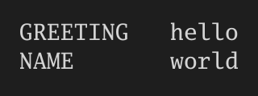

# mdsh

mdsh runs the code blocks in a markdown file, like a notebook whose file
format is plain markdown. The documentation lives at
**[gdey.github.io/markdownshell](https://gdey.github.io/markdownshell/)**.
[docs/cheatsheet.md](docs/cheatsheet.md) has every attribute, flag and
key on one page. See [docs/spec.md](docs/spec.md) for the design and
[docs/plan.md](docs/plan.md) for the roadmap.

Here is [examples/hello.md](examples/hello.md), written the literate way: prose
explains each block, and the output under each block was written back by
`mdsh -w`.

````markdown
#!/usr/bin/env mdsh
---
title: Hello, mdsh
---
# Hello, mdsh

First we decide what to say and who to say it to. `export` makes
`GREETING` visible to any sub-env we start later; `NAME` is a plain shell
variable, so it stays in this shell.

```sh {#setup}
export GREETING=hello
NAME=world
echo "$GREETING, $NAME"
```

```output {for=setup exit=0}
hello, world
```

Blocks without `env=` all run in the same shell, like lines of one
script, so this block still sees `NAME`. It counts the letters in it:
`printf` avoids a trailing newline, `wc -c` counts bytes, and `tr`
strips the padding some `wc`s add.

```sh {#count}
printf '%s' "$NAME" | wc -c | tr -d ' '
```

```output {for=count exit=0}
5
```

A sub-env is a separate shell that only receives the exported variables
named in `share=`. `GREETING` comes through. `NAME` doesn't, because it
was never exported, so `${NAME:-unset}` falls back to `unset`.

```sh {#isolated env=sub share=GREETING}
echo "GREETING=$GREETING NAME=${NAME:-unset}"
```

```output {for=isolated exit=0}
GREETING=hello NAME=unset
```

A block can also write markdown. `out=markdown` puts its output into the
document as-is, and `md_table` turns tab-separated lines (header first)
into a table. `md_table -F ' '` splits on runs of blanks instead (any
`awk -F` separator works), and `-s N` skips the first N lines.

```sh {#table out=markdown}
printf 'variable\tvalue\nGREETING\t%s\nNAME\t%s\n' "$GREETING" "$NAME" | md_table
```

<!-- mdsh:output for="table" -->
| variable | value |
| --- | --- |
| GREETING | hello |
| NAME | world |

<!-- /mdsh:output -->

A block's output can also be an image. With `out=image`, the block
prints image bytes (PNG, JPEG, GIF or SVG), and mdsh saves them next to
this file in `hello.md.assets/` and links them here. This block draws an SVG banner with plain `printf`:
the bar is 12 pixels wide per letter of the greeting, using shell
arithmetic `$(( ))`.

```sh {#banner out=image}
w=$(( ${#GREETING} * 12 ))
printf '<svg xmlns="http://www.w3.org/2000/svg" width="240" height="40">'
printf '<rect width="%d" height="40" rx="6" fill="#4f7cff"/>' "$w"
printf '<text x="%d" y="26" font-family="sans-serif" font-size="16" fill="#888">%s, %s</text>' "$(( w + 8 ))" "$GREETING" "$NAME"
printf '</svg>\n'
```

<!-- mdsh:output for="banner" -->

<!-- /mdsh:output -->

To take a picture of plain text output instead, use `out=screenshot`:
whatever the block prints is drawn as a terminal-style image. It's an
SVG by default; ending the path in `.png` asks for a PNG. Here
`printf '%-10s'` pads each name to 10 columns so the values line up.

```sh {#screenshot out=screenshot:hello.md.assets/screenshot.png}
printf '%-10s %s\n' GREETING "$GREETING" NAME "$NAME"
```

<!-- mdsh:output for="screenshot" -->

<!-- /mdsh:output -->

Some parts are only for debugging. Everything between the
`mdsh:if` and `mdsh:end` comments below is printed only when `DEBUG` is
set and exposed (try `DEBUG=1 MDSH_EXPOSE=DEBUG ./hello.md`), and `run={{$DEBUG}}` keeps the block
from running otherwise. Its stderr is shown too, because of
`show-stderr`; normally stderr only appears when a block fails.

<!-- mdsh:if {{$DEBUG}} -->
**Debug:** the shell is **{{#shell/env(SHELL_NAME):"sh"}}**.

```sh {#shell run={{$DEBUG}} show-stderr}
SHELL_NAME=$(ps -p $$ -o comm= 2>/dev/null || echo unknown)
echo "running in $SHELL_NAME" >&2
```

```output {for=shell stream=stderr}
running in sh
```
<!-- mdsh:end -->

Prose can quote what a block left behind: `setup` set the greeting to
**{{#setup/env(GREETING):"hello"}}** and greeted **{{#setup/env(NAME):"world"}}**.
It can also quote the environment mdsh was started in: this ran as
**{{$USER}}** (the value isn't saved in the file).
````

The two images it produced:




[examples/README.md](examples/README.md) is a guided tour of the rest:
quoting files, guard rails for runbooks, inputs, terminal recordings,
background blocks, reports and interactive sessions, ending with the
complete runbooks in [examples/runbooks](examples/runbooks): deploying a
site, cutting a release, a system report, Linux and macOS host triage,
and a test coverage report for mdsh itself. `go test ./cmd/mdsh` runs
each runbook; a name ending in `_linux.md` or `_darwin.md` runs only on
that OS.

## Install

With Homebrew, on macOS or Linux:

```sh
brew install gdey/tap/mdsh          # the command line and mdsh -i
brew install --cask gdey/tap/mdsh   # the desktop app and the command line, macOS only
```

The cask's app carries `mdsh` and links it for you, so it conflicts with
the formula: on a Mac, install one or the other.

On Debian, Ubuntu, Fedora and the like, each release has a `.deb` and an
`.rpm` for `mdsh`.

Or download an archive for your system from the
[releases page](https://github.com/gdey/markdownshell/releases), unpack it,
and put `mdsh` on your `PATH`. Builds cover Linux, macOS and Windows on
amd64 and arm64; `checksums.txt` lists each archive's SHA-256. For example,
on Linux amd64:

```sh
VERSION=1.0.0
curl -LO https://github.com/gdey/markdownshell/releases/download/v$VERSION/mdsh_${VERSION}_linux_amd64.tar.gz
tar xzf mdsh_${VERSION}_linux_amd64.tar.gz mdsh
sudo mv mdsh /usr/local/bin/
mdsh --version
```

On macOS, a downloaded binary may be quarantined; `xattr -d
com.apple.quarantine mdsh` clears it. Blocks run in `/bin/sh` by default;
on Windows, set `shell:` under `mdsh:` in the front matter to a POSIX shell
such as Git Bash's `bash.exe`. The Windows builds are not well tested yet.

The releases also have `mdsh-gui`, a desktop app for macOS (a universal
`.dmg`) and Linux (an AppImage), each carrying the same `mdsh`, which
Settings › Shell puts on your `PATH`; see [cmd/mdsh-gui](cmd/mdsh-gui).

With Go 1.27 or newer you can build it instead:

```sh
go install github.com/gdey/markdownshell/cmd/mdsh@latest
```

## Usage

```
mdsh notes.md              # run, print markdown with output under each block
mdsh -w notes.md           # run, write output back into the file
mdsh -o out.md notes.md    # same, but into out.md; notes.md is untouched
mdsh --hide-code notes.md  # prose and output only
mdsh --hide-output notes.md
mdsh --hide-code --hide-output notes.md   # prose only, nothing runs
mdsh -n notes.md           # print with the output saved by -w; nothing runs
mdsh -n -o view.md notes.md  # save that printout to view.md instead
mdsh --pdf notes.pdf notes.md   # what it would print, as a PDF
mdsh --only greet notes.md # one block, plus what it depends on
mdsh --yes notes.md        # run confirm blocks without asking
mdsh --step notes.md       # ask before every block: run, skip or stop
mdsh --source defs.zsh notes.md  # source defs.zsh into every shell first
mdsh -i notes.md           # open it in a terminal UI and run blocks as you pick them
mdsh -i ~/notes            # pick a file under ~/notes first (mdsh -i alone: this folder)
mdsh --serve notes.md      # open it in a web browser instead; see Serving to a browser
```

Shell completion covers flags, `.md` files and, after `--only`, the
file's block ids:

```
source <(mdsh completion bash)                 # bash, e.g. in ~/.bashrc
mdsh completion zsh > "${fpath[1]}/_mdsh"      # zsh, then restart the shell
source <(mdsh completion zsh)                  # or zsh, after compinit in ~/.zshrc
```

`mdsh lsp` is a language server for editors: on stdin and stdout, it
completes the attributes in a fence's `{…}` and the block names in
`depends=`, explains an attribute on hover and flags mistakes as
diagnostics. In Neovim, for markdown files:

```lua
vim.api.nvim_create_autocmd("FileType", {
  pattern = "markdown",
  callback = function(ev)
    vim.lsp.start({ name = "mdsh", cmd = { "mdsh", "lsp" } }, { bufnr = ev.buf })
  end,
})
```

Printed markdown is styled when stdout is a terminal; `--color=never`,
`--no-color` or `NO_COLOR` turn that off.

## Interactive mode

`mdsh -i notes.md` opens the document full screen, with its prose styled
and each block in a box. Pick a block and run it; its output streams in
under it. A • in the status line marks output that isn't saved; `w`
saves it, and `--autosave` saves after every block that runs.
If the file is read-only, `w` opens save as instead; with `--autosave`,
save as opens before the first run, and `esc` there lets the next run
go ahead without saving. mdsh-gui does the same with its Save dialog.
`mdsh -w` on a read-only file stops before running anything; `-o` saves
the output to another file.

Without a file, or with a folder, `mdsh -i` starts on a list of the
markdown files under the folder, as `mdsh-gui` does: the files opened
recently first, then the rest grouped by folder, each with its block
count, when it changed and the `description` (else `summary`, else
`abstract`) from its front matter. Typing filters the list by path and
description, and enter opens the file picked; `q` goes back to the list.
Recent files, and the view the last file was left in, are kept in
`mdsh/tui.json` in the user's config folder. Blocks keep
their envs between runs, the same as in one `mdsh` run, so running a
block again runs it in the env as the earlier runs left it, and replaces
its output.

| Key | Does |
| --- | --- |
| `j`/`k`, arrows, tab | next or previous block |
| `g`/`G` | first or last block |
| space, pgup/pgdn, ctrl+u/ctrl+d | scroll |
| enter or `r` | run the block |
| `a` | run the block and every one after it, like a normal run |
| `s` | run the section the block is in, its subsections included, as `a` would: from the heading above it to the next heading of the same or a higher level |
| `i` or `:` | type a command; enter adds it to the end of the document as an `sh` block and runs it, esc cancels |
| `h` | open the History pane: a shell along the bottom whose commands are added to the end of the document as `#history-N skip links` blocks with their output (`skip` keeps a whole-file run from running them again; `links` makes web addresses in it OSC 8 links), `#` lines as prose; tab completes, ↑/↓ or ctrl+p/n recall, the emacs line keys edit (ctrl+a/e, ctrl+w, ctrl+u/k, ctrl+y, alt+b/f/d, ctrl+l clears the pane), esc goes back to the document, ctrl+d closes it |
| `V` | select lines of the History pane's output (shift+↑ in the pane does too): ↑/↓ or `j`/`k` move the selection's end, `g`/`G` to the first or last line, `o` to its other end, `y` or enter copies them as text, without colors, the way `y` copies a block; esc cancels |
| `e` | edit the whole block, fences and attributes included, in `$VISUAL`, `$EDITOR` or `vi`; it is saved to the file, and enter runs it |
| `y` | copy the block's code, without its fences, to the clipboard. It is sent to the terminal as OSC 52, which works over ssh in terminals that allow it, and run locally it also goes to the system clipboard (`pbcopy`, `wl-copy`, `xclip` or `xsel`), for terminals that don't, such as macOS's Terminal or tmux by default |
| `E` | edit the whole file in `$VISUAL`, `$EDITOR` or `vi`, at the block under the cursor, with output not saved yet in it. Blocks whose code didn't change keep their output, as in `mdsh-gui`'s source view; save with `w` |
| alt+↑/↓, or `K`/`J` | move the block, with its output and tape, up or down past the paragraph, heading or block next to it, as alt+↑/↓ does in `mdsh-gui`. Prose stays put. What the move breaks that depends on block order, such as a `run=` that now reads a block below it, shows in the footer. Not while a block runs |
| `u` | undo the last move |
| `v` | show the block's image or recording full screen; enter goes back |
| `o` | show or hide the outline: the headings and blocks down the left, with each block's state (✓ ran, ✗ failed, ? waiting for an answer, … running) |
| `C` / `O` | hide or show the code / the output of blocks |
| `p` | create a report, as `mdsh-gui`'s Create Report: PDF, HTML or markdown, with or without code and output, of this run, of a run of every block, or of the file as saved. It shows the `mdsh` command that makes the same report |
| `,` | run options for this file: the arguments `$1` and on, `--only`, `--step` and `--stop-on-error`. Setting them starts new shells, and the file keeps them when opened again |
| `w` or ctrl+s | save now |
| `W` | save as: type a path (relative to the file's folder); mdsh follows the new file. In another folder it opens it again, with fresh shells |
| `R` | reload the file from disk, dropping output not saved |
| `M` | when the file changed on disk, keep what is shown; the next save overwrites the file |
| ctrl+c | stop the running block: it is interrupted, and its shell keeps what blocks set there. A block that won't stop gets ctrl+c again, which kills its shell. Quits when nothing runs |
| `q` | go back to the list of files, or close the tab; the last tab quits |
| ctrl+t | open a new tab with the list of files; picking a file already open in a tab goes to that tab |
| `]` / `[` | the next or previous tab. The tab bar marks a file with • when its output isn't saved, … while a block runs and ? while one waits for an answer. Blocks go on running in the tabs behind |
| ctrl+w | close the tab (esc on the list of files closes its tab). Quitting stops at a tab with output not saved first |
| `?` | the keys, each with what it does. Keys that do nothing now, such as `u` with no move to undo, are greyed with the reason. ↑/↓ pick one and enter does it; esc closes |

A block picked by hand runs even if it is marked `skip` or its `run=`
condition is false; `a` honors both. `confirm` blocks, and every block
under `--step` or `step: true` when running with `a`, ask in the
block's card, under its code, with the same choices as on the command line. `--yes`, `--stop-on-error`
and block arguments work as usual. A `tty` block runs in a terminal drawn
in its card, as in `mdsh-gui`: up to 24 rows, as wide as the card. While
it runs every key goes to it, ctrl+c included, and ctrl+] stops it. A
taped block's run is shown the same way. Images and recordings
show under their block as a preview in colored half blocks (any terminal
with 24-bit color; off with `NO_COLOR`). `v` shows one full size, through
the kitty, iTerm2 or sixel protocol when mdsh recognizes the terminal
(kitty, Ghostty, iTerm2, WezTerm, foot, mlterm, contour, or `sixel` in
`TERM`), and in half blocks otherwise. SVG images show only as a link. Include blocks show the file's lines,
numbered when they have `number_on`. `out=markdown` output is drawn as
markdown, and placeholders in the prose show their current values. If the file changes on disk while it
is open, a banner offers to reload it (`R`) or keep yours (`M`), and mdsh
won't save over it until you pick one or press `w` twice.

## Serving to a browser

`mdsh --serve` serves the same notebook mdsh-gui shows to a web browser:
rendered prose, blocks you run and watch stream, the source view, tty
blocks in a terminal, reports and tabs. It prints the address to open.

```
mdsh --serve                     # the markdown files under this folder, at 127.0.0.1:8080
mdsh --serve notes.md a b        # notes.md, with $1 and $2 set
mdsh --serve=localhost:9000 docs # the files under docs, on port 9000
```

The address comes after `=`: `--serve host:port` would take
`host:port` for the file. Each browser tab is a window with its own tabs.
Closing the browser tab leaves its shells running; opening the address
again picks the window up, and closing its last tab ends it. Ctrl+C
stops the server and every shell, without saving.

### Security

**Anyone who can use the page can run any command as the user who
started mdsh.** That is what the page is for, so treat the address like
a shell login:

- By default mdsh listens on 127.0.0.1, so only this machine can reach
  it. `--serve=0.0.0.0:8080` or another machine's address lets the
  network in, and mdsh warns when it does.
- Every start makes a new random token and prints it in the address.
  The first visit trades it for a cookie; without it every request is
  refused. Don't share the address or put it in a shell history others
  read.
- Requests from other sites' pages are refused (their `Origin` must be
  this server), and on 127.0.0.1 the `Host` must be a loopback name, so
  a site can't point its own name at your machine to get in.
- There is no TLS: the token and everything on the page cross the
  network in the clear. To use it from another machine, keep the
  default address and tunnel to it, for example
  `ssh -L 8080:127.0.0.1:8080 host`, rather than listening on the
  network.
- The page can read and write any file the user can, through its file
  dialogs and the commands it runs, and it shows the images and files
  beside open documents.
- The pages carry mdsh-gui's Content-Security-Policy, so nothing they
  show loads from the network: a document's image from another site is
  drawn as a note naming the host, not fetched. Other sites can't put
  the pages in a frame.

### Serving to another program

`mdsh --serve=stdio` serves the notebook to the program that started
mdsh, such as an editor plugin, instead of to a browser: the same calls,
events and questions, as one JSON object per line on stdin and stdout.
`mdsh-gui --serve=stdio` does the same and opens no window, so a plugin
can use whichever is installed.

```
{"id":1,"name":"ui.App.RunBlock","args":[0],"window":1,"tab":1}   → stdin
{"window":1,"name":"block","data":{"mdshTab":1,"data":{...}},"sender":"w1"}
{"id":1,"result":null}                                             ← stdout
```

A call names a method of `ui.App`, and its reply carries the same `id`
with a `result` or an `error`. Every other line is an event for a window.
A question (`mdsh:ask`, `mdsh:prompt`) is answered with
`{"answer":ID,"value":"..."}`. There is no token, as only the parent
holds the pipes. Logs go to stderr, and mdsh stops, closing every shell,
when stdin ends. The full format is in [serve/stdio.go](serve/stdio.go).

## PDF output

`--pdf FILE` lays out what mdsh would print as a PDF, so a run can be
shared as a report. The hide flags and `--only` apply, and with `-w` or
`-o` the markdown is written too:

```sh
mdsh --pdf report.pdf report.md                 # run, write the PDF
mdsh --hide-code --pdf report.pdf report.md     # prose and output only
mdsh -w --pdf report.pdf report.md              # update the file and the PDF
mdsh -n --pdf report.pdf report.md              # the output saved by -w; nothing runs
```

`--html FILE` writes the same view as a standalone HTML page instead, with
local images inside it, so it can be sent on its own.

It's pure Go, with no external tools. Output shows in a terminal-style box,
stderr in red, `out=screenshot` output as text, and `number_on` includes
with a line-number gutter. [examples/report.md](examples/report.md) shows
each of these, and [examples/pdf](examples/pdf) holds the PDFs of it,
[hello.md](examples/hello.md), [include.md](examples/include.md),
[terminal.md](examples/terminal.md) and a run of the
[test coverage report](examples/runbooks/test-coverage.md).

## Blocks

Every `sh` and `zsh` block runs, top to bottom. Blocks without `env=` share
one shell, so variables, functions and the working directory carry over.
Blocks run in `/bin/sh` unless `shell:` under `mdsh:` in the front matter
says otherwise; a document with any `zsh` block runs in `zsh` by default.
mdsh hands each block to the shell as written. In zsh a lone `}` ends a
`{ }` group wherever it is on the line, so `echo }` is a parse error
there; quote it, as in `echo '}'`. mdsh checks a block's syntax before
running it, so `setopt ignore_close_braces` in the block can't help.

| Attribute | Meaning |
| --- | --- |
| `#id` | Block name. An unnamed block gets `block-<uuid>`, written into its fence when mdsh saves the file |
| `skip` | Don't run |
| `run=COND` | Run only if the condition holds |
| `show=COND` | Print the code only if the condition holds |
| `show-output=COND` | Print the output only if the condition holds |
| `show-stderr[=COND]` | Show stderr (by default it only shows when the block fails) |
| `collapse[=COND]` | In mdsh-gui, open with the code folded to one line |
| `collapse-output[=COND]` | In mdsh-gui, open with the output folded to one line |
| `nosave` | Keep the value out of the file: the block's output, or what is typed in a textbox or picked in a choice, lives in the session, and saving leaves what the file holds. On an `output` fence, keeps just that fence |
| `secret` | The code and output hold a secret: mdsh-gui masks them until you show them, and as with `nosave` the output isn't saved to the file |
| `env=name` | Run in a named sub-env; `a/b` stacks `b` on `a` |
| `share=A,B` | Exported vars a new sub-env gets from its parent, besides `PATH`, `HOME`, `USER` and the rest of the base set (default all; empty for just the base set; `-PATH` drops one) |
| `on_error=stop` | Stop the run if this block fails |
| `depends=A,B` | Blocks to run first: each one that hasn't run yet is asked about |
| `always` | As a dependency, run again each time a block that depends on it runs, even if it already ran |
| `confirm[="question"]` | Show the block and ask whether to run it, skip it or stop the run |
| `timeout=30s` | Interrupt the block after this long, as ctrl+c would, and stop the run; the shell and what blocks set there stay |
| `tty` | Run on the terminal, for commands like `docker run -it`; the session is saved as an asciinema cast, which mdsh-gui plays |
| `frame=N` | With `tty`, the frame a PDF shows (default the last) |
| `out=markdown` | Insert output as raw markdown |
| `out=image[:path]` | Output is image bytes (PNG, JPEG, GIF, SVG): save it and link it |
| `out=screenshot[:path]` | Draw the text output as a terminal-style image: SVG, or PNG if the path ends in `.png` |
| `embed=inline` | With `out=image` or `out=screenshot`, embed a data URI instead of a file |

## Output copies

The output right under a block is its own. To show that output again
elsewhere, say in a summary at the end, put an `output` fence naming the
block anywhere else in the document; mdsh refills it on every run, the
way it fills in a placeholder:

````markdown
## Environment

```output {for=env exit=0}
HOME is set
GITHUB_TOKEN is not set
```
````

`stream=stderr` copies the block's stderr fence, and an
`<!-- mdsh:output for="id" -->` region copies `out=markdown` or image
output. A copy keeps what it holds when its block doesn't run, and mdsh
warns about a copy for a block that doesn't exist.

## Including files

A block marked `<include` holds lines from another file, so a doc can quote
real code without a copy that goes stale:

````markdown
```go {<include file=cmd/main.go from=10 to=24 number_on}
```
````

Each run writes the file's lines into the block, so it reads well on
GitHub too. `file=` is relative to the document, and `file=res://notes.md`
reads `notes.md` from the document's assets folder, `<doc>.assets/`.
`out=image:res://plot.png` saves an image there the same way. `from=` and `to=` are line
numbers counted from 1 and inclusive; `from` defaults to the start of the
file and `to` to the end. The fence's language is the language, and
`number_on` shows line numbers when the document is printed, in the
TUI, and in `--html` and `--pdf`. mdsh-gui numbers every code block, so
it numbers an include's lines from `from=` with or without `number_on`.
An include block never runs and has no name. [examples/include.md](examples/include.md)
shows each option.

## Confirming blocks

A block marked `confirm` pauses the run: mdsh shows its code and asks
`Run this block? [r]un / s[k]ip / [o]nly run blocks without saved output / [s]top`,
or your own question from `confirm="Deploy to prod?"`.

- `r` runs the block.
- `k` skips it and goes on. A skipped block keeps any output already saved
  in the file.
- `o` skips this block and every later one that already has saved output,
  and runs the rest. Blocks without saved output are still asked about.
  The prompt says `(has saved output)` when a block has some.
- `s`, or just enter, stops the run there. This is the safe choice.

The prompt goes to the terminal, so it works even when output is piped.
With no terminal, the run stops there with an error unless you pass `--yes`.

To step through a whole document this way, pass `--step` or set
`step: true` under `mdsh:` in the front matter. Every block that would run
is then asked about, as if it were marked `confirm`.

When a run can ask, because of `--step`, `step: true` or a `confirm`
block, mdsh prints the document as it goes rather than all at the end:
the prose and code up to each block before asking about it, and the
block's output, stderr included if it failed, as soon as it finishes.
This happens with `-w` too, so you can follow a run as it is written
back. Without asking, `-w` prints only a status line per block, followed
by the output and stderr of a block that failed.

## Dependencies

`depends=` lists blocks, by id, that a block needs to have run first:

````markdown
```sh {#build}
make
```

```sh {#deploy depends=build,login}
./deploy.sh
```
````

When `deploy` is about to run, mdsh first works out everything it needs:
`build` and then `login`, in that order, each after the blocks its own
`depends=` names, all the way up the chain. A block that has already run
in this session (in `mdsh -i` or mdsh-gui; in a plain `mdsh` run, earlier
in the run) and didn't fail is passed over, and so is what it needs,
unless it is marked `always` or is stale. Then
mdsh walks back down from the top of the chain, asking
`Run build first? [r]un / s[k]ip / [s]top` about each block right before
it would run, so each answer is followed by the run it allowed, and every
block a block needs has run (or been skipped) before it is asked about:

- `r` runs it now. Its `skip`, `run=` and `confirm` don't apply, since
  you just said to run it.
- `k` goes on without it; the blocks below it are still asked about.
- `s`, or just enter, runs neither it nor anything below it, nor `deploy`.

If `deploy` is itself marked `confirm`, it is confirmed last, after the
blocks it depends on have run.

If a dependency fails, `deploy` doesn't run. In a whole run, the run then
goes on or stops as the dependency's `on_error` says, and a block already
run as a dependency isn't run again when the run reaches it. With no
terminal the run stops with an error, unless you pass `--yes`, which runs
dependencies without asking. An id that names no block is a warning
and is ignored, so a typo doesn't stop the file opening; mdsh-gui
underlines it in the source and notes it in the Console. A block that depends on itself and a cycle
are errors when the file is read. mdsh-gui and `mdsh -i` ask the same
question in their own way.

A dependency with nothing to run, a body of only blank lines and `#`
comments, runs without asking, since running it does nothing; its own
`depends=` are still asked about, so an empty block can name a group of
steps. Mark it `confirm` to have it asked about anyway, as a checkpoint.

Mark a dependency `always` when what it does doesn't last, such as
refreshing a token or pulling the latest code:

````markdown
```sh {#login always}
./get-token.sh > .token
```
````

Each time a block that depends on `login` runs, `login` is asked about
again, even if it already ran. It runs once on the way to that block,
even when several of its dependencies need it. `always` doesn't make it
run without asking; `--yes` still does that.

A block that ran is **stale** once a block it depends on runs again, or
has its output cleared in mdsh-gui, or is stale itself. A stale
dependency is asked about again, like one that never ran. Say `c`
depends on `a`, `d` on `a`, `b` and `c`, and `e` on `a` and `d`, and
all have run. Run `a` again, and `c`, `d` and `e` are stale; run `e`,
and mdsh asks about `d`, then, on the way to `d`, `c`, but not `b`.
mdsh-gui marks a stale block's card with a *stale* badge, and `mdsh -i`
shows `✓ stale` in its header.

## Terminal blocks

Some commands need a terminal: `docker run -it`, `ssh`, `sudo`, an
editor, a REPL. Mark their block `tty` and mdsh runs it on a terminal,
passing your keys through:

````markdown
```sh {#shell tty}
docker run -it --rm alpine sh
```
````

The block still runs in its env's shell, so variables and the working
directory carry over as usual. Ctrl+c goes to the command, not to mdsh,
and window resizes are passed on.

mdsh records the session as an [asciinema](https://asciinema.org) cast,
`<doc>.assets/<block-id>.cast` (or the path `out=recording:path` names),
and links it below the block. mdsh-gui plays it in the block's card,
where you can pause, scrub, and step back and forth a frame at a time.
GitHub can't play a cast, so for a document read there, give a path
ending in `.gif`, as in `out=recording:res://demo.gif`: mdsh links an
animated GIF made from the cast instead, and keeps the cast beside it.
An HTML report plays a GIF made from the cast. A PDF can't animate, so
it shows the last frame; set `frame=N` to show frame `N` instead,
counting from 1.

A `tape` fence types the input for a `tty` block, in the commands of a
[VHS](https://github.com/charmbracelet/vhs) tape, so the block runs with
nobody at the keyboard, in CI or under `-w`:

````markdown
```sh {#repl tty}
python3 -q
```

```tape {for=repl}
Wait />>>$/
Type "print(6 * 7)"
Enter
Wait />>>$/
Type "exit()"
Enter
```
````

Or read it from a file: ```` ```tape {for=repl <include file=demo.tape} ````.
mdsh supports `Type`, the named keys (`Enter`, `Tab`, `Up`, …) with a
count, `Ctrl+X` and `Alt+X`, `Sleep`, `Wait /regex/` and
`Set TypingSpeed`, `WaitTimeout` and `WaitPattern`, and skips the rest of
VHS's commands. Double-quoted `Type` strings can hold placeholders,
`{{$VAR}}` or `{{#block/env(VAR)}}`, filled in as the tape plays, for
passwords and tokens that shouldn't be written into the document
(`--expose VAR` or `$MDSH_EXPOSE` must name a `{{$VAR}}` first). Single
quotes or backticks type the text as it is. A taped block runs on an 80x24 terminal so its recording
is the same everywhere. Start with a `Wait` or `Sleep`, since keys go out
as soon as the block starts. [examples/terminal.md](examples/terminal.md) shows each of
these, with the recordings they make.

With no terminal (cron, CI) or with mdsh in the background, a `tty` block
without a tape fails with an error instead of hanging.

## Conditions

A condition is a placeholder without the `:"..."` part, optionally
compared with `==` or `!=`, or negated with `!`:

| Condition | True when |
| --- | --- |
| `{{$DEBUG}}` | `DEBUG` in mdsh's environment is exposed, set and not `0`, `false`, `no` or `off` |
| `!{{$QUIET}}` | the opposite |
| `{{#detect/env(OS)}}==Linux` | block `detect` left `OS` set to `Linux` |
| `{{$?}}==0` | the last block that ran exited 0 (see below) |
| `{{#build/?}}!=0` | block `build` ran and failed |
| `{{$err?}}`, `{{#build/err?}}` | the same statuses: true when non-zero, so when the block failed |
| `{{$ran?}}`, `{{#build/ran?}}` | the last runnable block, or block `build`, ran (not skipped) |
| `true`, `false` | always, never |
| `once` | in `run=` only: the block has no output yet |

Use them in `run=`, `show=`, `show-output=` and `show-stderr=`, and to
show or hide whole stretches of the document:

```markdown
<!-- mdsh:if {{$DEBUG}} -->
Prose and blocks here are printed only when DEBUG is set.
<!-- mdsh:end -->
```

`{{$?}}` is the exit status of the last block that ran before it. In
`run=` that is the previous block, so `run={{$?}}==0` runs a block only
if the one before it succeeded. `show=`, `show-output=` and `show-stderr=`
are checked after the block runs, so there it is the block's own status:
`show-output={{$?}}!=0` shows output only on failure. `{{#build/?}}`
names the block instead. `{{$ran?}}` works the same way, so
`run=!{{$ran?}}` is a fallback for a block that was skipped, and
`{{$err?}}` is another name for `{{$?}}` that reads well as a condition.

`run=once` runs a block only while it has no output: none saved after it
in the file, and none from running it earlier in the same `mdsh -i` or
`mdsh-gui` session. Use it for a slow setup or a one-time fetch; delete
its output to run it again. Picking the block by hand still runs it.

Sections nest, and their comment lines never appear in printed output.
A `<!-- mdsh:collapse -->` line, optionally with a condition, makes
mdsh-gui open with the heading section it is in folded. With an input's
`var=`, `<!-- mdsh:collapse {{$MDSH_VAR_details}}!=yes -->` keeps a
section folded until someone picks yes. Folding a block or section by
hand in mdsh-gui writes these for you, and unfolding takes them out.
`show=`, `show-output=` and sections only change what is printed: `-w`
keeps everything in the file. Use `run=` to keep a block from running.

### Optional prechecks

Checks that only apply to some setups are ordinary blocks gated with
`run=`. Turn a check on with an environment variable, or let an earlier
block detect what is there:

````markdown
```sh {#detect}
command -v docker >/dev/null && HAS_DOCKER=1
```

```sh {#docker run={{#detect/env(HAS_DOCKER)}} show={{$ran?}}}
docker info >/dev/null && echo "docker is up"
```

```sh {#vpn run={{$CHECK_VPN}} show={{$ran?}}}
ping -c1 -W2 intranet.example.com
```
````

`mdsh doc.md` checks Docker only where it is installed, and the VPN
only with `CHECK_VPN=1`. `show={{$ran?}}` leaves a skipped check out of
the printed output. An `mdsh:if` section around a block hides it but
does not stop it running, so gate checks with `run=`.

mdsh doesn't run blocks that a block prints: fences in `out=markdown`
output are plain code. See
[Not pursued](docs/spec.md#not-pursued) for why.

## Placeholders

`{{#setup/env(NAME)}}` in the prose stands for the value `NAME` had right
after block `setup` ran (exported or not), and `{{$NAME}}` for `NAME` in
the environment mdsh was started in, if you exposed it: `--expose NAME`,
or `MDSH_EXPOSE=NAME,OTHER` in the environment (mdsh's own `MDSH_`
variables need nothing). A document you didn't write can't read your
`$GITHUB_TOKEN` this way, whatever its front matter says; an unexposed
`{{$NAME}}` prints as written and reads as unset in conditions, and the
value is never saved in the file. `{{#setup/?}}`, `{{$?}}`, `err?` and
`ran?` stand for exit statuses and whether a block ran, as in conditions. Printed output shows the value;
`-w` stores it in the file as `{{#setup/env(NAME):"world"}}`, so the
markdown reads well without running it and keeps the last value when the
block doesn't run. Placeholders in code blocks and inline code are left
alone. Turn them off with `interpolate: false` under `mdsh:` in the front
matter.

Every front matter option is listed on the
[Front matter](https://gdey.github.io/markdownshell/docs/front-matter/) page.

## Shell details

Blocks get a base set of variables from the environment mdsh was
started in: `PATH`, `HOME`, `USER`, `LOGNAME`, `SHELL`, `TERM`,
`COLORTERM`, `LANG`, `LANGUAGE`, `LC_*`, `TZ`, `TMPDIR` and, on macOS,
`__CF_USER_TEXT_ENCODING`. None of them is a secret. Name more under
`env:` in the front matter, or bring in everything with `...`, and drop
any with `-NAME`:

```yaml
mdsh:
  env:
    share: [..., -GITHUB_TOKEN]
```

`mdsh -i` and mdsh-gui show a banner over a file that brings in
everything, so you know before you run it.

A block's stderr is captured separately. It is shown only when the block
fails, unless `show-stderr` (or `show_stderr: true` under `mdsh:` in the
front matter) says otherwise.

An explicit `exit` ends the shell and stops the run. Blocks can use
`$MDSH_BLOCK`, `$MDSH_FILE`, `$MDSH_DIR`, `$MDSH_MODE` (`running`,
`interactive` or `report`, also readable in conditions as
`{{$MDSH_MODE}}`), `$MDSH_VAR_name` for each `textbox` or `choice` block
with `var=name` (the same control can appear more than once with one
`var=`, and changing one copy changes them all), the script's arguments as `$1`…,
and the helpers `md_h1`, `md_h2`, `md_h3`, `md_table [-F SEP] [-s N]` (TSV
on stdin) and `md_code`.

Blocks don't see the aliases and functions of the shell mdsh was started
from, since a child process only inherits exported variables. To use them,
source them into every shell (sub-envs too) with `--source FILE` or with
`source:` under `env:` in the front matter. This wrapper in `~/.zshrc`
passes along whatever your shell has defined when you run mdsh:

```zsh
mdsh() { command mdsh --source <(alias -L; typeset -f) "$@"; }
```

In bash, use `<(unset -f mdsh _mdsh; alias -p; declare -f)`; leaving out
the wrapper and its completion function keeps their bash-only syntax from
stopping a `/bin/sh` that is dash. Settings › Shell in mdsh-gui can add the
wrapper to `~/.zshrc` and `~/.bashrc`, with a line that loads completion.
