# mdsh-gui

A desktop window for mdsh, built with [Wails v3](https://wails.io/).
It shows a markdown file, runs its `sh` and `zsh` blocks as you pick
them, streams their output under them and saves it back to the file. It
uses the same `run.Session` as `mdsh -i`.

See [the design](../../docs/gui/design.md) for how it works and what
comes next.

```sh
mdsh-gui [flags] [file.md [args...] | folder]
```

Flags come before the file, as with `mdsh`; `mdsh-gui --help` lists them.
`--source FILE` (repeatable) sources a file into every shell of every
file opened, before its first block. It's read once at startup, so
`mdsh-gui --source <(alias -L; typeset -f) notes.md` gives blocks the
calling shell's aliases and functions. `--only`, `--step` and
`--stop-on-error` set the Run Options of the file named on the command
line.

With no file, the start screen lists the markdown files under the current
folder, or under `folder` when one is given (or the start folder from Settings, when started from Finder or
the Dock) to pick from, with the description from each file's front
matter (`description`, else `summary`, else `abstract`) under its name.
Each file opens in a tab of its own, with its own shells.

- **Tabs:** New Tab (cmd/ctrl+T, or the + in the tab bar) opens the
  start screen; Open…, Open Recent and dropped files open in a new tab.
  Drag a tab to reorder it, onto another window's tab bar or page to
  move it there, or onto its own page, or out of every window, for a
  window of its own. A block running in it carries on. Close Tab
  (cmd/ctrl+W, the ×, or a middle click) closes it, and the window goes
  with its last tab. View › Show Next Tab and Show Previous Tab
  (cmd/ctrl+shift+] and [) move between them.
- **File:** New File… (cmd/ctrl+N, or New File… on the start screen)
  offers the templates in the templates folder from Settings, if one
  is set, then asks where to save the file and opens it. Without a
  template, a new file starts with a heading named for it. New Tab, New Window (cmd/ctrl+shift+N), Open…, Open Recent, Save, Save As…,
  Create Report…, Reload, Close Tab and Close Window (cmd/ctrl+shift+W). Create Report… writes a PDF, HTML
  or markdown copy, with or without code and output, from the tab's
  run, a run of every block or the saved file, and shows the `mdsh`
  command that makes the same one. Dropping a markdown file on a window opens it. A • marks
  output that isn't saved, and closing or quitting asks first.
- **Run:** Run Current Block (cmd/ctrl+enter: the block the source
  view's cursor is in, or the selected card without the source view),
  Run All (cmd/ctrl+R, the toolbar button turns into Stop while
  blocks run), Stop (cmd/ctrl+.), Clear All Outputs and Run Options…
  for the file's arguments, `--only`, step mode and stop on error.
  Clear All Outputs takes every block's output, output copy and stored
  block value out of the document and starts the shells again, as if
  nothing had run. It isn't saved until you save; with the source view
  open, undo there brings the output back. A block marked
  `tty` runs in a terminal in its card: type at it as you would in a
  terminal. When it ends the card shows the recording, as `mdsh` saves
  it. A block marked `background` starts and lets other blocks run: its
  card has a dashed edge and says it is running in the background, the
  status line counts them, and its output shows when it ends. Closing
  the window kills those still running.
- **Editing** happens in the source view. The pencil (or `e`) on a block
  opens it with the cursor on the block's code, and clicking prose opens
  it on that text. New blocks are typed there too. Inside
  `{…}` the editor completes attribute names and values (for `file=`,
  the files beside the document and, as `res://` paths, those in its
  assets folder; for `out=image:`, the assets folder's),
  explains an attribute on hover and underlines mistakes. Vim key bindings are a
  setting; with them, `:w` saves and `:RunBlock` runs the block at the
  cursor, as cmd/ctrl+enter does.
- **Checkboxes, textboxes and choices:** task list items (`- [ ] label`)
  in the rendered view check and uncheck in the file when clicked, and
  so do table cells that start with `[ ]` or `- [ ]` (GitHub shows
  those as text). Checkboxes in a block's output, such as
  `out=markdown`'s, work the same way until the block runs again and
  rewrites them. A
  `textbox` block (```` ```textbox {#host lines=3 placeholder="Which host?"} ````)
  is a box to type in, at most `lines` lines high, showing `placeholder`
  while empty; what is typed goes into the block's body. A `choice`
  block lists its options as task list items and is drawn as a
  dropdown, radio buttons or checkboxes (`mode=dropdown`, `radio` or
  `multi`). With `var=name`, blocks and conditions read the text or
  picks as `$MDSH_VAR_name`; a later input reusing a name is marked, with
  `!` in the outline, and ignored. All are edits like typing in the source
  view: Save writes them.
- **Undo in the rendered view:** Edit › Undo (cmd/ctrl+Z) takes back the
  rendered view's last edit (checking a task, picking a choice, or what
  was typed into a textbox since moving to it) and Redo
  (cmd/ctrl+shift+Z) does it again, up to 100 edits back. It is its own
  history: in the source view, and in a textbox while typing, undo is
  that editor's own. Once the file changes some other way, such as
  typing in the source view, a run writing output or Reload, the
  rendered view's earlier edits can't be undone.
- **Links** in the rendered view open when clicked: web links in the
  browser, a markdown file in a new tab (or the tab it's already open
  in), any other file as the system would open it, and `#heading`
  links scroll to the heading. Right-click a link to open or copy it.
- **Source view** (the `<>` button or cmd/ctrl+\\): the whole file in a
  markdown editor beside the rendered view. Typing re-renders after a
  pause, and the two scroll together; clicking a block lines the source
  up with it. Blocks whose code didn't change
  keep their output. The play button in the gutter runs a block. The
  rendered view can be turned off too (its button or
  cmd/ctrl+shift+\\), to work in the source alone.
- **Markdown bar** over the source view, and Insert in its right-click
  menu: heading, bold, italic, code, link, image, lists, quote, table,
  code block and an mdsh block. Tab moves between table cells.
- **Outline** (the sidebar button or cmd/ctrl+shift+O): headings and
  blocks with their state, to jump around in both panes. View › Show Code and Show
  Output hide those parts of the blocks.
- **Code and output:** code is highlighted in both views, with line
  numbers in the rendered view, for shell and the common languages, and
  ANSI colors in a block's output are drawn as colors.
- **Folding:** the arrow by a block's code or output folds it to its
  first line, and the arrow by a heading folds its section, down to the
  next heading of the same or a higher level. The outline's arrows fold
  sections too. `collapse`, `collapse-output` and a
  `<!-- mdsh:collapse -->` line in a section say what starts folded; they
  take conditions, so `{{$MDSH_VAR_name}}` can fold or unfold a part as an
  input changes. Folding by hand lasts while the tab is open and never
  changes the file. The source view folds headings and fences in its
  gutter, apart from the rendered view. View › Folding collapses all
  blocks or sections, expands all, and copies the folds from one view to
  the other.
- **Images:** image, screenshot and recording output shows in the
  block, and so do images in the prose, from the document's folder.
  Click an output image to see it full size.
- **Keys:** `j`/`k` select a block, `enter` runs it, `a` runs from it and
  `e` edits it.
- **Settings** (mdsh › Settings… on macOS, Edit › Preferences… on
  Linux): autosave after each run, Vim mode, a shell for every file,
  the view files open in (rendered, source or both; by default the
  view the last tab had), the start folder, the templates folder for New File… and the theme (System, Light or Dark). They are kept in `mdsh/gui.json` in the user's
  config folder. One more, **Give blocks your zsh aliases and
  functions**, adds an `mdsh` function to `~/.zshrc` (or
  `$ZDOTDIR/.zshrc`) between marker comments, and unchecking it takes
  it out. The function runs the CLI with
  `--source <(alias -L; typeset -f)`; the app itself isn't started from
  a shell, so it can't see them.

If the file changes on disk, a banner offers to reload it.

## A tour

The start screen lists the runbooks in a folder, with the description
from each one's front matter. Type to filter.

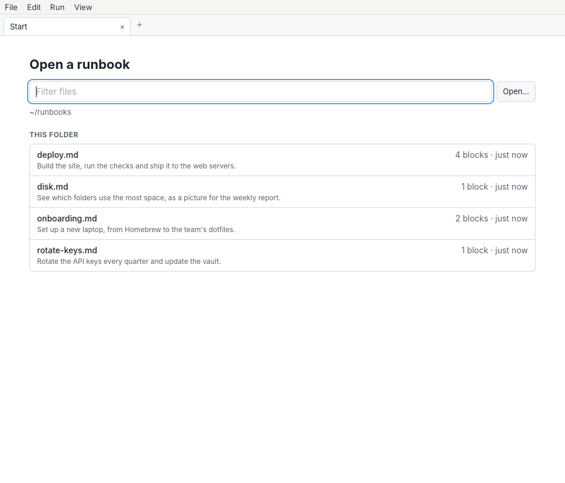

Run All streams each block's output in under it as it runs.

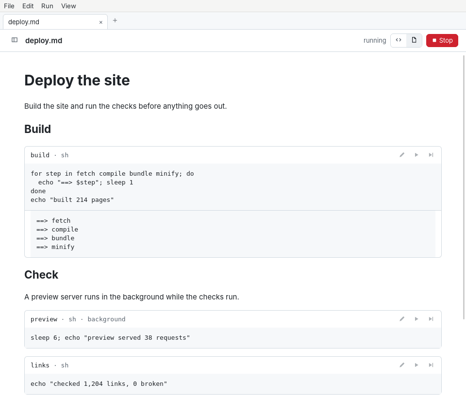

A `background` block runs on while the next ones do, with a dashed edge
until it ends. A `confirm` block asks in its card before it runs, and
so does a block that a block you run names in `depends=` and that hasn't
run yet.

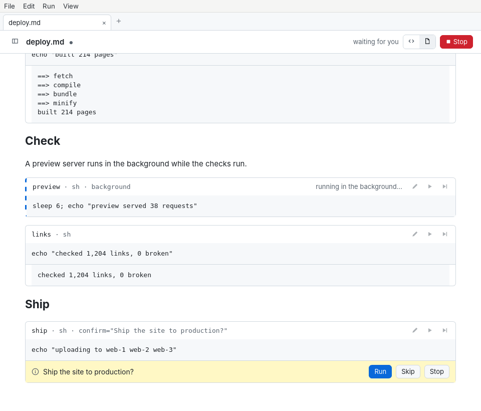

The outline lists the headings and blocks, with a mark for each block's
state. The selected block, or the one the source pane's cursor is in,
has a play button in the outline that runs it.
While blocks run, the toolbar lists them, the run's current step (▶)
first and then those in the background (◐); click one to go to it.

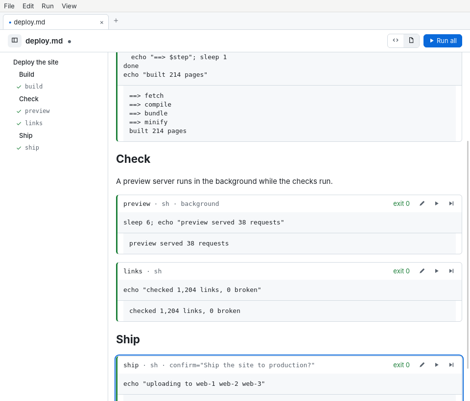

The source view shows the file in a markdown editor, with the markdown
bar over it, beside the rendered view. The two scroll together.

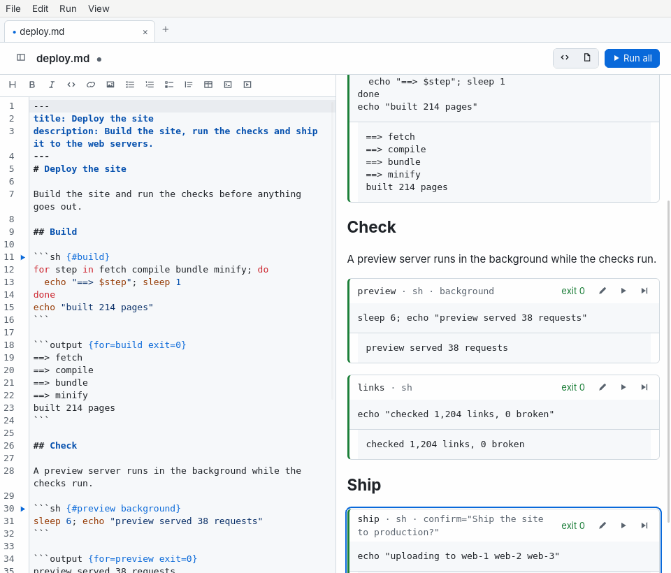

Image, screenshot and recording output shows in the block.

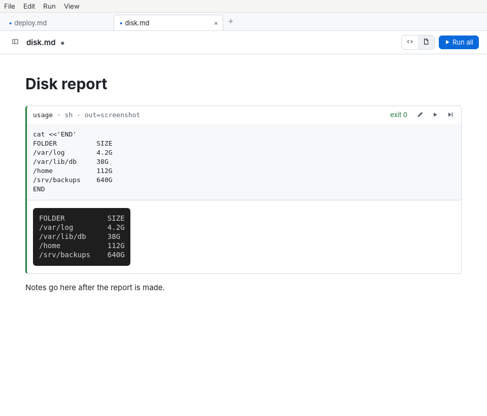

A `tty` block runs in a terminal in its card.

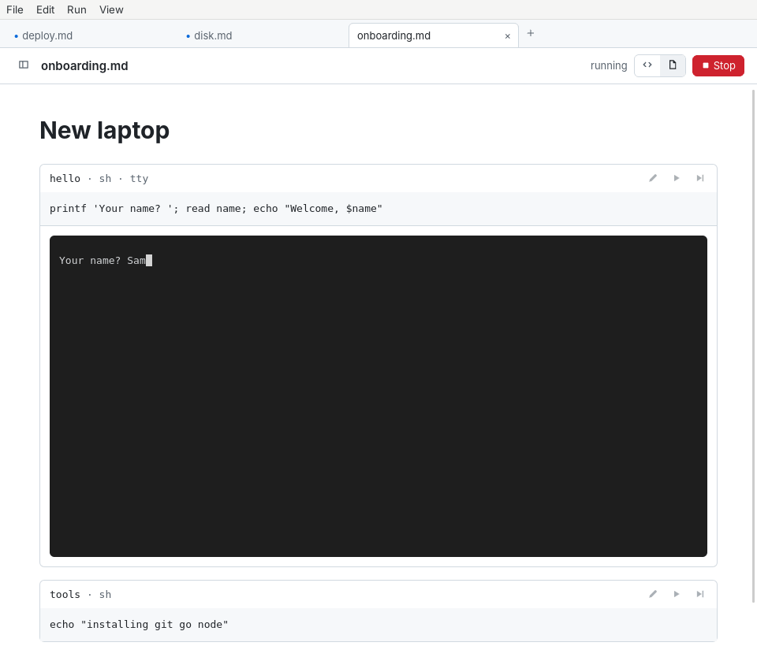

If the file changes on disk, a banner offers to reload it.

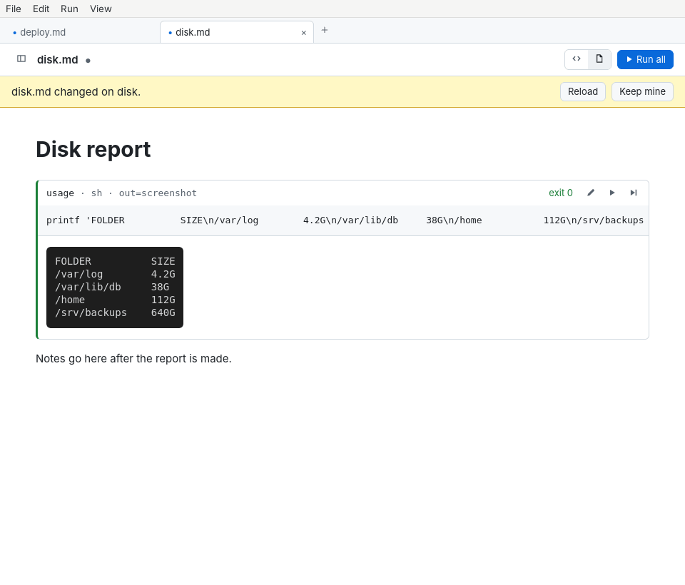

File › Create Report… makes a PDF, HTML or markdown report, and shows
the `mdsh` command that makes the same one.

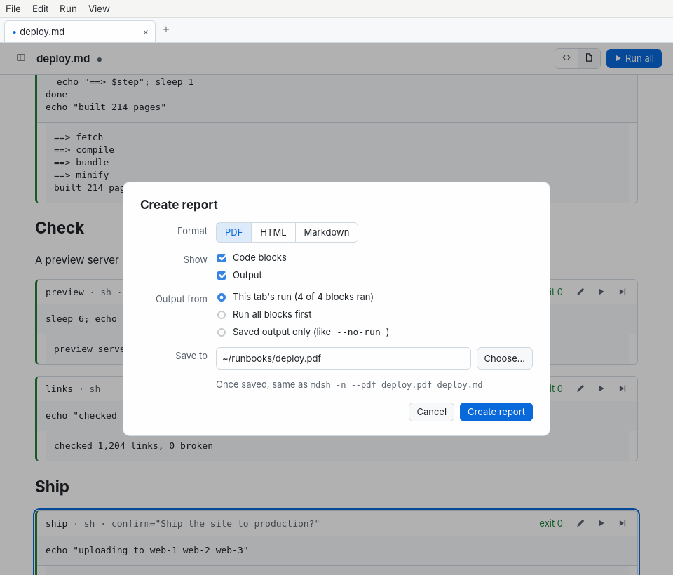

Tabs drag between windows, or out into a window of their own.

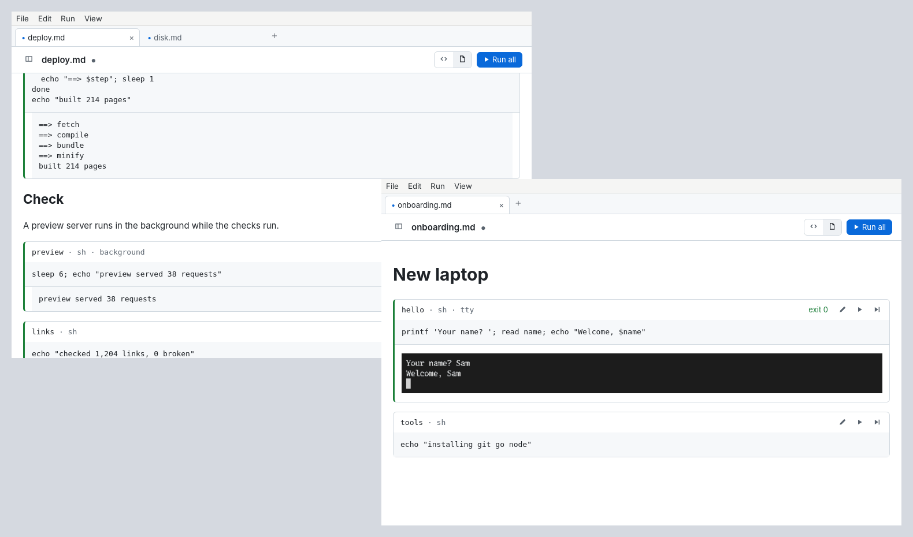

Settings has autosave, Vim mode, a shell for every file, the view files
open in, the start folder and the theme.

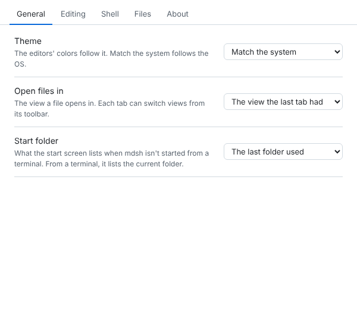

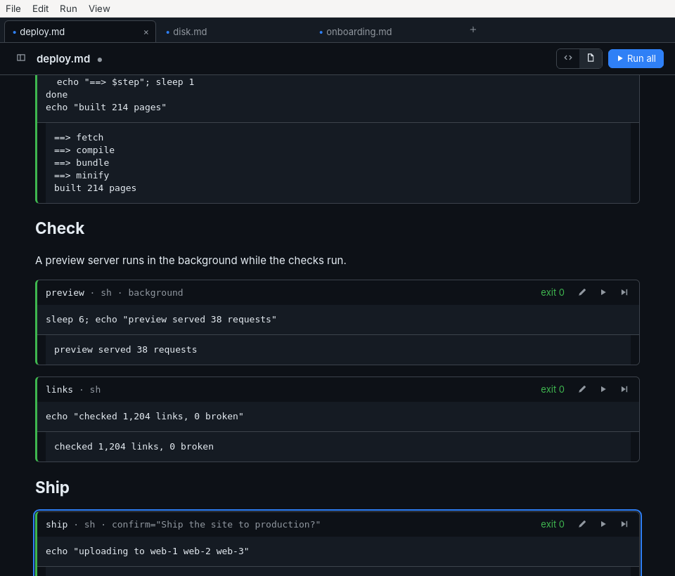

## Install

Releases have an unsigned universal macOS app (`.dmg` and `.zip`) and a
Linux AppImage; see [Desktop app](../../site/content/docs/desktop.md)
for how to open the unsigned app the first time.

## Building

mdsh-gui is its own Go module, so the `mdsh` command doesn't pull in
Wails or need cgo. It needs Go 1.27 and cgo, plus:

- macOS: the Xcode command line tools.
- Linux: GTK 4 and WebKitGTK 6, for example
  `sudo apt-get install libgtk-4-dev libwebkitgtk-6.0-dev`.
- Windows: WebView2, which ships with current Windows.

```sh
cd cmd/mdsh-gui
go build .
```

On macOS, Wails, Go and the SDK ask for different minimum macOS
versions, so the linker warns that object files were "built for newer
'macOS' version". The warnings are harmless; to build for one version
and silence them:

```sh
MACOSX_DEPLOYMENT_TARGET=13.0 CGO_CFLAGS=-mmacosx-version-min=13.0 \
  CGO_LDFLAGS=-mmacosx-version-min=13.0 go build .
```

The frontend is TypeScript in `frontend/src`, bundled into
`frontend/bundle` and embedded in the binary, so `go build` needs
nothing more. After changing the TypeScript or the Go methods the
frontend calls, regenerate the bindings and the bundle (no npm needed):

```sh
go generate
```

The code editor is CodeMirror 6 with Vim bindings, vendored as one
bundle in `frontend/vendor/codemirror.js`. `go run ./internal/vendorjs`
rebuilds it from the versions `frontend/vendor/package-lock.json` pins,
again without npm. To type-check the TypeScript:

```sh
npx --package typescript tsc -p frontend
```

## Packages

`build/darwin/app.sh VERSION OUTDIR`, on macOS, builds the universal
`mdsh.app`, signed ad hoc, and puts it in a `.dmg` and a `.zip`. The
`.dmg` window shows an arrow from mdsh to Applications; it is laid out
with [dmgbuild](https://github.com/dmgbuild/dmgbuild) by
`build/darwin/dmg/settings.py`, over a background drawn from
`build/darwin/dmg/background.svg` by `build/darwin/dmg/render.sh`.
`build/linux/appimage.sh VERSION OUTDIR`, on Linux, builds the
AppImage with `wails3 generate appimage`, which bundles GTK and WebKit's
helper processes. The icon is `build/appicon.png`, drawn from
`build/appicon.svg`. `.github/workflows/gui-packages.yml` runs both;
the release workflow adds their files to the release.
