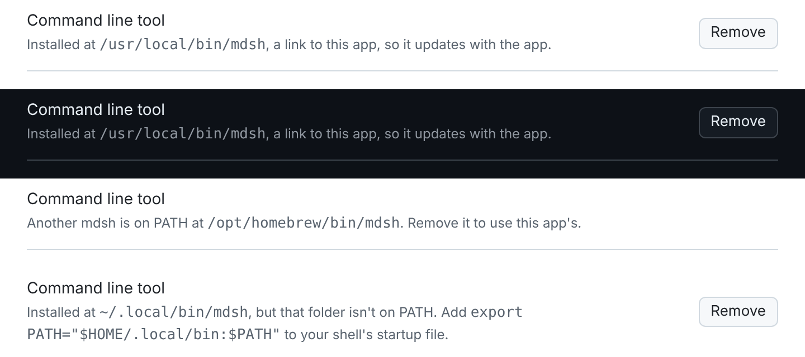

# The CLI inside the desktop app

Status: built, Nov 4, 2026.
Designed Nov 2, 2026. Asked for by j after the v1.3.0
release: "can we include the cli in the app bundle for the desktop app,
is there a convention for macOS apps to do that?"

Today `mdsh` (the command line) and `mdsh.app` (mdsh-gui) are installed
separately: the formula or an archive for one, the cask or the `.dmg` for
the other. The app needs the CLI for two things it hands to the user's
shell: the zsh wrapper from Settings › Shell (`command mdsh --source …`)
and the command Create Report shows. Someone who only installed the app
has neither, and the About tab's Tools list just says mdsh is missing.

This note puts the CLI inside the app bundle, and gives the app a way to
put it on `PATH`. The convention is well established on macOS; the
sections below say which parts of it mdsh follows and why.

## Goals

- One download gives both. `mdsh.app` carries the same `mdsh` the release
  archives do, at the same version, built from the same commit.
- Install to `PATH` is one click, the way VS Code, Zed and Docker Desktop
  do it, and can be undone.
- Nothing changes for people who install the CLI with the formula, a
  `.deb` or an archive. The release archives stay as they are.
- Signing and notarization, when the app gets a Developer ID, cover the
  embedded binary too.

On Linux the AppImage carries the CLI too (j, Nov 4: someone who runs
the AppImage may not want a `.deb` or `.rpm` managing their system), with
its own install step; see [Linux](#linux).

Not in scope: Windows, and making `mdsh-gui` itself answer as `mdsh`.

## Where the binary goes

`mdsh.app/Contents/MacOS/mdsh`, beside `mdsh-gui`.

Apple's Bundle Programming Guide says of `Contents/MacOS`: "Typically,
this directory contains only one binary file with your application's main
entry point and statically linked code. However, you may put other
standalone executables (such as command-line tools) in this directory as
well." That is the sanction, and it is what Ghostty, kitty, WezTerm and
Zed do (`Zed.app/Contents/MacOS/cli`). `Contents/Helpers/` is the other
place Apple's code-signing layout allows for helper tools; it would do as
well, but `MacOS` keeps the two binaries together and needs nothing new.
`Contents/Resources/` is wrong for executables: `codesign` seals it as
data, and a Mach-O in it fails notarization.

Two binaries, not one. `mdsh-gui` could answer as the CLI when run as
`mdsh` (by `argv[0]`, as kitty does, or a flag, as `mdsh-gui --lsp`
already does for the language server), but mdsh-gui links Wails and
WebKit, needs cgo, and takes longer to start, while `mdsh` is a static
binary with no dependencies. The CLI stays its own program.

Universal, like the app. `app.sh` builds `cmd/mdsh` for arm64 and amd64
with `CGO_ENABLED=0` from the same checkout (`cmd/mdsh-gui/go.mod`
replaces the root module with `../..`), then `lipo`s them, exactly as it
does for `mdsh-gui`. Each slice is about 17 MB, so the app and the `.dmg`
grow by about 35 MB. `-X main.version=$version` gives it the app's
version, so `mdsh --version` and About agree.

The `.goreleaser.yaml` archives are untouched: `mdsh_VERSION_darwin_*.tar.gz`
remain the CLI-only downloads and what the formula installs.

## Signing and notarization

Nested code is signed inside out, and the helper is nested code. The
script signs `Contents/MacOS/mdsh` first, then the app:

```sh
codesign --force $opts "$app/Contents/MacOS/mdsh"
codesign --force $opts "$app"
```

- **Ad hoc, as today.** `opts` is `--sign -`. The current
  `codesign --deep --sign -` would also reach the helper, but Apple
  deprecates `--deep` for signing and the explicit order costs one line.
  Go's linker already ad hoc signs darwin binaries, which is why a
  cross-compiled `mdsh` runs on Apple silicon at all; `lipo` keeps each
  slice's signature, and signing the universal file again is harmless.
- **Developer ID, when the app gets one.** `opts` is
  `--sign "Developer ID Application: …" --options runtime --timestamp`.
  The hardened runtime (`--options runtime`) is required for notarization
  on every executable in the bundle, the helper included. A Go binary
  needs no entitlements for it: no JIT, no unsigned libraries. The app
  isn't sandboxed (it runs the user's shells), so neither is the helper.
  Notarization then submits the `.zip`, `xcrun stapler staple` the app,
  and the `.dmg` is built from the stapled app and notarized and stapled
  in turn. One ticket covers all the code in the bundle, so the helper
  needs no step of its own.

Gatekeeper and the quarantine flag are the part to be careful about.
A downloaded `.dmg` puts `com.apple.quarantine` on everything copied out
of it, the helper included, and since macOS 10.15 running a quarantined
executable from Terminal gets the same "cannot be opened because the
developer cannot be verified" block as double-clicking an app. With a
notarized app this is a non-issue. With today's ad hoc signature:

- Approving the app with Open Anyway in System Settings is per bundle.
  Checked on j's Mac on Nov 4 with a CI build downloaded in the browser:
  after Open Anyway on the app, a symlink to the helper ran from
  Terminal (`mdsh --version`) with no prompt. The approval covers the
  helper too.
- What does work: `brew install --cask --no-quarantine mdsh`, and
  `xattr -dr com.apple.quarantine /Applications/mdsh.app`, which the
  desktop page already documents. The app's install step (below) runs
  the latter on its own bundle when it sees the flag, since the user has
  by then opened the app and chosen to install its CLI.

## Putting it on PATH

macOS has no post-install hook for a drag-installed app, so apps do this
themselves, on request, with a symlink into `/usr/local/bin`. That folder
is on every login shell's `PATH` through `/etc/paths`, including shells
that never source a profile. The symlink points at the binary inside the
app (`/Applications/mdsh.app/Contents/MacOS/mdsh`), not a copy, so the
CLI updates with the app and goes away with it.

**Where it's offered.** Two places, both calling the same service
method:

- `mdsh › Install Command Line Tool…` in the app menu, under
  Settings…, the way Zed has `zed › Install CLI` and iTerm2 has
  `Install Shell Integration`. Once installed the item reads
  `Uninstall Command Line Tool…`.
- A row in Settings › Shell, above the zsh wrapper switch that depends
  on it: `Command line tool: /usr/local/bin/mdsh → mdsh.app` with an
  Install or Remove button, or `not on PATH` with Install. Turning the
  zsh wrapper on when no `mdsh` is on `PATH` offers the install first,
  instead of writing a function that calls a command that isn't there.
- The About tab's Tools list keeps its `mdsh` row, and when `mdsh` isn't
  on `PATH` says `bundled, not on PATH` with the path inside the app, in
  place of today's Not found.

**What install does.** In order:

1. If an `mdsh` is already on `PATH` and isn't a symlink into this app,
   say where it is (`/opt/homebrew/bin/mdsh`, from the formula, is the
   likely case) and stop. Two copies with different versions would be
   worse than one.
2. Clear the quarantine flag on the bundle if it's set (see above).
3. `os.Symlink(target, "/usr/local/bin/mdsh")`, after `os.MkdirAll` of
   the folder. On an Intel Mac with Homebrew, `/usr/local/bin` is
   usually writable by the user and this succeeds.
4. On `EACCES`, ask for an administrator password through the standard
   macOS prompt: `osascript -e 'do shell script "…" with administrator
   privileges'`, the same route VS Code and Zed take. The shell command
   is `mkdir -p /usr/local/bin && ln -sfn TARGET /usr/local/bin/mdsh`
   with `TARGET` single-quoted for the shell and then escaped for the
   AppleScript string literal; the app's path can hold spaces and
   quotes, and this string runs as root. A test covers a path with both.
5. Tell the user, and say that open terminals see it after `rehash` or
   a new window.

Uninstall removes `/usr/local/bin/mdsh` only when it's a symlink into
this app, by the same two routes.

**Moved app.** The symlink dangles if the app moves. On launch, if
`/usr/local/bin/mdsh` is a symlink into an `mdsh.app` that isn't this
one or doesn't exist, the app repairs it quietly when it can write the
folder, and otherwise the Settings › Shell row says `broken, points at …`
with Install to redo it. VS Code does the same check on start.

**Not a `.pkg`.** A package installer could write the symlink with its
own privilege prompt, but the app is a drag install and the cask expects
one; a `.pkg` would be a second packaging to maintain for one symlink.

**Not `~/.local/bin`.** It isn't on a default macOS `PATH` and doesn't
exist by default, so it would need shell profile edits too, which is
what the zsh wrapper already does and what this feature is meant to
avoid.

## Linux

The AppImage gets the same binary at `usr/bin/mdsh` inside the image,
built by `build/linux/appimage.sh` for the machine's architecture with
the same flags as the app. The image is a file, not a folder, so a
symlink into it can't work the way it does on macOS; the AppImage
runtime offers two routes instead, and the design uses both:

- **Run it through the image.** The runtime sets `ARGV0` to the name
  the image was invoked by and passes the rest through, so an `AppRun`
  that checks `basename "$ARGV0"` runs `usr/bin/mdsh` when the image
  was called as `mdsh`, and `mdsh-gui` otherwise. `mdsh-gui.AppImage
  --cli …` does the same by flag, for a one-off from a terminal. This is
  what the AppImage packaging guide suggests for an app with a CLI.
- **Install a copy.** Settings › Shell's row offers Install, which on
  Linux copies `usr/bin/mdsh` out of the mounted image to
  `~/.local/bin/mdsh` (`APPIMAGE` names the image file, `APPDIR` its
  mount). A copy, not a symlink to the image, for three reasons: every
  run through the image mounts it first, with FUSE or by extracting,
  which is a noticeable start for a command used in scripts; the image's
  file name changes on each upgrade (`mdsh-gui_1.4.0_linux_x86_64.AppImage`),
  so a symlink would break at every release; and the CLI is a static
  binary of about 17 MB, so a copy costs nothing it doesn't already.

To keep the copy current, the app checks on launch, when it's running
from an AppImage and `~/.local/bin/mdsh` exists and was installed by it
(a marker file beside it, `.mdsh-from-appimage`, says so): if `mdsh
--version` disagrees with the app's version, it copies again, quietly.
Uninstall removes the copy and the marker, and only when the marker is
there. The Install step needs no privileges: `~/.local/bin` is the
user's, and Debian, Ubuntu and Fedora put it on `PATH` in the default
login profile when it exists. When the folder isn't on `PATH` the row
says so and shows the line to add to the shell's startup file, since
editing that file without asking is what the zsh wrapper does only on an
explicit switch.

In `appimage.sh`, `wails3 generate appimage` is given a build folder, so
the script builds `cmd/mdsh`, adds it and the dispatching `AppRun` to
that folder, and packs the image. Whether wails3 packs the image in the
same step as it fills the folder, and so needs the script to pack a
second time, is to be checked when implementing; the tool downloads
linuxdeploy either way, so the script can call it directly if it must.

## The Homebrew cask

`.github/scripts/tap.sh` adds two lines to the cask:

```ruby
  app "mdsh.app"
  binary "#{appdir}/mdsh.app/Contents/MacOS/mdsh"

  conflicts_with formula: "mdsh"
```

`binary` links the helper into Homebrew's bin (`/opt/homebrew/bin` on
Apple silicon, `/usr/local/bin` on Intel) on install and removes the link
on uninstall; Ghostty's, WezTerm's and Zed's casks use it the same way.
`conflicts_with formula:` is needed because the formula installs
`mdsh` to the same folder, and Homebrew refuses to link over it; Docker's
cask carries the same line for the same reason. The upshot for the
README's install section: on macOS, `brew install --cask gdey/tap/mdsh`
gives both, and `brew install gdey/tap/mdsh` is for a machine without
the app, or Linux.

The in-app install and the cask's `binary` can coexist. Homebrew's bin
comes first on `PATH`, so its link wins; the install step's check in
item 1 above sees it and does nothing, and the Settings row shows it as
the one in use.

As built, the Settings › Shell row in its states (installed on macOS,
the same in dark, behind the formula's `mdsh`, and an AppImage's copy
in a folder that isn't on `PATH`):



## Changes, by file

| Where | What |
| --- | --- |
| `cmd/mdsh-gui/build/darwin/app.sh` | Build `cmd/mdsh` for both arches, `lipo` into `Contents/MacOS/mdsh`, sign it before the app. Check `"$app/Contents/MacOS/mdsh" --version` prints the version. |
| `cmd/mdsh-gui/cli_darwin.go` (new) | `cliPath()` (the helper beside `os.Executable()`), `CLIState`, `InstallCLI`, `UninstallCLI`, the launch-time repair; the osascript quoting with its test. |
| `cmd/mdsh-gui/cli_linux.go` (new) | The same methods for the AppImage: `cliPath()` from `APPDIR`, the copy to `~/.local/bin` with its marker, the version check on launch, the `PATH` check. Windows gets a stub that reports no bundled CLI. |
| `cmd/mdsh-gui/build/linux/appimage.sh`, `build/linux/AppRun` (new) | Build `cmd/mdsh` into `usr/bin/mdsh`; `AppRun` dispatches on `ARGV0` and `--cli`. |
| `cmd/mdsh-gui/menu.go`, `about.go`, `settings/`, `frontend/src/settings.ts` | The menu item, the About row, the Settings › Shell row and the wrapper's install-first prompt. |
| `.github/scripts/tap.sh` | The `binary` and `conflicts_with` stanzas. |
| `site/content/docs/desktop.md`, `README.md`, `cmd/mdsh-gui/README.md` | Say the app and the AppImage carry the CLI, how to install it on each, and that the cask now conflicts with the formula. |
| `CHANGELOG.md` | Under Added, with a screenshot of the Settings row. |

The `.goreleaser.yaml`, the release workflow and the formula don't
change. `gui-packages.yml` already builds on changes under
`cmd/mdsh-gui/build/`, so the `app.sh` change gets a CI build before it
reaches a release.

## Open questions

- **Open Anyway and the helper.** Answered Nov 4: approving the app
  with Open Anyway also lets its helper run from a terminal (see
  Signing). The install still clears the quarantine flag, for someone
  who installs the CLI from the menu before Gatekeeper has asked.
- **Linux.** Decided Nov 4: the AppImage carries it; see [Linux](#linux).
- **`mdsh-gui --lsp`.** Decided Nov 4: the Neovim pane keeps running
  `mdsh-gui --lsp`, not the helper's `mdsh lsp`. The GUI's language
  server is the one that also drives the other pane, so it stays the one
  the app uses (j).
