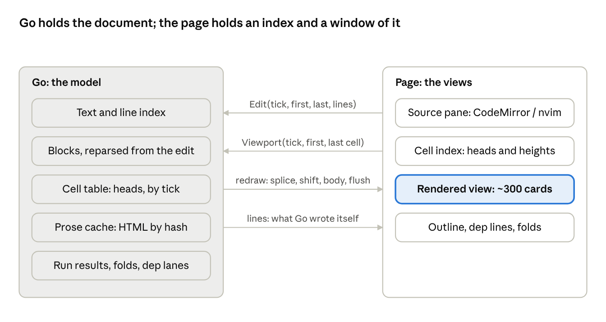

# A UI protocol for 1M-line documents

Status: approved, stage 1 in progress. Nov 7, 2026.

Asked for by j after PR #225 got typing smooth at 10K lines and usable
at 100K but not at 1M: "we should look at the UI Protocol (maybe see if
nvim ui protocol can give us something to base on) to see if we can get
1M comfortable." This is the design. The living copy, with j's
comments, is the Claude doc "UI protocol for 1M-line documents"; this
file is the record in the repository.

## Summary

Move the document model to Go and make the page a view of it, the way a
Neovim UI is a view of Neovim: the page sends edits as line
replacements, Go answers with a batch of cell changes that ends in a
flush, and the page only ever holds the cells near the viewport. That
takes the per-key cost at 1M lines from moving about 120 MB of text and
JSON across the bridge to a few kilobytes, and the rendered view from
one card per cell to a few hundred cards.

What it buys, against [PR #225](https://github.com/gdey/markdownshell/pull/225)'s numbers:

| 1M-line runbook | after #225 | target |
| --- | --- | --- |
| Open, first screen drawn | ~85 s | under 1 s |
| One key in the source view | ~1.5 s | under 50 ms |
| Bytes over the bridge per key | ~120 MB | under 10 KB |
| Cards in the DOM | one per cell (~250K) | ~300 |
| Views of one document | one per tab | any number, each seeing the others' changes, one editing at a time |

The design lands in four stages that each ship on their own, branched
from #225. Stage 1 (edits instead of whole texts) is the cheapest and
removes most of the per-key cost. Stage 2 (cell heads plus bodies on
demand, a lazy top-down parse, and a virtualized rendered view) is the
largest and is what makes opening fast. Stages 3 and 4 make Go push
changes instead of being polled, and move folds and the Neovim pane
onto the same protocol. Rough total: 8 to 10 weeks of work, now that
several views of one document are in scope, detailed in the last
section.

## Where we are

The page and Go each hold the whole document, and every change moves
all of it across the Wails bridge in both directions. That is the cost
that #225 could not remove.

How a keystroke in the source view flows today (`frontend/src/app.ts`,
`service.go`, `notebook/prose.go`):

1. CodeMirror holds the full text. 500 ms after typing stops,
   `applySource` calls `SetText(base, text)` with the text Go last had
   **and** the new text, so Go can refuse a stale write. At 1M lines
   that is about 54 MB.
2. Go's `SetText` compares `base` to its source, then `doc.SetSource`
   parses the **whole** file again and `sync` rebuilds every block's
   result.
3. The page calls `Cells()`. Go lays out every cell, renders every
   prose cell to HTML with goldmark, and returns one `[]Cell` holding
   every block's code and output. About 67 MB of JSON and 3 s at 1M
   lines.
4. The page compares the old and new cells by a per-cell string
   (`drawnAs`), keeps the unchanged head and tail, and redraws the
   cards in between. Then it refreshes the outline, dependency lines
   and folds from the DOM.
5. The `depends=` lint sends the text to Go again (`SourceBlocks`).

The rendered view has one DOM card per cell for the whole document.
#225 hides off-screen cards from layout with `content-visibility:
auto`, but they still exist, the outline still walks every `#doc >
section`, and `setDeps` still keeps a ring and a port per card.

What #225 fixed and what it left:

| | Fixed in #221 and #225 | Still whole-document |
| --- | --- | --- |
| Go layout | linear time via `doc.Index` | parse, layout and prose rendering on every edit |
| Bridge | fewer calls (`CheckInfos` batches fences) | `SetText` sends two full texts; `Cells` returns everything |
| Rendered view | only changed cards redrawn; off-screen cards skipped by layout | one card per cell; outline and deps scan every card |
| Source view | folds as a CodeMirror state field, scanned from the edit | CodeMirror holds the full text (fine: it is a rope) |
| Neovim pane | grid drawn from `ext_linegrid` events | the buffer's text comes back whole on every change (`mdsh_changed`) |

Two things in the repository already point the way. The embedded Neovim
pane (`nvim.ts`, `neovim.go`) already consumes a Neovim redraw stream
and draws a grid from deltas. The fold scanner that #225 added
(`fold.ts`) reparses from just above an edit until the state matches
what it was, which is the same trick Go's parser needs.

Measurements this doc relies on come from #225's description and have
not been re-run here. Where the 85 s open at 1M lines goes (parse,
`Cells`, JSON, or drawing) is not broken down there, so the open target
is an estimate until stage 2 measures it.

## What Neovim's UI protocol does, and what transfers

Neovim's rule is that the editor owns the state and a UI only draws
what it is told, as deltas, in batches it may apply when a `flush`
arrives. Four ideas from it carry over directly; two do not. Facts here
are from Neovim's `ui.txt` and `api.txt` (v0.10).

| Neovim | What it does | Our analogue |
| --- | --- | --- |
| `redraw` batch ending in `flush` | one notification carries many `[event, args...]` tuples; the UI draws nothing until `flush` | Go answers an edit with one `Redraw` batch; the page applies it in one frame |
| `grid_line` (`ext_linegrid`) | redraws a run of cells on one row, with `[text, hl_id, repeat]` compression; the rest of the row stays | `cells_splice`: replace a run of cells; untouched cells stay as drawn |
| `grid_scroll` | "copy these screen cells" rather than resend them | `cells_shift`: move the line and byte positions of every cell after an edit by a delta, without resending them |
| `win_viewport` (`ext_multigrid`) | tells the UI which buffer lines a window shows: `topline`, `botline`, `line_count`, `scroll_delta` | the page tells Go its viewport; Go sends bodies only for cells in it |
| `ext_*` options | the UI opts in to draw a part itself (popupmenu, tabline, messages) and Neovim sends semantic events for it instead of grid cells | the outline, dependency lines and folds each get their own semantic event stream instead of being read off the cards |
| `nvim_buf_lines_event` | `[buf, changedtick, firstline, lastline, linedata, more]`: lines `firstline` to `lastline` (exclusive, zero-based) became `linedata`; `changedtick` guards replies | the edit message in both directions, with `tick` as the guard |

What does not transfer:

- **A character grid.** Neovim's UI is a fixed-cell grid with one font.
  The rendered view is a flow of HTML cards of unknown height, so the
  unit of the protocol is a cell (a prose part or a block), not a
  screen row. The page measures heights; Go never knows pixels.
- **One authority.** In Neovim the UI never edits text. Here the page's
  CodeMirror is the editor and Go is the model, so edits go both ways
  and need a guard. Neovim's `changedtick` is the right guard, and the
  page's existing `Synced` class (`sync.ts`) already does the three-way
  merge when Go changed the text under the pane; it just needs to take
  line edits instead of whole texts.

The embedded Neovim pane is the proof that this shape works in this
app: `nvim.ts` already draws from `grid_line` and `grid_scroll`
batches. The only thing it does badly at scale is the `mdsh_changed`
handler in `mdsh.lua`, which sends the whole buffer back. Its
`nvim_buf_attach` hook is already in place to send
`nvim_buf_lines_event` deltas instead.

## Protocol design

Go owns the document: its text, its parse, its cells, its run results
and its folds. The page owns three views of it (source pane, rendered
view, outline) and holds only a compact index of every cell plus the
bodies of the cells near the viewport. Every message carries a `tick`,
Go's change counter, so a message built on an old state is refused and
rebased rather than applied.



Edits and viewport changes go right to left; batches of cell changes
and Go's own line edits come back, and the page keeps cards only for
the window it shows.

### Three rules

1. **Edits are line replacements, never texts.** The shape is
   `nvim_buf_lines_event`: lines `[first, last)` became `lines`. The
   page sends them for typing; Go sends them for what it writes itself
   (run output, include fills, task checks, folds, block moves). A key
   costs the bytes of one line.
2. **Go answers with a batch that ends in flush.** One `Redraw` holds
   every change an edit caused: cells spliced, positions shifted,
   bodies for cells in view, outline and dependency changes. The page
   applies it in one animation frame. Nothing is polled; `Cells()`
   goes away.
3. **Bodies only for the viewport.** A cell's *head* (kind, line, block
   index, line count, flags, a content hash) is small and the page has
   all of them. Its *body* (rendered HTML, code, output) is sent when
   the cell comes near the viewport and dropped when it leaves. Go
   caches rendered prose by content hash, so scrolling back is a
   lookup, not a render.

### Messages

Page to Go, as Wails bindings (request and reply):

| Call | Reply | When |
| --- | --- | --- |
| `Attach(viewport)` | `DocInfo` + first `Redraw` | opening a file, or a page catching up |
| `Edit(tick, first, last, lines)` | `Redraw`, or `Stale` with the line events since `tick` | 500 ms after typing stops, as now, but with only the changed lines |
| `Viewport(tick, firstCell, lastCell)` | `Redraw` with bodies for cells now in range | on scroll, throttled to one in flight |
| `Bodies(tick, cells)` | bodies | a peek, a fold preview, a search hit |
| existing calls (`RunBlock`, `SetTask`, `SetFolds`, `MoveBlock`, …) | unchanged reply | they now also cause a `redraw` event |

Go to page, as one `redraw` event per change, a batch of tuples like
Neovim's:

| Event | Fields | Meaning |
| --- | --- | --- |
| `tick` | `tick` | the state the rest of the batch brings the page to |
| `lines` | `first, last, lines` | Go changed the text; the source pane merges it as `Synced.incoming` does today, by delta |
| `cells_splice` | `at, remove, heads` | cells `[at, at+remove)` are replaced by `heads`; the page replaces that run of cards or index entries |
| `cells_shift` | `fromCell, lines, bytes, blocks` | every cell from `fromCell` on moved by these deltas; the page adds, it does not redraw (`grid_scroll`'s idea) |
| `body` | `cell, body` | a body for a cell in or near the viewport |
| `block` | as today, plus `tick` | live run events; applied only if the card is drawn, else kept by Go until its body is asked for |
| `outline_splice` | `at, remove, items` | the outline's items changed; it is no longer read off the DOM |
| `deps_set` | `edges, lanes` | the dependency edges and their lanes, computed once in Go per change |
| `folds_set` | `folds` | which sections and parts are folded, from the file and the session |
| `lease_set`, `lease_request`, `lease_release` | holder, requester | who may edit; see "Several views" below |
| `flush` | | apply everything above now |

### Shapes, in Go

```go
// A CellHead is what the page holds for every cell: about 40 bytes.
type CellHead struct {
	Kind  uint8  // prose, heading, block, textbox, choice
	Level uint8  // heading level, 1 to 6
	Flags uint16 // collapsed, ran, failed, stale, running, hidden, secret, nosave, movable
	Block int32  // block index, -1 for prose
	Line  int32  // first line, from 1
	Lines int32  // line count, for the height guess
	From  int32  // byte offset
	Hash  uint64 // of what the body is drawn from: equal hash, equal card
	ID    string // block id, "" for prose
}

// A CellBody is today's Cell minus the head's fields: HTML, Body,
// Output, Attrs, Depends, Tasks, Textbox, Choice, Ms, Timeout, ...

type Redraw struct {
	Tick   uint64
	Events []Event // each a [name, args...] tuple, ending in flush
}
```

At open, `Attach` returns the heads as columnar arrays (one array per
field) rather than an array of objects. For a 1M-line runbook, about
250K cells, that is roughly 3 MB of JSON once, instead of 67 MB on
every key. If that still shows in the open time, the arrays go across
as base64 typed arrays.

### Consistency

Two sides edit the text, so `tick` is the guard, as `changedtick` is in
Neovim. Go keeps a ring of the last few hundred line events. An `Edit`
whose `tick` is behind gets `Stale` with the events since; the page
maps its typing past them with the `ChangeSet` machinery already in
`sync.ts` and sends again. This replaces today's loop in `sendSource`
that reloads the whole text on a miss, and it ends in the same place:
nothing typed is lost, and Go never applies an edit against text the
page didn't see.

### Go's side of an edit

1. Apply the line replacement to `Src` and the line index (line starts;
   a shift of everything after the edit).
2. Reparse from the last block boundary before the edit
   (`doc.Index.Boundaries`) forward, until the new boundaries line up
   with the old ones past the edit, then splice the blocks. An open
   fence that swallows the rest of the file never lines up, so that
   case falls back to a full parse, which is the case #225 already
   holds back for 1.5 s while typing settles.
3. Splice the cell table for the reparsed span; emit `cells_splice` for
   it and `cells_shift` for everything after.
4. Render bodies for spliced cells inside the viewport (prose cache
   first), emit `body` for each.
5. Recompute what depends on the whole document only when it changed:
   link reference definitions, dependency lanes, the outline. Each is
   already linear and emits its own event only if its result differs.

The parse is the part of this with real risk, so stage 1 ships with a
full reparse and stage 3 makes it incremental, each behind the same
fuzz test that `fold.ts` has now: random edits, compare against a fresh
parse.

## How the rest of the view fits

Each of these is read off the DOM today. Under the new protocol each is
its own event stream from Go, the way an `ext_*` option turns a Neovim
widget into semantic events, and none of them needs a card to exist.

### The rendered view, virtualized

The page keeps cards for the cells in the viewport plus about two
screens either side, roughly 300 cards, between two spacer elements
sized from the cell index. A cell that has never been seen gets a
height guessed from its head (lines times the line height, plus the
card's chrome), the guess #225 already makes for `content-visibility`.
Once a card is laid out, its measured height is stored by content hash,
so scrolling back is exact. Replacing a guess with a measurement adjusts
the spacer and keeps the anchor cell where it was, as `anchor()` does
now.

Scrolling asks Go for bodies as cells come within the margin, one
`Viewport` call in flight at a time. A wheel flick across 10,000 cells
never asks for the ones it skipped. The source pane's scroll sync
(`syncScroll`, `cellAt`) binary-searches the cell index by line instead
of `#doc.children`, which it already nearly does.

### Outline

The outline comes from Go as `outline_splice` events: headings with
their level and cell index, blocks with their name and run state,
inputs with their binding. A 1M-line runbook has tens of thousands of
headings, so the outline list is virtualized the same way, and only
top-level items are drawn until a section is opened. The running-block
marks (`drawRunning`) are a `block` event, not a DOM scan.

### Dependency lines

Edges and lanes are Go's: `deps_set` carries `from`, `to` by block
index and the lane for each edge, computed once per change with the
sorted search #225 added. The page draws only the segments that cross
the viewport. An edge whose far end is off-screen runs to the window's
edge, in its lane, with its ring at the end that is visible; dragging a
ring over a spacer scrolls the view, the way dragging over a folded
heading peeks today. Rings and ports exist only for drawn cards.

### Folds

Folds live in Go: the file's `collapse=` and `mdsh:collapse` plus the
session's hand folds, which `SetFolds` already writes. Go sends
`folds_set` and, more usefully, excludes the hidden cells from the
shown sequence the page indexes, the way `win_viewport` counts a fold
as one line. Folding the top-level sections of a 1M-line document
brings the shown cells down to the headings, so the view is cheap no
matter the file. A peek into a folded section is a `Bodies` call for
its first few cells.

### Block outputs and runs

Live run events keep their shape (`block` with `kind`, `block`,
`data`). Go stamps each with the tick and applies it to its own results
first, so a card that is not drawn misses nothing: when it scrolls in,
its body already holds the output. Following a running block (`follow`)
becomes a `Viewport` move to that block's cell. For a block whose output
is enormous (the `output` stress shape), the body carries the rendered
output in pieces, the first screen at once and the rest on demand, which
today's `pre` can take as appended text.

### Source pane

CodeMirror keeps the whole text in the page. It is a rope, and #225
showed typing in it is fine at 100K; the stalls were the bridge and the
redraw. The Neovim pane sends `nvim_buf_lines_event` deltas from its
`on_lines` hook instead of the whole buffer, which is the same `Edit`
message, so both editors share one path into Go.

## Several views of one document

A document can have any number of attached views, each seeing every
change the moment it lands, with one of them editing at a time. This is
what `mdsh --serve` needs (a browser over an SSH tunnel beside, or
instead of, the app's window) and it falls out of the protocol: Go
already has to send one view a `redraw` batch per change, and sending
it to every view is a loop. Neovim likewise lets several UIs attach to
one instance and sends every one the same `redraw` stream.

### Attachments

Go keeps one attachment per view: its viewport, the last tick it was
sent, and whether it holds the edit lease. `Attach` creates one;
closing the page or a dead connection drops it. Every change, from any
view or from a run, is broadcast as the same `redraw` batch to every
attachment, with `body` events cut to each one's viewport. So when one
view types, the other sees the typed lines arrive in its source pane as
`lines` events and the changed cards redraw, within the same 500 ms
settle the typer sees. A view that comes back after being away gets,
from its last tick, either the line events since (Go keeps the ring) or
a fresh `Attach`, which is what today's `Live` catch-up does for a run.

This replaces the per-tab `liveEvent` list and the window-scoped events
in `tab.go`: the attachment is the unit, not the window, so a tab moved
to another window, a second window on the same file, and a browser tab
under `--serve` are all the same case.

### Handoff of control

Two CodeMirrors typing into one text at once would need operational
transformation; the `tick` rebase handles disjoint lines but not two
hands on one line. So the source text has an **edit lease**: one
attachment holds it, and only its `Edit` calls are applied. Everything
that goes through Go as an action (run a block, check a task, fold,
move a block, answer a confirm, type into the History pane) is allowed
from any view, since Go serializes those already, and every view sees
the result.

- A view without the lease shows its source pane read-only, with a bar
  saying who is editing and a **Request control** button. Typing in
  the read-only pane presses that button; it never takes the lease by
  itself.
- A request is a call, `RequestLease(tick)`. The holder gets a
  `lease_request` event and a prompt in its window: *"<name> wants to
  edit. Hand over?"* with **Hand over** and **Keep**. Keep answers no
  and the requester's bar says so.
- If the holder doesn't answer within a timeout (a setting, default 2
  minutes), the request is granted: the holder's pane flushes its
  pending edit first (Go sends `lease_release` and waits up to a
  second), then the lease moves and every view gets `lease_set` with
  the holder's name. The holder's pane goes read-only with a bar saying
  who has it now.
- Hand over does the same at once. A holder can also give the lease up
  from its bar without a request.
- A holder that disconnects loses the lease at the next request, with
  no wait.
- The requester's bar counts down while it waits and lets it withdraw
  the request.

What the lease does not cover: the Neovim pane holds its own buffer, so
it behaves as a CodeMirror that is always the lease holder while it is
open; two Neovim panes on one document are not supported, and the
second gets the read-only CodeMirror.

### Over a socket

Under `--serve` the bridge is a WebSocket rather than the Wails message
handler, and the same messages go over it as JSON. Bindings become
request/reply frames with an id; `redraw` and the run events are
notifications. The page's `api.ts` already funnels every Go call
through one module, so the transport is one adapter. The security side
of `--serve` (loopback, token, cookie) is in its own review (#56) and
is unchanged by this.

## Migration path

Four stages, each a PR that ships on its own, keeps the old bindings
until nothing calls them, and is held to the stress harness #225 added
(`internal/stress`, `gui.cjs --check`). Stage 1 is on the critical path
for typing; stage 2 for opening; 3 and 4 are polish that the first two
make possible.

1. **Edits instead of texts.** Add `Edit(tick, first, last, lines)` and
   the `lines` event; `SetText` and `Text` stay for the first load and
   as a fallback. Go still parses the whole file and the page still
   calls `Cells()`. The `Synced` class takes line events in place of
   whole texts. The Neovim pane's `mdsh_changed` sends `on_lines`
   deltas. The `depends=` lint asks Go about the spans it needs rather
   than sending the text. This stage also measures CodeMirror alone at
   1M lines with the bridge out of the way, to settle whether the
   source pane needs windowing too. Gate: a 1M-line key moves under
   10 KB; `gui.cjs --check` still passes on all five shapes.
2. **Heads, bodies, a lazy parse and a virtualized view.** Split `Cell`
   into `CellHead` and `CellBody`. `Attach` returns the heads parsed so
   far; Go parses top down and keeps appending `cells_splice` events as
   it goes, so the first screen draws as soon as its cells exist and
   the scrollbar grows behind it, the way a browser lays out a page as
   it loads. The document is linear, so block indices are stable as
   the parse proceeds, and a `depends=` that names a later block
   resolves when that block arrives. `Viewport` and `Bodies` return
   bodies. Go caches rendered prose by hash. The page's
   `drawDoc`/`updateDoc` become a window over the cell index with
   spacers; `drawOutline`, `setDeps`, `applyFolds` and `syncScroll`
   read the index, not the DOM. The old `Cells()` is removed at the end
   of this stage. Gate: a 1M-line open shows its first screen under
   1 s; the DOM holds under 500 cards at any scroll position; the
   existing fold fuzz test and a new scroll test (random jumps, compare
   the drawn cards against a full draw) pass.
3. **Go pushes, and several views.** `Edit` and the run bindings return
   nothing new; instead Go emits one `redraw` batch per change with
   `cells_splice`, `cells_shift`, `body` and `flush`, to every
   attachment. The edit lease and `RequestLease` land here, with a
   second window on the same file as the first test of two views. The
   incremental parse lands here too, behind a fuzz test against a full
   parse, and the 1.5 s settle for an open fence becomes Go's decision
   rather than the page's. Gate: one key at 1M lines under 50 ms end to
   end in `gui.cjs`; two windows on one file stay in step through a run
   and a handoff; `TestStressScales` holds linear.
4. **Folds and outline as Go's; the socket transport.** Hidden cells
   leave the shown sequence; `outline_splice`, `deps_set` and
   `folds_set` replace the page's scans; the Neovim pane's folds and
   run gutter come from the same events. The WebSocket adapter for
   `--serve` lands as the second transport of the same messages. Gate:
   folding every top-level section of a 1M-line runbook leaves under
   1,000 shown cells, and the outline opens in under 100 ms.

What stays the same through all four: the bindings the menus and
toolbar use, the `block` and `confirm` run events, the History pane,
the console, and every file format. A user sees no change except speed,
so no stage needs a screenshot in its PR beyond the before and after of
the stress document.

## Estimate, risks and decisions

About 8 to 10 weeks of focused work, with stage 2 the long pole. These
are estimates from reading the code, not from a spike, and the Go parse
number in stage 3 is the least certain.

| Stage | Go | Frontend | Tests | Total | Main risk |
| --- | --- | --- | --- | --- | --- |
| 1. Edits instead of texts | 2 d | 2 d | 1 d | 1 week | the three-way merge in `Synced` moving to line events; the Neovim `on_lines` path |
| 2. Heads, bodies, lazy parse, virtualized view | 6 d | 8 d | 3 d | 3.5 weeks | every page feature that reads `#doc` children (folds, deps, selection, drag, scroll sync, search) has to read the index instead; the lazy parse has to keep the outline and section ranges honest while the tail is unparsed |
| 3. Go pushes, several views, incremental parse | 7 d | 4 d | 4 d | 3 weeks | the incremental parse: fences, `mdsh:if` sections and includes make block boundaries depend on text far above; the lease handoff racing a pending edit, and the holder's prompt arriving while a confirm dialog is up |
| 4. Folds and outline in Go, socket transport | 3 d | 4 d | 1 d | 1.5 weeks | peeking into folded sections and dragging across them; the socket's reconnect and catch-up |

Risks that cut across stages:

- **WKWebView bridge limits.** Wails v3 carries bindings and events as
  JSON through the WebKit message handler. A 3 MB `Attach` reply is
  fine; a 67 MB one today works but is slow. If any single message
  still shows in profiles, the fallback is a local socket or chunked
  events, which Wails supports but which costs a few days.
- **Two authorities on the text.** The page's CodeMirror and Go both
  edit. The `tick` guard plus rebase is the Neovim pattern and the
  current `sendSource` loop in disguise, but it needs a fuzz test with
  both sides editing at once, which does not exist yet.
- **Block indices move.** Many events and bindings name a block by
  index, and inserting a block renumbers everything below. The
  `cells_shift` event covers it for cells, and `block` events carry the
  tick they were numbered at. Naming blocks by id instead would be
  cleaner but touches the `run` package, so this design keeps indices.
- **Height guesses.** A virtualized view with wrong guesses makes the
  scrollbar jump. Measured heights by hash and anchor-preserving
  corrections keep this to the first pass through a region; it is what
  every virtual list does, but it will need tuning on prose-heavy
  documents.

Decisions so far, from j:

- **Open target is 1 s**, not 3 s, so stage 2 includes the lazy
  top-down parse. The document is linear, which is what makes that
  cheap.
- **Branch stage 1 from #225**, as #225 branched from #221, so the
  stress harness needs no rebase.
- **Whether the source pane windows its text is measured, not
  decided.** The gut call is that it will need to; stage 1 measures
  CodeMirror alone at 1M lines once the bridge is out of the way, and
  if the pane is the stall, a windowed source pane (CodeMirror over a
  line range, with Go as the text) becomes a stage 5 of about two
  weeks.
- **Several views of one document, each seeing the others' changes,
  with handoff of control**, is a requirement, mainly for `--serve`.
  The redraw broadcast gives the first part for free; the lease gives
  the second. Control never moves silently: the holder is asked, and
  the request is granted on its own only after a timeout (default 2
  minutes).

Sources: [PR #225](https://github.com/gdey/markdownshell/pull/225),
[PR #221](https://github.com/gdey/markdownshell/pull/221), Neovim
`ui.txt` and `api.txt` at
[v0.10.0](https://github.com/neovim/neovim/tree/v0.10.0/runtime/doc),
and the code on #225's branch: `cmd/mdsh-gui/service.go`,
`notebook/prose.go`, `doc/source.go`, `frontend/src/app.ts`,
`sync.ts`, `deps.ts`, `fold.ts`, `nvim.ts`, `nvim/mdsh.lua`.
