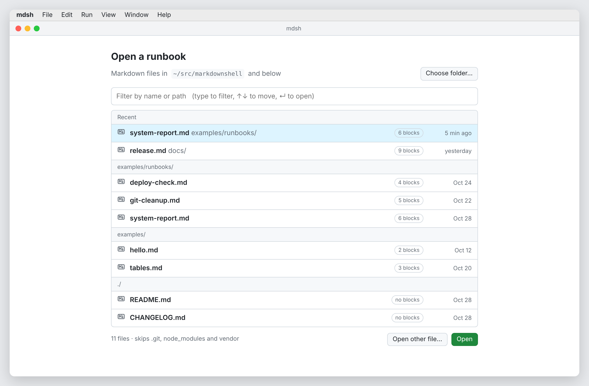
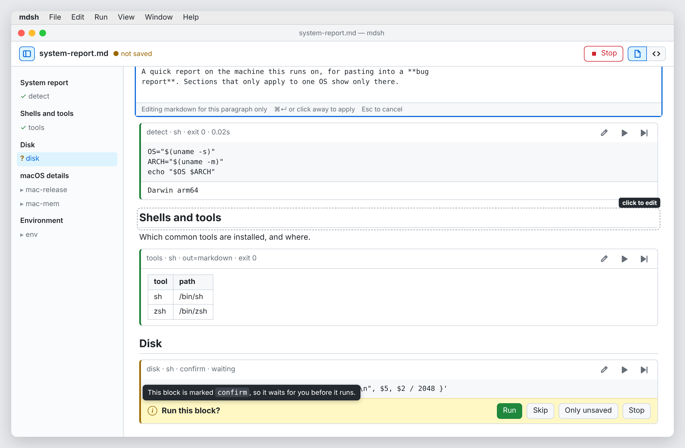
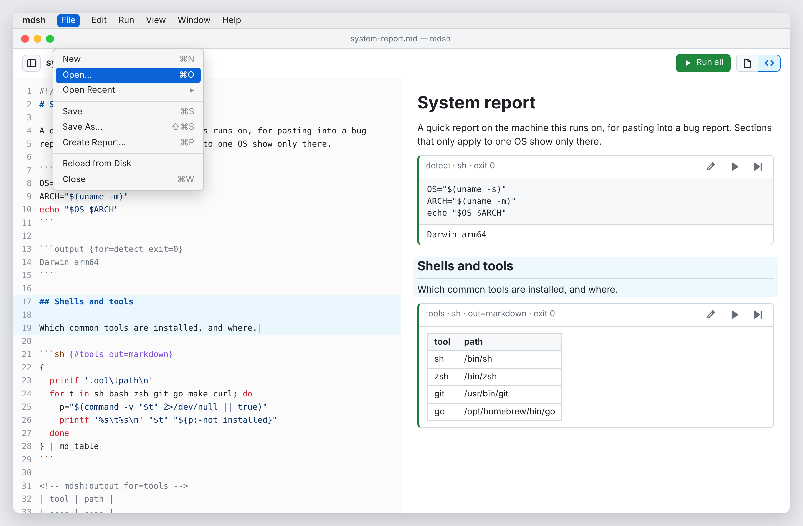
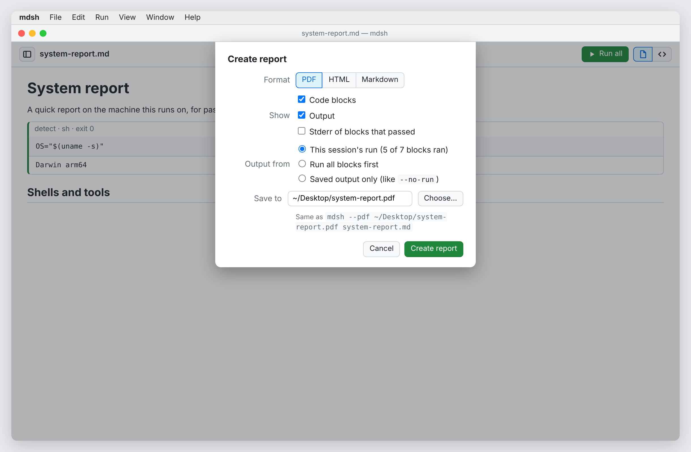
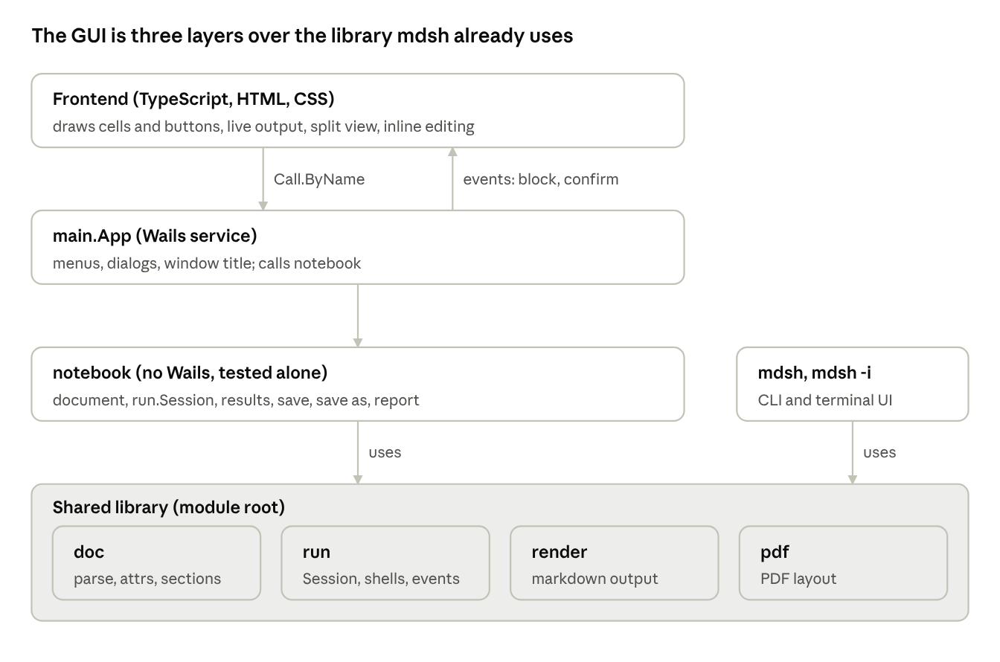

# mdsh-gui design

Status: design, Oct 28, 2026. Tracks the `gui` branch.

## Goals

mdsh-gui is a desktop notebook for mdsh files. You open a markdown runbook, run its blocks, edit it, and turn the result into a report, without a terminal. It does what `mdsh -i` does, adds what a window does better (editing, images, reports), and keeps the file format exactly as the CLI writes it.

- **Same files, same results.** A file saved by the GUI runs and prints the same in `mdsh`, and the reverse. All logic stays in `doc`, `run` and `render`, and the GUI adds no file format of its own.
- **Edit the markdown, see it rendered.** All editing happens in the source view, the whole file in a markdown editor, beside the rendered view and kept in sync with it. Clicking something in the rendered view takes you to its markdown. Editing in place in the rendered view was tried in M3 and dropped, since it was awkward next to the source (j, Oct 29).
- **Reports are a first-class output.** One action turns a run into a PDF, HTML or markdown copy to share.

Not goals for v1: multiple documents in one window (use one window per file), a plugin system, remote kernels, or languages beyond what `run` supports today (`sh`, `zsh`).

## Features

Every feature of `mdsh` and `mdsh -i` gets a place in the GUI. New in the GUI: save as, create report, a start screen, and editing the whole document. M1 to M6 are the milestones below.

| Feature | Today (CLI / TUI) | In the GUI | When |
| --- | --- | --- | --- |
| Run one block, run from here, run all | `enter`, `a` in `-i`; `mdsh file.md` | Buttons per block and in the toolbar | Done (#28) |
| Stream output, stop | live in `-i`, `ctrl+c` | Live under the block, Stop button | Done (#28) |
| confirm and step mode | prompt in `-i`, `--step`, `--yes` | Question under the block's code: Run / Skip / Only unsaved / Stop | Done, add Only unsaved in M1 |
| mdsh:if sections, placeholders | printed by `render` | Same rules, redrawn after each run | Done |
| Save | autosave in `-i`, `w`, `-w` | Save (cmd+S), opt-in autosave, a dirty marker | M1 |
| Save as | `-o file` | Save As… (cmd+shift+S); the window then follows the new file | M1 |
| File changed on disk | `w` twice to overwrite | Banner: Reload / Keep mine | M1 |
| Edit one block | `e` opens `$EDITOR` | The pencil (or `e`) puts the cursor on the block's code in the source view | M3 |
| Add a block | `i` / `:` prompt | Type it in the source view, anywhere in the file | M3 |
| Edit the whole document | `$EDITOR` outside mdsh | The source view, beside the rendered view or on its own; clicking prose takes you to its markdown | M3 |
| Images, screenshots, recordings | half-block preview, `v` | Real images in the output, click to open full size | M4 |
| Create report | `--pdf`, `--html`, `-o`, `--hide-code`, `--hide-output`, `--no-run` | Report… dialog: format (PDF, HTML, markdown), hide code, hide output, run first or use saved output | M5 |
| tty blocks | hand over the terminal | A terminal pane in the window (xterm.js over a pty) | M6 |
| Arguments `$1…` | trailing CLI args | Command line on launch, and an Arguments field | M1 |
| `--only`, `--stop-on-error`, `--shell` | flags | Settings (mdsh › Settings…) for defaults; Run menu for this file | M1 |
| Open recent, drag a file in, file association | none | Start screen listing `.md` files under the current folder (shown when no file is given), Open Recent, drag and drop, file association | M1 |

## Screens

There is one window per document, with the rendered view always present and the source optionally beside it. Native menus carry every action, so each one has a shortcut.

These are mockups, not the built app, shown as they would look on a Mac. The toolbar holds only what changes while you work. Run all turns into Stop while blocks run, and it goes back when they finish. Rendered and split use GitHub's file and `<>` icons. The sidebar icon opens and closes the outline. Open, Save, Save As and Create Report live in the File menu, and settings live in **mdsh › Settings…** (cmd+,). Block actions are icons: pencil to edit, play to run, play-to-bar to run from here.

*No file given.* The window lists markdown files under the folder it started in, with recent files first, and you click one to open it. The file names here are made up. When the app starts from Finder or the Dock there is no useful current folder (it is /), so it lists the start folder from Settings. That setting defaults to the last folder you used, and the first time to ~/Documents on macOS or your home folder elsewhere.

*Rendered view, while running.* `disk` is marked `confirm`, so its question (the block's own `confirm=` text, or "Run this block?") sits right under its code, and the view scrolls to it. Hovering over the ⓘ icon explains why it is waiting. The first paragraph is open in an inline markdown editor, an idea dropped in M3 for the source view.

*Split view, at rest.* Nothing is running, so the toolbar shows Run all, and the File menu is open. The cursor is on line 19, and the same section is highlighted on the right.

*Create report.* It maps onto existing flags, and the dialog shows the matching `mdsh` command.

1. **Rendered view** (always on; #28 has the read-only start). Prose is rendered, and runnable blocks are cards with Run, Run from here, an exit status and output below. Clicking a paragraph, heading, list or table opens the source view with the cursor on its markdown, and the pencil on a block puts it on the block's code. With the source view open, clicking a block or paragraph lines the source up with it, so the two show the same place even when Show Code or Show Output hides parts of the rendered view. A confirm question appears in the block's own card, under its code, and the view scrolls to it. A block's own Run button is its answer, so running one confirm block runs it straight away; Run from here and Run all still ask. A sticky banner at the top is kept for the file-changed notice.
2. **Source view** (toggle, cmd/ctrl+\). The whole file's markdown in a code editor (CodeMirror 6) on the left, with markdown and shell highlighting and mdsh attributes like `{#id confirm}` highlighted. The rendered view is on the right. The two scroll together and stay in sync: typing in the source re-renders after a short pause. When a run ends its output appears in the source too, as saving will write it. Output from blocks whose code did not change is kept, as `Session.Sync` does for `-i`. The opening line of each runnable block has a run button in the gutter, which applies what was typed and runs that block. The rendered view can be turned off too (its toolbar button, View › Rendered View or cmd/ctrl+shift+\), leaving the source alone; turning off the only pane shown brings back the other, and a confirm question brings back the rendered view, since it is asked in the block's card.
3. **Outline** (toggle: the sidebar icon at the left of the toolbar, View › Outline or cmd/ctrl+shift+O). A drawer on the left listing the headings and blocks, to jump around long runbooks. Blocks sit under their heading, and each shows its state: ✓ ran, ? waiting for a confirm answer, ✗ failed, … running. Clicking an entry scrolls to it, in the source view too when it is open.
4. **Report dialog** (File › Create Report…). A sheet with format (PDF, HTML, markdown), show code, show output, and where the output comes from: this window's run, "run all blocks first" (it runs as Run all does, asking its questions in the window), or the saved file (like `--no-run`). It defaults to a file beside the document, shows the matching `mdsh` command as run in the document's folder, writes the file, then offers Show in Folder. The mockup's "stderr of blocks that passed" is left out, since `render` decides that from `show-stderr` and the CLI has no flag for it.
5. **Settings (mdsh › Settings…, cmd+,).** App-wide defaults such as autosave, shell, theme, Vim mode and the start folder (last used, or a fixed folder). Theme is System, Light or Dark; the editors' code colors follow it, and System follows the OS. Per-file run options (arguments, `--only`, stop on error, step mode) go in the Run menu.

Menus: **File** (New, Open, Open Recent, Save, Save As, Create Report, Reload, Close) · **Edit** (Undo, Find) · **Run** (Run Block, Run From Here, Run All, Stop, Step Mode) · **View** (Rendered View, Source View, Outline, Show Code, Show Output, Zoom). The View items are check marks for the window in front. Each window keeps its own view, and a new window starts with the view the last one was left in. Show Code and Show Output hide the code and the output of runnable blocks in the rendered view.

**Block attribute helper.** The `{#id …}` part of a fence gets help in the source view. Typing inside the braces offers completions for attribute names and their known values (`out=` text, markdown, image, screenshot; `on_error=` stop, continue; env names already in the file; `{{#block/…}}` and `{{$VAR}}` in conditions), and hovering an attribute shows its one-line meaning and default. Invalid values are underlined as errors, and unknown attributes and include-only ones on a runnable block as warnings, since mdsh keeps them untouched. It reads the attribute table exported by `doc` (library change 5), so the GUI never keeps its own copy of the spec. M2's form over the attributes went with the block card editor in M3.

**Markdown bar.** The source view has a slim bar of common markdown actions, like GitHub's comment editor: heading, bold, italic, inline code, link, image, bulleted, numbered and task lists, quote, table, fenced code block, and an mdsh block (a shell fence with an `{#id}` attribute, with confirm as an option). Each button inserts or wraps markdown at the cursor or selection, so the text stays plain markdown. Heading steps the line through `#`, `##`, `###` and back. Table inserts a small header-and-row skeleton, and pressing tab inside a table moves between cells, skipping the row of dashes. The mdsh block button opens a short menu: an sh block, one marked confirm, or a zsh block, with the id selected to type over. Every button has a shortcut where a common one exists (cmd/ctrl+B, I, K, E). The source view's right-click menu has the same actions under Insert, after Cut, Copy and Paste.

**Vim mode** (Settings, off by default). Text is edited in the source view, a CodeMirror 6 editor, so one setting turns on Vim keys there, using the vendored `@replit/codemirror-vim` extension (normal, insert and visual modes including visual block, counts, operators and text objects, registers, marks, macros, `.` repeat, search, and `:s`). With Vim mode on, `:w` applies what was typed and saves the file. Changing the setting takes effect at once.

Shortcuts follow the TUI where they don't clash with the OS. `j`/`k` move between blocks, `enter` runs, `a` runs from here, and `e` edits, but only when no text field is focused. Cmd/ctrl+S, cmd/ctrl+shift+S, cmd/ctrl+R (run all), cmd/ctrl+. (stop), cmd/ctrl+\ (source view), cmd/ctrl+shift+\ (rendered view) and cmd/ctrl+shift+O (outline).

## Architecture

The GUI is a thin layer: the frontend draws, `main.App` binds, and `notebook` holds the state. Running, rendering and PDF stay in the shared library, so the CLI, the TUI and the GUI cannot drift apart.

- **Frontend** (`cmd/mdsh-gui/frontend`). TypeScript, bundled by esbuild's Go library from go generate, with no npm. CodeMirror, used by every editor, is a vendored pre-built bundle, `frontend/vendor/codemirror.js`, with the Vim extension and markdown support included. `go run ./internal/vendorjs` rebuilds it without npm: it downloads the exact versions `frontend/vendor/package-lock.json` pins from the npm registry, checks their integrity hashes, bundles them with esbuild and copies their type declarations and licenses beside it. The app's own code bundles into `frontend/bundle/` and imports the vendored bundle as a separate file, so the two change independently. Typed bindings come from `wails3 generate bindings -ts -b -names -i`, which import the runtime Wails serves at `/wails/runtime.js`. CI checks that the vendored bundle matches its lock and the bindings and bundle are generated, and tsc type-checks against the vendored types. The frontend listens for events: `block` (started, stdout, stderr, done), `confirm`, `opened`, `saved`, `file-changed`, `menu` (a menu command for the window in front), `settings` and, later, `tty`. Events reach every window, so each keeps those its own window sent.
- **`main.App`** (the Wails service). One per window. Menus, dialogs (open, save as, report destination), window title and dirty marker. No logic beyond calling `notebook`.
- **`notebook`** (no Wails import, tested on its own). The open document, its `run.Session`, results, dirty state, and the file's mtime for change detection. It gains `SaveAs`, `Report`, `Text` and `SetText` (the source view) and a pty for tty blocks. After a save the document is parsed again from what was written, so the source pane shows the saved output.
- **Shared library.** Today `doc`, `run`, `render` and `pdf`. Five changes were planned, each a small PR to main that the GUI then uses (change 3 ended up in the GUI alone):
  1. Move the report pipeline that `cmd/mdsh` builds inline for `--pdf`, `-o`, `--hide-code` and `--hide-output` into a library function, so the CLI and the Report dialog share it. The `report` package makes markdown, PDF and HTML, and the CLI gains `--html` so it exports the same formats as the GUI (j, Oct 29). (#38.)
  2. A way to carry results across a whole-document re-parse. `doc.Document.SetSource` parses a new source, and a block whose info string and body are unchanged keeps its `*Block`, wherever it moved. `run.Session.Sync` matches results by block, so those keep their output, and edited or new blocks start with none. (#34.)
  3. Image links. This turned out to need no library change, so M4 built it in the GUI: the window's asset server serves files under an open document's folder at `/doc/<absolute path>`, and only there (links out of the folder, symlinks included, are refused). `notebook` points every relative image link, in the prose and in image output, at that URL, with the file's modification time added so an image a run writes again loads again.
  4. tty blocks: `run.Options.TTY` takes an `*os.File` already. The GUI passes the far end of a pty and streams the near end to xterm.js. No change to `run` is expected, but it needs checking.
  5. Attribute table: `doc` exports its block attributes (name, value kind, allowed values, default, one-line help) as data, and a function that formats attributes back into an info string while keeping order and unknown ones. A test checks the table against the attribute table in `docs/spec.md`, so it can't drift from the spec. (#31.)

**Prose and the source.** `notebook` lays the prose out as one cell per top-level markdown block (paragraph, heading, list, table, quote), with the byte range and first line of its markdown in the file. goldmark gives each block's first source line; a cell runs from there to the next block, less the blank lines between, so lines goldmark gives no node of their own, such as a thematic break, go with the block above. Each cell is rendered on its own, with the file's link reference definitions added so `[text][ref]` links still resolve. Blocks mdsh can't run are prose cells too, and parts of mdsh:if sections that are off are left out. The first line is what lines the source view up with a cell. M3 first had a small markdown editor in each prose cell, applied with a byte-range splice, but it was dropped for the source view (j, Oct 29).

Only `notebook` and below hold logic. The CLI and TUI use the same library, so a fix there reaches all three.

## Decisions

j answered the open questions on Oct 28.

| Question | Decision |
| --- | --- |
| What is a report? | An export of the run: PDF, HTML or markdown, with hide code and hide output options, like `--pdf` and `-o`. |
| Frontend build | TypeScript with no npm. esbuild's Go library bundles it from `go generate`. CodeMirror is a vendored pre-built bundle in `frontend/vendor/`, rebuilt from a package lock by a Go tool. Typed bindings come from `wails3 generate bindings -ts`. `tsc` type-checks in CI only, through npx. |
| Autosave | Off by default: save when asked, with a dirty marker. Autosave is a setting. |
| Windows or tabs | One window per file for now. Keep the window state separate from the app state so tabs can be added later. |
| Packaging | Later. The targets are `.app` and `.dmg` for macOS, Flatpak for Linux, and a Windows installer much later. |
| Platforms | macOS and Linux. Windows is not supported for now. |
| Where to edit | In the source view only. Clicks in the rendered view take you there. Inline editors in the rendered view were tried and dropped (Oct 29). |
| Block attribute helper | Completion and hover help inside `{…}`, from an attribute table exported by `doc`. |
| Markdown bar | Insert-at-cursor buttons for headings, lists, tables, blocks and so on. The text stays plain markdown; it is not WYSIWYG. |
| Vim key bindings | A setting, off by default. It covers all editors, since they are all CodeMirror. |

## Milestones

Each milestone is one PR into `gui`, one commit each, with tests passing. Library changes go to main first and reach `gui` through a rebase. `gui` merges to main after M5. M6 can follow on main if tty blocks are not needed for a first release.

1. **M0, Scaffold.** Notebook view, run, stream, confirm, save. (#28.)
2. **M1, Files.** (#30.) Save As, a dirty marker and opt-in autosave, a file-changed banner, Open Recent, drag and drop, arguments and run settings, native menus and shortcuts.
3. **M2, Block editing.** (#32, #33.) Edit a block in place (pencil icon or `e`) and add a block at the end of the file, using `SetBlock` / `AppendBlock` + `Session.Sync`, as `-i` does. The editor holds the whole block, fences included, so the attributes are edited where they are written; the block's old output stays until it runs again. The block editor is CodeMirror from the vendored bundle, with the Vim mode setting. This brings in the frontend build. It also adds the block attribute helper (completion, hover help and the form), which needs library change 5 on main first. Adding a block anywhere but the end needs a library change (an insert next to `AppendBlock`) and comes later.
4. **M3, The source view and the outline.** (#35.) The source view (CodeMirror) beside the rendered view or on its own, with the markdown bar and run buttons in its gutter. It replaces M2's block card editor and Add block: the pencil and clicks on prose take you to the source. The outline drawer with its toolbar toggle, and the View menu's Source View, Rendered View, Outline, Show Code and Show Output. It needs library change 2 (results carried across a re-parse, #34) on main first.
5. **M4, Images.** (#37.) Serve the document's folder and show image, screenshot and recording output inline, and images in the prose. Clicking an output image shows it full size over the window; a vector image fills the window. Library change 3 is done in the GUI.
6. **M5, Reports.** The Report dialog for PDF, HTML and markdown. It needs library change 1 (a shared report pipeline, #38) on main first.
7. **M6, tty blocks.** A pty and xterm.js pane. Library change 4, if any.

After M5: merge `gui` into main. Packaging comes later: `.app` and `.dmg` for macOS, Flatpak for Linux, and a Windows installer much later.
