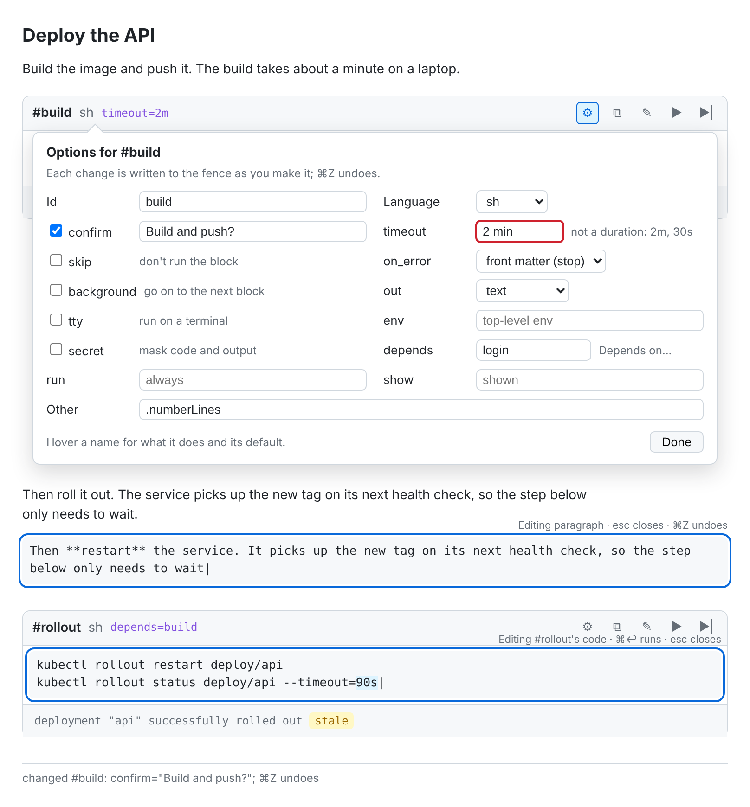

# Editing in the rendered view

Status: proposal, Nov 24, 2026. Nothing here is built; the decisions at
the end are open until j answers them.

j asked for two things on Nov 24: double-clicking a block's title should
open a panel for setting the block's options (the attributes in its
fence: `confirm`, `timeout=`, `out=`, an include's `file=` and `symbol=`,
and so on), and the GUI should start moving to a semi-WYSIWYG model,
where double-clicking a runnable block's body edits it in place, and the
same for prose. This doc is the design for both: the interaction, how it
lives beside the source pane and the Neovim pane, Vim mode, the TUI and
`mdsh --serve`, and the order to build it in.

## Why now, when it was dropped before

[design.md](design.md) records that M2 had an editor in each block card
and a form over its attributes, M3 had a small markdown editor in each
prose cell, and both went in favour of the source pane on Oct 29: "it
was awkward next to the source". What was awkward then was structural.
The page and Go each held the whole text, an in-place editor was a
third copy spliced in by byte range, and keeping three copies agreed
while a run wrote output into the file took most of the code.

The [UI protocol](../design/ui-protocol.md) changed the shape. Go owns
the text; the page sends line edits (`Edit(version, [first, last) →
text)`) and hears Go's own changes as line events; `Synced` in `sync.ts`
rebases what was typed over what arrived. The source pane is already
just a view that edits a range, the range being the whole file. An
in-place editor is the same view over a smaller range, with the same
guard and the same merge, and no copy of its own. The front matter
sheet, the include grips, task checkboxes, textboxes and the Depends on…
dialog already edit the file from the rendered view this way, one
`notebook` call each, undone with cmd/ctrl+Z. The proposal is to let
the fence and the body of a block, and a prose cell, be edited the same
way.

What does not change: the file format, the source pane, the Neovim
pane, the TUI's `e` and `E`, and the rule that logic lives in `doc` and
`notebook`. The GUI gains a third place to edit, not a new model of the
text.

## Interaction

*A mockup, not the app: the three pieces at once. In use, one editor or panel is open at a time.*

### Block options panel

| | |
| --- | --- |
| Open | double-click the card's head (the row with the id, language and attributes); the gear button that joins the head's icons; or `,` on the selected block. cmd/ctrl+, is the app's settings, so `,` is the block's |
| Where | a popover anchored under the head, inside the card's width, so it reads as part of the card and the output stays visible under it. Not a modal: the rest of the window still works. Its title is "Options for #build" (the block's id) |
| Close | esc, click outside, Done, or opening another block's panel. Nothing is lost by closing: every change was already written |
| Writes | each field writes the fence when it changes (checkboxes and selects at once, text fields on leaving them or enter), as the front matter sheet does. One `notebook` call, one Undo step, "changed #build: timeout=30s; cmd/ctrl+Z undoes" in the status line |

The form is generated from `doc.BlockAttrs`, so the GUI keeps no copy
of the spec and a new attribute in `doc` appears in the panel without
page changes. Which attributes show follows the block: runnable blocks
get the run attributes, include blocks the `Include` ones, textbox and
choice blocks their `Inputs` ones. Each attribute's kind picks its
control:

| `AttrKind` | Control | Note |
| --- | --- | --- |
| flag (`skip`, `confirm`, `tty`, `background`, `nosave`, …) | checkbox | `confirm` and the other `Bare` ones get a text field beside the box for the optional value: the question, the condition |
| choice (`out=`, `on_error=`, `mode=`) | select | a value ending in `:` (`image:`, `file:`) shows a path field beside the select |
| cond (`run=`, `show=`, `collapse=`) | text field with the fence completions the source pane already has for conditions | `run=once` and `false` are offered first |
| duration (`timeout=`) | text field | checked with `AttrSpec.Check` as typed; `30s`, `2m` |
| number (`frame=`, `from=`, `history=`) | number field | `lines=fit` and other word values from `Values` are a select beside it |
| list (`depends=`, `share=`) | `depends=` opens the existing Depends on… dialog; `share=` is a text field | one editor for `depends=`, not two |
| text (`env=`, `file=`, `symbol=`, `var=`) | text field | `env=` offers the file's env names, `file=` the folder's files, from `Names()` |
| `#` id | text field at the top | renaming warns when other blocks name it in `depends=` or `{{#id/…}}` and offers to rename those too (`doc` has the references) |

Below the known attributes, an **Other** line shows the tokens
`doc.SplitInfo` does not recognize, editable as text, so nothing in the
fence is hidden or dropped. The language is shown beside the id as a
select of the languages mdsh runs (`sh`, `zsh`, `bash`, `http`,
`textbox`, `choice`, and `include`), and changing it swaps the attribute
set; attributes the new kind does not take move to Other rather than
disappearing. Hovering a label shows the attribute's one-line help and
default; a field whose value fails `Check` is outlined and the fence is
not written until it passes, with the reason under the field.

The panel is read-only, with the reason in its header, while the block
or a background block runs, since the file can't change then (the same
guard `SetDepends` has). An include block's panel is the one place to
set `file=`, `from=`, `to=`, `match=`, `symbol=` and the rest without
the source pane, which is what j asked for first.

### Editing a block's body in place

Double-clicking the code of a runnable block, or pressing `e` on the
selected block, turns the `pre` into a CodeMirror editor holding the
block's body: the lines between the fences, not the fences, which the
panel owns. It keeps the card's width, grows with the text, uses the
block's language for highlighting, and has the editor settings the
source pane has (Vim mode, fonts, the Look's syntax colors).

| | |
| --- | --- |
| Writes | 500 ms after typing stops, as the source pane does, as one `Edit` for the body's line range. The output stays, marked stale as it is today when the code changes under an output |
| Run | cmd/ctrl+enter writes what was typed and runs the block (the source pane's gutter button does this). `:RunBlock` in Vim mode |
| Close | esc (in Vim mode, `:q`), clicking outside the card, or `e` again. The text stays, since it was written; the card redraws from Go's cells |
| Undo | inside the editor, CodeMirror's. After it closes, cmd/ctrl+Z in the rendered view takes the whole editing session back as one step, as a front matter field does |
| Keys | while the editor has the focus the single-letter keys (`j`, `k`, `a`, `e`) type, as in every other text field. The focus list in `app.ts` gains the in-place editor |

Double-click still selects on the first click, so the behaviour a
single click has today (select the card, line the source pane up) is
unchanged. `E` takes over what `e` does today: open the source pane with
the cursor on the block. That matches the TUI, where `e` is the block
and `E` the whole file.

One in-place editor is open at a time. Opening another, running the
block, or a change arriving from another view flushes the open one
first.

### Editing prose in place

Double-clicking a prose cell (paragraph, heading, list, table, quote, or
a fence mdsh cannot run) opens a CodeMirror markdown editor over the
cell's lines, with the same write and close rules as a block's body.
It has the markdown bar's shortcuts (cmd/ctrl+B, I, K, E) and table
tab-to-next-cell, but not the bar itself; the bar stays in the source
pane.

Prose cells become tab stops in reading order (the accessibility
baseline already wants every control reachable with tab), and `e` on a
focused prose cell edits it. `j`/`k` keep moving between blocks only,
so running a runbook from the keyboard is as it was.

While a prose editor is open, typing a blank line splits the paragraph,
and Go's reparse makes two cells of it. The editor does not close or
split: it stays over the lines it covers, which now span two cells, and
the cards for those cells are drawn when it closes. So the page defers
`cells_splice` and `body` events for cells inside an open editor's range
until the editor closes. The same rule covers typing a fence into prose,
which turns part of the cell into a block.

### What is not in scope

- Dragging text between cells, or a selection across cells. The source
  pane does that.
- Formatting controls on prose (a toolbar that bolds the selection and
  hides the asterisks). The text stays plain markdown in the editor, as
  the Markdown bar decision says. The semi in semi-WYSIWYG is that
  editing happens where the rendered text is, not that markup is hidden.
- Inserting a new block or cell from the rendered view. It is the next
  step after this, and it needs the same `Edit` path: a plus between
  cells that inserts an empty paragraph or an `sh` fence and opens its
  editor. Listed here so the design leaves room for it, not built in
  these PRs.

## How it fits the source pane and the Neovim pane

Go holds one text with one version. The page can have several editors
over it: the source pane (whole file), one in-place editor (a range),
and the Neovim pane (whole file, in Neovim's own buffer). All of them
send `Edit` calls with the version they saw and hear the line events
Go sends back; `Synced` already maps a pending edit past events that
landed first. Two rules make this safe:

1. **One pending edit at a time per page.** The page serializes its
   editors: before any editor sends, the others flush. The in-place
   editor's range is small, so a flush is cheap. Two editors cannot
   have unsent typing on the same line.
2. **An in-place editor's range follows the text.** Its `[first, last)`
   is mapped through every line event, so when a run writes output
   above it, or the source pane inserts a line above it, the editor
   still covers its lines. The include grips and the fold state field
   already do this mapping.

With the source pane open beside the rendered view, an open in-place
editor is shown there as a highlighted range, and typing in the source
pane inside that range closes the in-place editor (after a flush). The
two never both edit the same lines.

**Neovim pane.** Neovim holds its own buffer and `nvim.ts` already sends
its changes to Go as line edits and takes Go's back. It is the editor
while it is open, as the UI protocol's lease design says. So with the
Neovim pane open, double-clicking a body or a prose cell does what `e`
does today: jumps Neovim to those lines (`nvimCall("jump")`), rather
than opening a CodeMirror in the card. The options panel works
unchanged, since it writes through Go and Neovim's buffer takes the
line event. A setting could later allow both, but two editors with
their own undo histories over one text is the case the lease exists to
avoid.

**Vim mode.** The in-place editors are CodeMirror, so the Vim setting
covers them with no new code. `editor.ts`'s `ExTarget` gives each one
`:w` (write and save the file), `:q` (close), `:wq`, and `:RunBlock`.
With Vim mode on, esc returns to normal mode rather than closing; `:q`
or a click outside closes. The status line says which editor the ex
command acted on, as it does for the source pane.

## In the TUI

The TUI has no mouse editing and `e` already opens the block in
`$EDITOR`, which is its in-place editor. Parity is the options panel:

- `,` on the selected block opens an **options form** in the block's
  card, built like the report form (`p`): one line per attribute the
  block takes, in spec order, with its value or default greyed. `j`/`k`
  move, enter toggles a flag or edits a value on the status line, esc
  closes. It writes through the same `notebook` call as the GUI, so the
  undo (`u`) and the status line text match: "changed #build:
  timeout=30s; u undoes".
- Body and prose editing stay `e` and `E`. The help panel's Edit group
  gains `,` and the GUI's `E` keeps the TUI's meaning.

The HIG's parity table and keys table gain a row for `,`, and `e`'s row
reads "edit the selected block in place (GUI) or in $EDITOR (TUI)".

## In a browser: mdsh --serve

Nothing new. The panel and the editors are page code calling the same
`ui.App` methods over `/wails/call`, and `serve/runtime.js` already
draws the dialogs the page asks for. When the protocol's edit lease
lands (stage 3), an in-place editor is under the lease as the source
pane is: a view without it sees double-click open the editor read-only
with the "Request control" bar, and the options panel, which goes
through Go as an action like `SetDepends`, stays available from every
view.

## Accessibility and the HIG

- The panel is `role=dialog`, labelled "Options for #build", traps
  focus, closes on esc and returns the focus to the card. Each control
  is labelled with the attribute's name and described by its help.
  Validation errors are `aria-live`.
- An open in-place editor is labelled "Editing #build's code" or
  "Editing paragraph", and the status line announces open and close.
- Every pointer gesture has a key: `,` for the panel, `e` for the
  editors, `E` for the source pane, tab to reach prose.
- Messages follow the HIG's four places: a write goes to the status
  line with its undo key; a validation error stays in the panel under
  its field; a refused write while a block runs is the panel's header
  text and the Console.
- No new colors. The editor uses the source pane's tokens; the panel
  uses the front matter sheet's.

## Library and notebook changes

- `notebook.SetInfo(i int, info string)`: write a block's fence from a
  `doc.Info`, through `n.change`, with the guards and the result sync
  `SetDepends` has. `SetDepends` becomes a caller of it. Before PR 1
  merges, check that a block whose fence changes keeps its output and
  is marked stale, as `SetDepends` does today, since `doc.SetSource`
  gives an edited block a new identity.
- `doc.Info.Set` and `Del` and `doc.AttrSpec.Check` exist; the panel
  needs `doc.References(id)` to list the blocks and placeholders that
  name a block, for the rename warning.
- `App.Edit` exists and serves the in-place editors as it serves the
  source pane. The page side is a second `Synced` over a range, which is
  mostly moving the range mapping out of `app.ts`'s source pane code
  into `sync.ts`.
- The TUI form uses `SetInfo` through `notebook` too; the TUI already
  holds a `Notebook`.

## Plan

Each PR is one commit, with screenshots in its description and a
CHANGELOG entry with one.

| PR | What | Size |
| --- | --- | --- |
| 1 | Options panel in the GUI: `SetInfo`, the generated form, double-click and `,`, the gear button, the TUI form | about a week; the form from `BlockAttrs` is most of it |
| 2 | In-place body editor: `Synced` over a range, `e`/`E`, cmd/ctrl+enter, Vim ex commands, deferred redraws for the open range | about a week |
| 3 | Prose editor: focusable prose cells, the markdown editor, split and merge of cells under an open editor | about a week |
| 4 | Neovim jump instead of in-place; lease behaviour when stage 3 of the UI protocol lands | days, after stage 3 |

## Decisions to make

1. **Was Oct 29's "awkward" what this doc says it was?** If the problem
   was the feel of editing in a card rather than the three copies of
   the text, the protocol does not fix it and the design should change
   before PR 2.
2. **Keys**: `,` for the options panel; `e` edits in place and `E` opens
   the source pane at the block (today `e` does the latter).
3. **Write as you type** (500 ms, undo takes the session back) rather
   than a Save or Apply button in the editor and the panel. It matches
   the front matter sheet and "prefer undo to a question".
4. **Popover under the head**, not a sheet like the front matter or a
   modal dialog like Depends on….
5. **Prose cells become tab stops and take `e`**; `j`/`k` still skip
   them.
6. **With the Neovim pane open, double-click jumps Neovim** to the lines
   instead of opening a CodeMirror in the card.
7. **The TUI gets the options form on `,` and nothing else** from this
   design; `e` and `E` stay as they are.
8. **Order**: PR 1 (options panel) first, then the body editor, then
   prose.
