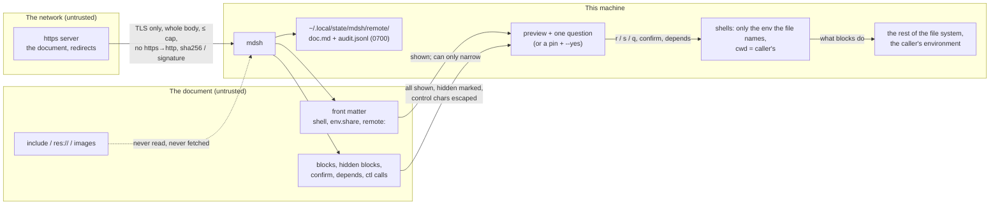

# Auditable install scripts: running a document from a URL

Status: design, Nov 2, 2026. For the release **after v1.3**; nothing
here is built. Questions for j are marked **Q1** to **Q8** and collected
under [Open questions](#open-questions). Diagrams are Mermaid, which
GitHub renders in place.

The idea (j, Nov 2): most projects install with `curl -fsSL https://… | sh`.
You trust a script you never saw, that ran before you could read it, and
that left no record. If the install script is a markdown runbook instead,
`mdsh https://example.com/install.md` can fetch it, show every step,
ask before running, honor the file's `confirm` gates, and write an audit
log of what ran. This doc designs URL support in `mdsh`, `mdsh -i` and
mdsh-gui, says what "safer than `curl | sh`" has to mean in practice,
and gives an honest account of where it is safer and where it is not.

## What `curl | sh` gets wrong

The pipe is popular because it is one line. Its problems are known and
worth naming, because each one is a requirement below.

1. **You can't see it before it runs.** The script streams straight into
   the shell. Reading it first means a second command (`curl -O`,
   `less`, `sh`) that almost nobody runs.
2. **The server can tell.** A server can serve one script to a browser
   and another to `curl`, by `User-Agent`, or by noticing that the
   client reads slowly while the shell executes, and swapping content
   mid-stream. Reading in a browser proves nothing about what the pipe
   got.
3. **A cut connection runs half a script.** `rm -rf /tmp/build/$NAME`
   truncated after the slash is the classic.
4. **Nothing is pinned.** The URL today and the URL tomorrow can differ,
   and a CDN, a proxy or a compromised host can change it in between.
5. **No record.** Afterwards you can't say what version ran, what it
   touched, or what it was given.
6. **It gets everything.** The script runs with your whole environment
   and your `sudo` cache, and it can ask for more.

mdsh can't fix 6; a block is shell, and running it runs it. It can fix
1 to 5, and most of that already exists for local files. The work is to
make the good path the *default* path for a URL.

## Goals

- `mdsh https://…/install.md` works wherever a file path does, in
  `mdsh`, `mdsh -i` and mdsh-gui, and nothing runs until the person has
  seen the document and said so. The scheme alone, `http(s)://` or
  `(s)ftp://`, puts mdsh in this mode (j, Nov 2); there is no flag.
- A remote document is **self-contained**: it loads nothing but itself,
  reads no local file, and writes only where its blocks write.
- Integrity can be **pinned** in the command line that people copy, so
  the one-liner stays one line.
- Every run of a remote document leaves an **audit log** and a copy of
  what ran, without being asked.
- The existing gates keep their meaning: `confirm`, `depends=`,
  `--step`, `--yes`, `--expose`, `env.share`, hidden blocks, the control
  socket. Nothing here gives a document a new power.

Not goals: fetching includes or images over the network from a remote
document (see [Later](#later)), a package manager, running a document
*on* a remote host (that is [docs/ssh/design.md](../ssh/design.md)),
and serving documents (that is the `serve` work on the `server` branch).

## How a URL is run

````sh
mdsh https://get.example.com/install.md
mdsh https://get.example.com/install.md#sha256=9f86d081…b00a08   # pinned
mdsh -i https://get.example.com/install.md                        # step through it in the TUI
````

**The scheme selects the mode.** A positional argument with a URL
scheme, `https://`, `http://`, `sftp://` or `ftp://`, is a remote
document, and everything in this doc applies to it: the preview, the
one question, the pin rules, the refused includes, the record. There
is no flag to turn the mode on and none to turn it off; a local copy
(`curl -O` and `mdsh install.md`) is how to run the same document the
ordinary way, and that is a deliberate extra step. Everything else is
a path, as today, so a file called `https:` in the current directory
is unreachable by that name; nobody has one. The four schemes:

| Scheme | Fetched with | Integrity on the wire | Without a pin |
| --- | --- | --- | --- |
| `https://` | `net/http`, Go TLS, system roots | TLS | Allowed, with the preview |
| `http://` | `net/http` | None | Refused, except localhost (**Q2**) |
| `sftp://[user@]host[:port]/path` | The system `sftp` client in batch mode (`sftp -b -`, `get path /dev/stdout`), so `~/.ssh/config`, agents, hardware keys and `known_hosts` apply, as in [docs/ssh/design.md](../ssh/design.md); `~/path` means the remote home, `/path` is absolute | SSH, with the host key the person already trusts | Allowed, with the preview |
| `ftp://` | The system `curl`, with `--fail --silent --show-error` and no `-k` | None, and the password if any is in the clear | Refused, except localhost |

`sftp://` is the scheme for a team's runbooks on a jump host or a file
server that already does SSH; there is no sftp client in Go's standard
library, and shelling out keeps the same "your SSH setup, as it is"
rule the SSH design chose. `ftp://` is included for completeness and
treated exactly as `http://`: a plain-text transport is fine when a
pin says what the bytes must be, and not otherwise. Userinfo in an
`sftp://` URL names the login user only; a password there is refused,
as it is for `https://`. An `sftp` or `ftp` fetch inherits the
client's own prompts (a passphrase, an unknown host key) on the
terminal; in mdsh-gui they come through the `SSH_ASKPASS` helper the
SSH design adds, so phase 2 for the GUI waits on that helper for
`sftp://`.

```mermaid
sequenceDiagram
    participant U as person
    participant M as mdsh
    participant S as https server
    U->>M: mdsh https://host/install.md#sha256=…
    M->>S: GET (User-Agent mdsh/1.x, no cookies, ≤ 8 MiB, 30 s)<br/>or sftp -b / curl for sftp:// and ftp://
    S-->>M: the whole document, to memory
    Note over M: TLS checked by Go's crypto/tls against the system roots.<br/>Redirects followed (≤ 5), never https → http.<br/>SHA-256 of the bytes computed, compared to the pin if given.
    M->>M: parse; refuse includes, res://, remote image fetches
    M->>U: header + the whole document, every block, hidden ones marked
    U->>M: [r]un / [s]tep / [q]uit
    M->>M: run, as mdsh doc.md would, with the usual confirm / depends questions
    M->>M: audit log + the fetched bytes saved under ~/.local/state/mdsh/remote/
```

### Fetching

- **The whole document first.** Whatever the scheme, mdsh reads the body
  to memory, to a cap (8 MiB, **Q1**), and only then parses. Nothing runs during the fetch,
  so a cut connection is an error, never a half-run (problem 3).
- **TLS, and only TLS by default.** `https://` uses Go's `crypto/tls`
  with the system roots. There is no flag to skip verification. Plain
  `http://` is refused unless the command carries a `sha256` pin: with
  a pin, the transport can't change what runs, only see it, and that is
  the person's call. `http://localhost` and `http://127.0.0.1` are
  allowed without a pin, for testing a document from a local server
  (**Q2**).
- **Redirects** are followed, at most 5, and a redirect from `https` to
  `http` is an error. The final URL is what the preview shows and the
  log records. `sftp://` and `ftp://` have no redirects.
- **Headers.** `User-Agent: mdsh/<version>` and `Accept: text/markdown,
  text/plain`. No cookies, no credentials, no `Authorization` from
  anywhere. A private document is a later feature
  ([Later](#later)); the point of this one is public install scripts.
  `HTTPS_PROXY` and friends are honored, as Go's default transport
  does.
- **No cache.** Every run fetches. A copy of what ran is kept for the
  record, below, not for reuse.

### What the document may do

A remote document has no directory, so everything that touches one is
settled here. The rule is *it loads nothing but itself and reads no
local file*: a document fetched from a URL must not be able to read
`~/.ssh/id_ed25519` into a report before anybody runs a block, which
is finding 3 of the v1.2.1 CLI review, still open for local files.

| Feature | For a remote document |
| --- | --- |
| `MDSH_FILE` | The final URL. `MDSH_DIR` is the working directory, below |
| Working directory of the shells | The caller's current directory, as `curl \| sh` has it (**Q3**). The preview says so |
| `<include file=…>` and `res://` | Never read. The block shows an mdsh error, "a remote document can't include files", and the run goes on. A URL in `file=` is also refused for now (see [Later](#later)) |
| Images in prose, `` | Not fetched. The CLI prints the link, mdsh-gui draws its note with the alt text and host, as it already does for remote images in local files |
| `out=image`, `out=screenshot`, `tty` recordings | Saved under the run's record directory (below), not beside a document that has no beside |
| `-w` | An error: "a remote document can't be written back; use -o or Save As" |
| `-o FILE`, `--pdf`, `--html` | Work; image links are relative to the output file, as for `-o` today |
| `--source FILE` | The person's own, as today |
| `shell:`, `env.share:`, `step:`, `on_error:` | Honored, and all shown in the preview, since a reader can't see front matter in a rendered page (finding 5 of the CLI review) |
| `remote:` (SSH, once built) | Honored, and shown in the preview in red: this document connects to another machine |
| `depends=`, `confirm`, `--step`, `background`, `timeout=` | Unchanged |
| `mdsh ctl` and the control socket | Unchanged: a block can `set` a variable, `ask`, `confirm` and report `status`. The audit log records every call |

### The preview, and the one question

For a local file, `mdsh doc.md` runs it. For a URL, mdsh does not run
until asked. The default is **show, then ask once**:

```
mdsh: fetched https://get.example.com/install.md (12 KiB, 9 blocks)
      sha256 9f86d081884c7d659a2feaa0c55ad015a3bf4f1b2b0b822cd15d6c15b0f00a08
      shell /bin/sh · shares GOPATH (nothing else, not even PATH) · asks before 2 blocks
      working directory /home/j · 1 block hidden when printed (shown below)

   …the whole document, prose and code, every block, in a pager…

Run 9 blocks from get.example.com? [r]un / [s]tep through them / [q]uit
```

- The preview shows **every runnable block**, including those a
  `show=` or an off `mdsh:if` section would leave out of a print, each
  marked `hidden when printed`, and control characters as `^[`, so
  what is on the screen is what runs. This is the lesson of findings 1
  and 2 of the two reviews, applied before the first block.
- `r` runs the document as `mdsh doc.md` would. `s` runs it as
  `--step` would, asking before every block. `q`, or enter, runs
  nothing and exits 0. The pager is `$PAGER` or `less -R` when stdout is
  a terminal; otherwise the document is printed plain.
- `--step` skips straight to stepping. `--no-run` prints the document
  and exits, as for a local file, which is how you read a script
  without running it.
- `confirm` blocks and `depends=` questions are asked as today, on top
  of the one question. They are the author's gates; the one question is
  the reader's.

**No terminal, and `--yes`.** `curl | sh` is also what CI and Dockerfiles
do, where nobody can answer. With no terminal, a URL run stops at the
question with an error, as `confirm` does today, unless `--yes` is
passed. `--yes` on a URL answers the one question and, as now, every
`confirm` and `depends=` question. The difference is what it needs:

- With a `sha256` pin, `--yes` runs the document. The pin is the review:
  somebody looked at *these bytes* and wrote the hash down.
- Without a pin, `--yes` is refused: "running an unpinned remote
  document without looking at it needs --unpinned". `--unpinned --yes`
  then runs it, so the choice is spelled out in the Dockerfile where a
  reviewer reads it, instead of being the default (**Q4**).

A placeholder `{{$VAR}}` reads only variables the person exposed with
`--expose` or `MDSH_EXPOSE`, as for any document since #144, and `--yes`
does not change that. So a remote document that writes `{{$GITHUB_TOKEN}}`
into its prose gets the placeholder back as text, in the preview and in
the run.

### Pinning: `#sha256=`

A pin is the SHA-256 of the document's bytes, the same hash the audit
log's `run.start` already records, so a pin can be copied from a
previous run's log.

```sh
mdsh https://get.example.com/install.md#sha256=9f86d081884c7d659a2feaa0c55ad015a3bf4f1b2b0b822cd15d6c15b0f00a08
mdsh --sha256 9f86d0… https://get.example.com/install.md    # the same, as a flag
```

The fragment form is the one for a project's README: a fragment is
never sent to the server, so the server can't see which pin a client
expects, and the one-liner stays one line that is copied whole. A pin
that doesn't match is an error before the preview, naming both hashes.
A publisher updates the pin when the document changes, which is the
cost of pinning anything; the README of a project that publishes an
`install.md` can print the current line from CI.

A **signature** is the pin that doesn't rot: the publisher signs each
version with a key, and the reader pins the key once. Of the formats a
Go binary can verify with the standard library and `x/crypto`, the two
that fit are minisign (Ed25519, one short public key to pass as
`--key`, a detached `.minisig` fetched from `<url>.minisig`) and SSH
signatures (`ssh-keygen -Y sign`, verified against an `allowed_signers`
file, so a team's existing SSH keys work). Sigstore is the other
candidate, with a stronger story and a much larger dependency. This doc
recommends **minisign first**, as phase 3, and leaves the choice open
(**Q5**). Signatures change nothing above: a verified signature stands
in for the hash wherever a pin is required.

### The record

A run from a URL writes, without being asked:

- an audit log, as `--audit FILE` would (the events in
  [spec.md](../spec.md#control-socket-and-audit-log-partly-built)),
  with `run.start` carrying the URL, the final URL, the HTTP status,
  the document's size and SHA-256, whether a pin or signature was
  checked, and the answer to the one question;
- the fetched bytes, exactly as served, so what ran can be read later
  and the hash recomputed.

Both go in `~/.local/state/mdsh/remote/<time>-<host>/` (`doc.md`,
`audit.jsonl`, the run's `.assets/`), mode 0700, `$XDG_STATE_HOME`
honored. `--audit FILE` moves the log, `--save FILE` keeps a copy of
the document elsewhere, and `--no-record` turns both off (**Q6**). The
end of the run prints one line saying where the record is. `mdsh
remote ls` and `mdsh remote show <id>` can list and print records
later; `jq` works from day one.

### `mdsh -i` and mdsh-gui

Both front ends already have a session that runs blocks one at a time
with every question asked in place. That is the "step" answer with a
better screen, so a URL in them skips the CLI's one question.

- **`mdsh -i https://…`** opens the document in a read-only session:
  nothing is saved until Save As gives it a local path, and
  `--autosave` is refused. The status line shows the host and `not
  saved`, the header shows the hash and front matter facts the CLI
  preview shows, and hidden blocks are drawn as they are in the GUI.
  The record is written when the session ends.
- **mdsh-gui** gets File › Open URL… (⌘⇧O), accepts a URL on the
  command line and a dropped or pasted link, and lists remote documents
  in Open Recent by URL. The tab shows a banner: the host, the hash,
  what the front matter shares, `not saved`, and a Save As button.
  Editing is allowed, as it is for any file, but the session is a
  new document until it is saved, so there is no write-back and no
  `.assets/` beside anything. Settings › Shell gets "Plain http"
  (off) and the default share list, below.
- **The site.** Once the GUI opens URLs, an `mdsh://` link could open a
  document straight from a web page. That is a URL scheme handler and
  its own threat model (any page can trigger it), so it is listed under
  [Later](#later), not here.

### What crosses into the shells

Since #177 (Nov 2) a local document's shells get a base set, `PATH`,
`HOME`, `USER`, `TERM`, `LANG` and the rest, plus whatever the front
matter's `env.share` names, and `share: [...]` brings in everything
with a banner in `mdsh -i` and mdsh-gui. The spec already settles the
remote case: **a document loaded from a URL gets no base set; its
shells see only what it names, and nothing when it names nothing.**
This design keeps that rule and adds how it is shown and where it
stops:

- The preview header lists every name the document asks for, or
  `shares nothing`. An installer that needs `PATH` and `HOME` names
  them, and a reader sees that it did.
- `share: [...]` in a remote document is the `curl | sh` default, your
  whole environment, chosen by the author. Recommendation (**Q7**): it
  is refused unless the person passes `--share-all`, and the preview
  says so in red when the document asks for it. Named variables are
  fine, since the preview shows the list; `...` is the one entry that
  hides what it brings.
- A `-NAME` in a remote document's list is allowed and pointless; the
  preview shows the list after it is applied.
- `{{$VAR}}` placeholders are unchanged: they read what the person
  exposed, never what the document names.

## Security

The threat model is the one in [SECURITY.md](../../SECURITY.md): running
a document runs its code; a bug is anything beyond that, and anything
that gets around a review gate. A remote document is the most
untrusted input mdsh will have, so the gates have to hold without a
single click.



- **Nothing before the answer.** Fetching, parsing and the preview run
  no block, read no local file, and send nothing anywhere but the one
  GET. The only writes before the answer are the record files.
- **The preview is complete.** Every runnable block is shown, hidden
  ones marked, control characters escaped, and front matter options that
  change what runs (`shell:`, `step:`, `env.share`, `remote:`) are
  printed in the header. A document can't make the preview lie about
  its code. It can still lie in its prose, which is the limit below.
- **A pin is a review of bytes, not of a URL.** With a pin, the server,
  a proxy and a CDN can't change what runs; without one, `--yes` won't
  run it quietly. `http://` with a pin is sound for integrity and says
  nothing about privacy, which is why it needs the pin and not a
  `--insecure` flag.
- **No local reads.** Includes and `res://` are refused outright for a
  remote document, rather than confined to a directory it doesn't have.
  Finding 3 of the CLI review (includes read any file) should be fixed
  for local files before this ships, so the two rules are "inside the
  document's directory" and "none", not "anything" and "none".
- **The environment is empty until the document names it** (the spec's
  rule for URL documents, with `...` refused without `--share-all`,
  **Q7**), placeholders read only exposed variables, and write-back
  can't store them because there is no write-back.
- **The record is private.** Mode 0700, the audit log's `--secret`
  HMAC rule applies, and the fetched document is kept as served, which
  can include whatever the server chose to send. The record directory
  is for the person, not for sharing.
- **Argument and URL hygiene.** The URL is parsed with `net/url`; a
  password in userinfo (`https://user:pw@host/`) is refused, since a
  credential in a copied one-liner is a leak, and only `sftp://` may
  carry a user name; the fragment is only ever read for `sha256=`. For
  `sftp` and `curl`, the host and path are passed as their own
  arguments after `--`, a host or user starting with `-` is refused,
  and the port must be a number, as the SSH design does for `ssh`.
- **mdsh-gui** keeps its Content-Security-Policy and never fetches
  anything but the document. A dropped link is confirmed the same way
  a typed one is.

## Is it safer? An honest assessment

**Where it is safer than `curl | sh`.**

| Problem with the pipe | With `mdsh https://…` |
| --- | --- |
| Can't see it before it runs | Shown whole, every block, before the one question; `s` steps block by block |
| Server serves different bytes to the pipe | What is shown is what runs: one fetch, one hash, shown and logged. A pin makes the bytes the publisher's responsibility |
| Half a script on a cut connection | Whole body or nothing |
| Nothing pinned | `#sha256=` in the one-liner; a signature later |
| No record | A log and the exact bytes, every time |
| Gets the whole environment | Nothing, until the document names each variable in its front matter, where the preview shows it; everything only with `--share-all` |
| Reading the script is a separate command nobody runs | Reading is the default; running is the extra keypress |

**Where it is not.**

- **A block is shell.** The first block can be `curl … | sh`, and
  mdsh will show it and run it if asked. The design shows what runs;
  it doesn't make it harmless. That is the same floor as a reviewed
  shell script, and no higher.
- **People press `r`.** A preview of 300 lines is scrolled, not read.
  The honest claim is that mdsh makes reading possible and the default,
  not that readers read. Step mode and `confirm` help by putting the
  question next to the step that matters, such as the `sudo` line.
- **Prose can lie.** "This step checks your Go version" above a block
  that does something else is social engineering, and markdown makes
  it easier to write persuasive prose than a shell comment does. The
  mitigation is that the code is right there, in a fence, escaped; it
  is not a mitigation against not reading it.
- **The author owns the gates.** `confirm` is placed by the person who
  wrote the document. It is a courtesy, not a control; `--step` and the
  one question are the reader's controls.
- **Pins rot, and signatures move the problem.** A hash changes with
  every edit, so READMEs go stale and people drop the fragment. A key
  pins the publisher, which is the right thing to pin, and then the
  question is how the reader got the key, which is the same bootstrap
  problem every signing scheme has.
- **Trust in the publisher is unchanged.** Pinning and previewing let
  you verify *what* you got, not *whom* you got it from. A malicious
  publisher ships a malicious document, signed. What mdsh adds is that
  the malice has to be in the open, in a file you kept.
- **mdsh itself has to be installed first,** today by Homebrew, a
  package, or a `curl -LO` from the releases page with a
  `checksums.txt`. The project's own install is the first document to
  publish this way, and it still needs a non-mdsh way in.
- **It's not a sandbox.** No file system or network confinement, no
  `sudo` policy. Those are the paid-tier items in the strategy doc,
  and they are what would make the next claim true.

Net: safer in every way the pipe is specifically bad, and no safer than
running a script you have read. For install scripts that is the right
bar, and it is a bar the pipe doesn't clear.

## Architecture

- **`fetch`** (new package): `Fetch(ctx, url, opts) (Doc, error)` with
  the cap, timeout, redirect rules, the pin check, and the record
  fields, behind one interface with a fetcher per scheme: `net/http`
  with Go's TLS and the system roots for `http(s)://`, the system
  `sftp` for `sftp://` and the system `curl` for `ftp://`, each run
  with its arguments after `--` and the URL validated first, so
  nothing from a URL is read as an option. No Go dependency outside the
  standard library. Signature checking lands here in phase 3.
- **`run`**: `Options.Remote` (the final URL, the hash), which turns
  includes and `res://` into errors, sets `MDSH_FILE` to the URL and
  `MDSH_DIR` to the working directory, and routes images and
  recordings to the record's `.assets/`. The no-base-set rule for URL
  documents is in `env` since #177; `--share-all` and the refusal of
  `...` live beside `--expose` in `run`'s environment handling.
- **`audit`**: new fields on `run.start`; an `answer` field for the one
  question.
- **`cmd/mdsh`**: URL detection, the preview and the question, `--sha256`,
  `--unpinned`, `--share-all`, `--save`, `--no-record`, the
  record directory, `mdsh remote ls|show`. `-w` and `--autosave` errors.
- **`tui`, `cmd/mdsh-gui`**: the read-only session, the banner, Open
  URL…, Open Recent by URL, Save As, the Settings switches.
- **`doc`**: nothing. A remote document is parsed exactly as a local
  one, which is the point: every existing rule applies.

**Testing.** `httptest.Server` covers the http fetch: the cap, a cut
body, a redirect to `http`, a wrong pin, `http://` with and without a
pin. A fake `sftp` and `curl` on `PATH` cover the other two schemes
and their argument handling, and the SSH design's `sshd` CI job runs
one real `sftp://` fetch. The
CLI test drives the question on a pty as the `confirm` tests do. A
runbook test publishes `examples/install.md` from a test server, runs
it with `--yes` and a pin, and checks the record directory. CI runs the
same against the GitHub Pages copy once the site has one.

## Milestones

Each one PR, one commit, tests passing.

1. **Fetch, preview, pin.** `fetch` for all four schemes, URL arguments
   in `mdsh`, the preview and the one question, `#sha256=` and `--sha256`, `--yes`
   rules and `--unpinned`, `-w` refused, includes refused, the record
   directory, the audit fields, `--share-all` and the refusal of `...`.
   The spec section and README.
2. **`mdsh -i` and mdsh-gui.** Read-only sessions, the banner, Open
   URL…, Save As, Open Recent.
3. **Signatures.** minisign (or SSH signatures, **Q5**), `--key`, the
   `.minisig` fetch, and a `mdsh remote verify` command.
4. **Dogfood.** `install.md` for mdsh itself on the site, with the
   pinned one-liner printed by the release workflow; a "Install with
   mdsh" section in the README beside the Homebrew line; an
   `examples/runbooks/install.md` that installs a small tool the same
   way.

## Later

- **Private documents.** A `--header` or a token from the keychain, so
  a company's internal runbooks can be run by URL. Needs its own look
  at where the credential comes from and what the record stores.
- **Includes and images from the same origin.** A remote document that
  includes `./lib/common.md` or shows `./diagram.png` from the same
  host and path prefix is reasonable, and it is the same loading rule
  the GUI has for local files. Not in the first version: every fetch
  is a thing the preview has to show and the record has to keep.
- **`mdsh://` links** from web pages into mdsh-gui.
- **A document that pins its own dependencies**, such as a release
  archive's hash in front matter that a block can read as
  `{{$MDSH_PIN_…}}`, so the document's hash covers the artifact's.
- **Policy.** An allowlist of hosts, "always ask", "never `--yes`",
  managed by an organization. This is the paid-tier policy item in the
  strategy doc, and it starts here.

## Open questions

For j. Each has a recommendation, which the milestones assume.

1. **Size cap.** 8 MiB (recommended), or no cap with a warning? A
   runbook with inlined images could exceed it; a document meant to be
   read before running shouldn't.
2. **Plain `http://` and `ftp://`.** Refused without a pin, allowed with
   one, and always allowed for localhost (recommended), or refused
   outright? And is `ftp://` worth having at all, or is `sftp://` the
   only file-transfer scheme that matters now?
3. **Working directory.** The caller's current directory, as the pipe
   has it (recommended, so `cd ~/src && mdsh https://…` means what it
   says), or a fresh temp directory, which is cleaner but surprises an
   installer that writes `./bin`?
4. **`--yes` without a pin.** Refused unless `--unpinned` is added
   (recommended), or allowed with a warning? The refusal is the one
   place this design is stricter than the pipe by default.
5. **Signature format.** minisign (recommended: small, one key string,
   Ed25519 in `crypto/ed25519`), SSH signatures (teams already have the
   keys), or Sigstore (keyless, large dependency)?
6. **The record by default.** Always written, with `--no-record` to
   turn it off (recommended), or only with `--audit`? Always is what
   makes "auditable" true without anyone remembering a flag.
7. **`share: [...]` in a remote document.** Refused unless the person
   passes `--share-all` (recommended), or allowed with the banner and
   the preview line, as for a local file? The spec's "only what it
   names" rule is settled; this is only about the one entry that names
   everything.
8. **Should local files get the preview too?** `mdsh doc.md` runs
   straight away and should keep doing so; but a `--preview` flag that
   gives any file the URL treatment is cheap once it exists.
