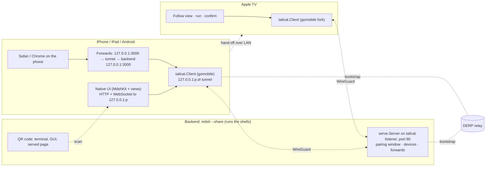
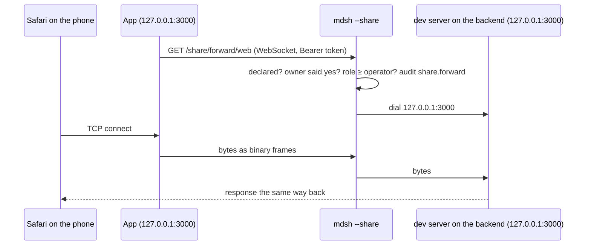

# Phone and TV front ends for a shared runbook

Status: design, Nov 18, 2026. Nothing here is built, and it is not for
1.7. It stands on the sharing design in [PR #267](https://github.com/gdey/markdownshell/pull/267)
(`docs/share/design.md` on the `share` branch), which is also design
only: `mdsh --share` has to exist before any of this can. Diagrams are
Mermaid, which GitHub renders in place. Open decisions for j are
collected under [Open questions](#open-questions); the text above them
reads as if the recommended answers were taken.

The one-line position:

> A runbook runs on one machine, as its author. A phone, a tablet or a
> TV reaches it through a tailcat tunnel the app carries itself, pairs
> by scanning a QR code the backend shows, and gets the same page,
> cards and questions the browser gets, drawn natively.

## What exists

- **`mdsh --serve`** (main, `-tags serve`): the GUI's page over HTTP.
  Its wire protocol is small and already transport-neutral: `POST
  /wails/call` names a `ui.App` method with JSON arguments, `GET
  /wails/events` is a WebSocket of events, `POST /wails/answer` answers
  a question, `GET /wails/files` serves a document's images. The
  guard checks a loopback `Host` when listening locally, the `Origin`,
  and one token, first in the URL and then a cookie. `--serve=stdio`
  speaks the same calls and events as JSON lines for a program that
  starts mdsh itself. [PR #295](https://github.com/gdey/markdownshell/pull/295)
  adds HTTPS off loopback and optional mutual TLS.
- **The sharing design (#267).** `mdsh --share` puts `serve.Server` on a
  `tailcat.Server` listener, port 80 of the tunnel only; `mdsh open
  tc…` is the desktop client; a directory service (Team tier) resolves
  names, logs people in and signs grants; three roles, viewer,
  operator and owner; `by` on audit events; shared shells per window;
  presence from open tunnels. All settled by j on Nov 17.
- **tailcat v0.7.0**, checked against pkg.go.dev on Nov 18. The server
  has `AllowedClients` and `AddAllowedClient(key)`, `ServedTCPPorts`,
  `OnTCP` and `OnTCPForward`; the client is `NewClient(addr)` with
  `Dial`, `DialTCPPort` and `PublicKey()`. An address is `tc` plus
  base64 CBOR holding the server's keys, a pre-shared key and a relay
  region, and is a password: whoever holds it can handshake unless
  `AllowedClients` is set. There is **no `AllowClient` callback and no
  `DisconnectClient`**, which #267 assumes; the lists below say what
  that changes. Platform support in the README: Linux, macOS, Windows,
  and a browser (js/wasm) build that stays on DERP. Nothing about iOS,
  tvOS or Android.
- **mdsh-swift** (`cmd/mdsh-swift` on `mdsh-swift-main`, not merged):
  a SwiftUI port of mdsh-gui for macOS 14, about 10,500 lines of
  Swift. The app only draws; a Go bridge serves the `notebook` package
  over JSON lines on stdin and stdout. `MdshKit` (bridge client, models,
  terminal text, readline) needs only Foundation. The views are
  SwiftUI with AppKit in a few places (source view styling, the panes,
  HTML prose import, clipboard, file dialogs).
- **Platform facts.** Go has no tvOS port; `GOOS=ios` is the closest.
  Tailscale ships an Apple TV app on tvOS 17 and NetBird ships one too,
  built from Go with a gomobile fork that adds tvOS targets
  (`netbirdio/gomobile-tvos-fork`), so Go on Apple TV is done in
  practice but off the supported path. Apple TV has no camera and no
  WebKit view for apps. gomobile's iOS and Android targets are the
  supported ones; Tailscale's own iOS and Android apps are built that
  way.

## Goals

- Pair a phone or tablet with a running backend by scanning a QR code,
  with nothing typed and no account anywhere.
- Pair an Apple TV, which can't scan, with one step on a phone that
  already is paired.
- Two or more people on one runbook at once, each action tied to a
  person and a device, with the same roles and audit log as #267.
- Ports a runbook declares in its front matter reach the phone as
  `localhost` ports, after the person says yes, so the phone's browser
  can open the dev server or dashboard the runbook started.
- Reuse mdsh-swift where it is SwiftUI, and reuse the `--serve`
  protocol everywhere, so the Go side gets one new transport and no
  new semantics.

## Non-goals

- Running shells on the phone or TV. The device draws and asks; the
  backend runs, as the author.
- A VPN. The app never routes device traffic; the tunnel is one socket
  inside the app.
- Editing documents on a phone or TV in v1. Running, answering,
  ticking tasks and filling textboxes, yes; the source view and nvim,
  no.
- Forwarding to anything but the backend's own loopback, or from the
  backend to the phone. One direction, declared ports only.

## The shape



Three things are new on the Go side, all in `serve` behind the `share`
build tag:

1. **A pairing window and a device list.** How a key gets into
   `AllowedClients` and how a device gets its own token.
2. **Presence and ownership on the wire.** Who is connected, who started
   a block, who a question waits on; a lock for whole-document runs.
3. **Forwards.** A WebSocket per connection that the backend dials to
   its own loopback, for ports the front matter declares.

Everything else is the existing `--serve` protocol over a new
listener. The app's UI talks to `127.0.0.1:p` on the device, so
`serve.guard`'s loopback Host check holds as it does for `mdsh open`.

## Pairing

### The QR code

`mdsh --share` prints a QR code in the terminal (a Go QR package, no
new C), and mdsh-gui and the served page show it under a Share button.
It encodes a URL the app registers for:

```
mdsh://pair?v=1&addr=tc…&pair=<one-time secret>&name=deploy-web&fp=<server key fingerprint>
```

- `addr` is the tailcat address. It is a secret, so the code is shown
  only on demand and goes away when the window closes or in two
  minutes.
- `pair` is a 20-byte random secret that is good for one device and
  two minutes. It is not the HTTP token: the token the browser gets
  never leaves the backend machine.
- `fp` lets the app show the backend's key fingerprint and refuse a
  server that presents another.

### The handshake problem

`AllowedClients` gates the WireGuard handshake, so the backend can't
learn a new device's key before admitting it. tailcat offers two
states: a list, or no list (address alone admits). So pairing has a
window:

```mermaid
sequenceDiagram
  participant P as Phone app
  participant S as mdsh --share
  Note over S: Share pressed: pairing window opens (2 min)<br/>AllowedClients stays set; window admits unknown keys only for /share/pair
  P->>P: scan QR; make or load node key (Keychain)
  P->>S: WireGuard handshake via DERP, then direct
  S->>S: unknown key during window: admit, mark "pairing"
  P->>S: POST /share/pair {pair, device: "j's iPhone", platform: "ios"}
  S->>S: secret ok? AddAllowedClient(key); mint device token; log share.pair
  S-->>P: {token, member: "j", role: "owner", server: {name, fp}}
  P->>P: store token with the node key; drop the pairing secret
  Note over S: window closes; a "pairing" key with no valid /share/pair is refused by the HTTP guard
```

Because tailcat admits at the WireGuard layer and we filter above it,
the HTTP guard, not `AllowedClients`, is the real gate: it maps
`RemoteAddr` (the tunnel address tailcat derives from the node key) to
a device record, and a request from an address with no record, or one
marked `pairing` after the window, gets the 403 page and nothing else.
`AllowedClients` is still kept current, so outside a pairing window an
unknown key never completes a handshake.

Since there is no `DisconnectClient`, **revoking a device** is: remove
its record (every request 403s, the WebSocket closes), remove it from
`AllowedClients` for the next handshake, and offer **Reset sharing**,
which makes a new server key and address and so a new QR for everyone.
The doc for the Share panel says so plainly.

### Tokens: one per device

Today `--serve` has one token for everyone. For `by` to mean anything,
each paired device gets its own token, minted at pairing, sent as
`Authorization: Bearer` by the app (no cookie, no URL). A device
record is `{node key, token hash, name, platform, member, role,
paired at, last seen}` in `mdsh/share-devices.json` beside the
settings, like `trust`'s stores. The owner's own browser keeps the URL
token as now. The role of a QR-paired device is **owner** when the
person pairing it is the author (the common case: my phone), and
**operator** for anyone else; the QR panel has a switch, since the
author knows who is holding the phone. With the directory (Team tier),
pairing is instead `mdsh open org/runbook` logic in the app: log in,
register the node key, get a grant; no QR needed, though one still
works.

### Apple TV: no camera

The TV can't scan, has no keyboard worth typing a `tc…` address on,
and a 6-digit code needs a rendezvous service we don't run in the free
tier. Routes:

| Route | Needs | Verdict |
| --- | --- | --- |
| **A. Hand-off from a paired phone.** The TV app shows a 6-digit code and listens on the LAN (Bonjour). The phone app's Share panel offers "Add Apple TV", finds it, the person types the code on the phone, and the phone sends the backend's address plus a fresh device token it asked the backend to mint for the TV. | Same Wi-Fi, Local Network permission on the phone | **Recommended for the free tier.** One screen on each side, nothing typed on the TV. |
| B. Device-code login through the directory, as streaming apps do: the TV shows a code and a URL, the person approves on any browser. | The Team tier's directory | Recommended for Team; it is the same flow `mdsh open` needs anyway. |
| C. iCloud Keychain sync of the phone's device record to the TV. | Same Apple ID, a shared keychain group | Not relied on: whether tvOS syncs app keychain items is unverified, and it leaves Android out. |
| D. LAN only: the TV talks HTTPS (#295) to the backend on the same network, no tailcat. | Same network, #295 | Keep as the **fallback** if Go on tvOS proves too costly; it loses nothing for a TV in the same room as the laptop. |

The TV's own node key is made on the TV and sent to the phone in route
A, so the backend's `AllowedClients` gets the TV's key, not a copy of
the phone's. The hand-off message is encrypted to the TV's key, so a
device on the Wi-Fi that watches the exchange learns nothing.

## One protocol, one new transport

### The protocol

The app speaks `--serve`'s protocol unchanged: `POST /wails/call` with
`ui.App` method names, the events WebSocket, `/wails/answer`,
`/wails/files`. What #267 and this design add to it:

| Addition | Shape |
| --- | --- |
| Identity | `Authorization: Bearer <device token>`; `by: {member, node, device}` on `block.start`, `block.skip`, `ask`, `var`, `task`, `write`, as #267 says |
| `GET /share/me` | This device's record and role, the backend's name and version, the document's declared forwards |
| `share.presence` event | The members connected, with device, role, what block each has selected, and since when; sent on join, leave and selection change |
| `share.lock` event | Who holds the document run lock (Run All, Run From Here), or nobody |
| `POST /share/pair`, `GET/DELETE /share/devices` | Pairing and the device list, owner only for the list |
| `GET /share/forward/{name}` | WebSocket, one per TCP connection; see Forwards |
| Audit events | `share.pair`, `share.revoke`, `share.reset`, `share.join`, `share.leave`, `share.lock`, `share.forward` |

### MdshKit's second transport

`MdshKit.Bridge` wraps a `Process` and speaks the bridge's JSON lines.
The mobile app needs the same API over HTTP and a WebSocket to
`127.0.0.1:p`. Two ways:

1. **Keep two protocols.** Add `HTTPBridge` to MdshKit that maps the
   bridge's method names (`runBlock`, `cells`, `open`…) onto `ui.App`
   names (`RunBlock`, `Cells`, `Open`…) and the bridge's events onto
   the serve events. The desktop app keeps its bridge; the Go side
   keeps two bridges with two method lists to maintain.
2. **Move mdsh-swift onto `--serve=stdio`.** The desktop app starts
   `mdsh --serve=stdio` instead of `mdsh-swift-bridge`, and MdshKit's
   one `Bridge` protocol gets two transports: pipes and HTTP. The
   bridge module (about 1,700 lines of Go and its own `go.mod`) goes
   away. Method names change throughout the Swift app once.

**Recommended: 2.** It is a one-time rename in Swift, deletes a module,
and means a feature added to `ui.App` reaches mdsh-gui, the browser,
the desktop Swift app, the phone and the TV at once. It is also the
right order: do it on `mdsh-swift-main` first, before any mobile code.
The bridge methods not in `ui.App` (`hello`, `info`, `castLoad`,
`castFrame`, `castGIF`) become `ui.App` methods or go, as each
deserves. (Q2)

### The tunnel in the app

`tailcat.Client` compiled with gomobile into an xcframework (iOS,
tvOS via the fork) and an AAR (Android), exposing three calls:

```go
// Package mdshtunnel is what gomobile binds: a tailcat client that
// listens on loopback for the app and for each forward.
func Open(addr, nodeKey string) (*Tunnel, error) // dials lazily
func (t *Tunnel) ListenHTTP() (port int, err error) // 127.0.0.1:p → tunnel port 80
func (t *Tunnel) Forward(name string, remotePort, localPort int) (int, error)
func (t *Tunnel) Status() string // direct | relayed | connecting
func (t *Tunnel) Close() error
```

No VPN entitlement: the tunnel is userspace WireGuard over ordinary
UDP sockets inside the app, as tailcat's CLI does on a laptop. Size
is tailcat's cost from #267, about 14 MB, plus the Go runtime; the
app ships larger but installs once. Each platform's background rules
apply: iOS suspends the app's sockets soon after it leaves the
foreground, so a run keeps going on the backend but the phone sees
the result when it comes back, and a forward lives while the app is
in front. The UI says "Reconnecting…" rather than pretending.

## Working together

#267 settles roles, shared shells, `by` and the audit log. This design
adds how it feels with several screens on one runbook:

- **Presence.** A row of people (member, device glyph, role) at the
  top of the document, from `share.presence`. Each person's selected
  block shows their initial in its gutter, as collaborative editors do.
- **One runner per block.** A block that is running shows who started
  it; a second Run on it is refused with their name, not queued.
  Stop is allowed to any operator, logged with `by`.
- **One driver for whole runs.** Run All and Run From Here take the
  document lock. While held, others can run single blocks that aren't
  in the run's path and can answer questions, but can't start another
  whole run. The lock is released when the run ends or the driver
  leaves; an owner can take it over.
- **Questions go to everyone who may answer.** A `confirm`, `ask` or
  depends question shows on every operator's screen with "waiting on
  anyone" and the block's starter named first. The first answer wins
  and is logged with `by`; the others see who answered. `confirm=owner`
  (later) narrows it to owners.
- **Follow mode, made for the TV.** A viewer can follow a person: the
  view scrolls to their selection and to running blocks. The TV
  defaults to following the most recent runner, so a room watches what
  the person with the phone is doing. Pressing the remote's select
  stops following and lets the TV's own user browse.
- **Secrets on a TV screen.** `secret` blocks never unmask on tvOS,
  and `ask --secret` can't be answered there. A TV is a wall, not a
  lap. (Q5)
- **Editing stays on the desktop in v1.** Phones tick tasks, fill
  textboxes and choices, and answer; they don't open the source view.
  So there is no edit lock to design yet. When editing comes, it
  follows the notebook's existing last-write-wins between tabs, with
  `write` carrying `by`.
- **Leaving.** Closing the app sends nothing special: the WebSocket
  drops, `share.leave` is logged, presence updates. Shells belong to
  the window and keep running, as two tabs do today.

What the audit log can answer stays as #267's table, with `device` in
`by` so "the same person from two devices" is readable, and
`share.forward` saying who opened which port when, and how many bytes
passed.

## Forwards

A runbook that starts a dev server, a dashboard or a database console
declares the ports in its front matter:

```yaml
---
title: Deploy web
mdsh:
  ports:
    - name: web
      port: 3000              # on the backend, 127.0.0.1 only
      local: 3000             # on the device; default the same, 0 picks any
      description: The dev server `start` brings up
      open: http://localhost:{local}/   # a link the card offers once it's up
    - name: db
      port: 5432
      description: Postgres, for a SQL client on the phone
---
```

Rules:

- **Only declared ports, only the backend's loopback.** The backend
  dials `127.0.0.1:port` and nothing else: no other hosts, no UDP.
  `ServedTCPPorts` stays `{80}` and `OnTCPForward` stays unset; a
  forward is a WebSocket on the one port the tunnel serves, so the
  tunnel's exposure doesn't grow with the list.
- **Two confirmations.** The backend's owner is asked once per
  document when it opens shared, "Let paired devices reach these
  ports: web (3000), db (5432)?", remembered in a `trust` store like
  `env.source` and asked again when the list changes. The person on
  the device is asked when they first turn a forward on, with the port
  named, and the answer is remembered per device and backend. A
  document from a repository can't open ports on either machine by
  being opened. 22, 3389 and 5900 get a stronger warning.
- **Local to the app.** The app listens on `127.0.0.1:local` on the
  phone; Safari or Chrome on the same phone opens
  `http://localhost:3000/`. Other devices on the Wi-Fi can't reach it.
  A forward lives while the app is in the foreground; the card shows
  its state and, on iOS, says it pauses in the background.
- **Who may.** Operators and owners. Viewers see the card but not the
  switch. Each open and close is `share.forward` with `by`, `name`,
  `port` and bytes.
- **Not on the TV.** Nothing on a TV can open `localhost`, so the card
  isn't drawn there.



The bytes cross the WireGuard tunnel inside a WebSocket inside HTTP,
which is more framing than a raw TCP forward and fine for a dev server
on a phone screen; a raw `OnTCP` per declared port could come later if
throughput matters, at the cost of widening `ServedTCPPorts`.

## Platforms

### iOS and iPadOS

Native SwiftUI, from mdsh-swift. The phone pairs by camera
(`DataScannerViewController` or AVFoundation), keeps its node key and
device tokens in the Keychain, and shows the backend's start screen,
documents, cards, questions and forwards. iPad gets the outline beside
the document, as the Mac does. A WebView of the served page would work
in an afternoon and is worth a spike to show the tunnel end to end,
but it is not the product: the a11y findings that pushed toward Swift
on the Mac hold on a phone, and the TV can't take a WebView at all.

### Apple TV

Native SwiftUI with the focus engine; no camera, no WebKit, no
pointer. Follow mode is the default, with run, stop and confirm on the
remote for operators. The build risk is Go: tvOS needs a gomobile fork
(NetBird's is public and shipping), a physical Apple TV to test (the
simulator can't run such apps), and it's off Go's supported path. The
fallback is route D, LAN HTTPS from #295 with no tailcat, which keeps
every screen above and loses only the out-of-room case.

### Android

Kotlin with Jetpack Compose. gomobile's AAR target is supported and is
how Tailscale ships Android. Nothing from mdsh-swift carries over
except the protocol and the shape of the JSON, so Android should be
built against a written protocol spec, not against the Swift code:
`docs/mobile/protocol.md`, generated where possible from the Go types
(the Wails bindings already emit TypeScript for the same methods, and
a JSON Schema from the same source would give Kotlin and Swift models
from one place). A Compose port of the cards and questions is a few
weeks; a WebView of the served page over the tunnel is a few days and
is the right first Android release, since there is no a11y or
platform reason a phone browser view is wrong on Android the way a TV
is. Native later if people use it. (Q7)

## What mdsh-swift gives us

Line counts from `mdsh-swift-main`, judged by reading, not by porting.

| Part | Lines | iOS / iPadOS | tvOS | Notes |
| --- | --- | --- | --- | --- |
| `MdshKit`: Bridge | 233 | Transport swap | Same | Becomes a protocol with pipe and HTTP transports (Q2) |
| `MdshKit`: Models, TermText, Readline, Elapsed, JSONValue | 1,000 | As is | As is | Foundation only |
| Theme, looks | 580 | As is | Mostly | Colors and fonts are SwiftUI; TV wants larger type and no paper textures at 10 ft |
| BlockCard, RenderedView, DocumentView, DocumentModel, DepLines, Diagram | 2,840 | Mostly | Partly | SwiftUI; drag-to-move and hover go; TV keeps cards, output, questions, badges |
| RichText (HTML prose) | 200 | Rework | Rework | AppKit's HTML import; UIKit has the same `NSAttributedString` import, slow and main-thread, and tvOS has it too, but a small markdown-to-`AttributedString` renderer serves all three better |
| CastPlayer | 299 | As is | As is | Timer and text; GIF export drops on TV |
| StartView, StartSheets | 719 | Mostly | Partly | Data already comes from the backend; file dialogs and folder pickers go |
| Sheets (front matter, run options, report) | 458 | Partly | No | Forms on a phone, none on a TV |
| Panes (History, Console), SourceStyle, CodeView | 2,255 | Later | No | AppKit text views; editing and the shell prompt are desktop in v1 |
| SettingsView | 487 | Partly | Little | Looks and text size; the rest is the backend's |
| Window, tabs, commands, clipboard, app | 1,255 | Replace | Replace | Scenes, navigation stack, Siri Remote |

Roughly: about 6,000 of 10,500 lines go to iOS as they are or with
light edits; about 3,500 to tvOS. The time is in what mdsh-swift
doesn't have: the tunnel binding, pairing, presence, forwards, and
the TV's focus model.

## Security notes

- **The QR is a credential.** It carries the address (a handshake
  password) and a one-time pairing secret. It is shown on demand, for
  two minutes, and a photo of it after that is worth nothing. The
  HTTP token never appears in it.
- **No way to kick at the WireGuard layer.** Revocation is enforced by
  the HTTP guard and completed by Reset sharing, which rotates the
  address. The Share panel says which devices are paired and when
  each was last seen, so a forgotten phone is visible.
- **A paired phone is the author's keyboard.** The pairing screen says
  so in the words #267 uses for `--share`. A lost phone is handled by
  revoke or reset from the backend, and the Keychain holds the token
  behind the device passcode.
- **Forwards are the new surface.** They are declared, confirmed on
  both ends, loopback-only on the backend, operator-and-up, and
  logged. A runbook can't reach a port the owner didn't say yes to.
- **The TV is a public screen.** Secrets stay masked, secret asks are
  refused, and the TV's token is its own, so revoking the TV doesn't
  touch the phone.
- **App review.** An app that drives shells on another machine is in
  the SSH-client family, which the stores allow; nothing runs on the
  device. The Local Network permission (route A) and the camera need
  their purpose strings.
- **tailcat's threat model** was one person at both ends; #267 already
  takes the two-party case. Phones add lost devices and shoulder
  surfing, covered above, and nothing new on the wire.

## Effort

Guesses from the code read. Each row assumes the one before it, and
all of them assume #267's steps 1 and 2 (`--share`, `by` on events)
are built.

| Step | Work | Size |
| --- | --- | --- |
| 0. Unify | mdsh-swift on `--serve=stdio`; MdshKit's Bridge as a protocol with a pipe transport; delete the bridge module | 1 week |
| 1. Pairing on the Go side | Pairing window, device records and tokens, Bearer auth, `/share/*`, QR in terminal, GUI and page, Share panel with devices and Reset | 1–2 weeks |
| 2. Tunnel binding | `mdshtunnel` package, gomobile xcframework and AAR, CI job on a Mac | 1 week |
| 3. iOS app | HTTP transport, scanner, start screen, document, cards, questions, presence, follow, settings | 4–6 weeks |
| 4. Presence and locks | `share.presence`, `share.lock`, one runner per block, questions to all operators, on the Go side and in mdsh-gui's page too | 1–2 weeks |
| 5. Forwards | Front matter, both confirmations, `/share/forward`, app listener and cards, audit | 1–2 weeks |
| 6. Android | WebView over the tunnel first; the protocol spec | 1–2 weeks |
| 7. Apple TV | gomobile fork build on a real device, focus UI, hand-off from the phone; or route D if the fork fights back | 3–5 weeks |

Steps 0 and 1 are worth doing for `mdsh open` on a laptop even if no
phone app follows.

## Open questions

Each has a recommendation; the text above assumes it.

- **Q1. Native or WebView, per platform?** *Recommend:* native
  SwiftUI on iOS and tvOS (a WebView spike first, to prove the tunnel);
  WebView first on Android, native if used.
- **Q2. Move mdsh-swift onto `--serve=stdio` before any mobile work?**
  *Recommend:* yes; one protocol, one less module, and the mobile
  transport falls out of it.
- **Q3. How does an Apple TV pair?** *Recommend:* hand-off from a
  paired phone over the LAN (route A) in the free tier, device-code
  login through the directory in Team, LAN HTTPS as the fallback if Go
  on tvOS costs too much.
- **Q4. One token per device, or keep the single URL token?**
  *Recommend:* per device, minted at pairing, sent as Bearer, with the
  browser keeping the URL token. Without it `by` can't name a device.
- **Q5. What may a TV do?** *Recommend:* view and follow for everyone;
  run, stop and answer for operators; never unmask a secret or answer
  a secret ask.
- **Q6. Does the backend owner also confirm forwards, or only the
  device?** *Recommend:* both, each remembered; the document's author
  is often neither.
- **Q7. Android stack?** *Recommend:* Kotlin and Compose when native,
  from a written protocol spec; no shared Swift.
- **Q8. Raw TCP forwards (`OnTCP` per declared port) or WebSocket
  framing?** *Recommend:* WebSocket on port 80 first; it keeps the
  tunnel's exposure at one port.
- **Q9. Which release?** Not 1.7. Steps 0 to 2 fit the release after
  #267's spike; the apps are their own track.
