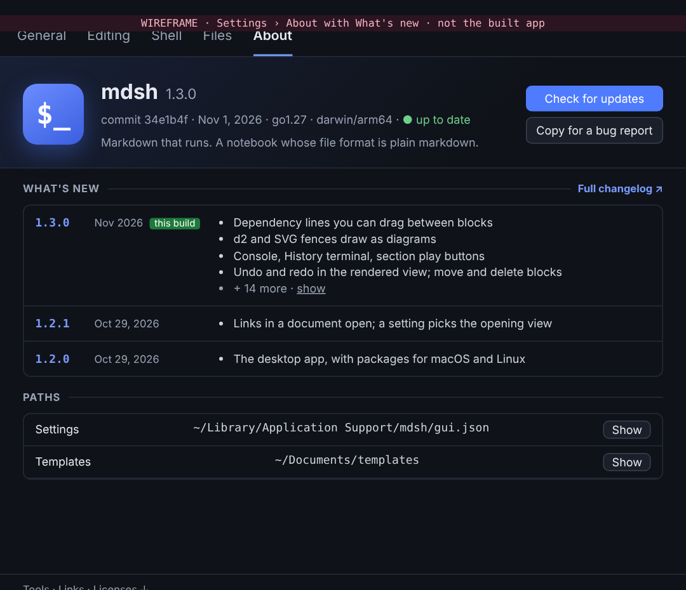
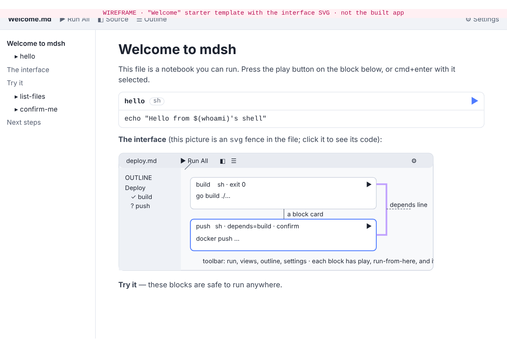
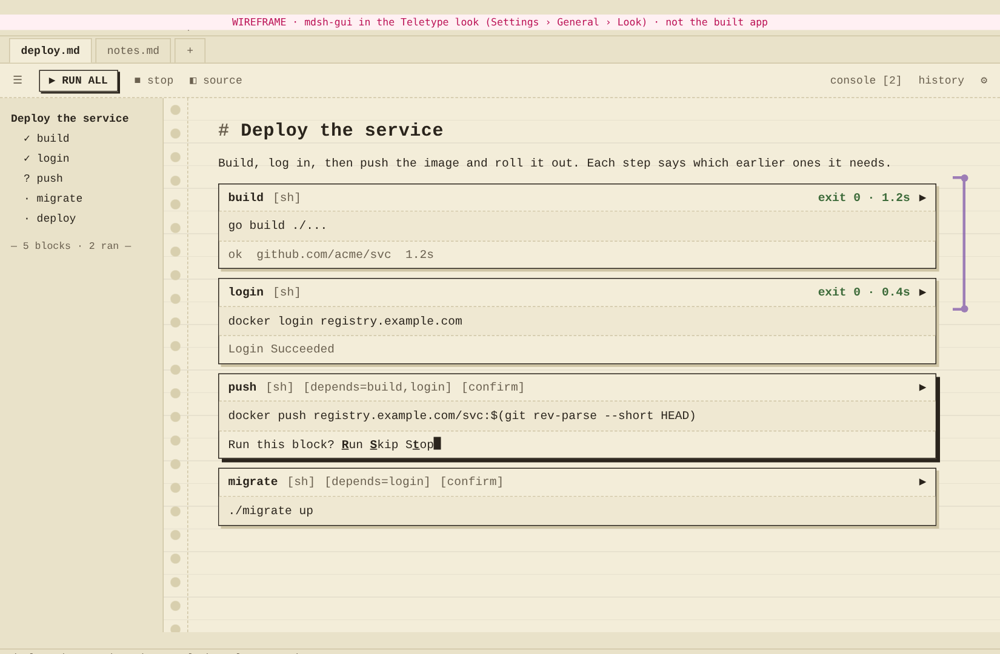
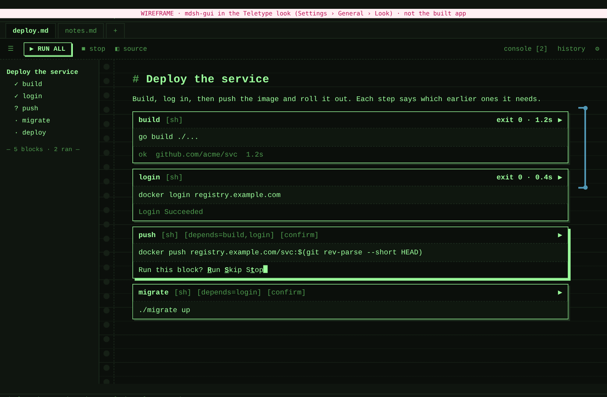
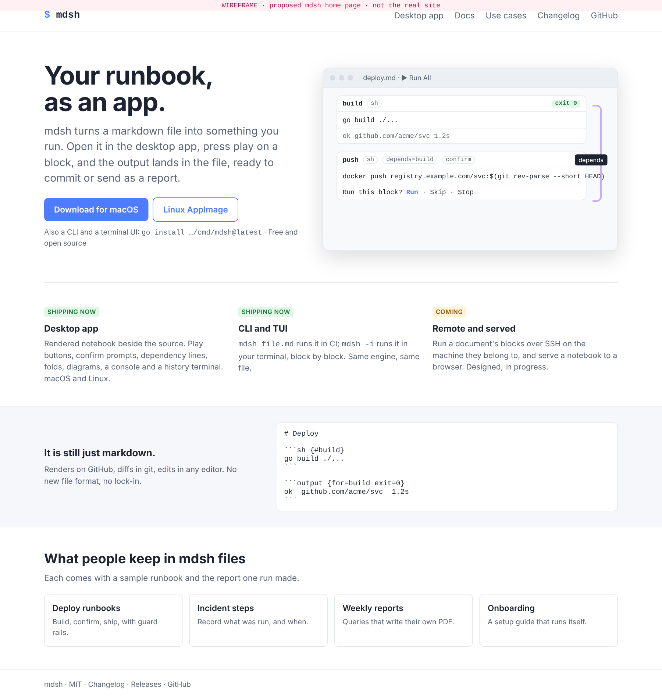
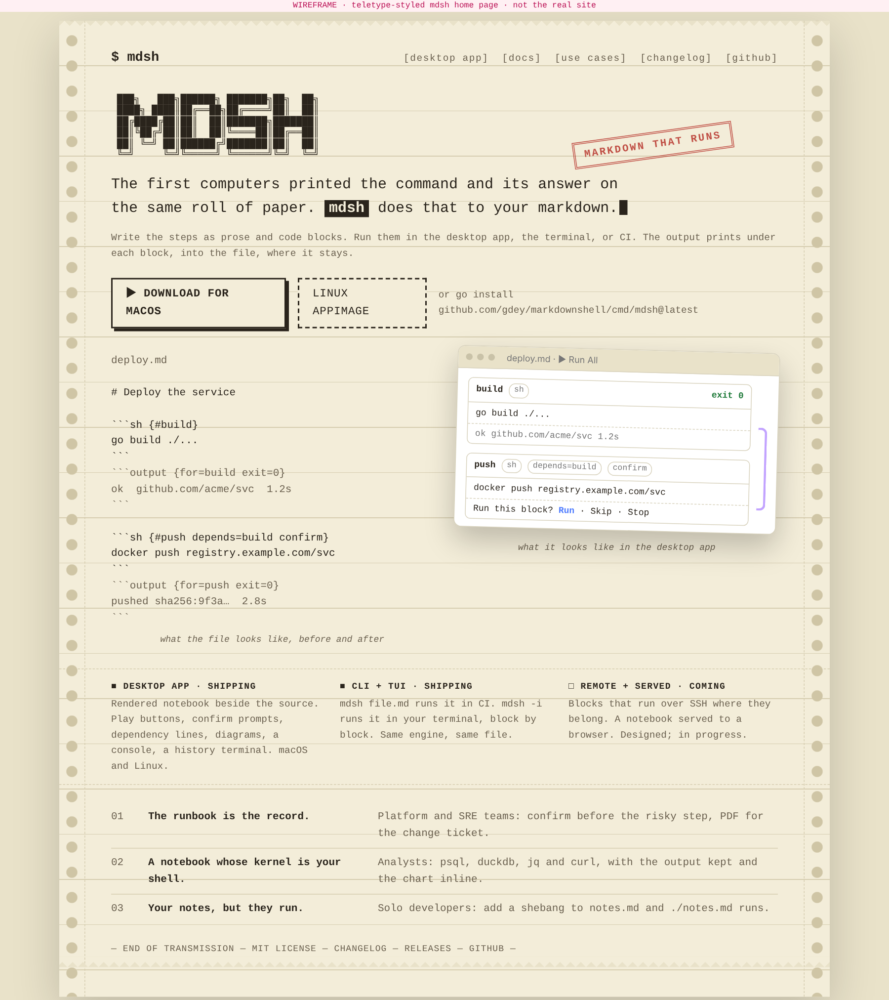
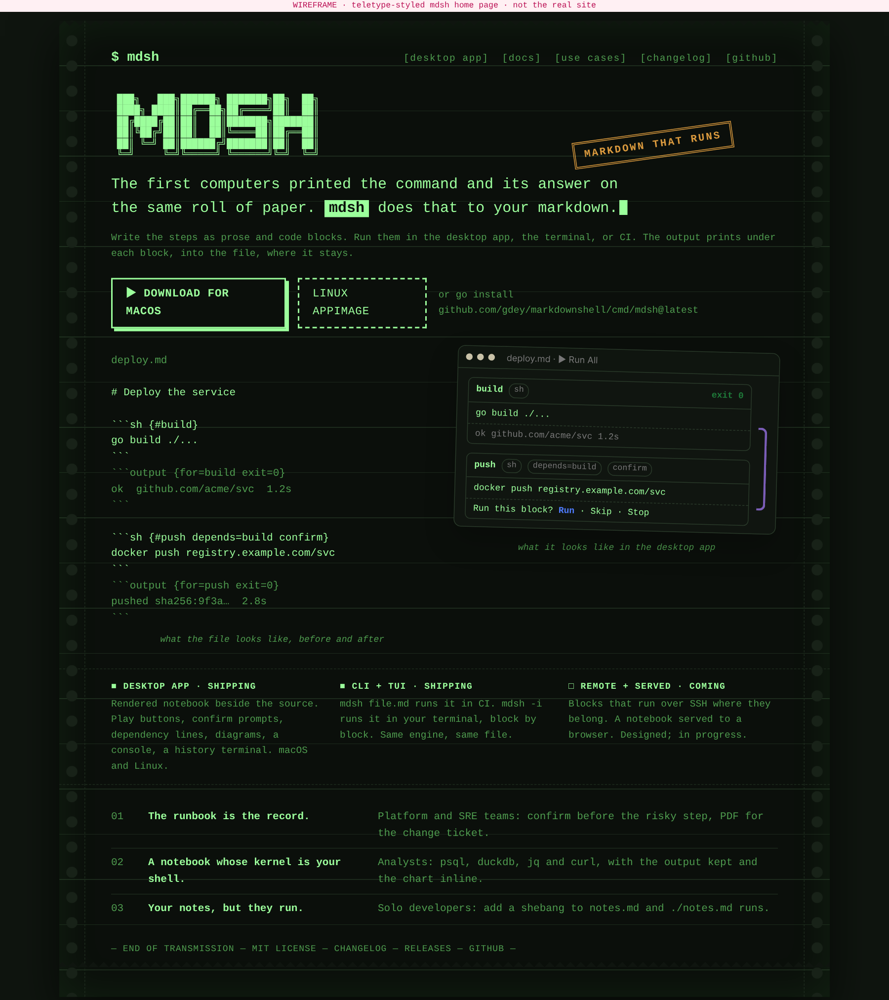

# v1.3: the release, the polish, and the site

Status: design, Nov 1, 2026. For j to react to; nothing here is built.

Since v1.2.1 shipped on Oct 29, main has taken some thirty pull requests,
nearly all of them to the desktop app. This note says what to ship next,
what it should be called, what would make `mdsh-gui` feel finished rather
than functional, and how the website should change now that the app is
the headline. The last section cuts the work into threads.

Wireframes for the pieces of new UI are beside this file:
[the site's home page](site-home.png) and its [teletype
alternative](site-teletype-paper.png), [Settings › About with the
changelog](settings-about.png) and [the Welcome
template](welcome-template.png). They are sketches of layout and
message, not pixel designs.

## 1. The release

### What has landed since v1.2.1

Everything in `CHANGELOG.md` under Unreleased, grouped by what a user
would notice. PR numbers are the merges on main.

| Area | What | PRs |
| --- | --- | --- |
| Running | `depends=` runs the blocks a block needs first, asks about ones that haven't run, and tolerates a name that is no block (warned, underlined, completed in the source pane); a play button on each heading runs its section; the active block has a play button in the outline; running blocks are listed in the toolbar; Run › Clear All Outputs; `run=once`; `$MDSH_MODE` | #91, #97, #102, and earlier |
| Editing in the rendered view | Undo and redo; move blocks with alt+arrows and by dragging cards, fences and outline sections; delete a block or clear its output; folds made by hand are saved in the file; task lists, textboxes and choices write back | #92, #93, #96, #99, #104, #66 |
| Seeing | `depends=` drawn as colored lines in the margin, edited by dragging their ends; d2 and svg fences drawn as diagrams; code highlighting and ANSI colors in output; images and recordings inline | #101, #98 |
| Panes | A Console for errors and notes, with a count on the toolbar; a History terminal that appends typed commands to the file as blocks; the outline; the source pane keeps your typing when the file changes under it, and checks the spelling of the prose | #103, #67, #90, #77 |
| Settings | Tabs (General, Editing, Shell, Files, About); About shows build, paths, tools on PATH, and links, with Copy for bug reports | #100 |
| Files | `res://` paths into `<doc>.assets/`; New File… from templates; unnamed blocks get `block-<uuidv7>` ids on save | #88, #62, #69 |
| TUI (`mdsh -i`) | The `tui` branch merged (#124): a start screen, Save As and the file-changed banner, an outline with show code and output and confirm in the card, editing the whole file in `$EDITOR`, report and run-options forms, tty blocks in their card, and tabs. The TUI now matches the app feature for feature where a terminal allows. | #124 |
| Library and CLI | `--source` and `env.source`; `--html`; backspace-bold output cleaned; errors name `block` not a temp file | various |

### What is still open

Every open item is a pull request; the repository has no open issues.

| PR | What | Recommendation |
| --- | --- | --- |
| #71 (draft) | Embedded Neovim source pane | Experimental; not for a release. |
| #95 | Design doc: blocks over SSH | Merge the doc any time; it does not gate the release. It is what the site's "coming" section points at. |
| #80 | Docs: Obsidian embedding feasibility | Same. |
| #55, #56, #85 | `mdsh --serve` browser pieces, its docs, and `--serve=stdio` | After 1.3. Serve is the second half of "remote", and its security review (#56) should land before any of it is in a tagged release. |

### Version number

**Recommend v1.3.0**, with one thing said loudly in the release notes.

The Unreleased section is almost entirely additions, which is a minor
bump. The one change that reaches into people's files is the rename of
unnamed blocks from `block-N` to `block-<uuidv7>` on the next save (#69).
It rewrites every reference inside the file consistently, so documents
keep working, but a script that calls `mdsh --only block-3` breaks. By
the letter of semver that is a major bump. Two reasons not to:

- The project is three days past 1.0 and nobody outside it has `--only
  block-3` in a cron job. A 2.0 now spends the number on a footnote.
- 2.0 is worth saving for the moment the *shape* of mdsh changes: when
  the TUI editor, SSH and serve make it a tool for more than one machine.

So: **1.3.0**, with a "Documents will have their unnamed blocks renamed"
paragraph at the top of the release notes, as the CHANGELOG already has
it. If j would rather follow semver strictly, everything else in this
note is unchanged and the number becomes 2.0.0. (Question 1.)

### What gates the release

In order. The first three are the actual gates; the rest are the polish
cut below, which should ship in 1.3 but can slip to 1.3.1 without
blocking a tag.

1. **A day of use on macOS.** The last several app features (drag
   handles, dependency-line editing, console, history) were verified on
   Linux under Xvfb and are "macOS untested" in their PRs, and the TUI
   branch (#124) landed six milestones at once. One pass through
   `examples/runbooks` in the packaged `.dmg` build, in light and dark,
   is the cheapest insurance there is. A short checklist runbook in
   `examples/runbooks/gui-smoke.md` would make it repeatable.
2. **CHANGELOG headline and Changed section.** Move the uuid rename
   paragraph to the top of the 1.3.0 section with a one-line summary
   under the heading, as 1.2.1 and 1.2.0 have. The release workflow
   already cuts release notes from that section.
3. **Site and README screenshots refreshed.** The Desktop page's images
   predate the outline play buttons, dependency lines, console and
   history, and the site's home page does not show the app at all.
   Section 3 covers the larger rework; the gate is only that the
   pictures match the build.
4. Then the 1.3 polish cut from section 2: Settings › About with the
   changelog, the Welcome template, the Help menu and shortcut sheet,
   empty states, and the toolbar icon pass.

Not gates: serve, SSH. The Teletype look (P9) is wanted for 1.3 but is paint, so it can follow in 1.3.1 if T4 runs long.

## 2. Polish: making the app feel finished

Each item says what it is, roughly what it costs, and whether it is in
the 1.3 cut. Effort is for one thread: **S** is an afternoon, **M** a
day, **L** two or three. The cut is what I would ship; the rest is
ordered by value for whoever picks next.

### The 1.3 cut

| # | Feature | What it is | Effort | Why now |
| --- | --- | --- | --- | --- |
| P1 | **Settings › About, with What's new** | See below. A version hero with the app icon, an **Update available** line, and the changelog in the page: this build's section open, older ones one line each. | M | j named it. It is also the only place the app tells you what changed. |
| P2 | **Welcome template and interface SVG** | See below. A built-in `Welcome.md` that explains the window with one `svg` fence and three blocks that are safe to run anywhere. Offered by New File…, on the empty start screen, and under Help. | M | j named it. Onboarding today is a start screen listing whatever `.md` files happen to be in `~/Documents`. |
| P3 | **Help menu and a shortcut sheet** | A Help menu (Welcome, Keyboard Shortcuts, Documentation, Changelog, Report an Issue) and a cmd/ctrl+/ sheet that lists every shortcut by menu, drawn from the menu definitions so it cannot drift. Tooltips on every toolbar button show the shortcut. | S | The app has forty shortcuts and no way to discover them except the menus. |
| P4 | **Empty states** | The start screen with no files: an illustration, "Open the Welcome notebook", New File…, Open…, and a one-line explanation of what folder it is looking at. A document with no blocks: a hint under the last paragraph pointing at the Insert menu. The Console and History panes when empty: one line saying what will appear there. | S | Every pane has a first impression, and most of them are blank. |
| P5 | **Icon pass** | Replace the mix of Unicode glyphs (▶ ◐ ? ✓ ✗ …) and ad hoc inline SVG with one icon set, inline SVG at 16px, same stroke weight everywhere: toolbar, outline markers, card buttons, pane buttons, Settings tabs. Lucide (ISC) fits the look. | M | Inconsistent glyphs are the single biggest "home-made" tell. (Question 4.) |
| P6 | **Motion** | Short, purposeful transitions, each under 200ms and off with `prefers-reduced-motion`: folds animate height; a block that starts running gets a soft pulse on its left edge; the running badge in the toolbar fades in; the Console and History slide; the order-warning bar slides down; confirm prompts fade in. No bounces. | S | The app currently snaps between states. Motion is what tells the eye what just changed. |
| P7 | **Type and spacing scale** | One scale for the rendered view: heading sizes, paragraph measure (about 72ch), card header height, badge size, outline row height, Settings row padding. Keep the system font stack; fix the sizes. Tabular numbers for exit codes and timings. | S | Everything is nearly right and slightly different from its neighbor. |
| P8 | **Update check** | On launch, once a day, fetch the latest release tag from GitHub (opt-out in Settings › General). Show it in About and as a quiet line on the start screen: "1.3.1 is available". No auto-update; link to the release. | S | Without it, nobody who installed the `.dmg` ever hears about 1.3.1. |
| P9 | **Looks: Plain and Teletype** | See below. A **Look** setting beside Theme: Plain (today's) or Teletype (the site's paper and phosphor), each in light and dark. The app's colors are already CSS variables the editors and terminal read, so a look is a second variable set plus a few texture rules. | M | j asked for it (Nov 1); it is what ties the app to the site, and it is cheap because the tokens exist. |

### Settings › About, with What's new (P1)



What changes from today's About:

- **A hero.** The app icon at 64px, the name and version large, and the
  build line under it (commit, date, Go, platform). A one-line tagline.
  To the right, two buttons: **Check for updates** and **Copy for a bug
  report** (today's Copy, named for what it is for). The hero has a
  faint gradient so the tab has a top; the rest of the page stays flat.
- **What's new**, directly under the hero, before Paths and Tools.
  Each release is a row: version, date, and its headline bullets. The
  running build's section is open and marked; older sections show their
  summary line with a disclosure. A **Full changelog ↗** link opens the
  site's changelog page. A build from an untagged commit shows the
  Unreleased section marked "in this build".
- **Paths, Tools, Links** as today, under section rules with the same
  small caps labels.

Where the text comes from: a root package `changelog` that embeds
`CHANGELOG.md` with `go:embed` and parses it into releases (version,
date, summary paragraph, sections, bullets). `cmd/mdsh-gui` already
depends on the root module through a `replace`, so the app gets the
text at build time with no copy step, and `mdsh changelog [VERSION]`
comes for free for the CLI. A test checks that the parsed version list
matches the `## [X.Y.Z]` headings, as the release workflow's awk does.

### The Welcome template (P2)



- **One file, `Welcome.md`**, embedded in the app, listed by New File…
  under a **Built in** group above the templates folder's files, opened
  by Help › Welcome, and offered by the empty start screen. Opening it
  from Help makes a copy in the start folder (or asks where), since the
  point is to run and edit it.
- **The interface picture is an `svg` fence** in the file, drawn by the
  app as of #98, so it renders in the rendered view with the "show the
  code" button that every diagram has. That is the trick: the picture
  that explains the interface is itself a feature of the interface. It
  labels the toolbar, the outline, a block card with its play button and
  badges, a dependency line, and the pane buttons. It uses CSS
  variables that the app's theme sets, so it is right in dark mode.
- **Three blocks, safe anywhere**: `echo` with `$(whoami)`, `ls` of the
  document's folder, and one marked `confirm` so the first confirm
  prompt a user sees is one they asked for. A textbox and a choice
  bound to a `var=` that the last block reads, so inputs are shown
  working. A `depends=` between two of them so a line is drawn.
- **A final section, Next steps**, linking the docs, the use cases and
  the keyboard sheet.
- The site's getting started page for the desktop app embeds the same
  SVG, so the picture is drawn once.

### Looks: Plain and Teletype (P9)





j asked for the site's teletype to be a look the app can wear too, so
the two match. The setting is **Look** in Settings › General, next to
Theme: **Plain** (what the app is today) or **Teletype**. Theme still
picks System, Light or Dark, so Teletype is paper in the light and
green phosphor in the dark, as on the site.

What a look is, and why it is cheap:

- **The app is already tokenized.** `style.css` defines every color as
  a variable (`--bg`, `--fg`, `--border`, `--accent`, the `--syn-*`
  syntax colors, the `--ansi-*` output colors, the `--dep-*` line
  colors, `--term-*` for the terminal), and the CodeMirror theme in
  `theme.ts`, the highlighter and xterm all read them. The dark theme
  is one block that redefines them. A look is the same thing: a block
  under `[data-look="tty"]`, and another under `[data-look="tty"]`
  with the dark query, that set the variables to the paper and
  phosphor palettes from the site. That alone gets most of the way.
- **A font variable.** Today the UI font and the code font are literal
  stacks in a few rules. They become `--font-ui` and `--font-code`, so
  the Teletype look can set both to the monospaced face. The site and
  the app share the face so they read as one thing.
- **A dozen texture rules.** Cards lose their rounded corners and take
  a hard one-pixel border with an offset shadow, the selected card's
  shadow in ink. Badges become `[sh]` in brackets. The rendered view's
  background gets the faint rule every line and the sprocket strip at
  its left edge, both pure CSS. Run All is a keycap. The confirm
  prompt gets a block cursor. Headings keep their `#`. Nothing moves,
  resizes or reflows between looks: a look changes paint, never
  layout, so tests, screenshots and the dependency-line geometry are
  unaffected.
- **Diagrams and images** are left alone; d2 output and PNGs show as
  they are on either paper. The History terminal takes the phosphor
  palette in the dark and ink-on-paper in the light through the
  `--term-*` and `--ansi-*` variables it already reads.
- **Settings and the start screen** follow the look too, since they
  are the same stylesheet. The Welcome template's interface SVG uses
  the variables, so it is right in every combination.
- **The code**: `settings.Look` (string, empty means plain) beside
  `Theme`; `applyTheme` sets `data-look` as it sets `data-theme`; the
  Settings page gets one more row; the `settings` event already
  reaches every window. A test asserts that every variable the plain
  look defines is also defined by the Teletype look, so a new token
  cannot be forgotten in one of them.

Not in this: user-supplied themes. If wanted later, a `look.css` in
the settings folder loaded after the built-in ones is a small change,
and the variable list is the documented surface. Also not in this: a
look that changes layout (density, a sidebar on the right). Those are
different features.

### After 1.3, in order

| # | Feature | What it is | Effort |
| --- | --- | --- | --- |
| P10 | **Command palette** | cmd/ctrl+K: every menu item, every block by name, every heading. Built from the same menu definitions as P3. | M |
| P11 | **Run summary and timings** | Each card's badge shows how long the block took; a run's end shows a quiet toast ("12 blocks, 1 failed, 48s") with a link to the first failure. | S |
| P12 | **Toasts** | Saved, Report written (with Show in Folder), Copied. Bottom-right, one at a time, auto-dismiss. Replaces the few places that flash a message today. | S |
| P13 | **Window state** | Window size per file landed in #130. Still open: position, pane widths, and which panes were open, per file. | S |
| P14 | **Block context menu** | Right-click on a card: Run, Run From Here, Run Section, Move Up/Down, Delete, Clear Output, Copy Code, Copy Output, Edit in Source. Mirrors the menus; the mouse-first path is missing today. | S |
| P15 | **Custom app icon states** | The dock or taskbar icon badges while a run is going and bounces once on a failure (macOS). | S |
| P16 | **Dark mode pass** | Check every surface against the new icon set and scale: diagrams, the History terminal's palette, dependency-line colors on both backgrounds, Settings. | S |
| P17 | **Printing** | File › Print… the rendered view with the report pipeline's stylesheet, so cmd+P does the obvious thing. | S |
| P18 | **Settings search** | A filter box on Settings that narrows rows across tabs. Only worth it once Settings has twice as many rows. | S |

Deliberately not on the list: themes beyond light and dark, a plugin
system, a WYSIWYG prose editor (dropped in M3 and still right), and
inline AI anything.

## 3. The website

### What the site says today

The site is a Hugo site with its own small layouts and 85 lines of CSS,
published to GitHub Pages. It is clean and reads well, and it was
written when mdsh was a CLI:

- **The hero is a `go install` line.** "Markdown that runs" is a good
  headline, but the first thing under it is a Go command, and the
  buttons are Get started (the CLI install page) and GitHub.
- **The app is one bullet of ten.** "A desktop app" sits seventh in the
  What it does list, after shared shells and placeholders. Nothing on
  the home page shows a window.
- **Desktop is a docs page**, weight 53, after Conditions, Environments
  and CLI. It has three screenshots at one size, no dark variants, and
  install instructions a third of the way down.
- **Use cases** (PR #51) is the strongest page: four real runbooks with
  the report each produced. It should stay and move up.
- **There is no changelog page**, no releases link in the nav, and no
  mention of what is coming.
- Screenshots were taken by hand at different sizes and are already
  behind main.

### Proposed structure

```
/                 Home: the app is the headline (wireframe below)
/app/             Desktop app: tour, download, first run
/docs/            Documentation, reordered: Desktop app first
/use-cases/       As today, with the app's screenshot of each runbook
/security/        The security model and the two reviews, in the words of the strategy doc's 3.4
/changelog/       Generated from CHANGELOG.md at build time
/roadmap/         TUI editor, SSH, serve: one paragraph each, linking the design docs
GitHub            External
```

The words come from one place. The strategy note in PR #108,
`docs/strategy/use-cases-and-monetization.md`, holds the one-line
position, three buyer pitches (platform and SRE, data and analyst, solo
developer) and a buyer's summary of the security model, and says the
site copies them rather than rewriting them. This plan does that: the
position line is the lede's source, the pitches become the home page's
"who it is for" rows, and 3.4 becomes the Security page. Edit there,
copy here.

Nav: **Desktop app · Docs · Use cases · Changelog · GitHub.** Roadmap is
linked from the home page's Coming card and the footer, not the nav.

### The home page



Top to bottom:

1. **Hero, two columns.** Left: headline, two sentences, two download
   buttons (macOS, Linux AppImage), a one-line "also a CLI and TUI"
   with the `go install` command, and "free and open source". Right: a
   real screenshot of a run in progress, in a window frame, with a
   confirm prompt and a dependency line visible. The screenshot swaps
   for its dark version with `prefers-color-scheme`.
2. **Three cards, with status tags.** Desktop app (shipping), CLI and
   TUI (shipping), Remote and served (coming). The tags do the honest
   work of saying where TUI editing, SSH and serve are, without a
   separate "roadmap" wall.
3. **"It is still just markdown."** A strip with the source of the file
   from the hero screenshot, so the reader sees the app and the file are
   the same thing. This is the argument against every other notebook.
4. **Who it is for**, three rows from the strategy doc's pitches, each
   a title, two sentences and a link to its use case page: *The runbook
   is the record* (platform and SRE), *A notebook whose kernel is your
   shell* (data and analyst), *Your notes, but they run* (solo
   developers and consultants).
5. **Use cases**, four cards, as today's section but with the sample
   report thumbnail.
6. Footer: license, security, changelog, releases, GitHub.

Headline candidates, in order of preference:

- **Your runbook, as an app.** (In the wireframe.) Says what the
  desktop app does for the thing people already have.
- **Markdown that runs.** Today's line. Still right, and worth keeping
  as the tagline under the logo and in `<title>`.
- **A notebook whose file is just markdown.** Clearest for people
  coming from Jupyter; weakest as a first line.

Lede, built on the strategy doc's position line ("mdsh turns the
markdown you already have into something that runs, and turns each run
into a record you can send"): "mdsh turns the markdown you already have
into something that runs. Open it in the desktop app, press play on a
block, and the output lands in the file, a record you can commit or
send as a report."

### Option B: the teletype

j asked what the site would look like as an old-school teletype with
modern features. Two renderings, paper by day and phosphor by night:





The conceit earns its place because it is literally true: a teletype
printed the command and its answer on the same roll of paper, and mdsh
writes the output under the block in the same file. The lede says so,
and the page is built as that roll.

- **The page is a sheet of fan-fold paper**: cream, with sprocket holes
  down both edges, a faint rule every line, and perforated tears at the
  top and bottom. Everything is set in one monospaced face (Courier
  Prime, or the system's), including headings. The logo is a figlet
  banner. Buttons are keycaps with a hard drop shadow; the second one is
  dashed. A rubber stamp carries the tagline. The footer reads END OF
  TRANSMISSION.
- **The modern part is the window.** The desktop app's screenshot sits
  on the paper in a real window frame, slightly rotated, next to the
  printed source of the same file. Old on the left, new on the right,
  same content. That one picture is the whole pitch.
- **Dark mode is a phosphor terminal**: near-black paper, green ink,
  amber stamp. Same layout, so nothing has to be designed twice.
- **Motion, if any**: the lede types itself once on first load with a
  block cursor, then stops. Nothing else moves. With
  `prefers-reduced-motion` it is simply there.
- **Below the fold** it carries the same content as option A: the three
  status columns, the three buyer rows from the strategy doc, use
  cases, footer.

Trade-offs, honestly:

| | Option A (clean) | Option B (teletype) |
| --- | --- | --- |
| Memorable | Looks like every good developer tool site | Looks like nothing else; people will screenshot it |
| Says "modern app" | Yes, at once | Only once the window is seen; the first impression is retro |
| Reads on a phone | Yes | Needs care: sprocket holes go, the two-column demo stacks, monospace at small sizes is wide |
| Docs pages | Same design carries | Docs stay in option A's plain style; the teletype is the home page and the Desktop app page only |
| Effort | 60 lines of CSS | About 150 lines of CSS, a figlet banner, and a typing effect |
| Risk | None | Can read as a joke if the copy is not dead serious; the copy must be dry |

**Decision (j, Nov 1): both, as themes.** The teletype is the site's
default look, the plain design stays as a second theme, and a switch in
the header picks between them. Each follows the OS for light and dark,
so there are four renderings from two stylesheets: paper, phosphor,
plain light, plain dark.

How the themes work:

- **One markup, two skins.** Every page is built once, from the same
  Hugo layouts, and `<html data-theme="tty">` or `data-theme="plain"`
  picks the skin. `site.css` keeps the layout and the plain skin's
  variables; `tty.css` overrides the variables (paper, ink, rule, the
  monospaced face) and adds the texture rules (sprocket holes, the
  ruled background, the tears, the keycap buttons, the stamp, the
  figlet logo in place of the wordmark). Dark mode in each skin is a
  `prefers-color-scheme` block, as the site has today.
- **The switch** is a small control at the right of the header,
  `[plain]` / `[tty]` in the teletype skin and a two-segment toggle in
  the plain one. The choice goes in `localStorage`, read by a few lines
  of inline script in `<head>` before the first paint so pages do not
  flash. With JavaScript off the default skin shows and the switch is
  hidden. No theme cookie, no server state.
- **Docs pages follow the theme too.** In the teletype skin, docs are
  the same paper with a narrower measure and the code highlighting
  colors swapped for an ink-on-paper Chroma style (`hugo gen
  chromastyles --style=friendly` is close; one more generated block in
  `chroma.css` under `[data-theme="tty"]`). Tables keep their rules.
  Screenshots are the same files in both skins, in their window frame.
- **The teletype's texture must not cost the layout.** Below 720px the
  sprocket holes and tears go, the paper fills the viewport, the demo
  stacks, and the monospaced face drops to 14px. The plain skin already
  does this with its one media query.
- **Images and Open Graph** are rendered once, from the teletype skin,
  since that is what a shared link should show.

What it costs: about 150 lines for `tty.css`, 20 for the switch and its
script, one Chroma block, and the figlet banner as an inline SVG so it
does not depend on the font. T5 absorbs it; the plain skin is mostly
already written.

### The Desktop app page

A landing page, not a docs page. Hero screenshot, then a tour of six
things with a screenshot each (run and confirm, source beside rendered,
dependency lines, diagrams and images, the History terminal, reports),
then the download table from today's docs page with the Gatekeeper
note, then "Build it" folded at the end. The docs page under `/docs/`
keeps the reference parts (keys, settings, flags).

### Build changes

- **Changelog page.** The Pages workflow copies `CHANGELOG.md` into
  `site/content/changelog.md` with a front matter header before
  `hugo`, so the site never carries a second copy.
- **Download buttons** link to `releases/latest/download/<name>`,
  which GitHub redirects to the newest asset, so the page needs no
  version in it. The visible version comes from a `site/data/release.json`
  the release workflow updates in the same tag build.
- **Screenshots from a script.** `site/screenshots.sh` launches the
  packaged app on `examples/runbooks/deploy.md` under Xvfb at 2x, in
  light and dark, drives it with xdotool to the states the page shows,
  and writes `static/images/app/<name>{,-dark}.png`. The same approach
  verified #96; making it a script keeps the pictures current for every
  release. Mac chrome around the window is a CSS frame, not a capture.
- **CSS**: the site stays hand-written. The plain skin adds the hero
  grid, the status tags, the window frame and a `<picture>` rule for
  dark screenshots, roughly 60 lines; the teletype skin is a second
  file of about 150 (see Option B). No framework.
- **Open Graph image** and a `description` per page, so links pasted
  into chat show the app.

### Messaging for TUI and remote

Say less, precisely. "Coming" cards link to the design docs in the
repo (`docs/gui/…`, the SSH doc once #95 merges), with one sentence
each and no dates. `mdsh -i` is the terminal UI everywhere, and since
#124 it is a full one (start screen, outline, editor, reports, tabs), so
the CLI and TUI card says so and shows a screenshot; the TUI is no
longer "coming" anywhere on the site. Remote is "run a document's
blocks over SSH on the machine they belong to"; serve is "open a
notebook in a browser", named separately so a reader who wants only one
is not confused. (Question 6.)

## 4. Splitting the work into threads

Each row is one thread and one PR, on main, one commit, tests passing.
A PR that changes anything a person sees (the app, the TUI, the site)
carries screenshots of the change in its description, before and after
where that helps (j, Nov 1). Rows with no dependency can start at once.

| Thread | Scope | Depends on | Model |
| --- | --- | --- | --- |
| T1 Release 1.3.0 | Write the gui smoke runbook and run it on macOS, with a pass through the new TUI screens too; reorder the CHANGELOG section with its headline; refresh the Desktop page's screenshots; tag when T2 and T3 land (or without them, if they slip). | none | Opus |
| T2 About and changelog | `changelog` package at the root with tests; `mdsh changelog`; the About hero and What's new; update check (P1, P8). | none | Opus |
| T3 Welcome template | `Welcome.md` with the interface SVG; Built in group in New File…; Help menu with Welcome, Shortcuts, Docs, Changelog, Report an Issue; the shortcut sheet; empty states (P2, P3, P4). | none (coordinate the Help menu with T2's Changelog item) | Opus; the SVG itself is design work and could start on Fable |
| T4 Icons, motion, type | P5, P6, P7, P16 in one pass, since they touch the same CSS and each other's pixels. Screenshots before and after in the PR. | none, but land after T2 and T3 so it restyles their UI too | Opus |
| T4b Looks | P9: the Look setting, the font variables, the Teletype palettes and texture rules, the token-coverage test. Shares the site's palette values with T5. | T4, so it skins the final icons and scale | Opus |
| T5 Site rework | New home, Desktop app page, nav, changelog, roadmap and security pages, download buttons; the teletype skin as default and the plain skin behind a header switch, each light and dark. Copy comes from the strategy doc (#108). Uses placeholder screenshots until T6. | #108 for the copy | Fable for copy and structure, then Opus for Hugo |
| T6 Screenshot script | `site/screenshots.sh` and the images it makes, light and dark; wire the pages to them. | T4 (so the pictures show the final look) | Opus |
| T7 Post-1.3 polish | P10 to P15, P17, P18, one or two per thread as picked. | 1.3 tagged | Opus |

The order that gets to a tag fastest: T1 starts now and waits; T2, T3
and T5 run in parallel; T4 follows T2 and T3; T4b and T6 follow T4; T1 tags.
If the tag is wanted this week, T4 and T6 can move to 1.3.1 and the
site ships with hand-taken screenshots.

## 5. Questions for j

Everything above proceeds on the recommended answers.

1. **Version.** 1.3.0 with the uuid rename called out, or 2.0.0 because
   it is strictly a breaking change? Recommend 1.3.0.
2. **What else is in.** #55/#56/#85 (serve) wait for 1.3.1 or later.
   Anything there you want in the tag?
3. **Tag timing.** Tag as soon as the macOS smoke pass is done and
   ship the polish as 1.3.1, or hold the tag for About, Welcome and the
   site? Recommend holding for About and Welcome (two threads, a day or
   two), and letting the icon pass and the site follow in 1.3.1 if they
   are not ready.
4. **Icons and type.** Vendor Lucide (ISC license, inline SVG, no
   runtime) for one icon set? Keep the system font stack rather than
   shipping a font? Recommend yes to both.
5. **Site home.** Decided: the teletype is the default theme, the
   plain design is a second theme behind a switch in the header, both
   follow light and dark, and the app gets the same two as a Look
   setting (P9). Still open: is a custom domain planned,
   which would change the Open Graph and footer work?
6. **"Remote" on the site.** Say SSH and serve as two coming things, or
   one "remote" story? Recommend two, named plainly, each linking its
   design doc.
