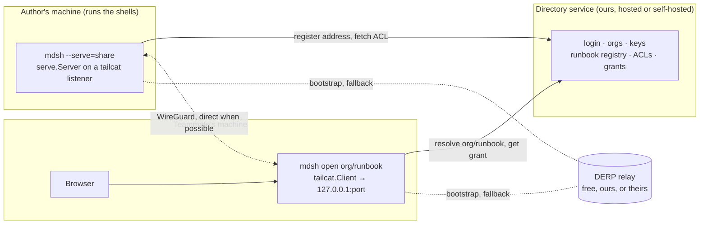
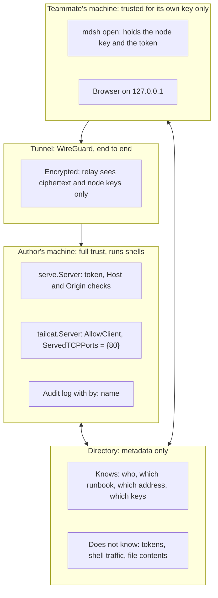

# Sharing a running runbook: tailcat tunnels and a directory service

Status: design, Nov 12, 2026; nothing here is built. The questions at
the end are open. Diagrams are Mermaid, which GitHub renders in place.
This doc follows the "Share runnable docs over Tailscale" thread, where
j asked whether [tailcat](https://github.com/tailscale/tailcat) could
carry `mdsh --serve` to a teammate, and then whether the business could
be the part tailcat leaves out: passing addresses, tokens and ACLs
between people, with hosted relays as an upsell.

The one-line position:

> `mdsh --serve` already turns a runbook into a page a browser can run.
> This design lets a teammate reach that page with nothing to set up,
> and makes the thing worth paying for the service that says who may.

## What exists

- **`mdsh --serve`** (the `server` branch, PR #56, not yet on main):
  the GUI's page served over HTTP, loopback by default, a random token
  in the first URL that becomes a cookie, Host and Origin checks, no TLS.
  `serve.Server.Serve` takes any `net.Listener`. Anyone who reaches the
  port with the token runs shells as the user who started it.
- **The control socket and audit log** (`docs/spec.md`): `ask` events
  record who answered (`user`, `default`, `yes-flag`, `none`). No other
  event says who did it, because today only one person can.
- **tailcat** (v0.7.0, BSD-3): Tailscale's data plane with no control
  plane. A server prints a `tc…` address holding its WireGuard key, a
  path-discovery key, a pre-shared key and a relay region. A client with
  that address bootstraps through a DERP relay, then usually upgrades to
  a direct UDP path. No account, no root, no routing changes. The
  library has `Server.Listen` (a `net.Listener`), `AllowClient` (admit a
  client by node key) and `Client.Dial`. Addresses are exchanged "out of
  band, however you want". There is no API stability promise, the free
  relays have no SLA and may be revoked, and its SECURITY.md says the
  threat model was "the same person on both ends".

Measured on Nov 12 (stripped, `CGO_ENABLED=0`, this repo at #259):

| | now | with tailcat | with tsnet (for comparison) |
| --- | --- | --- | --- |
| `mdsh` binary | 18 MB | +14 MB | +16 MB |
| `vendor/` | 31 MB, 27 modules | +34 MB, +48 modules | +35 MB, +44 modules |

## Goals

- A teammate reaches a runbook j is serving with one command and no
  networking: no port forwarding, no VPN, no TLS certificates.
- Every action on a shared runbook is tied to a person: on the cards,
  in confirms, and in the audit log.
- The shell traffic never passes through anything we run. We move
  metadata. The strategy doc's rule stands: we don't run customers'
  shells.
- The free path needs no account with anyone. The paid path is the
  directory, identity and ACLs, and relays with an SLA.

## Non-goals

- A hosted notebook service. The runbook runs where it always ran, as
  the person who started it.
- A network. One runbook is shared, not a subnet. Anything that needs
  a tailnet should use a tailnet.
- Replacing the token. The HTTP token stays as a second factor behind
  the tunnel.

## The three parts



1. **`mdsh --serve=share`** (name open, Q1). Starts a `tailcat.Server`
   with a persistent key (so the address survives a restart), listens on
   port 80 of the tunnel, and hands that listener to `serve.Serve`.
   `AllowClient` admits a node key only if the directory's current ACL
   for this runbook lists it, or, with no directory, if it is in a local
   allow file or the person running the server says yes to a prompt.
   The server prints its `tc…` address and registers it with the
   directory under `org/runbook`.
2. **`mdsh open org/runbook`** (or `mdsh open tc…` with no directory).
   Logs in once, resolves the name to an address and a grant, dials
   through a `tailcat.Client` with the person's persistent node key,
   listens on a loopback port, and opens the browser on it with the
   token. The page's Host is loopback, so today's Host check passes as
   is. WebSockets are plain TCP, so events work unchanged.
3. **The directory service.** A small Go service with a database:
   OIDC login, orgs and members, each member's node public keys, a
   registry of running servers with heartbeats, ACLs per runbook, and
   an Ed25519 signing key per org that signs grants. It never carries
   runbook traffic and never learns a token.

### Trust boundaries



What each secret buys an attacker:

| Secret | Alone gets | Because |
| --- | --- | --- |
| The `tc…` address | A WireGuard handshake attempt | `AllowClient` refuses an unlisted key |
| A member's node key | A tunnel to runbooks their ACL lists | Still needs the HTTP token |
| The HTTP token | Nothing from outside the tunnel | The listener only exists inside it |
| The directory database | Addresses and public keys | No private keys and no tokens are stored |
| A grant | Nothing | A grant names a public key; it is useless without the matching private key |

## Identity and grants

A person is their directory login. A device is a node key the person's
`mdsh` generated and registered after logging in. The directory signs
a **grant** when a member asks to open a runbook:

```json
{
  "v": 1,
  "org": "acme",
  "runbook": "deploy-web",
  "member": "dana@acme.example",
  "node": "nodekey:9c8d2e67…2e34",
  "role": "operator",
  "iat": "2026-11-12T05:40:00Z",
  "exp": "2026-11-12T13:40:00Z"
}
```

signed with the org's Ed25519 key, base64url, and sent with the
address. The serving side gets the org's public key once (pinned at
first registration, Q4) and the runbook's ACL as a list of such grants
or, simpler, as a list of allowed node keys with names and roles that
the directory pushes on change. `AllowClient` admits a node key that an
unexpired grant names. The HTTP layer maps `RemoteAddr` (the tunnel
address tailcat derives from the node key) to the grant, so every call
knows `member` and `role`.

Roles, kept to three (Q3):

- **viewer**: sees the page and output, can't run, answer or edit.
- **operator**: runs blocks, answers `ask` and `confirm`, edits inputs.
- **owner**: operator plus edits the document and settings.

The author of the server is always owner. Per-block policy stays in
the document, as today: `confirm`, `--step`, `depends=`. A later step
can add `confirm=owner` to require the owner's answer.

### What changes inside mdsh

- **`by` on events.** `block.start`, `block.skip`, `ask`, `var`, `task`
  and `write` get `by: {"member": …, "node": …}` when a shared window
  did it. Local runs keep `by` as it is. This is the piece the audit
  log needs whatever the transport.
- **Names on cards.** A running block shows who started it; a pending
  `ask` or `confirm` shows who it is waiting on and lets any operator
  answer, with the answer logged under their name.
- **One set of shells.** Everyone in a window shares its shells, as two
  tabs do today. That is the point of sharing a live runbook, and it is
  also why the audit log needs names. Separate shells per person is a
  non-goal for now (Q5).
- **Presence.** The page shows who else is connected, from the grants
  of open tunnels. `DisconnectClient` drops a member when the owner
  removes them from the ACL.

```mermaid
sequenceDiagram
  participant A as Author (mdsh --serve=share)
  participant D as Directory
  participant T as Teammate (mdsh open)
  participant B as Browser
  A->>D: register org/runbook: tc… address, server key
  D-->>A: ACL: allowed node keys with names and roles
  T->>D: open org/runbook (logged in, node key registered)
  D-->>T: address + signed grant
  T->>A: WireGuard handshake via DERP, then direct
  A->>A: AllowClient: key in ACL? admit
  T->>B: open http://127.0.0.1:port/?token=…
  B->>T: GET / with token
  T->>A: forwarded over the tunnel
  A->>A: serve.guard: Host loopback, token ok, map RemoteAddr → member
  A-->>B: the page; events over WebSocket
  B->>A: run block
  A->>A: audit: block.start by dana@acme.example
```

## Relays

The tunnel bootstraps through a DERP relay and falls back to it when
NAT traversal fails. Browsers in the wasm demo stay on DERP, which is
one reason this design uses a local `mdsh open` and not the wasm client.

| Tier | Relay | Terms |
| --- | --- | --- |
| Free, no directory | Tailscale's public tailcat relays | Rate limited, no SLA, revocable by Tailscale at any time |
| Team | Relays we run (`derper`, open source) listed in our DERP map | An SLA we write; egress is our cost when a session stays relayed |
| Enterprise | Their own relays, our map or theirs, `--derpmap-url` | Nothing leaves their network but the directory metadata, or they self-host that too |

Running `derper` is a day of work per region; the ongoing cost is
bandwidth for relayed sessions, which is the minority on ordinary
networks. The free tier's dependence on Tailscale's goodwill is the
reason the paid tiers can't share it.

## Security notes

- **The address is a secret** and a credential for a handshake, so it
  goes only to logged-in members through the directory, never into a
  README or a DNS record. `AllowClient` makes it insufficient on its own.
- **`ServedTCPPorts` is `{80}`** and the tailcat server has no `OnTCP`,
  so the tunnel reaches the notebook and nothing else on the author's
  machine. No subnet routing, no `OnTCPForward`.
- **The token stays.** It is generated as today and travels only inside
  the tunnel. A grant without the token gets the 401 page.
- **The directory is a target.** It can add a member to an org or a key
  to an ACL, which is how any such service can be abused. Grants are
  short-lived and logged; the serving side keeps its own log of who was
  admitted; an owner can pin the ACL and refuse pushed changes (Q4).
- **tailcat's own threat model** was one person at both ends. We are
  the two-party case. We vendor and pin a version, track their
  SECURITY.md, and keep the surface to one listener on one port.
- **Nothing here sandboxes blocks.** A member with `operator` runs
  shells as the author. That is the same as handing them the keyboard,
  and the doc should say so where the author turns sharing on.

## Business fit

This is option C from `docs/strategy/use-cases-and-monetization.md`,
the self-hosted team server, with a hosted piece that carries no shell
traffic.

- **Free:** `mdsh --serve=share` and `mdsh open tc…` with a pasted
  address and a local allow list. Works with no account anywhere.
- **Team (per seat):** the hosted directory: login, orgs, named
  runbooks, roles, presence, grants, our relays.
- **Enterprise (per org):** self-hosted directory, their relays or
  ours, audit log shipping, SSO groups as roles.

The pitch is "share one running runbook, not your network". A customer
who already has a tailnet may prefer `tsnet` and their own ACLs; the
design keeps `serve.Serve(ctx, listener)` transport-neutral so a tsnet
listener is a later option, not a rewrite.

## Effort

Guesses from the code read, not from having built one.

| Step | Work | Size |
| --- | --- | --- |
| 1. Spike | `--serve=share` on a tailcat listener behind a build tag, `mdsh open tc…`, vendoring commit, docs, an in-process end-to-end test | 2–3 days, after the `server` branch merges |
| 2. Names | `by` on events, names on cards, who a question waits on, local allow file, persistent server key | 1–2 weeks |
| 3. Directory MVP | OIDC login, orgs, key registry, runbook registry, ACLs, signed grants, `mdsh open org/runbook` | 4–6 weeks |
| 4. Relays | `derper` in two regions, our DERP map, monitoring | 1 week, then ops |

Steps 1 and 2 are worth doing even if 3 never happens.

## Open questions

- **Q1.** The flag: `--serve=share`, `--serve=tailcat`, or `--share`?
  *Recommendation:* `--share` as its own flag that implies `--serve`,
  because sharing is the thing the person wants and the transport is
  a detail.
- **Q2.** Does the plain `mdsh` binary carry tailcat (+14 MB), or does
  it live in a build tag or a second binary? *Recommendation:* build
  tag off by default for the CLI packages, on for the GUI builds, until
  the feature earns its place.
- **Q3.** Are three roles enough for v1? *Recommendation:* yes; add
  per-block `confirm=owner` later.
- **Q4.** Who wins when the directory pushes an ACL change the author
  didn't make? *Recommendation:* the author's machine applies it but
  shows it and logs it; an owner can pin the ACL and refuse pushes.
- **Q5.** Shared shells for everyone in a window, or a shell per person?
  *Recommendation:* shared; the audit log carries the names.
- **Q6.** Free relays: do Tailscale's terms allow a product on them?
  *Recommendation:* ask, and don't depend on the answer; paid tiers use
  ours.
- **Q7.** Keep a fork of tailcat ready, given no API stability promise?
  *Recommendation:* vendor and pin; fork only if an upgrade breaks us.
