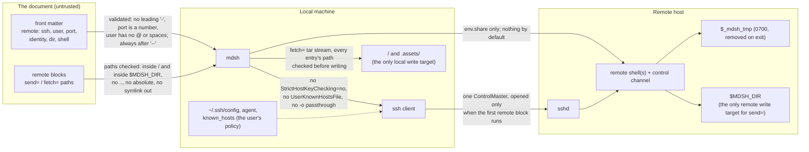
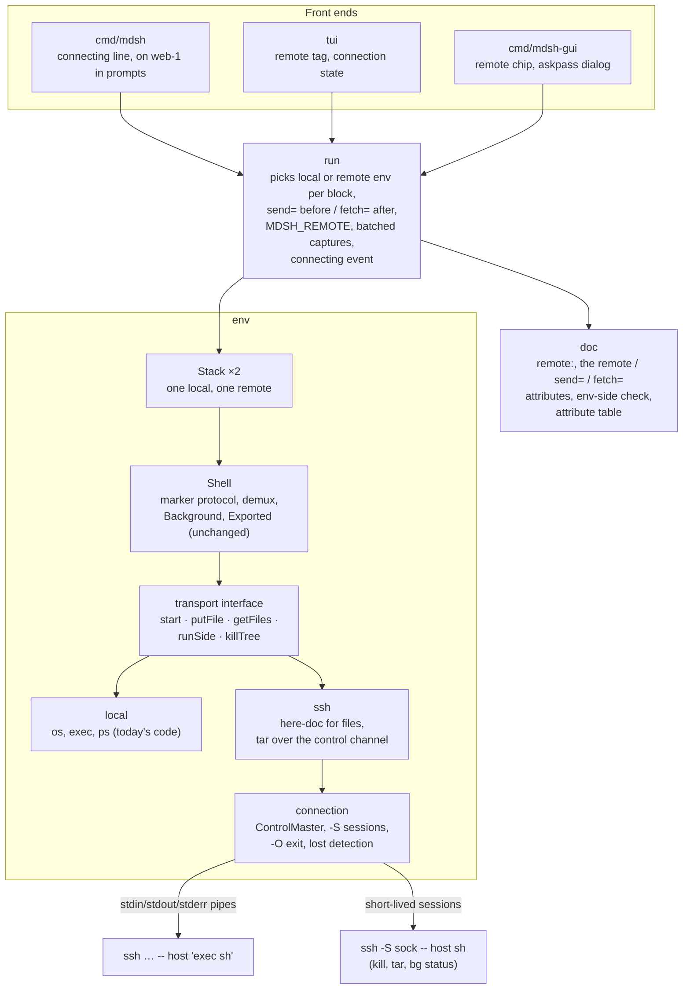

# Running blocks over SSH

Status: design, Nov 1, 2026. Nothing here is built yet. Questions for j are marked **Q1** to **Q9** and collected under [Open questions](#open-questions). The diagrams are Mermaid, which GitHub renders in place.

## Goals

A document can name one remote machine and tag the blocks that run on it, through SSH, while the rest keep running on the machine running mdsh. A runbook for a server then reads the same as a local one: tagged blocks share one long-lived shell on the remote, output still lands under each block, and the file runs the same in `mdsh`, `mdsh -i` and mdsh-gui.

- **Declared, not hidden.** The remote and which blocks run on it are written in the file, so a reader can see them before running anything, and every front end shows them.
- **Same model as local.** One long-lived shell per env, vars flowing down, the marker protocol, background blocks and placeholders all work as they do today. Only where the shell lives changes.
- **Your SSH setup, as it is.** `~/.ssh/config`, the agent, ProxyJump, hardware keys and `known_hosts` work without being described again in the document.
- **Files go both ways on purpose.** A block says which files it needs sent to the remote and which it wants back, and mdsh moves them. See [Assets](#assets-sending-files-to-the-remote-and-getting-them-back).
- **Nothing to install on the remote.** The remote needs `sshd`, a POSIX `sh`, `mktemp`, `tar`, `awk`, `ps` and `kill`, which every Linux and macOS box has.

Not goals: several remotes in one file (j, Nov 1: one host, and you tag the blocks that target it), running mdsh itself on the remote, other transports (`docker exec`, `kubectl exec`; see [Later](#later)), and Windows remotes.

## How a file opts in

The remote is named once in front matter under `mdsh:`, and a block runs there when it carries the bare attribute `remote`. Blocks without it run locally, as today. A file with no `remote:` in its front matter can't have `remote` blocks: that is a parse error, found without running anything.

````markdown
---
mdsh:
  remote:
    ssh: web-1                 # a Host alias from ~/.ssh/config, or user@host
    user: deploy
    dir: /srv/app
---

```sh {#build}
make dist/app.tar.gz
```

```sh {#deploy remote send=dist/app.tar.gz confirm}
tar -xzf app.tar.gz && systemctl restart app
```

```sh {#logs remote fetch=logs/app.log}
journalctl -u app --since -5m > logs/app.log
```

```text {<include file=logs/app.log to=20}
```
````

`remote:` is a map, or a string that is short for `{ssh: <string>}`. Fields:

| Field | Meaning | Default |
| --- | --- | --- |
| `ssh` | SSH destination: a `Host` alias from your SSH config, a hostname, `user@host`, or `ssh://user@host:port` | required |
| `user` | Login user (`-l`) | the destination's, then SSH config, then your local user |
| `port` | Port (`-p`) | the destination's, then SSH config, then 22 |
| `identity` | Private key file (`-i`, with `IdentitiesOnly=yes`); `~/` is your local home | SSH config and the agent |
| `dir` | Working directory on the remote, where sent files land and fetched ones are read from. `~/` is the remote home | a fresh per-session dir under the remote's `$TMPDIR` (**Q3**) |
| `shell` | Shell to start on the remote | mdsh's usual rule: `/bin/sh`, or `zsh` when the document has `zsh` blocks |

Anything else SSH can do (ProxyJump, ciphers, ControlMaster, timeouts) goes in `~/.ssh/config`, not the document. There is no `options:` passthrough, on purpose (see [Security](#security)).

**Block attributes.** `remote` runs the block on the remote. `send=` and `fetch=` move files (below). All three are step attributes like `env=`, so they are parse errors on includes, tapes, textboxes and choices, and `send=`/`fetch=` without `remote` is a parse error too.

**Envs and the remote.** A shell lives on one machine, so remote blocks get a top-level env of their own, and a named env belongs to one side: `env=build` on a local block and on a remote block is a parse error (the first block that names an env decides its side). Sub-envs stack on their parent on the same side. Vars never cross between local and remote; to move a value, write it into the document with a placeholder or send a file.

## Transport: the system `ssh` client

mdsh runs the system `ssh` binary rather than speaking SSH itself with `golang.org/x/crypto/ssh`.

| | System `ssh` | `x/crypto/ssh` |
| --- | --- | --- |
| `~/.ssh/config` (aliases, `Match`, `Include`, ProxyJump, ProxyCommand) | All of it, for free | Partly, with a third-party parser, and never quite the same |
| Agent, FIDO/hardware keys, certificates, Kerberos, 1Password/Secretive agents | Yes | Agent and certificates only, by hand |
| `known_hosts` (hashed entries, `@cert-authority`, `UpdateHostKeys`) | Yes, the user's own policy | Reimplemented, so a second place to get it wrong |
| Password, passphrase and 2FA prompts | ssh asks on the terminal, or through `SSH_ASKPASS` | mdsh draws every prompt |
| Separate stdout and stderr, several sessions on one connection | Yes, with ControlMaster | Yes, natively |
| A pty and separate stderr at once | No (needs the trick under tty blocks) | No either: a pty session has one output stream |
| Works without `ssh` installed | No | Yes |

The deciding rows are the first three: people already have their SSH setup working, and a runbook should connect exactly the way `ssh web-1` does in their terminal. The cost is a dependency on `ssh` being on `PATH`, which is true on macOS and every Linux desktop and server. The ssh code sits behind a small interface in `env` (see [Architecture](#architecture)), so an `x/crypto/ssh` transport could be added later, for example for a Flatpak build of the GUI that has no host `ssh` (**Q2**).

**One connection.** mdsh starts the connection as a ControlMaster with a socket in its own private temp dir:

```
ssh -T -x -o ControlMaster=auto -o ControlPath=<mdsh tmp>/cm-%C -o ControlPersist=no \
    -o ClearAllForwardings=yes [-l user] [-p port] [-i key -o IdentitiesOnly=yes] -- <destination> 'exec <shell>'
```

Every later session (sub-env shells, file transfers, the control channel below) goes over the same connection, so a password or 2FA prompt happens once per run, and connecting costs one handshake. `ClearAllForwardings` keeps a `LocalForward` in the user's config from failing on the second session. `-x` turns off X11 forwarding; agent forwarding follows the user's SSH config, and the document can't turn it on. mdsh closes the master with `ssh -O exit` when the session ends.

The connection is lazy: it opens when the first `remote` block runs, never by parsing, `--no-run`, `--hide-code --hide-output`, reports from saved output, or opening a file in the TUI or GUI.

## The remote shell session

Locally, `env.Shell` writes each block to a temp file, checks it with `sh -n` in a separate process, sources it with stdin from `/dev/null`, and reads a random marker and `$?` from stdout and a marker from stderr. Over SSH the protocol stays the same; what changes is how files get to the remote and how processes are killed.

- **Start.** The master session runs `exec <shell>`, with the shell reading commands from stdin, as locally. Its first command makes a private temp dir, `_mdsh_tmp=$(mktemp -d "${TMPDIR:-/tmp}/mdsh.XXXXXX")`, makes the working dir (`dir`, or `$_mdsh_tmp/doc`), `cd`s there, prints both paths and `$$`, and installs a `trap 'rm -rf "$_mdsh_tmp"' EXIT`.
- **A block.** mdsh sends one write: the block into `$_mdsh_tmp/block.sh` through a here-document with a random 96-bit delimiter, then `<shell> -n` on it, then, if that passed, `. "$_mdsh_tmp/block.sh" </dev/null` and the two marker lines. Doing it in one write makes a block cost one round trip, not three. Error messages name the file as `block`, as today.
- **Variables.** `Exported` (the awk listing) and placeholder captures run in the shell as they do locally. Placeholder captures are one round trip per variable today; over SSH they are batched into one script per block.
- **Sub-envs.** A sub-env is another shell over the same connection, started as `exec env -i <shell>`. Its first command exports the parent's shared vars, sent over stdin rather than on the command line, so values don't show in the remote's `ps`.
- **Killing.** Locally mdsh kills the shell's process group. A remote shell started without a pty doesn't get SIGHUP when ssh goes away, and its children keep running. So mdsh opens a **control channel**, a short-lived `ssh -S <socket> -- <destination> sh` over the master, and kills the remote tree from the shell's `$$` downwards with the same `ps -A -o pid= -o ppid=` walk `killTree` does locally. A `timeout=` or ctrl+c kills the shell and the run stops, as locally. The same channel carries file transfers and background-job reads.
- **Connection lost.** If the master dies, every remote shell has exited: the running block fails with an mdsh error ("connection to web-1 lost"), and the run stops as if the block had called `exit`. Remote processes may outlive this, and the temp dir is left behind; mdsh says so in the error.
- **Startup files.** The remote shell is non-interactive, so it reads what sshd and the login shell give non-interactive commands, as `ssh host cmd` does. `env.source` files are read locally, relative to the document, and sourced on the remote as part of the shell's init, so a document's helpers go with it.

### What each feature does remotely

| Feature | On the remote |
| --- | --- |
| Shared state across blocks | Same: one shell per env, on each side |
| `MDSH_VAR_*`, `MDSH_BLOCK`, `MDSH_MODE`, `$1…` | Same: they are set in-band by the block's prelude and the shell's init |
| `MDSH_DIR`, `MDSH_FILE` | `MDSH_DIR` is the remote working dir, where sent files are. `MDSH_FILE` stays the local path, for messages. New: `MDSH_REMOTE` is the remote's `ssh` value on remote blocks and empty locally, so conditions can read it |
| Starting environment | The remote's own login environment, not yours. `env.share` names the local vars to export on the remote; with no `env.share`, none are sent, unlike locally where the default is all (**Q4**) |
| `{{$VAR}}` placeholders and conditions | Still mdsh's own (local) environment, as the spec says |
| `{{#block/env(VAR)}}`, `{{$?}}`, `ran?` | Same: read from the block's shell |
| `out=text`, `markdown`, `image`, `screenshot` | Same: the bytes come back on stdout, and mdsh saves images locally in `<doc>.assets/` |
| Files a block needs or makes | `send=` and `fetch=` (below). Without them, what a remote block writes stays on the remote |
| Includes, `res://` | Read locally, relative to the document, when the run reaches them, so an include below a `fetch=` block shows the fetched file |
| `background` | Same, with its files in the remote temp dir. mdsh reads `status`, `stdout` and `stderr` over the control channel when it checks for ended jobs (before each block, and at the end), and kills a job's tree there. `fetch=` on a background block runs when the job ends |
| `confirm`, `--step`, `depends=` | Same, and the question says `on web-1` (below) |
| `timeout=` | Same; counts from when the block is sent, after `send=` has finished, and `fetch=` is skipped when it fires |
| `tty` | Not in the first version: a `tty` block marked `remote` is a parse error. See [tty blocks](#tty-blocks) |
| Tapes, `out=recording` | Follow `tty` |
| Control socket (`mdsh ctl`, planned in [spec.md](../spec.md#control-socket-and-audit-log-planned)) | Not reachable from the remote: `$MDSH_SOCK` is a local Unix socket, so it isn't set on remote blocks, `$MDSH_TOKEN` isn't either, and `mdsh ctl` there exits 3 ("not running under mdsh") like any script outside mdsh. Forwarding it needs `mdsh` on the remote and a reverse-forwarded socket (`ssh -R`); see [Later](#later) |
| Audit log | `env.start` for a remote env records the destination, `block.start` records `remote: true`, and new `transfer` events record each `send=`/`fetch=` with direction, paths and sizes. No file contents and no connection details beyond the destination |

### Assets: sending files to the remote and getting them back

Output already comes back on its own: `out=image` bytes, text, and placeholders travel on the shell's stdout. What doesn't is files. A deploy needs the artifact a local block built, and a diagnostic wants the log a remote block collected, so a report or an include can show it. The document says both on the block, and mdsh does the moving from the local side, over the one connection. The remote never reaches into the local machine.

| Attribute | Meaning |
| --- | --- |
| `send=A,B` | Before the block runs, copy these local files or directories into the remote working dir, keeping their relative paths and modes |
| `fetch=A,B` | After the block ends, copy these remote files or directories (globs allowed, expanded on the remote) from the remote working dir into the document's directory, keeping their relative paths |

Paths are relative to the document's directory locally and to `MDSH_DIR` remotely, and `res://name` is `<doc>.assets/name` on both sides, as for includes. A path that leaves its directory (`..`, an absolute path, a symlink that points out) is an error, locally and remotely, so a document can't write over `~/.ssh/authorized_keys` on either machine. A `send=` path that doesn't exist is an mdsh error before the block runs; a `fetch=` glob that matches nothing is an error after it, shown below the block (`fetch=logs/*.log?` with a trailing `?` makes it optional, **Q6**). Fetched files replace what is there, and mdsh says what it fetched and how big in the progress output. Sending happens even when the block's `run=` is false? No: `send=` and `fetch=` are part of running the block, so a block that doesn't run moves nothing.

**Data flow.** One block with both attributes, from the local side's point of view:

```mermaid
sequenceDiagram
    participant D as <doc>/ (local files)
    participant M as mdsh (local)
    participant C as control channel<br/>ssh -S sock -- host sh
    participant S as remote shell<br/>(stdin over the master)
    participant W as $MDSH_DIR (remote)

    Note over M: 1. send= : check each path stays inside <doc>/
    M->>D: read files, build a tar stream (archive/tar)
    M->>C: tar -xf - -C "$MDSH_DIR"  (stdin = tar stream)
    C->>W: files land with their relative paths and modes
    C-->>M: exit status; non-zero is an mdsh error, the block doesn't run

    Note over M: 2. the block itself
    M->>S: here-doc block.sh; sh -n; . block.sh; markers
    S->>W: the block reads sent files, writes new ones
    S-->>M: stdout, stderr, exit status (same protocol as local)

    Note over M: 3. fetch= : expand globs on the remote, check each stays inside $MDSH_DIR
    M->>C: cd "$MDSH_DIR" && tar -cf - -- <matches>
    C->>W: read files
    C-->>M: tar stream on stdout
    M->>D: unpack under <doc>/ after checking every entry's path
    M-->>M: placeholder capture, output saved, include blocks below now see the files
```

Why tar over the control channel, rather than `scp`/`sftp` or `cat > file` per file: the master connection is already open, so a transfer is one more session with no new handshake; `tar` carries directories, modes and many files in one round trip; Go's `archive/tar` writes and reads the stream, so mdsh needs no local `tar` and checks every path itself before writing anything; and sftp would need the subsystem enabled on the remote. The remote needs `tar`, which every Linux and macOS box has.

Where files land: `dir` is the remote working directory for sent files, fetched files, and every remote block. With no `dir`, mdsh makes a fresh per-session directory under the remote's temp dir and removes it when the session ends, so a runbook that just needs a scratch area carries nothing over from one run to the next and leaves nothing behind. A runbook that deploys sets `dir: /srv/app`. Sent files are never removed by mdsh, since they're inside the user's `dir`.

Not in the first version, and listed under [Later](#later): moving files from inside a block (`md_fetch`/`md_put` helpers), since a remote shell function has no way back to mdsh except the stdout stream it already shares with the block's output; and fetching into `out=image` instead of printing the bytes.

### tty blocks

Locally, a document with `tty` blocks gives each shell a pty as its controlling terminal, while blocks still talk to mdsh over pipes, so stdout and stderr stay apart. SSH can't give both at once: a session with a pty has a single output stream, whichever client is used.

The way through is to put the remote shell on a pty (`ssh -tt`, set to raw with no echo) and carry its commands, stdout and stderr over named pipes in `$_mdsh_tmp`, each read or written by its own session over the master. The pty then plays the role the local pty plays: `/dev/tty` for `tty` blocks, SIGINT from ctrl+c, and SIGHUP to everything when the connection goes. That is a lot of moving parts, and it changes how commands reach the shell, so it gets a spike of its own before it is promised (**Q5**). Until then, a `tty` block that needs a remote terminal can run `ssh -t web-1 …` in a local block, which already works.

## What the front ends show

The rule: wherever a block's identity is shown, a `remote` block also shows where it runs.

- **CLI.** Before connecting: `mdsh: connecting to web-1 (deploy@web-1)` on stderr, and the ssh error as is if it fails. Step and confirm questions add `on web-1` after the block's name. `-w` progress lines name the remote, and `send=`/`fetch=` print one line each with the file count and size. Completions offer `--remote`.
- **Written file.** Unchanged. The `remote` attribute is already on the block, so a reader of the saved file knows where its output came from without a new attribute on output fences.
- **TUI.** A `remote` tag next to the block, like the `background` tag, and the connection state (connecting, connected, lost) in the status line.
- **GUI.** A remote chip in each tagged block card's header and in the outline, and one connection indicator in the toolbar, with the destination in its tooltip. ssh's own prompts (password, key passphrase, an unknown host key) appear as a dialog in the window: mdsh-gui sets `SSH_ASKPASS` to itself with `SSH_ASKPASS_REQUIRE=force`, and the helper asks the running app over a local socket. A GUI started from Finder or the Dock has no terminal for ssh to ask on, so this is required, not a nicety.
- **Reports.** A report run from saved output never connects. The Report dialog's matching `mdsh` command is unchanged.

## Security

The threat model is the one in the v1.2.1 reviews: running a document runs its code, so the bugs that matter are what happens **without** running a block, and anything that gets around the review gates (`confirm`, `--step`, `env.share`). A local block can already run `ssh prod rm -rf /`, so a remote adds no new power. It does make reaching another machine declarative, and files now move in both directions under mdsh's name, which deserves to be visible and hard to misuse.

**Trust boundaries.** What the document can and can't reach:



- **No connection without running.** Parsing, `--no-run`, opening a file in the TUI or GUI, completions and reports from saved output never start `ssh`. ssh itself can run local commands before any block runs (a `ProxyCommand`, `LocalCommand`, `KnownHostsCommand`, a `Match exec`), which is why the document can't pass ssh options; only the user's own config can.
- **Argument injection.** A destination or user starting with `-` (`-oProxyCommand=…`) is a parse error, the destination always comes after `--`, `port` must be a number, and `user` may not contain `@`, spaces or control characters. `identity` is passed as its own argument after `-i`.
- **Host keys are the user's policy.** mdsh never passes `StrictHostKeyChecking=no`, `UserKnownHostsFile` or `GlobalKnownHostsFile`, and the document has no way to. An unknown host is asked about by ssh on the terminal, or in the GUI's dialog; with no terminal (CI) it fails, as plain `ssh` does, and the fix is a `known_hosts` entry.
- **Confirming the target.** In `mdsh -i` and mdsh-gui, the first `remote` block to run asks once per session: "This document runs blocks on web-1 (deploy@web-1). Connect?" The CLI prints the connecting line but doesn't ask, as it doesn't ask before running local blocks (**Q7**). A `confirm` question always names the remote, so a block can't look local at the prompt.
- **File paths.** `send=` reads only inside the document's directory and `fetch=` writes only there, checked on the unpacked tar entry, not on the pattern, so a remote that lies in its tar stream (`../../.ssh/authorized_keys`, an absolute path, a symlink entry) is refused before anything is written. On the remote, `send=` lands only inside `$MDSH_DIR`. This is the same rule the v1.2.1 review asked for on `out=image:PATH` and `.assets` (finding 6), applied in both directions.
- **Secrets stay local.** With no `env.share`, no local variable is sent to the remote (**Q4**). Placeholders keep reading the local environment, so a `{{$TOKEN}}` in prose isn't a remote leak, but finding 2 of the CLI review applies as before. `send=` can ship a secret file on purpose; it's visible on the block, which is the point.
- **Remote temp files** live in a `mktemp -d` dir (mode 0700) and are removed when the shell exits. The ControlMaster socket lives in mdsh's own 0700 temp dir and closes with mdsh.
- **Escapes in remote output** are the same problem as local output (finding 4 of the review): whatever filtering local output gets, remote output gets too.
- This should be folded into the next security review once built.

## Architecture

Today `env.Shell` does its file and process work directly (`os.WriteFile` for the block, `exec.Command` for `sh -n`, `killTree` with `ps`). The change is to pull that behind a small transport interface, keep today's code as the local implementation, and add an ssh one. Everything above `env` sees a `Shell` as before.



- **`doc`**: parse `remote:`, the `remote`, `send=` and `fetch=` attributes, validate the destination and paths, and the env-belongs-to-one-side check. Add the three attributes to the exported attribute table and to `docs/spec.md`, so the GUI's attribute helper learns them for free.
- **`env`**: the transport interface, with the local implementation in a PR that changes no behavior, then the ssh implementation and the connection (master, control channel, transfers, cleanup). `Stack` stays as it is; `run` holds one for each side.
- **`run`**: pick each block's side and env, run `send=` and `fetch=` around the block, set `MDSH_REMOTE`, batch placeholder captures, close the connection with the session, and report `connecting` and `transfer` events for front ends.
- **`cmd/mdsh`, `tui`, `cmd/mdsh-gui`**: show the remote and connection state, the connect question, transfer progress, and the GUI's askpass helper.

**Testing.** Most tests don't need `sshd`: a fake `ssh` on `PATH` that ignores the destination and runs the remote command locally (honouring `-S` by running it too) exercises the whole remote path, here-document delivery, remote temp dir, control channel, tar in both directions with the path checks, background files and kills. One CI job on Linux runs the same suite against a real `sshd` on localhost with a throwaway key and `known_hosts` entry.

## Milestones

Each one PR, one commit, tests passing, as usual.

1. **Spec and parsing.** `remote:`, the `remote`, `send=` and `fetch=` attributes and their validation in `doc`, the spec section, and an error for any block that would run remotely ("running on a remote isn't built yet").
2. **Transport interface.** The `env` refactor, no behavior change.
3. **SSH.** The ssh transport, background blocks, kills, connection loss, `MDSH_REMOTE`, the CLI connecting line, and the fake-ssh tests plus the `sshd` CI job.
4. **Assets.** `send=` and `fetch=` over the control channel, with the path checks and progress lines.
5. **TUI and GUI.** Remote tags and chips, connection state, the connect question, and the GUI's askpass dialog.
6. **tty over SSH.** After the spike in **Q5**.

## Later

- **Other transports.** The transport is "a command that gives a shell on stdin, plus a way to run a side command", so `docker exec -i ctr sh` or `kubectl exec -i pod -- sh` fit the same interface (`remote: {docker: ctr}`).
- **Moving files from inside a block, and `mdsh ctl` on the remote.** Both need a request channel from the remote shell back to mdsh. Two shapes: a request line on the shell's stderr demux that mdsh answers over the control channel, pausing the block until it is done (no `mdsh` needed on the remote, but only mdsh's own helpers can use it); or reverse-forwarding the control socket (`ssh -R <remote sock>:<$MDSH_SOCK>`) and shipping an `mdsh` binary for the remote's platform into `$_mdsh_tmp`, so `mdsh ctl set`, `ask` and `status` work unchanged there. The second is the better end state and the first is cheaper; neither is in the first version. Worth it only if `send=`/`fetch=` on the block turns out too coarse, or remote runbooks want `ctl`.
- **Several remotes.** Not planned. If it comes, `remote` becomes `remote=name` with a `remotes:` map, and the env-side rule becomes an env-per-remote rule.
- **Choosing the remote at run time.** See **Q8**.

## Open questions

For j. Each has a recommendation, which the milestones above assume. Settled on Nov 1: one remote per file, blocks tagged `remote` (was Q1); the name `remote`/`remote:` rather than `host`/`hosts` (was Q10), since with one target "host" said nothing about which side a block is on.

1. **Asset attributes.** Is `send=`/`fetch=` on the block the right shape, or would you rather have a front-matter list (`remote.send:`) sent once at connect time, or both? *Recommend both*: front matter for files every remote block needs, the attribute for a block's own.
2. **Transport.** System `ssh` (recommended), or `golang.org/x/crypto/ssh` so mdsh has no external dependency? The GUI's Flatpak, if it comes, may need the latter.
3. **Default `dir`.** A fresh per-session temp dir on the remote (recommended: a run leaves nothing behind and sent files are private), or the login directory, like `ssh host cmd`?
4. **Default for `env.share`.** Send no local variables to the remote unless `env.share` lists them (recommended), or keep the local default of sending all? Sending all leaks tokens and gives the remote a local `PATH` and `HOME`.
5. **tty blocks over SSH.** Worth a spike now, or leave `tty` local-only until someone needs it? *Recommend: local-only at first*; `ssh -t` in a local block covers the common case.
6. **Missing fetch.** Should a `fetch=` glob that matches nothing fail the block (recommended, so a runbook notices a log that wasn't written), with a `?` suffix to make a path optional?
7. **Ask before connecting.** Ask once in the TUI and GUI only (recommended), also in the CLI when there's a terminal, or never?
8. **Choosing the remote at run time.** Allow `remote: {ssh: "{{$MDSH_VAR_target}}"}` so a choice input picks staging or prod, and/or a CLI `--remote dest` override? *Recommend the CLI flag first*; the placeholder makes a file's target depend on its inputs, which is harder to review.
9. **`MDSH_REMOTE`.** Expose the destination as `MDSH_REMOTE` on remote blocks (recommended) so conditions can read it, or keep `MDSH_DIR` as the only sign a block is remote?
