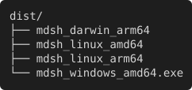

#!/usr/bin/env mdsh
---
title: Release report
---
# Release report

This document shows what `mdsh --pdf` makes of a run. Run it with

```
mdsh --pdf pdf/report.pdf report.md
```

and the PDF holds what `mdsh report.md` would print: the prose, every
block, and the output each block printed. The copy in
[pdf/report.pdf](pdf/report.pdf) was made that way.

## Checklist

| Step | Block | Shows |
| --- | --- | --- |
| Count the targets | `targets` | plain text output |
| Summarize them | `summary` | markdown output, drawn as a table |
| Check the config | `config` | a failing block and its stderr |
| List the build | `tree` | a terminal-style screenshot |

## Targets

```sh {#targets}
printf '%s\n' linux/amd64 linux/arm64 darwin/arm64 windows/amd64 | sort
```

```output {for=targets exit=0}
darwin/arm64
linux/amd64
linux/arm64
windows/amd64
```

A block with `out=markdown` prints markdown, which becomes part of the
document, so this table is drawn like any other:

```sh {#summary out=markdown}
echo '| OS | Targets |'
echo '| --- | ---: |'
for os in darwin linux windows; do
  printf '| %s | %d |\n' "$os" "$(printf '%s\n' linux/amd64 linux/arm64 darwin/arm64 windows/amd64 | grep -c "^$os/")"
done
```

<!-- mdsh:output for="summary" -->
| OS | Targets |
| --- | ---: |
| darwin | 1 |
| linux | 2 |
| windows | 1 |
<!-- /mdsh:output -->

## Config

A failing block keeps going by default. Its exit status is shown above
the output, and its stderr in red:

```sh {#config}
echo "reading config.yaml"
echo "config.yaml: missing key 'port'" >&2
false
```

```output {for=config exit=1}
reading config.yaml
```

```output {for=config stream=stderr}
config.yaml: missing key 'port'
```

## Build

`out=screenshot` draws the output as a terminal. The PDF draws it as text,
so it stays sharp and searchable:

```sh {#tree out=screenshot}
printf '%s\n' 'dist/' '├── mdsh_darwin_arm64' '├── mdsh_linux_amd64' '├── mdsh_linux_arm64' '└── mdsh_windows_amd64.exe'
```

<!-- mdsh:output for="tree" -->

<!-- /mdsh:output -->

## The script

Include blocks quote another file. With `number_on` the PDF puts the line
numbers in a gutter beside the code:

```sh {<include file=include/greet.sh from=4 to=10 number_on}
greet() {
	printf 'hello, %s\n' "$1"
}

for name in "$@"; do
	greet "$name"
done
```

> Images, front matter and mdsh's own markers are handled too: PNG, JPEG
> and GIF images are drawn, and front matter is left out.
