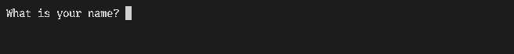
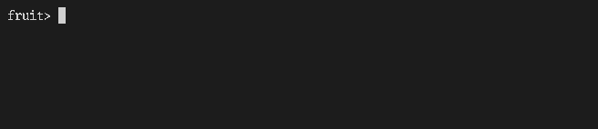
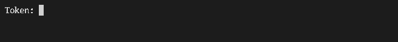

#!/usr/bin/env mdsh
# Terminal blocks

Some programs need a terminal: `docker run -it`, `ssh`, `sudo`, editors
and REPLs. A block marked `tty` runs on one. mdsh records the session
as an [asciinema](https://asciinema.org) cast and an animated GIF and
links the GIF below the block. A PDF can't animate, so it shows the GIF's
last frame, or the frame `frame=N` picks.

Without a tape, you type the input yourself. A `tape` fence types it
instead, in [VHS](https://github.com/charmbracelet/vhs) tape commands,
so the blocks below run with nobody at the keyboard. That covers CI, and
`mdsh -w terminal.md`, which regenerates the recordings.

## A prompt, answered by an inline tape

`read` waits at the prompt until the tape types a name. Shell variables
set in a `tty` block carry over to later blocks, like any other block's.

```sh {#greet tty}
printf 'What is your name? '
read -r NAME
printf 'Hello, %s!\n' "$NAME"
```

<!-- mdsh:output for="greet" -->

<!-- /mdsh:output -->

The tape waits for the prompt before typing. Keys go out as soon as the
block starts, so most tapes start with a `Wait` or a `Sleep`.

```tape {for=greet}
Wait /name\?$/
Type "Ada"
Enter
```

```sh {#after}
echo "NAME is still $NAME"
```

```output {for=after exit=0}
NAME is still Ada
```

## A tape from a file

[terminal/fruit.sh](terminal/fruit.sh) is a small prompt loop. Its tape,
[terminal/fruit.tape](terminal/fruit.tape), fixes a typo with
`Backspace`, types slower with `Type@100ms`, and quits with `q`. An
include fence reads the tape from the file on every run, so the
document shows the tape that was used.

```sh {#fruit tty}
sh terminal/fruit.sh
```

<!-- mdsh:output for="fruit" -->

<!-- /mdsh:output -->

```tape {for=fruit <include file=terminal/fruit.tape}
# Input for the fruit block in ../terminal.md, in VHS tape commands.
Wait /fruit>$/
Type "appel"
Sleep 300ms
Backspace 2
Type "le"
Enter
Wait /fruit>$/
Type@100ms "pear"
Enter
Wait /fruit>$/
Sleep 500ms
Type "q"
Enter
```

## Typing a secret

Double-quoted `Type` strings can hold placeholders: `{{$VAR}}` from
mdsh's environment, or `{{#block/env(VAR)}}` from an earlier block. They
are filled in as the tape plays, so the document keeps the placeholder,
never the value. In single quotes or backticks, text is typed as it is. The
recording only holds what the screen shows, and this prompt turns echo
off, so the token stays out of the GIF and the cast too.

```sh {#token}
TOKEN=$(printf 'demo-%s' 4242)
```

```sh {#login tty}
printf 'Token: '
stty -echo
read -r t
stty echo
printf '\nGot a token of %d characters.\n' "${#t}"
```

<!-- mdsh:output for="login" -->

<!-- /mdsh:output -->

```tape {for=login}
Wait /Token:$/
Type "{{#token/env(TOKEN)}}"
Enter
```

## A block you drive yourself

This block has no tape, so someone has to type. It runs only when
`LIVE` is set, because without a terminal it would fail:

    LIVE=1 mdsh terminal.md

```sh {#live tty run={{$LIVE}}}
printf 'Type anything, then press enter (ctrl+c works too): '
read -r line
echo "you typed: $line"
```
